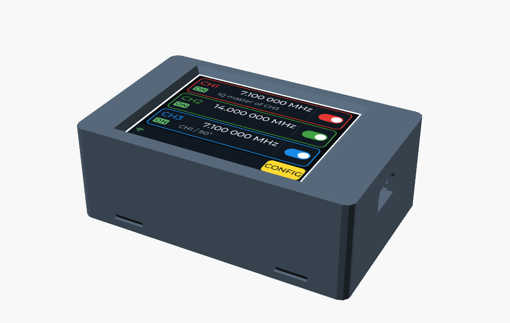
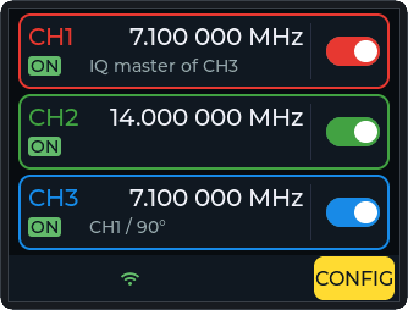
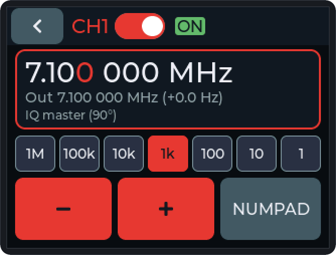
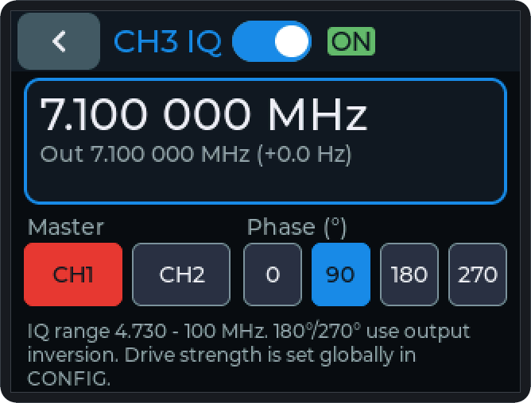
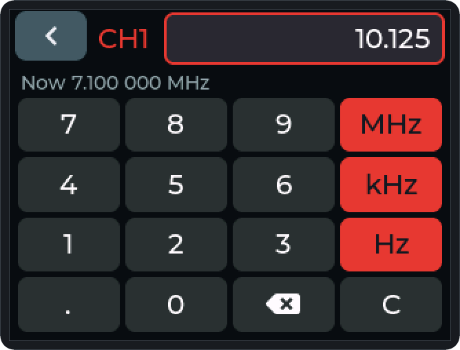
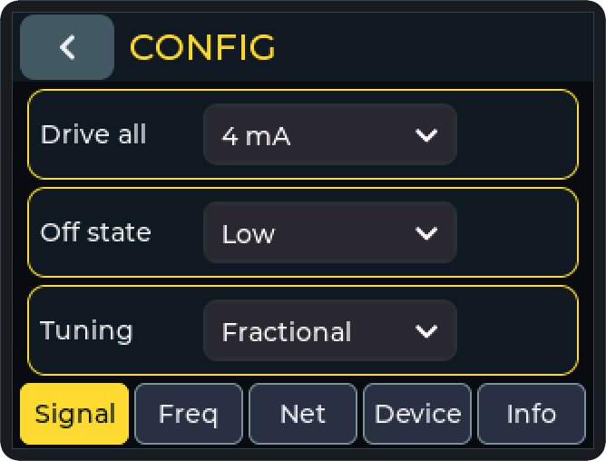
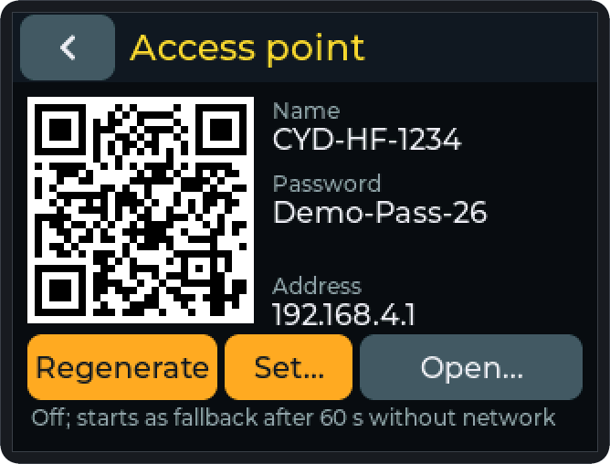
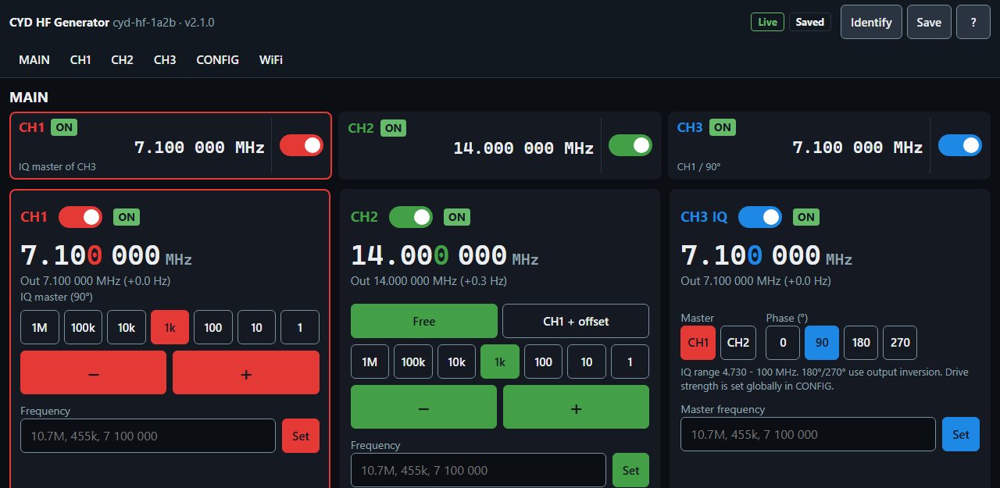
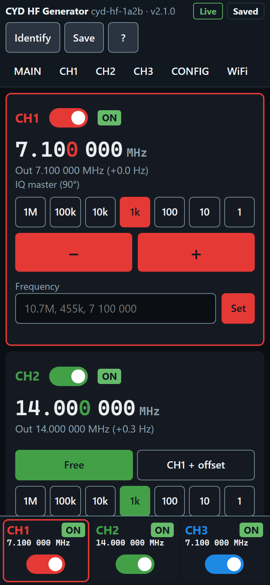

# CYD HF Generator

[](https://github.com/dm8sb/CYD-HF-Generator/actions/workflows/ci.yml?query=branch%3Amain)
[](https://github.com/dm8sb/CYD-HF-Generator/actions/workflows/fuzz.yml?query=branch%3Amain)
[](https://github.com/dm8sb/CYD-HF-Generator/releases/latest)
[](#license)

PlatformIO + Arduino-ESP32 firmware for a 3-channel HF square-wave generator with an SI5351 on the ESP32-2432S028R "Cheap Yellow Display" (original CYD and CYD2USB).

> **AI-generated:** This project is largely AI-generated. Code, tests and documentation were written mainly by an AI assistant (Claude by Anthropic, used through Claude Code) under the direction of the author, who specified the requirements, made the decisions, reviewed the results and tested them on the hardware. Use it like any hobby project: without warranty, and check it yourself before you rely on it.

**[Flash in the browser](https://dm8sb.github.io/CYD-HF-Generator/)** (Chrome or Edge) · **User manual** [English](USER_MANUAL_EN.md) / [Deutsch](USER_MANUAL_DE.md) · **[Hardware: wiring and parts](docs/hardware.md)** · **[Remote control API](docs/REMOTE_API.md)**

<p align="center"></p>
<p align="center"><sub>Rendered from the OpenSCAD case and the firmware's GUI code (sample values); photos follow.</sub></p>

## Documentation

- [USER_MANUAL_DE.md](USER_MANUAL_DE.md): user manual, reference for all behavior (German); [USER_MANUAL_EN.md](USER_MANUAL_EN.md): English translation
- [docs/hardware.md](docs/hardware.md): SI5351 wiring to CN1, supply, outputs, bill of materials, safety
- [docs/REMOTE_API.md](docs/REMOTE_API.md): remote control API in English: setup, SCPI over USB/TCP/VXI-11, REST and WebSocket, examples
- [case/](case/README.md): parametric OpenSCAD case for the CYD2USB with the Si5351 module and three SMA sockets
- [PROJECT_SPECIFICATION.md](PROJECT_SPECIFICATION.md): requirements and decisions
- [ARBEITSPLAN.md](ARBEITSPLAN.md): open findings, WEB-HMI concept and task list (German)
- [MESSPLAN.md](MESSPLAN.md): hardware measurement plan by priority (German)
- [CLAUDE.md](CLAUDE.md): architecture and development rules

## Features

- CH1 and CH2: independent outputs 8 kHz–160 MHz with the actual output frequency on the channel pages
- CH3: IQ follower of CH1 or CH2 with 0/90/180/270° (4.730–100 MHz; 180/270° via output inversion)
- Tuning modes `Fractional` (no dropouts), `Low noise` (integer MultiSynth) and `Integer` (frequency on a raster); spread spectrum on CH1; switched-off outputs Low, High or High-Z; drive 2–8 mA; frequency correction in ppm
- SI5351 on CN1 (GPIO22/27) with SDA/SCL in either order, identity check, supervision and automatic reconnect
- One firmware for both boards: the display controller (ILI9341 / ST7789) is detected at every boot
- LVGL GUI: MAIN with a status bar and a mode line for settings that differ from the defaults; touch calibration at the first start
- NVS persistence with 5 s autosave; all outputs start off
- Serial log with version, branch, commit and build time; host tests and CI
- WiFi client or own access point (default off), web interface in the browser with REST API and WebSocket, optional web password, two-stage network changes (manual sections 8 and 16)
- Remote control with SCPI over USB and TCP port 5025, LXI discovery and VXI-11 (`TCPIP::<ip>::INSTR` for lxi-tools, PyVISA, python-vxi11) (manual section 15)
- Web flasher on GitHub Pages, releases with checksums, build provenance, license texts and LGPL sources

## Screenshots

Rendered on the PC from the firmware's GUI code and the web UI with sample values (invented networks, sample passwords); more in [Appendix A of the manual](USER_MANUAL_EN.md#appendix-a-page-images).

| MAIN | CH1 | CH3 IQ |
|---|---|---|
|  |  |  |
| **NUMPAD** | **CONFIG** | **Access point** |
|  |  |  |

 

## Changes

### Next release

- Remote control API reference in English (`docs/REMOTE_API.md`): setup of USB and WiFi, all SCPI commands for USB, TCP 5025 and VXI-11, REST and WebSocket, examples
- CONFIG in five tabs instead of a scrolled list (`Signal`, `Freq`, `Net`, `Device`, `Info`; tab bar at the bottom, at most three rows each, nothing scrolls); `Reconnect all` moved to `Net`, the touch calibration next to `Lock` in `Device` (E-42)
- One header for every page except MAIN: `◀` at the top left goes one level back (replaces the `MAIN` button of the channel pages and CONFIG), page actions at the right; the WiFi scan list pages with `▲`/`▼` (E-43)
- The device no longer shows `Saved` / `Saving...`; only save errors appear in red (E-44)
- WiFi without power save and at full TX power: the device answers in the network within milliseconds instead of up to 0.4 s, at about 80–100 mA more current (E-45)
- The WiFi status is cached: addresses and network name once per connection, signal strength and AP stations at most once per second, instead of several driver calls in every loop; the web server rebuilds its shared state only on a change
- The display redraws only what changes: labels, colors and the AP QR code are set only for a new value, a touch action redraws once, the RSSI on the info card follows changes of 3 dB or more, the heap line is sampled every 5 s; `SYSTem:HEAP?` answers from a cache of at most 100 ms
- WiFi search with backoff: no background scan without a stored network, 15 s doubling to 5 min while no stored network is seen, at most every 2 min with devices on the fallback AP (E-46)
- One owner of the network settings during a web change: only the confirmed state is saved (a power loss brings back the previous settings), the device refuses network changes meanwhile with `Web change pending` (`Revert` / `Keep`), also with a web password (E-47)
- `SYSTem:SAVE` and `POST /api/save` write only the changed keys and at most once per 10 s per source; further requests are merged silently (no flash wear from a save loop)
- With a web password reading needs the login as well: the page asks for the password when it opens, state, token and WebSocket answer 401 without a session; `/lxi/identification` stays open. WebSocket: only the PONG to the device's random PING counts, a PING flood closes the client, a hidden tab frees its slot after 60 s (E-48)
- WebSocket pushes at most every 100 ms (the first change at once, then the latest state); pushes and new connections check the largest free heap block, so a fragmented heap skips a push or answers 503 instead of restarting
- Manual: new section 17 "Updating the firmware" (web flasher, first installation or update, checking the download, esptool, building from source)
- Manual: new section 18 "Mixer experiments" (settings, typical levels per drive strength, harmonics and low-pass filters, diode ring mixer, NE612/SA612, Tayloe detector with CH3 IQ, cable lengths, phase error and image rejection, two worked examples); levels are calculated or datasheet values until the measurements
- Log lines go into a 1 KB serial transmit buffer instead of waiting for the UART; without an SI5351 the search slows down from every 2 s to every 10 s after one minute (log line `[APP] SI5351 search every 10 s`)
- The numpad rounds half a hertz exactly like SCPI and REST (integer arithmetic instead of `double`; e.g. `1.0079105 MHz` gave 1 007 910 Hz instead of 1 007 911 Hz)
- REST and WebSocket state: new `limits` (frequency range and step list of the firmware); the web UI takes its range checks and step buttons from it, the mock and the fake SCPI device read `include/constants.h`
- The web UI refuses static addresses with leading zeros (`192.168.001.5`) itself, like the device; the host tools parse `host:port` in one place (`[v6]:port`, a bad port is reported)
- WIFI pages: text entry (limits, title, counter, what OK does for each of the six purposes), the status line and the pages of the scan list moved into host-tested logic (`InputLogic::submitEntry()`, `StatusText::wifiLine()`, suite `test_wifi_entry`); no visible change
- Confirmation dialogs (title, text, buttons, action) come from one table instead of an if/else chain; no visible change
- The WIFI pages are a class of their own (`WifiPages`: overview, scan list, text entry, access point, device page with their widgets and state) instead of part of the GUI class; no visible change
- GUI callbacks of main (touch calibration store, factory reset, WiFi manager and save, web change confirmation, web password worker, remote clients) are passed as one `GuiServices` struct instead of six setters; no visible change
- The status LED is driven by `main` in every loop (color of the shown channel page, or Identify blinking with the backlight) instead of by the GUI; the GUI reads the heap line through a callback; no visible change
- Web server code grouped by task: connection gate (async_tcp), login service (async_tcp and its worker task), pusher (loop), shared data under one lock; the job mailbox for WiFi changes and scans is a host-tested `JobSlot`; no change of the API
- REST writes and WiFi jobs no longer block the network task for up to 80/180 ms with 1-ms polling: they wait at most 20 ms, woken by the main loop, and a slow loop answers them from the connection's poll callback; the state JSON and error bodies are written into a fixed buffer without heap allocations (byte-identical output, E-50)
- Host tools: `rest_example.py` and `web_check.py` ask for the web password (`--password` without a value) or take `CYD_WEB_PASSWORD`; a password on the command line still works with a warning. CI fails if `include/test_wifi_local.h` or Python bytecode is tracked
- Advisory check: weekly and before every release, the pinned dependencies (libraries, Arduino-ESP32, ESP-IDF, ESP Web Tools with its npm packages) are checked against the GitHub advisories of their upstream repositories and OSV; a finding fails the run and opens an issue (`tools/dep_check.py advisories`, accepted exceptions with reason in `tools/advisories_accepted.json`)
- Release dry run: pull requests to `main` run the release workflow without release and deploy; asset names, licenses archive, `SHA256SUMS` and notes come from `tools/release_files.py` for the dry run and the release alike
- Reproducible stamps: the info card and boot line show the commit time in UTC instead of the local build time, a release candidate shows its tag version (`2.0.0-rc1`) and the tag instead of `HEAD`; the license and LGPL archives of a release are deterministic (sorted, commit time, no owner, gzip without name and time), so an independent rebuild can be compared with the attested assets
- Framework pinned exactly: `platform_packages` fixes the Arduino-ESP32 packages, the toolchain and esptool (the platform only asked for tilde ranges); CI and the release check the resolved packages against the pins and `THIRD_PARTY_NOTICES.md` (`tools/dep_check.py`), the release build runs without a package cache and its notes list every package; PlatformIO Core in CI is installed with hashes (`tools/requirements-ci.txt`, kept current by Dependabot); the package cache of CI is written only on `main` and `dev`
- Zero-warning gate in CI: a compiler warning in `src/` or `include/` of the firmware builds fails the job `Firmware build`; host tests with `-Wall -Wextra`, `native-cpp20` with `-Werror`; a further job builds the touch log firmware and the host screen renderer
- CI, fuzzing and CodeQL run on pushes to `main`, `dev` and `agent/**` and on pull requests (no longer on tags or other branches); runs on `main` are never cancelled by a later push, so the CodeQL alerts of `main` always come from a complete analysis
- Host tests: the `Preferences` fake rejects NVS names over 15 characters and strings over 4000 bytes like the real NVS; `test_nvs` loads the complete key set of 2.0.0 from both namespaces (upgrade test)
- Host tests pin the boundaries and error paths the mutation audit found open (AF35): CH3 exactly at 4.730 and 100 MHz, the remainder of the remote rate limit (75 ms steps, `millis()` overflow), Authorization 1024/1025 bytes, five UTF-8 edges, the autosave and retry delays, the Identify blinking with the backlight, the RSSI tie of two WiFi networks (the first one wins), every failing transfer of the SI5351 init, closed I2C bus, cut log lines, an inconsistent touch calibration and NVS write errors; the random tests restart from their seed in every test and name it in the message
- Fix: a log line longer than 127 bytes on the serial port lost its newline, so the next line was glued to it; the cut line now ends with a newline like in the SCPI log buffer (found by the AF35 tests)
- Fuzzing: two more harnesses (12): `prefilter` (the byte filter in front of the HTTP parser, in random chunks and time steps, against an independent reference and differentially against the request guard) and `rest_wifi` (POST/GET `/api/wifi` against an independent model of the rules: unknown key −108, refusals leave the settings unchanged, no secret in any answer); both run 60 s per push in the CI job `Fuzz`
- Host tests: random interleavings of the web job mailbox (`JobSlot`, request, timeout and late result of loop(), 200 000 steps): every request gets its own result or none, every scan buffer is freed exactly once (AF33)
- Web server: the routes are one table in `net/web_routes.*` used by the request dispatch and the request guard, and the request body is assembled there (host-tested against every path of `data/www/README.md`); a body with an embedded NUL byte is now refused with `-102` instead of being cut at the NUL, and the whole body is wiped after a password (AF32)
- CI: the host tests also run under ASan and UBSan (env `native-asan`, Linux), and a deliberate overflow in the probe suite `test_sanitizer` must be reported (AF36)
- CI job `Tool checks`: size report self-test, mock with web check (without and with password), fake device with device check, and shared contract vectors (`test/contract/vectors.json`) that the C++ host tests and `tools/contract_check.py` read; they found the mock answering differently from the firmware (Origin, Sec-Fetch-Site and token rules on GET, POST outside `/api/`, broken Cookie/Authorization, duplicate keys, rate limit counting refused bodies), now fixed in the mock; the build stops on `innerHTML` and friends in `data/www` (AF34)

### 2.0.0

Major version: Arduino core 3, WiFi with web interface and REST, SCPI over USB and TCP, LXI/VXI-11, release with provenance and web flasher. The repository history starts again with this release.

- SCPI over USB: IEEE 488.2 common commands, outputs, frequencies, CH3 and all settings; exact number parsing with units and MIN/MAX/DEF, error queue, log read-out (`SYST:LOG?`) while a session keeps the serial port free of log lines, `SYST:IDEN` blinks backlight and LED; one error per invalid command unit
- SCPI over TCP on port 5025 (one connection, HTTP lines refused, keepalive, mDNS `_scpi-raw._tcp`; not over an open AP)
- LXI / VXI-11 (LX1): portmapper on UDP/TCP 111 answering the `lxi discover` broadcast, VXI-11 core channel on TCP 9009 (one link, no abort or interrupt channel), mDNS `_lxi._tcp`, `_vxi-11._tcp`, `_http._tcp`, `GET /lxi/identification`; same access rule as SCPI over TCP, no login (manual section 15, `SECURITY.md`); checked with lxi-tools 2.8, PyVISA/pyvisa-py and python-vxi11; `tools/lxi_example.py`
- Host tools in `tools/`: SCPI example (USB/TCP/PyVISA), `device_check.py` (checks the SCPI command set on the device and restores it), fake SCPI device, REST example
- Fuzzing: 10 harnesses in `test/fuzz/` incl. request guard and REST JSON against independent reference models (libFuzzer with ASan/UBSan in the CI job `Fuzz`, standalone driver for gcc/MinGW), fixed-seed random test `test_fuzz_random` in the host tests
- Request guard (host, origin, token, sessions, login lock, PBKDF2 web password) and REST JSON mapping with strict JSON check (ArduinoJson 7.4.3), host-tested, wired to the web server (see the web interface entry)
- Issue forms (bug report with board, firmware version and commit, log) and a pull request template with the gate checklist
- OpenSCAD case in `case/` (two parts, snap hooks or screws, SMA holes, slide-in holder for the Si5351 module)
- Hardware page `docs/hardware.md` (bill of materials, CN1 wiring, supply, safety) and README badges
- Security policy (`SECURITY.md`, private vulnerability reporting) and CodeQL for C/C++, Python, JavaScript and workflows
- Dependabot keeps the pinned GitHub Actions up to date (weekly, grouped, to `dev`)
- CI: Flash and static RAM of the firmware env as a job summary table and artifact `firmware-size` (`tools/size_report.py`), compared with the target branch in pull requests and with the previous commit on pushes
- Release workflow with build provenance and checksums; web flasher site for GitHub Pages (ESP Web Tools, separate parts so an update keeps the settings), goes live with the first release
- License notices: `THIRD_PARTY_NOTICES.md` and `LICENSES/`; releases carry the license texts (`…-licenses.tar.gz`) and the source of the LGPL libraries (`…-lgpl-sources.tar.gz`); the flasher site serves ESP Web Tools itself (no CDN) with its notices; additional permission under GPLv3 section 7 for Espressif's object-code-only libraries (`LICENSE-EXCEPTION.md`); SPDX headers in all own files and `REUSE.toml` for files without comments
- Web interface on port 80 (manual section 16): embedded page, REST API and WebSocket, request guard with session login (web password set at the device), two-stage network changes with confirmation, at most 3 browsers; web password on the Device page, remote clients and `Reconnect all` on the info card; fixed header with area links and logout; `tools/web_mock.py` to try it without the device, `tools/web_check.py` checks the contract
- TFT_eSPI fonts no longer built (all text comes from LVGL): Flash −27.6 KB
- Build paths stripped from `__FILE__` (`tools/prefix_map.py`): no local home directory in the image, builds independent of the build machine
- Arduino-ESP32 3.3.12 (`espressif32@8.0.0`, built with `-Os`) and LVGL 8.4.0; the Arduino 2.0.x build is gone (E-32), the last firmware on it is 1.3.3
- WiFi (CONFIG `WiFi` and `Remote out.`, WIFI page with network scan and on-screen keyboard, access point page with QR code, device page with name and static IP, WiFi state and `REMOTE <source>` in the status bar, WiFi and heap lines on the info card; default Off): network settings in NVS `hfnet`, client with up to two networks, fallback access point after 60 s, AP off as soon as the client has an address, mDNS, captive DNS; the factory reset also erases the WiFi settings
- Audit follow-ups (priority 1, ARBEITSPLAN Phase 10): the off state `High` from SCPI, VXI-11 or REST is refused under `Remote out. local only` like switching on (E-40); the web login is refused over an open access point; log lines are sanitized and `SYST:LOG?` reads the log buffer only over USB; manual and `SECURITY.md` state that network SCPI (TCP 5025, VXI-11) has no login and the web password protects only the web interface and REST (E-41); confirmation dialogs at the device are queued; release workflow: tag only from `main`, host tests on the tag, no overwriting of a release, provenance over all assets, flasher deploy only after the release; the REST contract (`data/www/README.md`) lists the error and status codes as the firmware sends them; the manual lists all SCPI error codes, log lines and saved settings
- Documentation images in `docs/img/` (interim until photos exist): device screens rendered from the real GUI code on the host (`pio run -e screens-win`, LVGL 8.4 on the test fakes), web UI screenshots on `tools/web_mock.py`, OpenSCAD views of the case with the MAIN page on the display, social preview; `tools/render_images.py` regenerates them

### 1.3.3

- CH3 page sets the master frequency and switches a waiting master on; holding +/- starts slowly and speeds up after 3 s and 6 s, pressure dropouts up to 70 ms are bridged
- Frequency correction can be typed on the numpad (tap the value in CONFIG)
- Screen lock (CONFIG `Screen` → `Lock`, hold 2 s to unlock), reset to defaults keeping the calibration, factory reset
- CH1/CH2 range 8 kHz–160 MHz (was 1–100 MHz): kHz display below 1 MHz, 10-character numpad, hints on the channel page; above 100 MHz exact to 1.5–3 Hz (next to 112.5 MHz it was off by up to 5 Hz)

### 1.3.2

- Header shows the actual state; mode line on MAIN and the channel pages; `Off state` = `High` needs a confirmation
- MAIN status bar (save state, `CONFIG`) instead of the buttons CH1–CH3; CONFIG ordered by signal settings, `Step` row removed
- Larger dialog and edge buttons, better contrast, states as filled labels (`! ERR`, `! NO HW`), step chips in digit order
- Numpad keeps a rejected input and shows why; output error dialogs name the channel
- Touch calibration at the first start and via CONFIG `Touch`; boot gesture removed
- Test builds for touch log and hit map; manual with quick start, glossary and symptom table

### 1.3.1

- Fixes: CLK2 stays off while CH3 is in `ERR`; `~` on MAIN right after boot; integer VCO limits with ±50 ppm; reconnect in the same supervision cycle
- Saving only on a real change and retried every 30 s; stricter frequency parser
- Restart instead of freezing on an LVGL assert or a blocked `loop()` (task watchdog)
- `-Wall -Wextra` without warnings, dependencies pinned, CI

### 1.3.0

- SDA/SCL in either order, SI5351 identity check, new connection messages
- One firmware for both boards (display detection)
- CONFIG options `Tuning`, `Spread CH1`, `Off state`; CONFIG scrolls and has an info card; backlight in 10 % steps
- Actual output frequency on the channel pages; divider planning host-tested

### 1.2.0 and older

- 1.2.0: own SI5351 register driver (exact correction, tuning without PLL reset), supervision with reconnect, outputs start off, tap a digit to select the step
- 1.1.0: layout without clipping, tappable MAIN cards with switches, step presets and hold-to-repeat, numpad, frequency correction, CH3 IQ from 4.730 MHz

## Pinout

The authoritative pin table is in [PROJECT_SPECIFICATION.md](PROJECT_SPECIFICATION.md), section 2.

| Function | Bus | GPIO |
|---|---:|---:|
| TFT MOSI / MISO / SCK / CS | HSPI | 13 / 12 / 14 / 15 |
| TFT DC / RST | - | 2 / -1 (EN) |
| Touch MOSI / MISO / SCK / CS | VSPI | 32 / 39 / 25 / 33 |
| Touch IRQ | - | 36 |
| SI5351 SDA / SCL (CN1, either order) | I2C | 22 / 27 |
| Backlight PWM | LEDC | 21 |
| RGB LED R / G / B | active low | 4 / 16 / 17 |
| Free input only | - | 35 |

The firmware tries SDA=22 first, then the swapped assignment; the log shows the result, e.g. `[APP] SI5351 at 0x60, SDA=27 SCL=22 (swapped)`.

## Libraries

Pinned in `platformio.ini`:

| Library | Version | License |
|---|---|---|
| Arduino-ESP32 (core, WiFi, Network, ESPmDNS, DNSServer, AsyncUDP, Wire, SPI, Preferences, FS, Hash) with ESP-IDF 5.5.5 | 3.3.12 via `espressif32@8.0.0`, package `framework-arduinoespressif32@4.30312.261116` (exact, with `-esp32-libs@3.3.12`, toolchain and esptool) | LGPL-2.1-or-later, Apache-2.0, MIT |
| `bodmer/TFT_eSPI` (exact: the ST7789 init sequence is derived from it) | 2.5.43 | FreeBSD (BSD-2-Clause-Views), MIT |
| `lvgl/lvgl` | 8.4.0 | MIT |
| XPT2046_Touchscreen | commit `d57f64c` (tag v1.4) | MIT |
| scpi-parser | commit `8866159` (v2.3 + build fixes) | BSD-2-Clause |
| `bblanchon/ArduinoJson` | 7.4.3 | MIT |
| `esp32async/AsyncTCP` | 3.5.0 | LGPL-3.0-or-later |
| `esp32async/ESPAsyncWebServer` | 3.12.1 | LGPL-3.0-or-later |

The web flasher serves ESP Web Tools 10.4.0 (Apache-2.0) itself. Every component with its copyright holders: [THIRD_PARTY_NOTICES.md](THIRD_PARTY_NOTICES.md).

## Build and Flash

| Board | Display controller | Detected by (RDDID, command 04h) |
|---|---|---|
| Original CYD, micro-USB only | ILI9341 | ID `00 00 00` |
| CYD2USB, additional USB-C port | ST7789 type | any other ID (measured `81 81 B3`) |

```bash
pio run -t upload            # both boards
pio device monitor -b 115200
```

Releases (`.github/workflows/release.yml`): a `v*` tag is built only if its commit is on `main` and passes the host tests; the release is never overwritten (tag ruleset and immutable releases on GitHub), and the web flasher goes live only after the release exists. Every release asset is covered by the build provenance; check one with `gh attestation verify <file> --repo dm8sb/CYD-HF-Generator` and the checksums with `sha256sum -c SHA256SUMS`. A manual run of the workflow builds and assembles the flasher site as an artifact but never deploys it. Every pull request to `main` (and every push to `dev` or `agent/**` that changes the release path) runs the same workflow as a dry run: tests, build without cache, flasher site and the job `Release dry run`, which names the assets and writes the notes with the same script as the release (`tools/release_files.py`) without publishing anything.

The controller is read over SPI before the display init at every boot; nothing is stored. For an unrecognized board (display shows only noise), build with `-DDISPLAY_FORCE_PANEL=1` (ILI9341) or `2` (ST7789). `tools/build_info.py` passes branch, commit (`+` = uncommitted changes), the commit time in UTC (`SOURCE_DATE_EPOCH` if set) and, for a tag build, the tag version (e.g. `2.0.0-rc1`) to `src/utils/build_info.cpp` only, so two builds of the same commit give the same image. Partition table `huge_app.csv`; a standard 4 MB module is sufficient.

## Tests

```bash
pio test -e native-win         # host tests on Windows (MinGW bundled with PlatformIO)
pio test -e native             # host tests on Linux/macOS/CI (gcc in PATH)
pio test -e native-win-fault   # IQ error state (TEST_FAULT_IQ); native-fault on Linux
pio test -e native-asan        # host tests under ASan/UBSan (Linux/CI)
```

Host tests cover the SI5351 driver and planner against a register model (`test/helpers/si5351_model.h`, decoded independently of the driver), the AppController, display detection, touch, GUI input logic, status texts, contrast, the remote command queue, SCPI, SCPI over TCP, VXI-11 and LXI identification, the web request guard, the web routes and body assembly (every path of the REST contract), REST JSON and WiFi mapping, network settings, the NVS limits and the upgrade from the stored keys of 2.0.0, WiFi policy, the logger and sanitizing, plus fuzz harnesses with a fixed seed (`test_fuzz_random`). `test/fakes` replaces the Arduino core, `Wire` and `Preferences`; the fuzz harnesses are described in [test/fuzz/README.md](test/fuzz/README.md).

Touch test builds for the measurement plan (not built by a plain `pio run`, never released; CI builds the hit map env):

```bash
pio run -e esp32-2432S028R-touchlog -t upload   # normal GUI, one [TOUCH] log line per touch
pio run -e esp32-2432S028R-hitmap -t upload     # 20 target crosses, [HITMAP] and [TOUCH] lines
```

## Documentation images

`docs/img/` holds rendered images: device screens, web UI, case views and the social preview (`social-preview.png`, 1280 × 640, uploaded by hand under Settings → General → Social preview). Regenerate them after GUI, web UI or case changes:

```bash
python tools/render_images.py              # all (about 2 min)
python tools/render_images.py screens      # device screens only; also: case, web, social
```

Needs Python 3, PlatformIO, OpenSCAD, Chrome or Edge and Node; details of the renderers: [tools/README.md](tools/README.md). Only sample values go into the images: invented networks (`Lab`, `Workshop`), sample passwords, a locally administered MAC.

## Architecture

- `main.cpp`: initialization order and loop
- `core/app_controller.*`: single source of truth for runtime state, the only user of the SI5351 driver
- `drivers/si5351_manager.*`, `drivers/si5351_plan.*`: SI5351 register driver and PLL/MultiSynth planning per tuning mode (pure functions)
- `drivers/display_detect.*`, `drivers/display_panel.*`: controller detection (host-testable) and TFT_eSPI with the ST7789 init
- `drivers/touch*`, `drivers/backlight.*`, `drivers/status_led.*`, `drivers/led_color.h`: touch with filter, backlight PWM, RGB LED (driven by `main`: shown page or Identify)
- `hal/i2c_bus.*`: owns `Wire`, opens either SDA/SCL assignment
- `services/*`: Preferences storage and autosave
- `remote/*`: command queue and state snapshot for remote access, line framer, SCPI command tree (`scpi.*`), the USB link (`scpi_usb.*`), SCPI over TCP (`scpi_tcp*`), ONC RPC and VXI-11 with portmapper (`onc_rpc.*`, `vxi11.*`, glue `vxi11_server.*`), LXI identification (`lxi_ident.*`), REST JSON mapping (`rest_json.*`, `rest_wifi.*`)
- `net/*`: network settings (`net_settings`), WiFi policy (pure) and manager, SHA-1/PBKDF2, scan list (`scan_list`); web server glue (`web_server.*`) with the pure, host-tested request guard (`request_guard`), raw-byte limits (`web_limits`) and network change, scan and login state (`web_state`)
- `gui/gui.cpp`, `gui/gui_layout.h`, `gui/pages/*`: LVGL setup, navigation and dialogs, layout grid and colors, pages
- `utils/*`: pure, host-tested logic (`frequency_utils`, `input_logic`, `message_queue`, `status_text`, `contrast`, `touch_cal`, `touch_test`), logger, build info

## License

CYD HF Generator, Copyright (C) 2026 DM8SB.

This program is free software: you can redistribute it and/or modify it under the terms of the GNU General Public License as published by the Free Software Foundation, either version 3 of the License, or (at your option) any later version (GPL-3.0-or-later, text in [LICENSE](LICENSE)). It is distributed in the hope that it will be useful, but WITHOUT ANY WARRANTY; without even the implied warranty of MERCHANTABILITY or FITNESS FOR A PARTICULAR PURPOSE. This applies to the whole repository, including the web interface, the flasher page and the case in `case/`. Private, non-commercial hobby project.

As an additional permission under GPLv3 section 7, the firmware may be conveyed linked with the libraries Espressif distributes only in object code form (Wi-Fi, PHY, Bluetooth controller and the like); the exact wording is in [LICENSE-EXCEPTION.md](LICENSE-EXCEPTION.md). Every own source file carries the lines `SPDX-FileCopyrightText: 2026 DM8SB` and `SPDX-License-Identifier: GPL-3.0-or-later`; [REUSE.toml](REUSE.toml) covers the files without comments.

Third-party components and their licenses: [THIRD_PARTY_NOTICES.md](THIRD_PARTY_NOTICES.md), license texts in [LICENSES/](LICENSES/). Every release includes the license texts and notices (`…-licenses.tar.gz`) and the complete source of the LGPL libraries in the firmware (`…-lgpl-sources.tar.gz`). The case dimensions of the CYD were measured from the STEP model "Cheap Yellow Display" by mbrembati (measurements only, no files copied).
