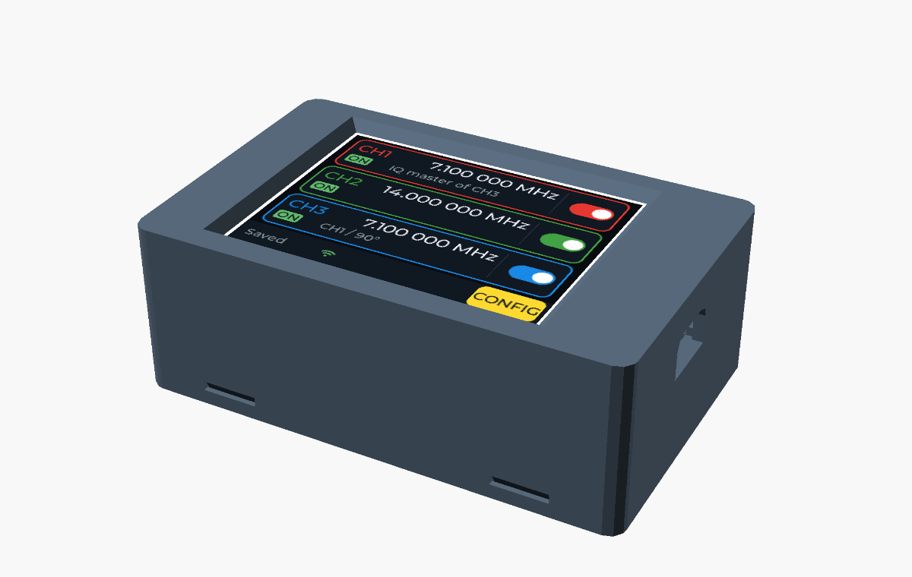
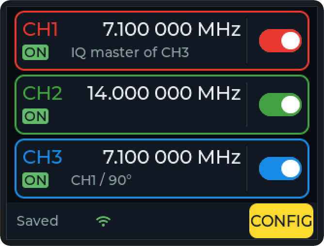
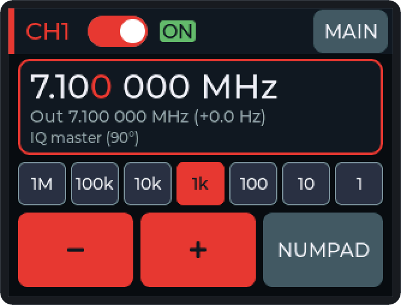
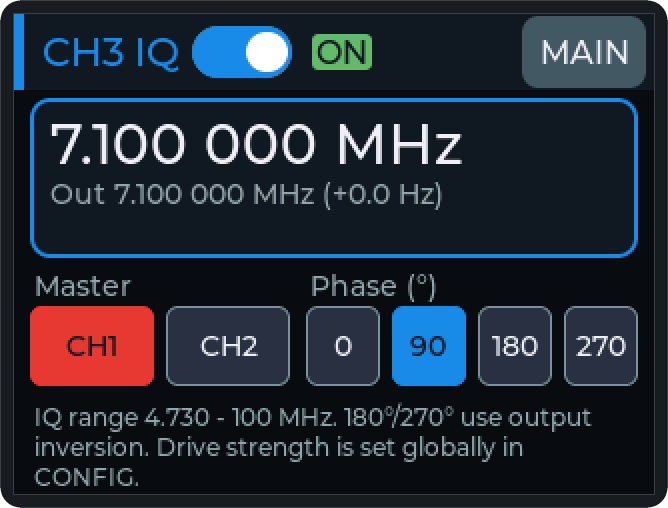
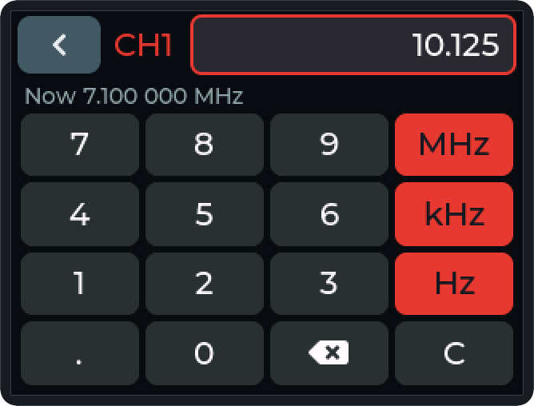
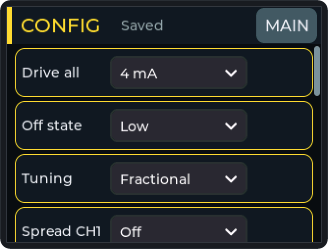
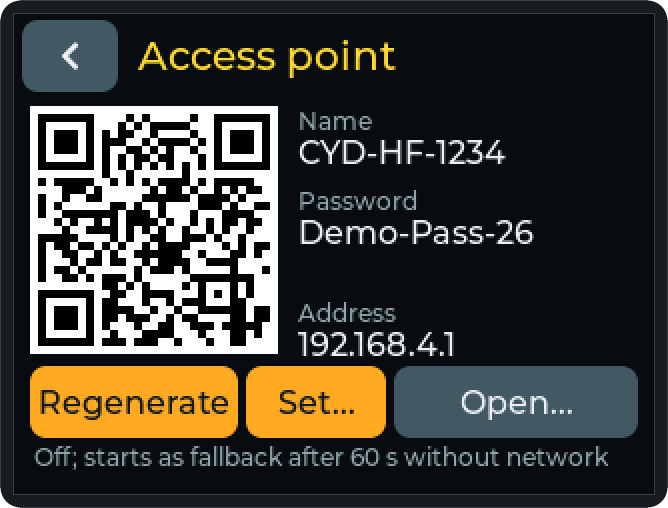
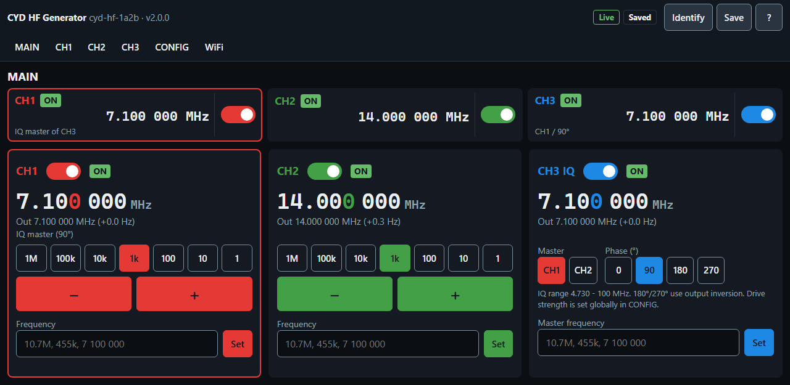
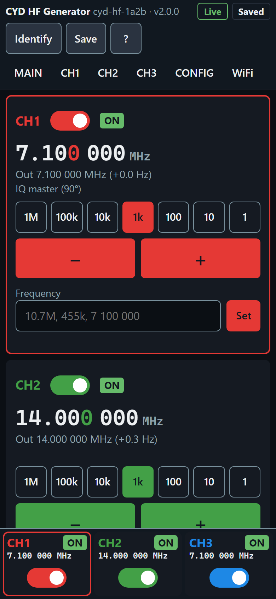

# CYD HF Generator

[](https://github.com/dm8sb/CYD-HF-Generator/actions/workflows/ci.yml?query=branch%3Amain)
[](https://github.com/dm8sb/CYD-HF-Generator/actions/workflows/fuzz.yml?query=branch%3Amain)
[](https://github.com/dm8sb/CYD-HF-Generator/releases/latest)
[](#license)

PlatformIO + Arduino-ESP32 firmware for a 3-channel HF square-wave generator with an SI5351 on the ESP32-2432S028R "Cheap Yellow Display" (original CYD and CYD2USB).

> **AI-generated:** This project is largely AI-generated. Code, tests and documentation were written mainly by an AI assistant (Claude by Anthropic, used through Claude Code) under the direction of the author, who specified the requirements, made the decisions, reviewed the results and tested them on the hardware. Use it like any hobby project: without warranty, and check it yourself before you rely on it.

**[Flash in the browser](https://dm8sb.github.io/CYD-HF-Generator/)** (Chrome or Edge) · **User manual** [English](USER_MANUAL_EN.md) / [Deutsch](USER_MANUAL_DE.md) · **[Hardware: wiring and parts](docs/hardware.md)**

<p align="center"></p>
<p align="center"><sub>Rendered from the OpenSCAD case and the firmware's GUI code (sample values); photos follow.</sub></p>

## Documentation

- [USER_MANUAL_DE.md](USER_MANUAL_DE.md): user manual, reference for all behavior (German); [USER_MANUAL_EN.md](USER_MANUAL_EN.md): English translation
- [docs/hardware.md](docs/hardware.md): SI5351 wiring to CN1, supply, outputs, bill of materials, safety
- [case/](case/README.md): parametric OpenSCAD case for the CYD2USB with the Si5351 module and three SMA sockets
- [PROJECT_SPECIFICATION.md](PROJECT_SPECIFICATION.md): requirements and decisions
- [ARBEITSPLAN.md](ARBEITSPLAN.md): open findings, WEB-HMI concept and task list (German)
- [MESSPLAN.md](MESSPLAN.md): hardware measurement plan by priority (German)
- [CLAUDE.md](CLAUDE.md): architecture and development rules

## Features

- CH1 and CH2: independent outputs 8 kHz–160 MHz with the actual output frequency on the channel pages
- CH3: IQ follower of CH1 or CH2 with 0/90/180/270° (4.730–100 MHz; 180/270° via output inversion)
- Tuning modes `Fractional` (no dropouts), `Low noise` (integer MultiSynth) and `Integer` (frequency on a raster); spread spectrum on CH1; switched-off outputs Low, High or High-Z; drive 2–8 mA; frequency correction in ppm
- SI5351 on CN1 (GPIO22/27) with SDA/SCL in either order, identity check, supervision and automatic reconnect
- One firmware for both boards: the display controller (ILI9341 / ST7789) is detected at every boot
- LVGL GUI: MAIN with a status bar and a mode line for settings that differ from the defaults; touch calibration at the first start
- NVS persistence with 5 s autosave; all outputs start off
- Serial log with version, branch, commit and build time; host tests and CI
- WiFi client or own access point (default off), web interface in the browser with REST API and WebSocket, optional web password, two-stage network changes (manual sections 8 and 16)
- Remote control with SCPI over USB and TCP port 5025, LXI discovery and VXI-11 (`TCPIP::<ip>::INSTR` for lxi-tools, PyVISA, python-vxi11) (manual section 15)
- Web flasher on GitHub Pages, releases with checksums, build provenance, license texts and LGPL sources

## Screenshots

Rendered on the PC from the firmware's GUI code and the web UI with sample values (invented networks, sample passwords); more in [Appendix A of the manual](USER_MANUAL_EN.md#appendix-a-page-images).

| MAIN | CH1 | CH3 IQ |
|---|---|---|
|  |  |  |
| **NUMPAD** | **CONFIG** | **Access point** |
|  |  |  |

 

## Changes

### 2.0.0

Major version: Arduino core 3, WiFi with web interface and REST, SCPI over USB and TCP, LXI/VXI-11, release with provenance and web flasher. The repository history starts again with this release.

- SCPI over USB: IEEE 488.2 common commands, outputs, frequencies, CH3 and all settings; exact number parsing with units and MIN/MAX/DEF, error queue, log read-out (`SYST:LOG?`) while a session keeps the serial port free of log lines, `SYST:IDEN` blinks backlight and LED; one error per invalid command unit
- SCPI over TCP on port 5025 (one connection, HTTP lines refused, keepalive, mDNS `_scpi-raw._tcp`; not over an open AP)
- LXI / VXI-11 (LX1): portmapper on UDP/TCP 111 answering the `lxi discover` broadcast, VXI-11 core channel on TCP 9009 (one link, no abort or interrupt channel), mDNS `_lxi._tcp`, `_vxi-11._tcp`, `_http._tcp`, `GET /lxi/identification`; same access rule as SCPI over TCP, no login (manual section 15, `SECURITY.md`); checked with lxi-tools 2.8, PyVISA/pyvisa-py and python-vxi11; `tools/lxi_example.py`
- Host tools in `tools/`: SCPI example (USB/TCP/PyVISA), `device_check.py` (checks the SCPI command set on the device and restores it), fake SCPI device, REST example
- Fuzzing: 10 harnesses in `test/fuzz/` incl. request guard and REST JSON against independent reference models (libFuzzer with ASan/UBSan in the CI job `Fuzz`, standalone driver for gcc/MinGW), fixed-seed random test `test_fuzz_random` in the host tests
- Request guard (host, origin, token, sessions, login lock, PBKDF2 web password) and REST JSON mapping with strict JSON check (ArduinoJson 7.4.3), host-tested, wired to the web server (see the web interface entry)
- Issue forms (bug report with board, firmware version and commit, log) and a pull request template with the gate checklist
- OpenSCAD case in `case/` (two parts, snap hooks or screws, SMA holes, slide-in holder for the Si5351 module)
- Hardware page `docs/hardware.md` (bill of materials, CN1 wiring, supply, safety) and README badges
- Security policy (`SECURITY.md`, private vulnerability reporting) and CodeQL for C/C++, Python, JavaScript and workflows
- Dependabot keeps the pinned GitHub Actions up to date (weekly, grouped, to `dev`)
- CI: Flash and static RAM of the firmware env as a job summary table and artifact `firmware-size` (`tools/size_report.py`), compared with the target branch in pull requests and with the previous commit on pushes
- Release workflow with build provenance and checksums; web flasher site for GitHub Pages (ESP Web Tools, separate parts so an update keeps the settings), goes live with the first release
- License notices: `THIRD_PARTY_NOTICES.md` and `LICENSES/`; releases carry the license texts (`…-licenses.tar.gz`) and the source of the LGPL libraries (`…-lgpl-sources.tar.gz`); the flasher site serves ESP Web Tools itself (no CDN) with its notices; additional permission under GPLv3 section 7 for Espressif's object-code-only libraries (`LICENSE-EXCEPTION.md`); SPDX headers in all own files and `REUSE.toml` for files without comments
- Web interface on port 80 (manual section 16): embedded page, REST API and WebSocket, request guard with session login (web password set at the device), two-stage network changes with confirmation, at most 3 browsers; web password on the Device page, remote clients and `Reconnect all` on the info card; fixed header with area links and logout; `tools/web_mock.py` to try it without the device, `tools/web_check.py` checks the contract
- TFT_eSPI fonts no longer built (all text comes from LVGL): Flash −27.6 KB
- Build paths stripped from `__FILE__` (`tools/prefix_map.py`): no local home directory in the image, builds independent of the build machine
- Arduino-ESP32 3.3.12 (`espressif32@8.0.0`, built with `-Os`) and LVGL 8.4.0; the Arduino 2.0.x build is gone (E-32), the last firmware on it is 1.3.3
- WiFi (CONFIG `WiFi` and `Remote out.`, WIFI page with network scan and on-screen keyboard, access point page with QR code, device page with name and static IP, WiFi state and `REMOTE <source>` in the status bar, WiFi and heap lines on the info card; default Off): network settings in NVS `hfnet`, client with up to two networks, fallback access point after 60 s, AP off as soon as the client has an address, mDNS, captive DNS; the factory reset also erases the WiFi settings
- Audit follow-ups (priority 1, ARBEITSPLAN Phase 10): the off state `High` from SCPI, VXI-11 or REST is refused under `Remote out. local only` like switching on (E-40); the web login is refused over an open access point; log lines are sanitized and `SYST:LOG?` reads the log buffer only over USB; manual and `SECURITY.md` state that network SCPI (TCP 5025, VXI-11) has no login and the web password protects only the web interface and REST (E-41); confirmation dialogs at the device are queued; release workflow: tag only from `main`, host tests on the tag, no overwriting of a release, provenance over all assets, flasher deploy only after the release; the REST contract (`data/www/README.md`) lists the error and status codes as the firmware sends them; the manual lists all SCPI error codes, log lines and saved settings
- Documentation images in `docs/img/` (interim until photos exist): device screens rendered from the real GUI code on the host (`pio run -e screens-win`, LVGL 8.4 on the test fakes), web UI screenshots on `tools/web_mock.py`, OpenSCAD views of the case with the MAIN page on the display, social preview; `tools/render_images.py` regenerates them

### 1.3.3

- CH3 page sets the master frequency and switches a waiting master on; holding +/- starts slowly and speeds up after 3 s and 6 s, pressure dropouts up to 70 ms are bridged
- Frequency correction can be typed on the numpad (tap the value in CONFIG)
- Screen lock (CONFIG `Screen` → `Lock`, hold 2 s to unlock), reset to defaults keeping the calibration, factory reset
- CH1/CH2 range 8 kHz–160 MHz (was 1–100 MHz): kHz display below 1 MHz, 10-character numpad, hints on the channel page; above 100 MHz exact to 1.5–3 Hz (next to 112.5 MHz it was off by up to 5 Hz)

### 1.3.2

- Header shows the actual state; mode line on MAIN and the channel pages; `Off state` = `High` needs a confirmation
- MAIN status bar (save state, `CONFIG`) instead of the buttons CH1–CH3; CONFIG ordered by signal settings, `Step` row removed
- Larger dialog and edge buttons, better contrast, states as filled labels (`! ERR`, `! NO HW`), step chips in digit order
- Numpad keeps a rejected input and shows why; output error dialogs name the channel
- Touch calibration at the first start and via CONFIG `Touch`; boot gesture removed
- Test builds for touch log and hit map; manual with quick start, glossary and symptom table

### 1.3.1

- Fixes: CLK2 stays off while CH3 is in `ERR`; `~` on MAIN right after boot; integer VCO limits with ±50 ppm; reconnect in the same supervision cycle
- Saving only on a real change and retried every 30 s; stricter frequency parser
- Restart instead of freezing on an LVGL assert or a blocked `loop()` (task watchdog)
- `-Wall -Wextra` without warnings, dependencies pinned, CI

### 1.3.0

- SDA/SCL in either order, SI5351 identity check, new connection messages
- One firmware for both boards (display detection)
- CONFIG options `Tuning`, `Spread CH1`, `Off state`; CONFIG scrolls and has an info card; backlight in 10 % steps
- Actual output frequency on the channel pages; divider planning host-tested

### 1.2.0 and older

- 1.2.0: own SI5351 register driver (exact correction, tuning without PLL reset), supervision with reconnect, outputs start off, tap a digit to select the step
- 1.1.0: layout without clipping, tappable MAIN cards with switches, step presets and hold-to-repeat, numpad, frequency correction, CH3 IQ from 4.730 MHz

## Pinout

The authoritative pin table is in [PROJECT_SPECIFICATION.md](PROJECT_SPECIFICATION.md), section 2.

| Function | Bus | GPIO |
|---|---:|---:|
| TFT MOSI / MISO / SCK / CS | HSPI | 13 / 12 / 14 / 15 |
| TFT DC / RST | - | 2 / -1 (EN) |
| Touch MOSI / MISO / SCK / CS | VSPI | 32 / 39 / 25 / 33 |
| Touch IRQ | - | 36 |
| SI5351 SDA / SCL (CN1, either order) | I2C | 22 / 27 |
| Backlight PWM | LEDC | 21 |
| RGB LED R / G / B | active low | 4 / 16 / 17 |
| Free input only | - | 35 |

The firmware tries SDA=22 first, then the swapped assignment; the log shows the result, e.g. `[APP] SI5351 at 0x60, SDA=27 SCL=22 (swapped)`.

## Libraries

Pinned in `platformio.ini`:

| Library | Version | License |
|---|---|---|
| Arduino-ESP32 (core, WiFi, Network, ESPmDNS, DNSServer, AsyncUDP, Wire, SPI, Preferences, FS, Hash) with ESP-IDF 5.5.5 | 3.3.12 via `espressif32@8.0.0` | LGPL-2.1-or-later, Apache-2.0, MIT |
| `bodmer/TFT_eSPI` (exact: the ST7789 init sequence is derived from it) | 2.5.43 | FreeBSD (BSD-2-Clause-Views), MIT |
| `lvgl/lvgl` | 8.4.0 | MIT |
| XPT2046_Touchscreen | commit `d57f64c` (tag v1.4) | MIT |
| scpi-parser | commit `8866159` (v2.3 + build fixes) | BSD-2-Clause |
| `bblanchon/ArduinoJson` | 7.4.3 | MIT |
| `esp32async/AsyncTCP` | 3.5.0 | LGPL-3.0-or-later |
| `esp32async/ESPAsyncWebServer` | 3.12.1 | LGPL-3.0-or-later |

The web flasher serves ESP Web Tools 10.4.0 (Apache-2.0) itself. Every component with its copyright holders: [THIRD_PARTY_NOTICES.md](THIRD_PARTY_NOTICES.md).

## Build and Flash

| Board | Display controller | Detected by (RDDID, command 04h) |
|---|---|---|
| Original CYD, micro-USB only | ILI9341 | ID `00 00 00` |
| CYD2USB, additional USB-C port | ST7789 type | any other ID (measured `81 81 B3`) |

```bash
pio run -t upload            # both boards
pio device monitor -b 115200
```

Releases (`.github/workflows/release.yml`): a `v*` tag is built only if its commit is on `main` and passes the host tests; the release is never overwritten (tag ruleset and immutable releases on GitHub), and the web flasher goes live only after the release exists. Every release asset is covered by the build provenance; check one with `gh attestation verify <file> --repo dm8sb/CYD-HF-Generator` and the checksums with `sha256sum -c SHA256SUMS`. A manual run of the workflow builds and assembles the flasher site as an artifact but never deploys it.

The controller is read over SPI before the display init at every boot; nothing is stored. For an unrecognized board (display shows only noise), build with `-DDISPLAY_FORCE_PANEL=1` (ILI9341) or `2` (ST7789). `tools/build_info.py` passes branch, commit (`+` = uncommitted changes) and build time to `src/utils/build_info.cpp` only. Partition table `huge_app.csv`; a standard 4 MB module is sufficient.

## Tests

```bash
pio test -e native-win         # host tests on Windows (MinGW bundled with PlatformIO)
pio test -e native             # host tests on Linux/macOS/CI (gcc in PATH)
pio test -e native-win-fault   # IQ error state (TEST_FAULT_IQ); native-fault on Linux
```

Host tests cover the SI5351 driver and planner against a register model (`test/helpers/si5351_model.h`, decoded independently of the driver), the AppController, display detection, touch, GUI input logic, status texts, contrast, the remote command queue, SCPI, SCPI over TCP, VXI-11 and LXI identification, the web request guard, REST JSON and WiFi mapping, network settings, WiFi policy, the logger and sanitizing, plus fuzz harnesses with a fixed seed (`test_fuzz_random`). `test/fakes` replaces the Arduino core, `Wire` and `Preferences`; the fuzz harnesses are described in [test/fuzz/README.md](test/fuzz/README.md).

Touch test builds for the measurement plan (not built by a plain `pio run`, never released; CI builds the hit map env):

```bash
pio run -e esp32-2432S028R-touchlog -t upload   # normal GUI, one [TOUCH] log line per touch
pio run -e esp32-2432S028R-hitmap -t upload     # 20 target crosses, [HITMAP] and [TOUCH] lines
```

## Documentation images

`docs/img/` holds rendered images: device screens, web UI, case views and the social preview (`social-preview.png`, 1280 × 640, uploaded by hand under Settings → General → Social preview). Regenerate them after GUI, web UI or case changes:

```bash
python tools/render_images.py              # all (about 2 min)
python tools/render_images.py screens      # device screens only; also: case, web, social
```

Needs Python 3, PlatformIO, OpenSCAD, Chrome or Edge and Node; details of the renderers: [tools/README.md](tools/README.md). Only sample values go into the images: invented networks (`Lab`, `Workshop`), sample passwords, a locally administered MAC.

## Architecture

- `main.cpp`: initialization order and loop
- `core/app_controller.*`: single source of truth for runtime state, the only user of the SI5351 driver
- `drivers/si5351_manager.*`, `drivers/si5351_plan.*`: SI5351 register driver and PLL/MultiSynth planning per tuning mode (pure functions)
- `drivers/display_detect.*`, `drivers/display_panel.*`: controller detection (host-testable) and TFT_eSPI with the ST7789 init
- `drivers/touch*`, `drivers/backlight.*`, `drivers/status_led.*`: touch with filter, backlight PWM, RGB LED
- `hal/i2c_bus.*`: owns `Wire`, opens either SDA/SCL assignment
- `services/*`: Preferences storage and autosave
- `remote/*`: command queue and state snapshot for remote access, line framer, SCPI command tree (`scpi.*`), the USB link (`scpi_usb.*`), SCPI over TCP (`scpi_tcp*`), ONC RPC and VXI-11 with portmapper (`onc_rpc.*`, `vxi11.*`, glue `vxi11_server.*`), LXI identification (`lxi_ident.*`), REST JSON mapping (`rest_json.*`, `rest_wifi.*`)
- `net/*`: network settings (`net_settings`), WiFi policy (pure) and manager, SHA-1/PBKDF2, scan list (`scan_list`); web server glue (`web_server.*`) with the pure, host-tested request guard (`request_guard`), raw-byte limits (`web_limits`) and network change, scan and login state (`web_state`)
- `gui/gui.cpp`, `gui/gui_layout.h`, `gui/pages/*`: LVGL setup, navigation and dialogs, layout grid and colors, pages
- `utils/*`: pure, host-tested logic (`frequency_utils`, `input_logic`, `message_queue`, `status_text`, `contrast`, `touch_cal`, `touch_test`), logger, build info

## License

CYD HF Generator, Copyright (C) 2026 DM8SB.

This program is free software: you can redistribute it and/or modify it under the terms of the GNU General Public License as published by the Free Software Foundation, either version 3 of the License, or (at your option) any later version (GPL-3.0-or-later, text in [LICENSE](LICENSE)). It is distributed in the hope that it will be useful, but WITHOUT ANY WARRANTY; without even the implied warranty of MERCHANTABILITY or FITNESS FOR A PARTICULAR PURPOSE. This applies to the whole repository, including the web interface, the flasher page and the case in `case/`. Private, non-commercial hobby project.

As an additional permission under GPLv3 section 7, the firmware may be conveyed linked with the libraries Espressif distributes only in object code form (Wi-Fi, PHY, Bluetooth controller and the like); the exact wording is in [LICENSE-EXCEPTION.md](LICENSE-EXCEPTION.md). Every own source file carries the lines `SPDX-FileCopyrightText: 2026 DM8SB` and `SPDX-License-Identifier: GPL-3.0-or-later`; [REUSE.toml](REUSE.toml) covers the files without comments.

Third-party components and their licenses: [THIRD_PARTY_NOTICES.md](THIRD_PARTY_NOTICES.md), license texts in [LICENSES/](LICENSES/). Every release includes the license texts and notices (`…-licenses.tar.gz`) and the complete source of the LGPL libraries in the firmware (`…-lgpl-sources.tar.gz`). The case dimensions of the CYD were measured from the STEP model "Cheap Yellow Display" by mbrembati (measurements only, no files copied).
