# Benutzeranleitung – CYD HF Generator

Firmware-Version: 2.1.0

Diese Anleitung ist die Referenz für das Verhalten der Firmware; [USER_MANUAL_EN.md](USER_MANUAL_EN.md) ist ihre Übersetzung.

## Inhalt

- [Kurzanleitung](#kurzanleitung)
- [1. Überblick](#1-überblick)
- [2. Grundbedienung](#2-grundbedienung)
- [3. Frequenzanzeige](#3-frequenzanzeige)
- [4. CH1 und CH2 verwenden](#4-ch1-und-ch2-verwenden)
- [5. Frequenz mit + und − ändern](#5-frequenz-mit--und--ändern)
- [6. Frequenz über NUMPAD eingeben](#6-frequenz-über-numpad-eingeben)
- [7. CH3 als IQ-Follower verwenden](#7-ch3-als-iq-follower-verwenden)
- [8. CONFIG-Seite](#8-config-seite)
- [9. Speicherung der Einstellungen](#9-speicherung-der-einstellungen)
- [10. Beispielanwendungen](#10-beispielanwendungen)
- [11. Fehler und Hinweise](#11-fehler-und-hinweise)
- [12. Serielle Diagnose](#12-serielle-diagnose)
- [13. Aktuelle Hardware-Pinbelegung](#13-aktuelle-hardware-pinbelegung)
- [14. Sicherheitshinweis](#14-sicherheitshinweis)
- [15. Fernsteuerung über USB und Netz (SCPI)](#15-fernsteuerung-über-usb-und-netz-scpi)
- [16. Weboberfläche](#16-weboberfläche)
- [17. Firmware aktualisieren](#17-firmware-aktualisieren)
- [18. Mischer-Experimente](#18-mischer-experimente)
- [Anhang A: Seitenbilder](#anhang-a-seitenbilder)
- [Anhang B: Glossar](#anhang-b-glossar)
- [Anhang C: Symptome und Abhilfe](#anhang-c-symptome-und-abhilfe)

## Kurzanleitung

Für den Laborplatz; Einzelheiten in den genannten Abschnitten, Bilder der Seiten in Anhang A.

1. **Anschließen:** SI5351-Modul an CN1 (3,3 V, GND, GPIO22, GPIO27; SDA und SCL beliebig), Versorgung über USB. CH1 = CLK0, CH2 = CLK1, CH3 = CLK2 (Abschnitt 13).
2. **Einschalten:** Alle Ausgänge sind aus. Beim allerersten Start erscheint der Touch-Abgleich: vier Kreuze und ein Prüfkreuz nacheinander halten, bis sie grün werden (Abschnitt 8).
3. **Frequenz einstellen:** Karte `CH1` antippen, Schritt-Taste wählen (`1M` … `1`), dann `−` / `+`; oder `NUMPAD`, Zahl eingeben, mit `MHz`, `kHz` oder `Hz` bestätigen (Abschnitte 5 und 6).
4. **Ausgang einschalten:** Schalter auf der Karte oder in der Titelzeile. Daneben steht, was der Ausgang tut: `ON` im grünen Feld = läuft.
5. **IQ-Signal:** Karte `CH3`, Master `CH1` oder `CH2`, Phase `0` / `90` / `180` / `270`, Schalter ein. Unter 4,730 MHz Masterfrequenz wartet CH3 (`WAIT`) und startet von selbst (Abschnitt 7).
6. **Vor dem Messen:** Steht unter einer Frequenz eine Moduszeile (z. B. `OFF=High`, `SSC -0.5%`, `Integer`), weicht CONFIG von den Werkseinstellungen ab (Abschnitt 2).
7. **Bei Fehlern:** `! NO HW` = SI5351 nicht verbunden; `! ERR` = Einstellen fehlgeschlagen, die Firmware versucht es alle 2 s erneut (Abschnitt 11, Anhang C).

Werkseinstellungen in CONFIG: `Drive all` 4 mA, `Off state` Low, `Tuning` Fractional, `Spread CH1` Off, `Corr.` 0 ppm, `Backlight` 80 %, Bild aufrecht (`Rotate` 0°); Frequenzen 10 MHz (CH1) und 14 MHz (CH2), CH2 `Free` (Offset 0), Schritt 1 kHz. Für die nächste Gruppe: CONFIG `Device` → `Reset` → `Defaults` (die Kalibrierung bleibt); gegen Verstellen: CONFIG `Device` → `Screen` → `Lock`.

---

## 1. Überblick

Der **CYD HF Generator** ist ein 3-Kanal-HF-Rechteckgenerator auf Basis eines ESP32-2432S028R Displays und eines SI5351-Taktgenerators.

Das Gerät erzeugt Rechtecksignale mit 50 % Tastverhältnis im Bereich:

```text
8 kHz bis 160 MHz (CH1, CH2)
4,730 MHz bis 100 MHz (CH3 im IQ-Betrieb)
```

Über 100 MHz sinkt der Ausgangspegel; unter 1 MHz enthält das Rechteck starke Oberwellen (Tiefpass verwenden). Die Kanalseite weist dann darauf hin (Abschnitt 5).

Die drei Ausgänge sind:

| Ausgang | Funktion |
|---|---|
| CH1 / CLK0 | Frei einstellbare Frequenz |
| CH2 / CLK1 | Frei einstellbare Frequenz |
| CH3 / CLK2 | IQ-Follower von CH1 oder CH2 |

CH3 folgt immer der Frequenz seines Masters und kann mit einer Phasenlage von 0°, 90°, 180° oder 270° betrieben werden. Der IQ-Betrieb ist im Bereich **4,730 MHz bis 100 MHz** möglich; dort sind alle vier Phasen verfügbar.

Auf der CONFIG-Seite lassen sich außerdem das Teilerverfahren des SI5351 (`Tuning`), Spread Spectrum für CH1 und der Zustand abgeschalteter Ausgänge wählen (Abschnitt 8).

### Lizenzen

Firmware, Weboberfläche und Webflasher-Seite sind freie Software unter der GNU General Public License Version 3 oder (nach Wahl) jeder späteren Version (GPL-3.0-or-later), Copyright (C) 2026 DM8SB. Sie werden **ohne jede Gewährleistung** bereitgestellt, auch ohne die stillschweigende Gewährleistung der Marktreife oder der Eignung für einen bestimmten Zweck; die Nutzung geschieht auf eigene Gefahr. Der CYD HF Generator ist ein privates, nicht kommerzielles Hobbyprojekt. Als zusätzliche Erlaubnis nach GPLv3 Abschnitt 7 darf die Firmware zusammen mit den Bibliotheken weitergegeben werden, die Espressif nur als Objektcode liefert (WLAN, PHY, Bluetooth-Controller u. a.); der Wortlaut steht in `LICENSE-EXCEPTION.md`.

Die Firmware enthält Komponenten Dritter unter eigenen Lizenzen (u. a. Arduino-ESP32 mit ESP-IDF, TFT_eSPI, LVGL, ArduinoJson, AsyncTCP und ESPAsyncWebServer). Alle Komponenten mit Lizenz und Rechteinhabern stehen in `THIRD_PARTY_NOTICES.md`; jedes Release enthält die Lizenztexte (`cyd-hf-generator-<Version>-licenses.tar.gz`) und den Quellcode der LGPL-Bibliotheken (`cyd-hf-generator-<Version>-lgpl-sources.tar.gz`). Der vollständige Quellcode liegt auf GitHub: https://github.com/dm8sb/CYD-HF-Generator. Die Lizenzzeile steht in der Fußzeile der Weboberfläche (Abschnitt 16), nicht auf dem Display.

---

## 2. Grundbedienung

Nach dem Einschalten bleibt das Display dunkel, bis das erste Bild gezeichnet ist; dann erscheint die Hauptseite. Beim allerersten Start (noch kein Touch-Abgleich gespeichert) erscheint vorher der Touch-Abgleich (Abschnitt 8, `Touch`). **Alle Ausgänge sind nach dem Einschalten aus**, auch wenn sie beim Ausschalten an waren. Frequenzen, CH3-Master und -Phase sowie alle CONFIG-Einstellungen bleiben gespeichert.

Die Hauptseite zeigt für jeden Kanal eine Karte mit:

- Kanalname und Status
- eingestellter Frequenz (Sollfrequenz)
- eigenem ON/OFF-Schalter
- Zusatzzeile: bei CH1/CH2 die Moduszeile (siehe unten) und `IQ master of CH3`, wenn CH3 eingeschaltet ist und diesem Kanal folgt (mit Moduszeile kurz `| IQ master`); bei gekoppeltem CH2 der Offset kurz, z. B. `CH1 +455 kHz` (Abschnitt 4); bei CH3 Master und Phase, z. B. `CH1 / 90°`, bei `WAIT` und `! ERR` mit dem Grund (z. B. `CH1 / 90° / master off`)

Im Modus `Tuning` = `Integer` steht vor der Frequenz ein `~`, wenn die tatsächliche Frequenz um 1 Hz oder mehr von der Sollfrequenz abweicht (Abschnitt 8). Ab 100 MHz passt das `~` nicht mehr in die Karte und entfällt; die Moduszeile zeigt dann `Integer`.

### Moduszeile

CONFIG-Einstellungen, die das Signal eines Kanals gegenüber den Werkseinstellungen verändern, stehen als Moduszeile auf der Hauptseite (Karten CH1 und CH2) und auf den Kanalseiten (CH1 bis CH3, in der Karte unter der `Out`-Zeile). Mit den Werkseinstellungen ist sie leer. Die Einträge stehen in dieser Reihenfolge, getrennt durch ` | `:

| Eintrag | Erscheint bei |
|---|---|
| `OFF=High` / `OFF=High-Z` | `Off state` ≠ `Low` |
| `SSC -0.5%`, `SSC -1.5%`, `SSC +/-0.5%` | `Spread CH1` ≠ `Off`, nur bei CH1 und bei CH3 mit Master CH1 |
| `Low noise` / `Integer` | `Tuning` ≠ `Fractional` |
| `2mA`, `6mA`, `8mA` | `Drive all` ≠ `4 mA` |

Beispiel: `SSC -0.5% | Low noise | 8mA` auf CH1, `Low noise | 8mA` auf CH2. Mit `OFF=High` ist die Zeile orange, weil ein ausgeschalteter Ausgang dann Gleichspannung führt; sonst grau. Ist die Zeile auf der Hauptseite zu lang, endet sie mit `...`; die Kanalseite zeigt sie vollständig.

Bedienung auf der Hauptseite:

- **Karte antippen** öffnet die Seite des Kanals.
- **Schalter auf der Karte** (rechts, durch eine Linie abgetrennt) schaltet den Ausgang direkt ein oder aus, ohne die Seite zu wechseln. Ein Tipp auf die Frequenz oder `MHz` öffnet nur die Kanalseite.
- Die Frequenzen stehen rechtsbündig, Dezimalpunkt und `MHz` aller Karten untereinander.
- Die Statusleiste unten zeigt links nur dann etwas zum Speichern, wenn es ein Problem gibt (rot `Save failed` / `Not saved`, Abschnitt 8), und hat rechts den Button `CONFIG` (gelb). Die Kanäle öffnen sich über ihre Karten. Bei gesperrtem Bildschirm steht dort zusätzlich `LOCKED` im orangen Feld (Abschnitt 8).
- Daneben steht der WLAN-Zustand (Abschnitt 8, `WiFi`): das WLAN-Symbol grün (verbunden) oder grau (sucht), `AP` grün, wenn der eigene Access Point läuft, `AP open` orange, wenn er ohne Passwort läuft; bei `Off` nichts.
- Nach einem Befehl der Fernsteuerung steht 10 s lang `REMOTE USB` (SCPI über USB), `REMOTE SCPI` (SCPI über TCP oder VXI-11) bzw. `REMOTE WEB` (Weboberfläche und REST) im blauen Feld (Farbe von CH3); `LOCKED` hat Vorrang.
- Auf farbigen Tasten und gewählten Chips ist die Schrift dunkel, ausgeschaltete Schalter haben eine hellgraue Spur, nicht gewählte Chips einen grauen Rand.
- Tasten am Bildschirmrand (z. B. `◀` oben links, `CONFIG` unten rechts, die äußeren NUMPAD-Tasten) reagieren bis an den Rand, auch auf einen Tipp knapp daneben in Richtung Rand. Der Abstand zwischen zwei Tasten bleibt frei.

Statusanzeige unter dem Kanalnamen (in der Titelzeile der Kanalseiten ebenso). Jeder Zustand außer `OFF` steht als farbiges Feld mit dunkler Schrift; Fehler beginnen mit `!`. So sind aktive und gestörte Ausgänge auch ohne Farbunterscheidung und aus der Entfernung erkennbar.

| Status | Bedeutung |
|---|---|
| `ON` (grünes Feld) | Ausgang aktiv |
| `OFF` (graue Schrift, kein Feld) | Ausgang aus |
| `! ERR` (rotes Feld) | Einstellen des Ausgangs ist fehlgeschlagen, obwohl der SI5351 antwortet; die Firmware versucht es alle 2 s erneut. Der Schalter zeigt weiter die gewünschte Einstellung |
| `WAIT` (oranges Feld) | CH3 ist eingeschaltet, kann aber gerade nicht laufen (Master aus oder Masterfrequenz außerhalb des IQ-Bereichs: unter 4,730 MHz, mit `Spread CH1` auf Master CH1 etwas enger, Abschnitt 8); oder CH2 ist an CH1 gekoppelt und eingeschaltet, CH1 + Offset liegt aber außerhalb 8 kHz – 160 MHz (Abschnitt 4) |
| `! NO HW` (rotes Feld) | SI5351 nicht gefunden oder Verbindung verloren; die Firmware verbindet automatisch neu |

Die Farben der Kanäle: CH1 rot, CH2 grün, CH3 blau, CONFIG gelb.

Alle Seiten außer der Hauptseite haben dieselbe Titelzeile: links oben `◀` geht eine Ebene zurück (von CH1, CH2, CH3 und CONFIG zur Hauptseite, von den WIFI-Seiten zu CONFIG bzw. zur WIFI-Übersicht, vom NUMPAD ohne Änderung zur Seite davor), dahinter steht der Titel, rechts gegebenenfalls eine Taste der Seite (z. B. `Device`, `Scan`). Auf den Kanalseiten enthält die Titelzeile zusätzlich den ON/OFF-Schalter und daneben den tatsächlichen Zustand wie auf der Hauptseite: `ON`, `OFF`, `WAIT` (CH3 und gekoppelter CH2), `! ERR` oder `! NO HW`. Der Schalter zeigt, was eingestellt ist, der Text, was der Ausgang gerade tut; bei CH3 und gekoppeltem CH2 kann der Schalter also auf ON stehen, während der Text `WAIT` zeigt. Das NUMPAD hat stattdessen die Taste `◀` (Abschnitt 6).

Die RGB-LED zeigt auf den Kanal-Seiten ebenfalls die Kanal-Farbe:

| Seite | RGB-LED |
|---|---|
| CH1 | Rot |
| CH2 | Grün |
| CH3 | Blau |
| MAIN, CONFIG, NUMPAD | aus |

---

## 3. Frequenzanzeige

Die Frequenz wird in MHz mit gruppierten Dezimalstellen angezeigt.

Beispiele:

```text
455.000 kHz
1.000 000 MHz
5.000 000 MHz
10.700 000 MHz
150.000 000 MHz
```

Unter 1 MHz zeigt das Gerät die Frequenz in kHz mit drei Nachkommastellen (Hz-Auflösung).

Das entspricht:

| Anzeige | Frequenz |
|---|---:|
| 1.000 000 MHz | 1 MHz |
| 5.000 000 MHz | 5 MHz |
| 10.700 000 MHz | 10,7 MHz |
| 100.000 000 MHz | 100 MHz |
| 455.000 kHz | 455 kHz |

Angezeigt und gespeichert wird die **eingestellte Sollfrequenz** mit 1 Hz Auflösung. Der SI5351 kann nicht jede Frequenz exakt erzeugen; die tatsächliche Frequenz steht in der Zeile `Out` der Kanalseite (Abschnitt 5).

---

## 4. CH1 und CH2 verwenden

CH1 und CH2 sind frei einstellbare Frequenzausgänge.

### CH1 oder CH2 einschalten

1. Auf der Hauptseite die Karte `CH1` bzw. `CH2` antippen.
2. Den ON/OFF-Schalter in der Titelzeile einschalten.
3. Die Anzeige wechselt auf `ON`.
4. Am entsprechenden SI5351-Ausgang liegt ein Signal an:

| Kanal | SI5351-Ausgang |
|---|---|
| CH1 | CLK0 |
| CH2 | CLK1 |

Alternativ kann der Kanal direkt mit dem Schalter auf seiner Karte der Hauptseite eingeschaltet werden.

### CH1 oder CH2 ausschalten

1. Kanal-Seite öffnen (oder Schalter auf der Hauptseite verwenden).
2. ON/OFF-Schalter ausschalten.
3. Die Anzeige wechselt auf `OFF`.
4. Der Ausgang wird abgeschaltet und nimmt den unter `Off state` gewählten Zustand an (Standard `Low`, Abschnitt 8).

### CH2 an CH1 koppeln (`CH1 + offset`)

CH2 kann CH1 mit festem Abstand (Offset) folgen, z. B. als LO oder Testsignal eines Überlagerungsempfängers mit fester ZF (Abschnitt 18). Auf der CH2-Seite stehen unter der Frequenzkarte zwei Chips; die übrigen Zeilen rücken dafür etwas zusammen:

| Chip | Wirkung |
|---|---|
| `Free` | CH2 ist frei einstellbar (Standard) |
| `CH1 + offset` | CH2 läuft auf CH1 + Offset |

Gekoppelt gilt:

- Die Frequenzkarte zeigt den Offset, immer mit Vorzeichen, z. B. `+455.000 kHz` oder `-10.700 000 MHz`. `+`/`−`, die Schritt-Chips, ein Tipp auf eine Ziffer und das NUMPAD (Abschnitt 6) ändern den Offset. Die Zeile `Out` zeigt die tatsächliche Frequenz von CH2.
- Offset −160 MHz bis +160 MHz in 1-Hz-Schritten; `+`/`−` halten an diesen Grenzen an.
- CH1 bleibt frei einstellbar. Jede Änderung von CH1 stellt CH2 mit (eigene PLL B; im Modus `Fractional` ohne Aussetzer, Abschnitt 5).
- Liegt CH1 + Offset außerhalb von 8 kHz – 160 MHz, **wartet** CH2: Der Ausgang CLK1 bleibt aus, der Status zeigt `WAIT` (bei eingeschaltetem CH2), die Zeile unter dem Offset `Waiting: CH1 + offset below 8 kHz` bzw. `Waiting: CH1 + offset above 160 MHz` (auch bei ausgeschaltetem CH2). Kommt CH1 + Offset wieder in den Bereich, startet CH2 **von selbst**; es erscheint keine Fehlermeldung.
- Die Hauptseite zeigt auf der CH2-Karte die Frequenz CH1 + Offset (unter 0 Hz `0.000 kHz`) und in der Zusatzzeile den Offset kurz, z. B. `CH1 +455 kHz` oder `CH1 -10.7 MHz`.
- `Free` antippen: CH2 bleibt auf der Frequenz, auf der er zuletzt lief (wartete er, auf der letzten gültigen), und ist wieder frei einstellbar. Der Offset bleibt erhalten und gilt beim nächsten `CH1 + offset` wieder; er lässt sich über SCPI und REST auch im Modus `Free` vorab setzen.
- Mit CH3: Ist CH2 Master von CH3, folgt CH3 der gekoppelten CH2-Frequenz, der IQ-Bereich (4,730 – 100 MHz) gilt dann für CH1 + Offset. Wartet CH2, wartet auch CH3 (`Waiting: CH2 below 4.730 MHz` bzw. `above 100 MHz`). Jede CH1-Änderung stellt dann das IQ-Paar neu ein, mit dem kurzen Aussetzer aus Abschnitt 7. Ein Tipp auf die Frequenz der CH3-Seite öffnet in diesem Fall das NUMPAD für den Offset.
- `Spread CH1` wirkt nicht auf CH2 (PLL B), auch nicht gekoppelt.
- Kopplung und Offset werden gespeichert (Abschnitt 9); `Defaults` und `*RST` setzen `Free` und Offset 0. Fernsteuerung: SCPI `SOUR2:COUP` und `SOUR2:FREQ:OFFS` (Abschnitt 15), REST `coupled` und `offset` (Abschnitt 16). Solange CH2 gekoppelt ist, lehnt das Gerät eine CH2-Frequenz von außen mit −221 `CH2 is coupled to CH1` ab.

Beispiel: CH1 7,100 MHz, CH2 `CH1 + offset` mit Offset `+455.000 kHz` → CH2 läuft auf 7,555 MHz; CH1 auf 7,200 MHz verstellen → CH2 7,655 MHz. Mit Offset `-7.100 000 MHz` wartet CH2 (0 Hz liegt unter 8 kHz), bis CH1 über 7,108 MHz steht.

---

## 5. Frequenz mit + und − ändern

Die Kanalseite von CH1 und CH2 enthält:

- die Frequenzkarte mit der Zeile `Out`
- eine Reihe Schritt-Tasten: `1M`, `100k`, `10k`, `1k`, `100`, `10`, `1` (in Hz), wie die Stellen der Frequenz darüber: links die großen, rechts die kleinen Schritte
- große Tasten `−` (links) und `+` (rechts)
- die Taste `NUMPAD`

Die Tasten `−` und `+` ändern die Frequenz um den aktuell gewählten Schritt. Der gewählte Schritt ist farbig hervorgehoben und wird auf der Kanalseite gewählt. Er gilt für CH1 und CH2 gemeinsam und bleibt gespeichert: Ein Wechsel von CH1 zu CH2 behält den Schritt.

**Stelle direkt antippen:** Ein Tipp auf eine Ziffer der Frequenzanzeige wählt diese Stelle als Schritt (z. B. die dritte Nachkommastelle = 1 kHz). Die Stelle, die `−`/`+` ändert, ist in der Kanalfarbe hervorgehoben. Ziffern über 1 MHz (10 MHz, 100 MHz) wählen den größten Schritt 1 MHz. Ein Tipp auf die Einheit `MHz` öffnet das NUMPAD. Das Antippen ist eine Abkürzung zu den Schritt-Tasten: Die Ziffern sind nur 2–3 mm breit, ein Tipp auf den Punkt oder eine Lücke wählt die nähere Nachbarziffer.

**Gedrückt halten:** Nach ca. 0,6 s wiederholt sich der Schritt automatisch, bis die Taste losgelassen wird: zuerst etwa 3 Schritte pro Sekunde, nach 3 s Halten etwa 10 pro Sekunde, nach 6 s etwa 20 pro Sekunde (2 Schritte je Wiederholung). Kurze Druckaussetzer (bis 70 ms) beenden das Halten nicht. Das gilt auch für `−`/`+` bei `Corr.`.

Ob eine Frequenzänderung den Ausgang kurz unterbricht, hängt von `Tuning` ab (Abschnitt 8):

- `Fractional` (Standard): keine Unterbrechung. Nur in seltenen Fällen muss die PLL umgeschaltet werden; dann gibt es einen kurzen Aussetzer. Ab 112,5 MHz ändert jeder Schritt die PLL: kurzer Aussetzer bei jedem Schritt.
- `Low noise`: kurzer Aussetzer, wenn der Teiler wechselt.
- `Integer`: kurzer Aussetzer, wenn sich die PLL ändert.
- Im IQ-Betrieb setzen Master und CH3 bei jeder Frequenzänderung kurz aus (Abschnitt 7).

### Tatsächliche Frequenz (`Out`)

Unter der Frequenz zeigt die Zeile `Out` die Frequenz, die der SI5351 mit den programmierten Teilern tatsächlich erzeugt, und in Klammern die Abweichung von der Sollfrequenz:

```text
Out 10.000 000 MHz (+0.3 Hz)
```

- Die Werte setzen voraus, dass die Frequenzkorrektur (Abschnitt 8) stimmt.
- Ab 1 Hz Abweichung erscheint die Zeile orange.
- Abweichung je Modus bis 100 MHz: `Fractional` ≤ 0,5 Hz, `Low noise` bis 1,5 Hz; darüber bis 1,5 Hz (bis 112,5 MHz), 2 Hz (bis 150 MHz) und 3 Hz (bis 160 MHz). Im Modus `Integer` liegt die Frequenz auf einem Raster und kann um einige kHz abweichen, z. B. bei 7,1 MHz:

```text
Out 7.102 273 MHz (+2272.7 Hz)
```

- Mit Spread Spectrum auf CH1 zeigt die Zeile die mittlere Frequenz und die Einstellung:

```text
Out 9.975 000 MHz mean, SSC -0.5 %
```

- Außerhalb von 1–100 MHz steht in der Moduszeile ein Hinweis: `>100MHz: low level` bzw. `<1MHz: harmonics`.
- Bei ausgeschaltetem Kanal beginnt die Zeile mit `Off | `, z. B. `Off | Out 10.000 000 MHz (+0.3 Hz)`: So würde der Ausgang nach dem Einschalten laufen.
- Folgt CH3 diesem Kanal, steht in der Moduszeile darunter `IQ master (90°)` mit der Phase von CH3; Frequenzänderungen verschieben dann beide Ausgänge.

Bei Fehlern steht statt der Frequenz in Rot:

| Anzeige | Bedeutung |
|---|---|
| `SI5351 not found` | SI5351 fehlt oder Verbindung verloren (Status `! NO HW`) |
| `Output error, retrying` | Einstellen fehlgeschlagen, die Firmware versucht es alle 2 s erneut (Status `! ERR`) |

Beispiel:

```text
Aktuelle Frequenz: 10.000 000 MHz
Schritt: 1k
+ drücken
Neue Frequenz: 10.001 000 MHz
```

Noch ein Beispiel:

```text
Aktuelle Frequenz: 7.100 000 MHz
Schritt: 10k
− drücken
Neue Frequenz: 7.090 000 MHz
```

Die Frequenz bleibt immer im Bereich 8 kHz bis 160 MHz.

---

## 6. Frequenz über NUMPAD eingeben

Auf CH1 oder CH2:

1. `NUMPAD` drücken.
2. Zahlen eingeben. Unter dem Eingabefeld steht links die aktuelle Frequenz, z. B. `Now 10.000 000 MHz`.
3. Optional einen Dezimalpunkt verwenden (nur einer ist möglich).
4. Eine Einheit drücken:
   - `Hz`
   - `kHz`
   - `MHz`

Die Einheit bestätigt die Eingabe direkt und kehrt zur Kanalseite zurück.

Mit der Taste `◀` oben links geht es **ohne Änderung** zurück zur Kanalseite.

Bei gekoppeltem CH2 (Abschnitt 4) gibt das NUMPAD den **Offset** ein: Titel `Offs.`, darunter `Now +455.000 kHz`, in der unteren Reihe zusätzlich `+/-` für das Vorzeichen (das Feld zeigt dann ein `-`). `0` ist erlaubt, `C` löscht auch das Vorzeichen. Außerhalb von ±160 MHz erscheint `-160 to +160 MHz`.

```text
 7    8   9   MHz
 4    5   6   kHz
 1    2   3   Hz
+/-   .   0   ⌫   C
```

### Tastenfeld

```text
 7   8   9   MHz
 4   5   6   kHz
 1   2   3   Hz
 .   0   ⌫   C
```

| Taste | Funktion |
|---|---|
| 0–9 | Zifferneingabe |
| . | Dezimalpunkt |
| `⌫` | Letztes Zeichen löschen |
| C | Eingabe löschen |
| Hz | Wert als Hz übernehmen |
| kHz | Wert als kHz übernehmen |
| MHz | Wert als MHz übernehmen |
| `◀` | Zurück zur Kanalseite ohne Änderung |

Maximal 10 Zeichen sind erlaubt (z. B. `150.000001`); ein elftes zeigt `Max. 10 characters`.

Die Frequenz wird auf ganze Hz gerundet, ab einem halben Hz aufwärts, genau wie bei SCPI und REST: `7.1000005` `MHz` ergibt 7 100 001 Hz, `7.10000049` `MHz` 7 100 000 Hz.

### Ungültige Eingabe

Liegt der Wert außerhalb von 8 kHz – 160 MHz oder ist die Eingabe leer bzw. ungültig, wird sie **nicht übernommen**. Die Eingabe bleibt stehen, der Rahmen wird rot und rechts unter dem Feld erscheint der Grund in Rot:

| Anzeige | Bedeutung |
|---|---|
| `8 kHz - 160 MHz` | Wert außerhalb des Bereichs, z. B. `500` `MHz` |
| `Enter a number` | keine Ziffer eingegeben (leer oder nur `.`) |
| `Max. 10 characters` | Feld voll |
| `-160 to +160 MHz` | Offset eines gekoppelten CH2 außerhalb von ±160 MHz |

Die Eingabe lässt sich mit `⌫` korrigieren oder mit `C` löschen; die nächste Taste löscht den Hinweis.

### Beispiel 1: 10 MHz eingeben

1. CH1 öffnen.
2. `NUMPAD` drücken.
3. Eingeben:

```text
10
```

4. `MHz` drücken.
5. CH1 wird auf 10 MHz gesetzt.

Anzeige:

```text
10.000 000 MHz
```

### Beispiel 2: 10,7 MHz eingeben

1. CH2 öffnen.
2. `NUMPAD` drücken.
3. Eingeben:

```text
10.7
```

4. `MHz` drücken.

Anzeige:

```text
10.700 000 MHz
```

### Beispiel 3: 1 000 kHz eingeben

1. CH1 öffnen.
2. `NUMPAD` drücken.
3. Eingeben:

```text
1000
```

4. `kHz` drücken.

Anzeige:

```text
1.000 000 MHz
```

### Beispiel 4: 5 000 000 Hz eingeben

1. CH1 öffnen.
2. `NUMPAD` drücken.
3. Eingeben:

```text
5000000
```

4. `Hz` drücken.

Anzeige:

```text
5.000 000 MHz
```

---

## 7. CH3 als IQ-Follower verwenden

CH3 ist kein frei einstellbarer Kanal. CH3 folgt CH1 oder CH2.

Auf der CH3-Seite können eingestellt werden:

- Master: Tasten `CH1` oder `CH2`
- Phase: Tasten `0`, `90`, `180` oder `270` (Grad)
- ON/OFF über den Schalter in der Titelzeile

Die gewählte Taste ist farbig hervorgehoben. Die Frequenz von CH3 ist immer identisch mit der Frequenz des Masters; die Drive-Strength stellt CONFIG für alle Kanäle ein.

- **Masterfrequenz von hier aus ändern:** Ein Tipp auf die Frequenz öffnet das NUMPAD des Masters; nach der Eingabe (oder `◀`) geht es zurück zur CH3-Seite.
- **Master einschalten:** Wartet CH3 auf den ausgeschalteten Master, steht in der Statuszeile `Master CH1 is off: tap to switch on`; ein Tipp darauf schaltet den Master ein.

### Statuszeile

Unter der Frequenz zeigt die CH3-Seite den aktuellen Zustand:

| Anzeige | Bedeutung |
|---|---|
| `Off  \|  follows CHx` | CH3 ausgeschaltet |
| `Out 10.000 000 MHz (+0.3 Hz)` | IQ-Ausgang läuft; tatsächliche Frequenz von CLK2 (Abschnitt 5) |
| `Master CHx is off: tap to switch on` | CH3 eingeschaltet, Master aus; ein Tipp auf die Zeile schaltet ihn ein |
| `Waiting: CHx below 4.730 MHz` | CH3 eingeschaltet, Masterfrequenz zu niedrig (mit Spread Spectrum auf CH1 höher, z. B. `4.749`) |
| `Waiting: CHx above 99.502 MHz` | CH3 eingeschaltet, Masterfrequenz zu hoch; nur mit Spread `+/-0.5 %` auf Master CH1 |
| `IQ setup failed, retrying` | Einstellen des IQ-Paars fehlgeschlagen (Status `! ERR`); CLK2 ist aus, der Master läuft weiter, die Firmware versucht es alle 2 s erneut |
| `SI5351 not found` | SI5351 fehlt |

**Wichtig:** Ist CH3 eingeschaltet, aber gerade nicht möglich (Master aus oder unter 4,730 MHz), bleibt der Schalter auf ON. Der Ausgang CLK2 bleibt aus, bis die Bedingungen erfüllt sind – dann startet CH3 **automatisch**. Es erscheint keine Fehlermeldung.

### Frequenzbereich und Phasen

| Phase | Verfügbar |
|---|---|
| 0° | 4,730 – 100 MHz |
| 90° | 4,730 – 100 MHz |
| 180° | 4,730 – 100 MHz |
| 270° | 4,730 – 100 MHz |

180° und 270° werden durch Invertieren des CH3-Ausgangs erzeugt (0° bzw. 90° + Invertierung). Unterhalb von 4,730 MHz würde der SI5351-Oszillator (VCO) unter 600 MHz und damit außerhalb seiner Spezifikation laufen.

Genauigkeit: In den Modi `Fractional` und `Low noise` weicht die IQ-Frequenz höchstens ≈ 1,4 Hz von der Sollfrequenz ab. Im Modus `Integer` nutzt auch der IQ-Betrieb eine ganzzahlige PLL; die Frequenz liegt dann auf dem Raster (Abschnitt 8), die Phasen funktionieren unverändert.

### Abstimmen im IQ-Betrieb

Master und CH3 teilen sich eine PLL. Jede Änderung der Masterfrequenz oder der Frequenzkorrektur und jeder Phasenwechsel von 0°/180° auf 90°/270° (oder umgekehrt) schaltet beide Ausgänge kurz ab, stellt sie neu ein und richtet die Phasenlage über einen Neustart der PLL neu aus. Ein Wechsel zwischen 0° und 180° bzw. 90° und 270° und eine Änderung der Drive-Strength kommen ohne Aussetzer aus.

Spread Spectrum (`Spread CH1`) wirkt auch auf CH3, wenn CH1 sein Master ist; mit Master CH2 ist CH3 nicht betroffen.

Ist der Master CH2 an CH1 gekoppelt (Abschnitt 4), folgt CH3 der Frequenz CH1 + Offset; jede Änderung von CH1 oder des Offsets ist dann eine Änderung der Masterfrequenz.

### Beispiel: CH3 folgt CH1 mit 90° Phase

1. CH1 auf 10 MHz einstellen.
2. CH1 einschalten.
3. Zur CH3-Seite wechseln.
4. Master `CH1` antippen.
5. Phase `90` antippen.
6. CH3 einschalten.

Ergebnis:

```text
CH1 / CLK0 = 10 MHz, 0° Referenz
CH3 / CLK2 = 10 MHz, 90° verschoben
```

### Beispiel: CH3 folgt CH2 mit 180° Phase

1. CH2 auf 5 MHz einstellen.
2. CH2 einschalten.
3. CH3 öffnen.
4. Master `CH2` antippen.
5. Phase `180` antippen.
6. CH3 einschalten.

Ergebnis:

```text
CH2 / CLK1 = 5 MHz
CH3 / CLK2 = 5 MHz, 180° verschoben
```

---

## 8. CONFIG-Seite

Auf der CONFIG-Seite werden globale Einstellungen geändert. Jede Änderung wirkt sofort und wird automatisch gespeichert (Abschnitt 9).

### Aufbau und Register

Die Titelzeile mit `◀` bleibt stehen. Darunter zeigt CONFIG höchstens drei Zeilen; unten wählt eine Registerleiste, welche. Nichts scrollt.

| Register | Zeile | Bedienelemente |
|---|---|---|
| `Signal` | `Drive all` | Auswahlliste `2 mA` … `8 mA` |
| | `Off state` | Auswahlliste `Low`, `High`, `High-Z` |
| | `Tuning` | Auswahlliste `Fractional`, `Low noise`, `Integer` |
| `Freq` | `Spread CH1` | Auswahlliste `Off`, `-0.5 %`, `-1.5 %`, `+/-0.5 %` |
| | `Corr.` | Wert in ppm (antippen: Eingabe), Schritt-Taste, `−`, `+` |
| `Net` | `WiFi` | Auswahlliste `Off`, `Client`, `Access point`; Taste `Setup` (Seite WIFI) |
| | `Remote out.` | Auswahlliste `allowed`, `local only` |
| | `Clients` | Taste `Reconnect all` (Fernsteuer-Verbindungen trennen) |
| `Device` | `Backlight` | `−`, Wert, `+` |
| | `Screen` | Tasten `Lock` (Bildschirmsperre), `Touch cal.` (Touch-Abgleich) und `Rotate` (Bild um 180° drehen) |
| | `Reset` | Tasten `Defaults` und `Factory` (rot) |
| `Info` | Info-Karte | Firmware, Build, Display, Touch, SI5351, PLL, WLAN, Fernsteuerung, Speicher |

- Ein Tipp auf ein Register zeigt dessen Zeilen; das gewählte Register ist gelb gefüllt. Beim ersten Öffnen nach dem Einschalten ist `Signal` gewählt, die Einstellungen, die das Signal verändern.
- Das zuletzt gewählte Register bleibt erhalten, wenn man über `◀`, `Setup` oder das NUMPAD der Korrektur die Seite verlässt und zu CONFIG zurückkehrt (bis zum Ausschalten).
- Den Frequenzschritt stellen die Schritt-Tasten der Kanalseiten ein (Abschnitt 5).
- Auswahllisten öffnen sich nach oben, wenn unten kein Platz ist.

### Speicheranzeige

Jede Änderung wird automatisch gespeichert, einige Sekunden nach der letzten Änderung (am Gerät 5 s, Abschnitt 9); eine Anzeige dafür gibt es nicht. Wer das Gerät direkt nach einer Änderung ausschaltet, verliert sie unter Umständen. Nur wenn das Speichern nicht klappt, steht in der Titelzeile rechts neben `CONFIG` und in der Statusleiste der Hauptseite in Rot:

| Anzeige | Bedeutung |
|---|---|
| `Save failed` (rot) | Speichern im Flash ist fehlgeschlagen, zusätzlich erscheint ein Dialog; die Firmware versucht es alle 30 s erneut |
| `Not saved` (rot) | Flash-Speicher (NVS) beim Start nicht verfügbar, Änderungen gehen beim Ausschalten verloren |

### Drive all

Die Drive-Strength gilt global für alle Kanäle (CH1, CH2 und CH3); CH3 hat keine eigene Einstellung. Auswahl: `2 mA`, `4 mA` (Standard), `6 mA`, `8 mA`.

Die Ausgänge des SI5351 sind CMOS-Rechtecktreiber. Die Drive-Strength legt fest, wie viel Strom ein Treiber in die Last liefern kann:

| Wirkung | kleiner Wert (2 mA) | großer Wert (8 mA) |
|---|---|---|
| Pegel an 50 Ω | niedriger | höher |
| Flanken | flacher, weniger Oberwellen | steiler, mehr Oberwellen |
| Übersprechen zwischen den Ausgängen, Störungen auf der Versorgung | geringer | stärker |
| Stromaufnahme | geringer | höher |

- An einem hochohmigen Eingang (Logik, Zähler, Oszilloskop mit 1 MΩ) ändert sich der Pegel kaum; dort reichen 2 oder 4 mA.
- An einer 50-Ω-Last oder einem langen Koaxkabel bringen 6 oder 8 mA mehr Pegel und sauberere Flanken.
- Ein Rechteck enthält immer ungerade Oberwellen (3., 5., … Vielfaches). Wer ein sauberes Sinussignal braucht, filtert mit einem Tiefpass; eine kleinere Drive-Strength mildert die Oberwellen nur.
- Die Änderung wirkt sofort und ohne Aussetzer, auch bei einem laufenden IQ-Paar.
- Typische Pegel je Stufe an 50 Ω (noch nicht gemessen) stehen in Abschnitt 18; die Messwerte folgen nach der Messung M-312 in `MESSPLAN.md`.

### Off state (Zustand abgeschalteter Ausgänge)

Legt fest, welchen Pegel ein ausgeschalteter Ausgang führt (SI5351-Register 24). Die Einstellung gilt für CLK0, CLK1 und CLK2.

| Option | Ausgang im Zustand OFF | Typischer Einsatz |
|---|---|---|
| `Low` (Standard) | LOW (0 V) | DC-gekoppelte Mischer (Diodenring, Schalter wie FST3253), Logik mit aktiv-high-Eingang: aus = kein Takt, kein Strom in eine 50-Ω-Last |
| `High` | HIGH (Versorgungsspannung der Ausgänge, meist 3,3 V) | Logik mit aktiv-low-Eingang, die im Ruhezustand HIGH sehen muss |
| `High-Z` | hochohmig | Die externe Schaltung bestimmt den Ruhepegel (Pull-up/-down, Vorspannung über einen Widerstand), oder ein anderer Treiber nutzt dieselbe Leitung |

- `High` muss bestätigt werden: Der Dialog `Off state High` erklärt die Gleichspannung am ausgeschalteten Ausgang. `High` (orange) übernimmt die Einstellung, `Cancel` lässt die bisherige stehen. `Low` und `High-Z` wirken ohne Rückfrage.
- Aus der Ferne (SCPI über USB, TCP oder VXI-11, REST, Weboberfläche) gilt `High` nur bei `Remote out.` = `allowed`, dann ohne Rückfrage am Gerät (die Weboberfläche fragt selbst nach). Bei `local only` lehnt das Gerät `High` ab, so wie das Einschalten eines Ausgangs (SCPI `-221`, REST 403); `Low` und `High-Z` bleiben erlaubt.
- Die Änderung wirkt sofort; laufende Ausgänge bleiben unberührt.
- Weicht die Einstellung von `Low` ab, zeigen Hauptseite und Kanalseiten `OFF=High` bzw. `OFF=High-Z` in der Moduszeile (Abschnitt 2).
- Die Firmware schreibt den Zustand beim Verbinden mit dem SI5351, bevor ein Ausgang eingeschaltet werden kann.
- **`High`:** In eine DC-gekoppelte Last (z. B. 50 Ω) fließt ein Dauerstrom, begrenzt durch die Drive-Strength; an einem DC-gekoppelten Mischer liegt eine Gleichspannung an.
- Für DC-gekoppelte Diodenringmischer `Low` oder `High-Z` verwenden.
- Bis zur Hardwareprüfung M-118 (`MESSPLAN.md`) bleibt bei `High` und `High-Z` der Ausgangstreiber abgeschalteter Ausgänge versorgt, auch der von CLK2 bei ausgeschaltetem CH3. Bei `Low` wird CLK2 wie bisher ganz abgeschaltet, solange CH3 nicht im IQ-Betrieb läuft.

### Tuning (Teilerverfahren)

`Tuning` legt fest, wie der SI5351 eine Frequenz zusammensetzt. Davon hängen drei Dinge ab: wie sauber das Spektrum ist (Nebenlinien), wie genau die Frequenz getroffen wird und ob der Ausgang beim Abstimmen kurz aussetzt. Die Einstellung gilt für alle Kanäle.

**So entsteht die Frequenz:** Der SI5351 arbeitet in zwei Stufen. Eine PLL vervielfacht den 25-MHz-Quarz auf 600–900 MHz (VCO). Ein Teiler (MultiSynth) teilt diese Frequenz auf die Ausgangsfrequenz herunter; unter 1 MHz teilt ein zusätzlicher Teiler (R) noch einmal durch 2 bis 128.

```text
Ausgang = 25 MHz × PLL-Faktor / Teiler
```

Beide Stufen können **ganzzahlig** (z. B. Faktor 36, Teiler 90) oder **fraktional** arbeiten (mit Bruchteil, z. B. Teiler 126,7605). Ein fraktionaler Teiler kann nicht wirklich durch 126,7605 teilen: Er wechselt in einem festen Muster zwischen 126 und 127, sodass der Mittelwert stimmt. Dieses Muster erzeugt einen kleinen, periodischen Phasenfehler, der im Spektrum als **Nebenlinien** (Spurs) neben dem Träger erscheint. Wo sie liegen und wie stark sie sind, hängt vom Bruchteil ab, also von der genauen Frequenz. Eine ganzzahlig arbeitende Stufe erzeugt diese Nebenlinien nicht. Ein fraktionaler Teiler in der PLL stört weniger als einer im MultiSynth, weil die Regelschleife der PLL einen Teil des Fehlers herausfiltert.

**Überblick:**

| | `Fractional` (Standard) | `Low noise` | `Integer` |
|---|---|---|---|
| PLL (VCO) | fest: 900 MHz oder 887,5 MHz | fraktional, folgt der Frequenz | ganzzahlig: 25 MHz × 24 … 36 |
| Teiler (MultiSynth) | fraktional | gerade, ganzzahlig | gerade, ganzzahlig |
| Nebenlinien | am ehesten, je nach Frequenz | weniger | am wenigsten |
| Abweichung von der Sollfrequenz | ≤ 0,5 Hz (bis 100 MHz) | ≤ 1,5 Hz (bis 100 MHz) | Raster, Hz bis MHz (Tabelle unten) |
| Abstimmen mit `+`/`−` | ohne Aussetzer, selten ein kurzer | ohne Aussetzer, kurzer Aussetzer beim Teilerwechsel | kurzer Aussetzer, wenn sich beim Rasterwechsel die PLL ändert |
| Frequenzkorrektur (`Corr.`) | voll ausgeglichen | voll ausgeglichen | nicht ausgleichbar |
| `Spread CH1` | möglich | möglich | gesperrt |
| CH3 IQ | ja, Abweichung ≤ 1,4 Hz | ja, Abweichung ≤ 1,4 Hz | ja, auf dem Raster |

Über 100 MHz arbeiten `Fractional` und `Low noise` weitgehend gleich (siehe unten); die Abweichung steigt dort auf bis 1,5 Hz (bis 112,5 MHz), 2 Hz (bis 150 MHz) und 3 Hz (bis 160 MHz).

Ob eine Einstellung im Einzelfall messbar weniger Nebenlinien bringt, hängt von Frequenz, Last und Messaufbau ab. Die Vergleichsmessungen stehen in `MESSPLAN.md` (M-301, M-303, M-302); danach wird auch entschieden, ob `Low noise` Standard wird.

#### Fractional

Die PLL bleibt fest auf einem von zwei Werten (900 oder 887,5 MHz); nur der MultiSynth-Teiler ändert sich, und zwar fraktional mit einem Nenner bis 1 048 575. So lässt sich jede Frequenz bis 100 MHz auf 0,5 Hz genau treffen, auch mit Frequenzkorrektur.

- **Abstimmen:** Ein neuer Teiler wird ohne Neustart der PLL übernommen; der Ausgang läuft durch. Nur wenn die aktuelle PLL-Frequenz eine Frequenz nicht genau genug trifft, wechselt sie auf den anderen Wert und startet neu: Der Ausgang setzt einmal kurz aus. Die Firmware bleibt bei der bisherigen PLL, solange sie auf 0,25 Hz genau ist; Wechsel sind deshalb selten.
- **Nebenlinien:** Der Teiler ist fast immer fraktional. Selbst 10 MHz (900 MHz / 90) wird fraktional, sobald eine Frequenzkorrektur eingestellt ist. Die Nebenlinien können deshalb bei jeder Frequenz auftreten und beim Abstimmen wandern.
- **Über 100 MHz:** Trifft keine der beiden festen PLL-Frequenzen auf 0,25 Hz, nimmt die Firmware wie bei `Low noise` einen geraden Teiler (8, 6 oder 4) mit fraktionaler PLL, wenn das genauer ist. Ab 112,5 MHz ist das immer so; dann ändert jeder Schritt die PLL und der Ausgang setzt bei jedem Schritt kurz aus.
- **Geeignet für:** allgemeinen Gebrauch, Durchstimmen ohne Unterbrechung (z. B. als VFO, Wobbeln von Hand), Kalibrieren.

#### Low noise

Der MultiSynth-Teiler ist eine gerade ganze Zahl; die PLL übernimmt die Feinabstimmung und die Frequenzkorrektur. Das ist das Verfahren der VFOs von QRP Labs und Etherkit.

- **Teilerwahl:** Die Firmware nimmt den größten geraden Teiler, bei dem der VCO höchstens 900 MHz erreicht. Beispiel: Teiler 90 deckt 6,67–10 MHz ab (VCO 600–900 MHz).
- **Abstimmen:** Solange die Frequenz im Bereich des aktuellen Teilers bleibt, ändert sich nur die PLL, ohne Neustart und ohne Aussetzer. Erst wenn der Bereich verlassen wird (im Beispiel unter 6,67 oder über 10 MHz), wechselt der Teiler; die PLL startet neu und der Ausgang setzt kurz aus. Wer zurückstimmt, bleibt beim neuen Teiler, solange es geht; der Wechsel passiert also nicht ständig an derselben Stelle hin und her.
- **Nebenlinien:** Der Teiler am Ausgang erzeugt keine Nebenlinien; die fraktionale PLL erzeugt weniger, weil ihre Regelschleife filtert.
- **Genauigkeit:** bis 1,5 Hz (bei 100 MHz mit Teiler 8), bei den meisten Frequenzen deutlich darunter.
- **Geeignet für:** Empfänger- und Mischerversuche, Lokaloszillator, alles, wo ein sauberes Spektrum wichtiger ist als Abstimmen ohne jeden Aussetzer.

#### Integer

PLL und Teiler sind beide ganzzahlig. Die Frequenz kann deshalb nur Rasterwerte annehmen:

```text
Ausgang = 25 MHz × a / Teiler    (a = 24 … 36, Teiler gerade; unter 1 MHz zusätzlich / 2 … 128)
```

Die Firmware wählt den Rasterpunkt, der der Sollfrequenz am nächsten liegt. Je höher die Frequenz, desto gröber das Raster (Werte ohne Frequenzkorrektur):

| Soll | Rasterpunkt | Abweichung | Abstand der Rasterpunkte dort |
|---|---|---:|---:|
| 3,5 MHz | 25 × 28 / 200 = 3,500 000 MHz | 0 Hz | ≈ 4 kHz |
| 7,1 MHz | 25 × 25 / 88 = 7,102 273 MHz | +2,3 kHz | ≈ 19 kHz |
| 10 MHz | 25 × 24 / 60 = 10,000 000 MHz | 0 Hz | ≈ 57 kHz |
| 14,2 MHz | 25 × 25 / 44 = 14,204 545 MHz | +4,5 kHz | ≈ 38 kHz |
| 28,5 MHz | 25 × 32 / 28 = 28,571 429 MHz | +71 kHz | ≈ 160 kHz |
| 50,1 MHz | 25 × 24 / 12 = 50,000 000 MHz | −100 kHz | ≈ 1,6 MHz |
| 144,3 MHz | 25 × 35 / 6 = 145,833 333 MHz | +1,5 MHz | ≈ 4 MHz |

- **Abstimmen:** `+`/`−` ändern die Sollfrequenz. Die tatsächliche Frequenz springt erst, wenn ein anderer Rasterpunkt näher liegt. Ändert sich dabei der PLL-Faktor, startet die PLL neu und der Ausgang setzt kurz aus. Die Zeile `Out` der Kanalseite zeigt immer die tatsächliche Frequenz und die Abweichung.
- **Anzeige:** Die Hauptseite zeigt die Sollfrequenz mit vorangestelltem `~`, wenn die Abweichung 1 Hz oder mehr beträgt (ab 100 MHz ohne `~`, dann steht `Integer` in der Moduszeile).
- **Frequenzkorrektur:** Das Raster wird aus dem korrigierten Quarz berechnet. Die Korrektur verschiebt deshalb die tatsächliche Frequenz, statt sie auszugleichen; die Zeile `Out` zeigt das.
- **Nebenlinien:** Keine Stufe arbeitet fraktional; das Spektrum ist hier am saubersten.
- **Spread Spectrum:** gesperrt, weil es eine fraktionale PLL braucht. Der Wechsel auf `Integer` schaltet es aus.
- **Geeignet für:** Ausbildungsversuche zum Vergleich ganzzahliger und fraktionaler Teiler (Abschnitt 10, Beispiel E), Messungen, bei denen genau ein Rasterpunkt gebraucht wird (z. B. 10 MHz, 25 MHz, 50 MHz); nicht für beliebige genaue Frequenzen.

#### Modus wechseln

- Ein Wechsel stellt alle Ausgänge neu ein; laufende Ausgänge setzen dabei einmal kurz aus, ein IQ-Paar wird danach neu ausgerichtet.
- Weicht der Modus von `Fractional` ab, steht er in der Moduszeile von Hauptseite und Kanalseiten (Abschnitt 2).
- Über SCPI: `SYST:TUN FRAC|LNO|INT` (Abschnitt 15).

**Welcher Modus wofür?**

| Anwendung | Empfehlung |
|---|---|
| Allgemein, Durchstimmen ohne Unterbrechung | `Fractional` |
| Lokaloszillator für Empfänger oder Mischer, sauberes Spektrum | `Low noise` |
| Genaue Frequenz mit Kalibrierung (`Corr.`) | `Fractional` oder `Low noise` |
| Spread Spectrum auf CH1 | `Fractional` oder `Low noise` |
| Vergleich fraktional/ganzzahlig, Rasterfrequenzen | `Integer` |

### Spread CH1 (Spread Spectrum)

Spread Spectrum (SSC) moduliert die Frequenz von PLL A mit etwa 31,5 kHz und verteilt die Leistung des Trägers auf ein Frequenzband. Der SI5351 kann das nur auf PLL A. Deshalb wirkt es auf CH1 und auf CH3, wenn CH1 sein Master ist; CH2 (PLL B) bleibt unberührt.

| Option | Wirkung |
|---|---|
| `Off` | aus (Standard) |
| `-0.5 %` | Down-Spread: Frequenz schwankt zwischen der Sollfrequenz und 0,5 % darunter |
| `-1.5 %` | Down-Spread: zwischen der Sollfrequenz und 1,5 % darunter |
| `+/-0.5 %` | Center-Spread: ±0,5 % um die Sollfrequenz |

Beispiel: CH1 = 10 MHz mit `-0.5 %` belegt das Band 9,95–10,00 MHz; die Kanalseite zeigt die mittlere Frequenz `Out 9.975 000 MHz mean, SSC -0.5 %`.

- Beim Umschalten startet PLL A neu: CH1 setzt kurz aus. Läuft CH3 im IQ-Betrieb mit Master CH1, wird die Phasenlage danach neu ausgerichtet.
- Im Modus `Integer` ist die Option gesperrt und zeigt ausgegraut `Off (Integer)`. Ein Wechsel auf `Integer` schaltet Spread Spectrum aus; nach dem Zurückwechseln muss es neu gewählt werden.
- Auch mit Spread muss der SI5351-Oszillator (VCO) im Bereich 600–900 MHz bleiben. Mit Master CH1 wird der IQ-Bereich von CH3 deshalb etwas schmaler: `-0.5 %` ab 4,749 MHz, `-1.5 %` ab 4,797 MHz, `+/-0.5 %` von 4,749 bis 99,502 MHz. Außerhalb wartet CH3 (`WAIT`) wie unter 4,730 MHz. Die CH3-Seite zeigt den gültigen Bereich an.
- **Wozu:** Spread Spectrum verteilt die Leistung von Träger und Oberwellen auf ein breiteres Band und senkt so deren Spitzenpegel. Das hilft bei EMV-Versuchen (Störabstrahlung eines Takts) und zeigt, wie ein Empfänger auf ein verbreitertes Signal reagiert.
- Für Mischer- und Empfängerversuche mit sauberem Träger `Off` lassen: Der Träger ist mit Spread kein einzelner Strich mehr, sondern ein Band.

### Frequenzkorrektur (`Corr.`)

Die Korrektur gleicht die Toleranz des SI5351-Quarzes aus. Sie wird in **ppm** angezeigt, z. B. `+9.70 ppm`.

| Element | Funktion |
|---|---|
| Schritt-Taste (`0.01` / `0.1` / `1`) | Schrittweite in ppm, jedes Antippen wechselt zur nächsten |
| `−` / `+` | Korrektur um die Schrittweite ändern, gedrückt halten wiederholt |
| Wert (umrahmt) | öffnet das NUMPAD für die Korrektur: Ziffern, `.`, `+/-` (Vorzeichen), `ppm` übernimmt, `◀` zurück ohne Änderung |

Bereich: ±50 ppm. Ein positiver Wert bedeutet: Der Ausgang war ohne Korrektur zu hoch. Auf dem NUMPAD steht oben `Now +9.70 ppm`; ein Wert außerhalb zeigt `-50.00 to +50.00 ppm`, die Eingabe wird auf 0,01 ppm gerundet.

Die Ausgänge werden nach jeder Änderung neu konfiguriert; der SI5351 wird dabei nicht neu initialisiert. Im Modus `Integer` kann die Korrektur nicht ausgeglichen werden, sie verschiebt nur die angezeigte tatsächliche Frequenz (siehe `Tuning`).

**Kalibrieren:**

1. CH1 auf 10 MHz stellen und einschalten (`Tuning` = `Fractional` oder `Low noise`).
2. Mit Frequenzzähler messen.
3. Abweichung in Hz durch 10 teilen = Korrektur in ppm.
4. Diesen Wert zur aktuellen Korrektur addieren und eingeben: Wert antippen, Zahl tippen, `ppm`.

Beispiel:

```text
Gemessen: 10 000 097 Hz  ->  +97 Hz bei 10 MHz  ->  +9.70 ppm einstellen
```

### Backlight

`−` und `+` ändern die Display-Helligkeit in 10-%-Schritten:

```text
10 % bis 100 %
```

Der aktuelle Wert steht zwischen den Tasten. Gedrückt halten wiederholt nicht. Das Minimum von 10 % verhindert, dass das Display versehentlich ganz dunkel und damit unbedienbar wird. Gespeicherte Werte älterer Firmware werden auf die nächste 10-%-Stufe gerundet; Werte unter 5 % (z. B. 0 % aus Firmware 1.0.0) werden auf 80 % gesetzt.

### WiFi

Auswahlliste `Off` (Standard), `Client`, `Access point`. Die Einstellung wird sofort gespeichert und gilt sofort.

- `Off`: Der Funk ist aus (für die sauberste HF).
- `Client`: Das Gerät sucht die gespeicherten WLANs und verbindet sich mit dem stärksten. Findet es 60 s lang keines, öffnet es zusätzlich einen eigenen Access Point (Rückfall) und sucht weiter; sobald es verbunden ist, geht der Access Point aus.
  Gesucht wird zuerst alle 15 s; solange keines der gespeicherten Netze zu sehen ist, verdoppelt sich der Abstand bis auf 5 min (15 s, 30 s, 1 min, 2 min, 4 min, 5 min). Ein verstecktes Netz wird im selben Takt angewählt. Sind Geräte mit dem Rückfall-Access-Point verbunden, sucht es höchstens alle 2 min, weil der Access Point dafür jedes Mal kurz seinen Kanal verlässt. Ohne gespeichertes Netz sucht es gar nicht. Nach einem Ausfall des Routers kann das Wiederverbinden daher bis zu 5 min dauern; `Change` auf der Seite WIFI oder ein neu gespeichertes Netz startet die Suche sofort wieder mit 15 s.
- `Access point`: Das Gerät öffnet ein eigenes WLAN `CYD-HF-<4 Stellen>` mit Passwort.

Netze, Passwörter und die Daten des Access Points werden auf der Seite WIFI eingerichtet (Taste `Setup` rechts in der Zeile). Statusleiste und Info-Karte zeigen den Zustand.

### Seite WIFI (Setup)

Oben links führt `◀` zurück zu CONFIG. Darunter stehen die beiden Netzplätze `1` und `2`:

- Netzname und darunter `Password set`, orange `Open network (no password)` oder `Empty`.
- `Change`: sucht die Netze in der Umgebung (`Scanning...`, etwa 3 s) und zeigt sie, das stärkste zuerst, je 4 pro Seite; `▲` und `▼` blättern, `Scan` sucht neu. Rechts stehen Signalstärke und bei offenen Netzen orange `open`. Versteckte Netze erscheinen nicht; für sie gibt es `Other...` (Name eingeben).
- Ein Netz antippen: Bei einem Netz mit Passwort öffnet sich die Tastatur. Das Passwort (8–63 Zeichen, oder der 64-stellige Hex-Schlüssel (PMK) eines reinen WPA2-Netzes) eingeben, `Show`/`Hide` zeigt bzw. verdeckt es, rechts unter dem Feld steht die Zahl der Zeichen. Der Haken (✓) speichert, das Kreuz bricht ab. Ein offenes Netz wird erst nach einer Warnung (`Use`) übernommen.
- Papierkorb: löscht den Platz nach Rückfrage.

Die Tastatur hat Buchstaben, Ziffern und Sonderzeichen, aber keine Umlaute, `ß` und `€`. Netznamen werden bereinigt angezeigt (Steuerzeichen und ungültige Zeichen als `?`). Ein gespeichertes Passwort wird nie wieder angezeigt.

Unten zeigt eine Zeile, was das WLAN gerade tut: `WiFi is Off. Choose Client in CONFIG > WiFi.`, `Searching...`, `Connecting...`, grün `Connected <Netz>` mit Adresse und `<Gerätename>.local`, rot `Wrong password`, `Network not found`, `Connection failed`, `Fallback: AP <Name> active`, `Access point <Name> active`, `No network stored. Tap Change.`, orange `Web change pending (<Sekunden> s)` (eine Änderung aus dem Browser wartet auf die Bestätigung, Abschnitt 16)

Nach einem Speichern startet das WLAN mit den neuen Daten neu. Sind beide Plätze belegt, verbindet sich das Gerät mit dem stärkeren Netz (bei gleicher Stärke mit dem ersten); scheitert es dort (z. B. falsches Passwort), versucht es beim nächsten Mal das andere.

Die dritte Karte `AP  CYD-HF-<4 Stellen>` zeigt den eigenen Access Point (`WPA2` oder orange `open`, `active` oder `off`); `Show` öffnet seine Seite. `Device` oben rechts öffnet Gerätename und IP-Einstellungen.

### Access Point (Seite)

- Links ein QR-Code zum Verbinden: Handy-Kamera darauf richten, das Handy verbindet sich ohne Eintippen. Rechts Name, Passwort (im Klartext, damit es abgetippt werden kann) und die Adresse `192.168.4.1`.
- Das Passwort (12 Zeichen ohne verwechselbare wie `0`/`O`, `1`/`l`/`I`) entsteht zufällig beim ersten Öffnen der Seite bzw. beim ersten Start des Access Points und wird gespeichert.
- `Regenerate`: neues Zufallspasswort; `Set...`: eigenes Passwort (8–63 Zeichen) über die Tastatur. Ein laufender Access Point startet mit dem neuen Passwort neu, verbundene Geräte müssen sich neu verbinden.
- `Open...`: Access Point ohne Passwort, erst nach einer Warnung. Das Passwort zeigt dann orange `none (open)`, die Taste heißt `Secure` und stellt WPA2 wieder her. Ein offener Access Point geht nach 15 min ohne verbundenes Gerät aus.
- Unten der Zustand: `Active, 1 connected`, `Off; starts as fallback after 60 s without network` (Betriebsart `Client`), `Off. Choose Access point in CONFIG > WiFi.`
- Ist der Access Point offen eingestellt und findet das Gerät im Betrieb `Client` kein Netz, startet der Rückfall-Access-Point erst nach der Frage `Open fallback AP` (`Start`). Ist gerade eine andere Rückfrage offen, erscheint die Frage danach; `Start` gilt nur, solange das Gerät noch kein Netz gefunden hat (Abschnitt 11).

### Gerät (Seite)

`Device` oben rechts auf der Seite WIFI öffnet die Geräteeinstellungen. Jede Änderung wird sofort gespeichert, das WLAN verbindet sich mit den neuen Daten neu.

| Zeile | Bedeutung |
|---|---|
| `Name` | Gerätename, unter dem das Gerät als `<Name>.local` erreichbar ist (Standard `cyd-hf-<4 Stellen>`). Antippen öffnet die Tastatur; erlaubt sind 1–32 Zeichen `a`–`z`, `0`–`9` und `-`, nicht am Anfang oder Ende. Sonst steht unter dem Feld `a-z 0-9 - (1-32)`. |
| `IP` | `DHCP` (Adresse vom Router) oder `Static` (feste Adresse) |
| `Address`, `Mask`, `Gateway`, `DNS` | Bei `DHCP` grau die gespeicherten festen Werte, für leere Felder die Zuteilung des Routers (`-` ohne Verbindung). Bei `Static` schwarz die gespeicherten Werte; antippen öffnet ein Ziffernfeld (`192.168.1.50`). `DNS` leer heißt `= gateway`. |
| `Web pw.` | Web-Passwort für die Weboberfläche (Abschnitt 16): `Set (login needed)` oder orange `None (no login)`, das Passwort selbst wird nie angezeigt. Antippen öffnet die Tastatur `Web password` (8–64 Zeichen, sonst `8-64 characters`); OK speichert, das Verschlüsseln dauert etwa 1,3 s (`Saving...`), die Bedienung läuft weiter. Ist ein Passwort gesetzt, entfernt ein leeres Feld mit OK es nach der Rückfrage `Remove web password`. Jede Änderung beendet alle Web-Anmeldungen; das WLAN startet dabei nicht neu. |

Beim Umschalten auf `Static` werden leere Felder mit der aktuellen DHCP-Zuteilung gefüllt, meist muss also nur `Address` geändert werden. Eine unplausible Kombination wird abgelehnt, die Meldung `Static IP` nennt den Grund, und der alte Wert bleibt (beim Umschalten bleibt `DHCP`):

| Meldung | Ursache |
|---|---|
| `The mask must be /1 to /30, e.g. 255.255.255.0.` | Maske nicht zusammenhängend oder /0, /31, /32 |
| `Address and gateway must be set.` | Adresse oder Gateway fehlt |
| `The address equals the gateway.` | Adresse = Gateway |
| `The gateway is not in the subnet of the address.` | Gateway in einem anderen Netz |
| `Address or gateway is the network address.` / `... broadcast address.` | Netz- bzw. Broadcast-Adresse des Subnetzes |

Eine falsche, aber plausible statische Adresse (z. B. schon vergeben) macht das Gerät im Netz unerreichbar; dann am Gerät wieder `DHCP` wählen.

### Remote out. (Fernschalten der Ausgänge)

Auswahlliste `allowed` (Standard) und `local only`. Bei `local only` darf die Fernsteuerung (SCPI über USB, TCP und VXI-11, Weboberfläche und REST) alles einstellen und Ausgänge ausschalten, aber **nicht einschalten** und `Off state` nicht auf `High` stellen (Gleichspannung an den ausgeschalteten Ausgängen; Abschnitt 15). Die Einstellung lässt sich nur hier am Gerät ändern, wird sofort gespeichert und bleibt bei `Defaults` und `*RST` erhalten; `Factory` setzt sie auf `allowed` zurück.

### Touch (Touch-Abgleich)

Der Abgleich passt die Touch-Erkennung an das Board an: Mit fest eingestellten Werten lagen die Treffer je nach Board bis zu 19 px daneben, am rechten Rand war die Ecke nicht erreichbar.

Er startet automatisch, solange kein Abgleich gespeichert ist (erster Start, nach dem Löschen des Speichers), und jederzeit mit `Device` → `Screen` → `Touch cal.`:

1. Ein oranges Kreuz erscheint nahe der linken oberen Ecke, darüber `Hold the cross (1/4)`.
2. Die Kreuzmitte antippen und halten, bis das Kreuz grün wird (etwa ½ s, Anzeige `Release`), dann loslassen.
3. Ebenso rechts oben, rechts unten und links unten.
4. Zur Prüfung das Kreuz in der Mitte halten (`Check: hold the cross`).

- Liegt das Prüfkreuz höchstens 8 px daneben, wird der Abgleich gespeichert und gilt sofort; danach erscheint die Hauptseite (erster Start) bzw. CONFIG.
- Sonst erscheint unter dem Kreuz in Orange der Grund (`Check cross off by … px. Again, please.` oder `The corners did not match. Again, please.`) und der Abgleich beginnt von vorn.
- Ohne Berührung für 30 s endet der Abgleich: beim ersten Start mit den festen Werten (er erscheint beim nächsten Start wieder), aus CONFIG ohne Änderung.
- Während des Abgleichs warten Meldungen (z. B. `SI5351 not found`), bis er beendet ist.
- Der Abgleich funktioniert auch bei gedrehtem Bild (`Rotate`): Die Kreuze erscheinen in den Ecken des angezeigten Bildes. Gespeichert werden die Rohwerte der Bildränder des aufrechten Bildschirms, deshalb gilt ein Abgleich in beiden Lagen; nach `Rotate` ist kein neuer Abgleich nötig. Ändert sich die Lage während des Abgleichs (z. B. über SCPI), beginnt er in der neuen Lage von vorn.

### Screen (Bildschirmsperre)

`Lock` sperrt die Bedienung, damit niemand versehentlich etwas verstellt, z. B. während einer Messung oder zwischen zwei Gruppen:

- Das Gerät wechselt auf die Hauptseite; die Statusleiste zeigt `LOCKED` im orangen Feld. Die Ausgänge laufen unverändert weiter.
- Ein Tipp bewirkt nichts; solange der Finger liegt, erscheint `Locked: hold 2 s to unlock`.
- **Entsperren:** an beliebiger Stelle 2 s halten. Die Berührung, die entsperrt, löst nichts aus; erst der nächste Tipp wirkt.
- Die Sperre gilt bis zum Entsperren oder Ausschalten (sie wird nicht gespeichert).
- Dialoge erscheinen auch bei gesperrtem Bildschirm; zum Schließen mit `OK` erst entsperren.

### Rotate (Bild um 180° drehen)

Für den Einbau in ein Gehäuse, in dem USB- und SMA-Buchsen auf der anderen Seite liegen: `Rotate` (Register `Device`, Zeile `Screen`) dreht Bild und Touch um 180°; der nächste Tipp stellt beides wieder aufrecht (0°, Standard).

- Die Drehung wirkt sofort ohne Neustart: Die angezeigte Seite wird in der neuen Lage neu gezeichnet (auch ein offener Dialog), Tipps treffen die gedrehten Bedienelemente bis in die Ecken. Die Ausgänge laufen unverändert weiter.
- Die Lage wird gespeichert (nach 5 s wie jede Änderung, Abschnitt 9) und gilt nach dem Einschalten schon für das erste Bild.
- `Defaults` und `Factory` stellen das Bild aufrecht (0°). `*RST` über SCPI tut das wie beim `Backlight` nur im RAM: nicht gespeichert, nach einem Neustart gilt wieder die gespeicherte Lage.
- Der Touch-Abgleich bleibt gültig und lässt sich in beiden Lagen ausführen (Abschnitt „Touch“).
- Fernsteuerung: SCPI `SYST:DISP:ROT 0|180` (Abschnitt 15), REST `rotation` (Abschnitt 16); die Weboberfläche zeigt sie in CONFIG als Zeile `Screen` mit `0°` und `180°`.

### Reset (Grundzustand, Werksreset)

| Taste | Wirkung |
|---|---|
| `Defaults` | Nach Bestätigung (`Reset`) gelten alle Werkseinstellungen (Kurzanleitung), auch die Frequenzen, CH3-Master und -Phase, der Schritt und das aufrechte Bild (`Rotate` 0°); alle Ausgänge gehen aus. **Frequenzkorrektur und Touch-Abgleich bleiben.** Gespeichert wird nach 5 s wie bei jeder Änderung. |
| `Factory` (rot) | Nach Bestätigung (`Erase`) löscht das Gerät alle gespeicherten Einstellungen einschließlich Frequenzkorrektur, Touch-Abgleich, `Remote outputs` und WLAN-Einstellungen (auch die des WLAN-Treibers) und startet neu. Danach erscheint der Touch-Abgleich wie beim ersten Start. |

`Cancel` lässt alles unverändert.

### Info-Karte

Das Register `Info` zeigt Angaben für die Fehlersuche ohne seriellen Monitor, zum Beispiel:

```text
Firmware 2.1.0 | main 1a2b3c4
Build 2026-11-05 14:00 UTC
Display ST7789 (detected)
Touch calibrated x 161-3778 y 245-3830
SI5351 SDA 22 SCL 27
PLL locked: A ok  B ok
WiFi Lab 192.168.1.50 -60 dBm
Heap 241/215 KB, block 108 KB, LVGL 30 KB
```

| Zeile | Inhalt |
|---|---|
| `Firmware` | Version, Branch und Commit, aus dem die Firmware gebaut wurde. Ein Release-Kandidat zeigt die Version seines Tags mit Zusatz, z. B. `Firmware 2.0.0-rc1 | v2.0.0-rc1 1a2b3c4` (statt des Branches steht bei Release-Builds der Tag). `+` hinter dem Commit: mit nicht eingecheckten Änderungen gebaut. Ohne git steht `unknown` |
| `Build` | Datum und Uhrzeit des Commits in UTC, nicht des Bauens: zwei Builds desselben Commits sind gleich, und die Firmware eines Releases lässt sich Byte für Byte nachbauen. Nur ein Build mit `+` zeigt die Zeit des Bauens |
| `Display` | Display-Controller (`ILI9341` oder `ST7789`) und Herkunft: `detected` (erkannt), `default` (nichts erkannt, ILI9341 angenommen), `build flag` (beim Bauen festgelegt) |
| `Touch` | `Touch calibrated x … y …`: gespeicherter Abgleich mit den Rohwerten der Bildränder; `Touch not calibrated (default)`: feste Werte |
| `SI5351` | I2C-Pins der Verbindung; Zusatz ` (swapped)` bei vertauschten Adern, ` (clone?)` bei ungewöhnlichem Register 183 (z. B. Nachbau). Ohne Verbindung: `SI5351 not found` |
| `PLL locked` | Einrastzustand der beiden PLLs des SI5351 (`A` speist CH1, `B` CH2; CH3 hängt an der PLL seines Masters), gelesen bei der Überwachung alle 2 s: `ok` eingerastet, `LOL` (Loss of Lock) nicht eingerastet, dann ist die ganze Zeile orange; `-` für eine PLL, die seit dem Verbinden noch nicht eingestellt wurde. Ein kurzes `LOL` direkt nach einem Frequenzwechsel mit PLL-Reset ist möglich; ein bleibendes `LOL` deutet auf einen Fehler des Moduls (Quarz, Versorgung). Ohne Verbindung: `PLL locked: -` in Rot |
| `WiFi` | `WiFi off`; verbunden: Netz, Adresse, Signalstärke (neu angezeigt erst bei einer Änderung um mindestens 3 dB, abgefragt etwa einmal pro Sekunde); `WiFi searching (<Gerätename>)`; Access Point: `AP` bzw. `Fallback AP`, Name, Adresse, Zahl der verbundenen Geräte (orange, wenn ohne Passwort). Fremde Netznamen werden bereinigt (Steuerzeichen und ungültige Zeichen als `?`, höchstens 32 Byte) |
| `Remote` | `web <n>` offene Browser-Seiten, `SCPI <Adresse>` bzw. `-` der SCPI-Client über TCP 5025 oder, wenn dort keiner verbunden ist, über VXI-11. Die Taste `Reconnect all` (Register `Net`, Zeile `Clients`) trennt alle Browser-Verbindungen, beendet die Web-Anmeldungen, die SCPI-TCP- und die VXI-11-Verbindung. Die Gegenstellen verbinden sich danach von selbst neu (ein Browser ohne Web-Passwort nach wenigen Sekunden, ein SCPI-Programm sofort). Aussperren lässt sich niemand damit. Ein Web-Passwort sperrt nur Weboberfläche und REST; SCPI über TCP 5025 und VXI-11 bleiben ohne Anmeldung (Abschnitt 15). Gegen das Einschalten der Ausgänge aus dem Netz `Remote out.` auf `local only` stellen, gegen fremde Clients ein eigenes, gesichertes Netz verwenden oder das WLAN abschalten (Abschnitt 14). |
| `Heap` | freier Arbeitsspeicher und sein Minimum seit dem Start, größter zusammenhängender Block, freier Speicher der Bedienoberfläche (LVGL), je in KB; alle 5 s gemessen, neu angezeigt, wenn sich der freie Speicher um mindestens 4 KB ändert oder die Seite ohnehin neu gezeichnet wird |

Das Display zeichnet nur, was sich ändert: Ohne Bedienung und ohne Änderung von außen bleibt der Bildschirm unverändert (keine SPI-Übertragung zum Display neben dem SI5351).

---

## 9. Speicherung der Einstellungen

Änderungen werden automatisch gespeichert.

Ablauf:

1. Eine Einstellung ändern.
2. 5 Sekunden warten.
3. Die Firmware speichert automatisch in NVS.
4. Im Serial Monitor erscheint:

```text
[SETTINGS] Saved to NVS
```

Gespeichert werden:

- CH1 Frequenz
- CH2 Frequenz
- CH3 Master
- CH3 Phase
- Backlight
- Frequenzschritt
- Frequenzkorrektur
- globale Drive-Strength
- `Tuning`, `Spread CH1` und `Off state`
- CH2-Kopplung (`Free` / `CH1 + offset`) und Offset
- die Lage des Bildes (`Rotate`: 0° oder 180°)
- der Touch-Abgleich (sofort nach dem Abgleich, nicht über Autosave)
- `Remote out.` (sofort beim Ändern, nicht über Autosave)
- die WLAN-Einstellungen: Betriebsart, Netze mit Passwort, Access Point, Gerätename, statische IP und das Web-Passwort (als Hash); sofort beim Ändern in einem eigenen Speicherbereich, nicht über Autosave (Änderungen aus dem Browser erst nach der Bestätigung, Abschnitt 16)

Fehlen die drei neuen Optionen im Speicher (Einstellungen aus Firmware 1.2.0), gelten die Standardwerte `Fractional`, `Off` und `Low`, also das Verhalten von 1.2.0. Fehlen Kopplung und Offset (Einstellungen aus einer Firmware ohne Kopplung), bleibt CH2 `Free` mit seiner gespeicherten Frequenz, Offset 0. Fehlt die Lage des Bildes (Einstellungen aus einer Firmware ohne `Rotate`), steht das Bild aufrecht (0°). Ungültige gespeicherte Werte werden beim Start durch den Standardwert ersetzt.

Der Display-Controller wird nicht gespeichert, sondern bei jedem Start erkannt (Abschnitt 13).

Der Touch-Abgleich wird je Board gespeichert; ein unplausibler gespeicherter Wert wird nicht verwendet (der Abgleich startet dann erneut).

Über SCPI (USB, TCP, VXI-11) geänderte Einstellungen werden erst nach 30 s ohne weitere Änderung gespeichert, `SYST:SAVE` sofort; `*RST` speichert nichts (Abschnitt 15). Änderungen aus der Weboberfläche und über REST werden wie am Touch nach 5 s gespeichert, `POST /api/save` sofort (Abschnitt 16).

Der ON/OFF-Zustand der Ausgänge wird nicht gespeichert; nach dem Einschalten sind alle Ausgänge aus. Ein- und Ausschalten löst deshalb kein Speichern aus, ebenso wenig eine Einstellung, die schon den gewählten Wert hat. Das schont den Flash-Speicher.

---

## 10. Beispielanwendungen

### Beispiel A: Einfacher 10-MHz-Ausgang auf CH1

1. Hauptseite öffnen.
2. `CH1` drücken.
3. `NUMPAD` drücken.
4. `10` eingeben.
5. `MHz` drücken.
6. CH1 auf `ON` stellen.

Ausgang:

```text
CLK0 = 10 MHz Rechtecksignal
```

---

### Beispiel B: Zwei unabhängige Frequenzen

Ziel:

```text
CH1 = 10 MHz
CH2 = 14 MHz
```

Vorgehen:

1. CH1 öffnen.
2. 10 MHz eingeben.
3. CH1 einschalten.
4. Zur Hauptseite zurück.
5. CH2 öffnen.
6. 14 MHz eingeben.
7. CH2 einschalten.

Ausgänge:

```text
CLK0 = 10 MHz
CLK1 = 14 MHz
```

---

### Beispiel C: IQ-Ausgang 10 MHz mit 90°

Ziel:

```text
CH1 = 10 MHz
CH3 = 10 MHz mit 90° Phasenverschiebung
```

Vorgehen:

1. CH1 auf 10 MHz stellen.
2. CH1 einschalten.
3. CH3 öffnen.
4. Master `CH1` antippen.
5. Phase `90` antippen.
6. CH3 einschalten.

Ausgänge:

```text
CLK0 = 10 MHz Referenz
CLK2 = 10 MHz, 90° verschoben
```

---

### Beispiel D: Ausgangsleistung ändern

Ziel:

```text
Alle Kanäle mit 8 mA Drive-Strength
```

Vorgehen:

1. CONFIG öffnen.
2. Bei `Drive all` den Wert `8 mA` auswählen.
3. Einige Sekunden warten, dann ist die Einstellung gespeichert.

Diese Einstellung gilt danach für alle Kanäle.

---

### Beispiel E: Fraktionale und ganzzahlige Teiler vergleichen

1. CH1 auf 7,1 MHz stellen und einschalten, Spektrumanalysator an CLK0.
2. In CONFIG `Tuning` nacheinander auf `Fractional`, `Low noise` und `Integer` stellen.
3. Nebenlinien vergleichen. Die Kanalseite zeigt jeweils die tatsächliche Frequenz, bei `Integer` `Out 7.102 273 MHz (+2272.7 Hz)`.

---

## 11. Fehler und Hinweise

### Fehlermeldungen

Fehler werden als Dialog angezeigt. `OK` (große hellgraue Taste unten) schließt den Dialog. Es ist immer höchstens ein Dialog offen; weitere Meldungen erscheinen nacheinander, gleiche Meldungen nur einmal. Verbindungsmeldungen schließen sich nach dem Wiederverbinden selbst, Meldungen zu Ausgangsfehlern bleiben offen, bis sie mit `OK` geschlossen werden.

Für Rückfragen mit zwei Tasten (z. B. `Delete network`, `Open fallback AP`, `Network change`) gilt dasselbe: Es ist höchstens eine offen. Kommt während einer Rückfrage eine zweite, erscheint sie erst danach; jede Taste wirkt nur auf die Rückfrage, in der sie steht. Wird eine wartende oder offene Rückfrage überflüssig (das Gerät hat inzwischen ein Netz gefunden, die Netzänderung aus dem Browser ist beendet), verschwindet sie ohne Wirkung.

### SI5351 nicht gefunden

Wird der SI5351 beim Start nicht gefunden, erscheint **eine** Meldung. Danach zeigen die Kanäle auf der Hauptseite `! NO HW`, die Kanalseiten `SI5351 not found`. Einstellungen lassen sich trotzdem ändern und werden gespeichert.

Die Firmware prüft alle 2 Sekunden, ob der SI5351 antwortet. Ohne SI5351 sucht sie in der ersten Minute nach dem Start bzw. nach dem Verbindungsverlust alle 2 s, danach alle 10 s (jeder Suchschritt baut den I2C-Treiber für beide Zuordnungen neu auf); ein später angeschlossenes Modul wird dann nach spätestens etwa 10 s gefunden. Wird er nachträglich angeschlossen oder ist ein Wackelkontakt behoben, verbindet sie automatisch neu, stellt die eingestellten Frequenzen und ON/OFF-Zustände wieder her und schließt die Verbindungsmeldung. Geht die Verbindung im Betrieb verloren (oder verliert der SI5351 kurz die Versorgung), erscheint die Meldung `Connection lost` und die Kanäle zeigen `! NO HW`, bis die Verbindung wieder steht. Die Firmware versucht sofort nach dem Erkennen neu zu verbinden; nach einem kurzen Versorgungsausfall laufen die Ausgänge daher spätestens nach etwa 2 s wieder.

Einen Neustart des SI5351 erkennt die Überwachung auch, wenn kein Ausgang eingeschaltet ist: Der SI5351 setzt nach jedem Einschalten seiner Versorgung ein Merkbit (`SYS_INIT_STKY` in Register 1), das die Firmware nach dem Einrichten löscht und alle 2 s mitliest. Ist es wieder gesetzt, hat das Modul die Versorgung verloren (Spannungseinbruch, Wackelkontakt an 3,3 V); die Firmware meldet `Connection lost`, richtet den SI5351 neu ein und stellt die Einstellungen wieder her (Log `[ERROR][SI5351] Device restarted (SYS_INIT)`). Ein Nachbau, der dieses Bit nicht löschen lässt, wird trotzdem verwendet; für ihn gilt diese Erkennung nicht (Log `SYS_INIT sticky not cleared; restart detection off`), ein Versorgungsausfall fällt dann nur bei eingeschaltetem Ausgang auf.

SDA und SCL dürfen an CN1 beliebig angeschlossen sein (GPIO22/GPIO27). Die Firmware probiert beide Zuordnungen, auch nach dem Umstecken im Betrieb. Die Info-Karte auf CONFIG und der Serial Monitor zeigen die gefundene Zuordnung, bei vertauschten Adern mit dem Zusatz `(swapped)`.

Weitere Meldungen beim Verbinden:

| Meldung | Bedeutung |
|---|---|
| `SI5351 not found ...` | Kein Gerät auf Adresse 0x60: Kabel, 3,3 V und GND prüfen. Die Suche läuft weiter. |
| `I2C line stays low ...` | Eine I2C-Leitung liegt dauerhaft auf GND: Kurzschluss, fehlende 3,3 V am Modul oder defektes Modul. Die Suche läuft weiter. |
| `The device at I2C address 0x60 is not an SI5351 ...` | Auf 0x60 antwortet ein anderes Gerät. Es wird nicht programmiert (höchstens ein Testbyte in Register 3), bis es abgezogen wird. Ein SI5351, der beim Anstecken kurz falsche Werte liefert, wird automatisch erneut geprüft. |

Hinweis: Bleibt ein SI5351-Modul beim Abziehen des Kabels versorgt, laufen seine Ausgänge weiter. Beim Wiederverbinden schaltet die Firmware sie für einige Millisekunden ab und stellt sie dann wieder her.

### Ausgangsfehler

Schlägt das Einstellen eines Ausgangs fehl, obwohl der SI5351 antwortet, erscheint ein Dialog. Der Kanal zeigt `! ERR` (Hauptseite, Titelzeile), die Kanalseite `Output error, retrying` bzw. die CH3-Seite `IQ setup failed, retrying`. Der Dialog nennt den Kanal und was weiterläuft. Der Schalter behält die gewünschte Einstellung; die Firmware versucht es alle 2 s erneut, ohne weiteren Dialog. Bei einem IQ-Fehler läuft der Master weiter.

| Meldung | Bedeutung |
|---|---|
| `CH1: frequency setup failed. Retrying every 2 s.` | CH1 (bzw. CH2) ließ sich nicht einstellen |
| `CH3: IQ setup failed, CLK2 stays off. CH1 keeps running. Retrying every 2 s.` | Das IQ-Paar ließ sich nicht einstellen; CLK2 bleibt aus, der Master (hier CH1) läuft weiter |

### Einstellungen werden nicht gespeichert

Ist der Flash-Speicher (NVS) beim Start nicht verfügbar, erscheint ein Dialog und CONFIG zeigt `Not saved`. Schlägt ein Speichervorgang fehl, erscheint ein Dialog und CONFIG zeigt `Save failed`. Die Änderung bleibt vorgemerkt: Die Firmware versucht alle 30 s erneut zu speichern, ohne weiteren Dialog, und zeigt `Save failed`, bis es gelingt. Eine neue Änderung wird wie gewohnt nach 5 s gespeichert.

### Neustart nach internem Fehler

Geht der Speicher der Bedienoberfläche aus oder hängt die Firmware länger als 5 s, startet das Gerät selbst neu, statt mit laufenden Ausgängen einzufrieren. Danach sind wie nach jedem Einschalten alle Ausgänge aus; die gespeicherten Einstellungen bleiben erhalten. Bis die Firmware den SI5351 neu initialisiert, laufen seine Ausgänge kurz weiter. Im Serial Monitor steht der Grund (Abschnitt 12).

### Kein Ausgangssignal

Prüfen:

1. Zeigen Hauptseite bzw. Titelzeile `ON` (nicht nur der Schalter)?
2. Richtiger Ausgang gemessen?

```text
CH1 = CLK0
CH2 = CLK1
CH3 = CLK2
```

3. SI5351 wird per I2C gefunden? Die Info-Karte auf CONFIG zeigt die Pins (`SI5351 SDA 22 SCL 27`) oder `SI5351 not found`. Im Serial Monitor sollte stehen:

```text
[APP] SI5351 at 0x60, SDA=22 SCL=27
```

4. Gemeinsame Masse vorhanden?
5. SI5351 mit 3,3 V versorgt?
6. OE-Pin des SI5351-Moduls, falls vorhanden, auf aktivem Pegel?

Viele SI5351-Module haben OE active-low:

```text
OE = GND -> Ausgänge aktiv
OE = HIGH -> Ausgänge deaktiviert
```

### CH3 zeigt WAIT bzw. „Waiting“

Mögliche Ursachen:

```text
Master ist ausgeschaltet.
Masterfrequenz liegt unter 4,730 MHz.
Mit Spread Spectrum auf Master CH1: Masterfrequenz außerhalb des schmaleren IQ-Bereichs
(-0.5 %: ab 4,749 MHz, -1.5 %: ab 4,797 MHz, +/-0.5 %: 4,749 bis 99,502 MHz).
```

Lösung:

- Master einschalten
- Masterfrequenz auf mindestens 4,730 MHz stellen (mit Spread auf den Bereich, den die CH3-Seite anzeigt)
- oder `Spread CH1` auf `Off` stellen

CH3 startet dann automatisch; der Schalter muss nicht erneut betätigt werden.

### CH2 zeigt WAIT bzw. „Waiting: CH1 + offset …“

CH2 ist an CH1 gekoppelt (Abschnitt 4), und CH1 + Offset liegt unter 8 kHz oder über 160 MHz.

Lösung: CH1 oder den Offset so ändern, dass CH1 + Offset im Bereich liegt, oder `Free` wählen. CH2 startet dann automatisch.

### Grenzen

- Der Touch-Abgleich ist linear je Achse (Versatz und Steigung); eine Verdrehung des Touch-Panels gegen das Display gleicht er nicht aus.
- Die angezeigte tatsächliche Frequenz setzt voraus, dass die Frequenzkorrektur stimmt.
- IQ-Betrieb nur bei 4,730 bis 100 MHz Masterfrequenz; darüber wartet CH3 (`WAIT`), der Master läuft weiter.

---

## 12. Serielle Diagnose

Serial Monitor:

```bash
pio device monitor -b 115200
```

Die Firmware schreibt Log-Zeilen in einen Sendepuffer von 1 KB und wartet nicht auf die serielle Schnittstelle. Kommen mehr Zeilen, als bei 115 200 Bd hinausgehen (etwa 11 KB/s), wartet sie erst, wenn der Puffer voll ist.

Wichtige Meldungen:

| Meldung | Bedeutung |
|---|---|
| `[BOOT] CYD HF Generator 2.1.0 (main 1a2b3c4, 2026-11-10 11:00 UTC)` | Start: Version, Branch, Commit und Build-Zeit wie auf der Info-Karte |
| `[I2C] Line held low; releasing bus` | Eine I2C-Leitung lag beim Start auf LOW und wurde freigegeben |
| `[SETTINGS] Loaded from NVS` | Einstellungen geladen |
| `[SETTINGS] Stored display choice removed; the controller is detected` | Einmalig nach dem Update von 1.3.0/1.3.1: die Wahl der früheren Boot-Geste wurde gelöscht (Abschnitt 13) |
| `[SI5351] Init OK; all outputs off` | SI5351 initialisiert, alle Ausgänge aus |
| `[APP] SI5351 at 0x60, SDA=22 SCL=27` | Verbunden; bei vertauschten Adern `SDA=27 SCL=22 (swapped)` |
| `[APP] SI5351 not found` | Kein SI5351 gefunden, die Suche läuft weiter |
| `[APP] SI5351 search every 10 s` | Eine Minute ohne SI5351: die Suche läuft nur noch alle 10 s (Abschnitt 11) |
| `[TOUCH] XPT2046 init OK on VSPI` | Touch bereit |
| `[TOUCH] Calibration started` | Touch-Abgleich beginnt |
| `[TOUCH] Calibrated: x 161..3778, y 245..3830, check -2/+2 px` | Abgleich gespeichert: Rohwerte der Bildränder, Abweichung des Prüfkreuzes |
| `[TOUCH] Calibration skipped; default calibration` / `Calibration cancelled` | 30 s ohne Berührung (erster Start bzw. aus CONFIG) |
| `[ERROR][TOUCH] Check cross off by … px. Again, please.` | Prüfung nicht bestanden, Abgleich beginnt von vorn |
| `[ERROR][SETTINGS] Stored touch calibration implausible; using the default` | Gespeicherter Abgleich unbrauchbar; der Abgleich startet |
| `[DISPLAY] ST7789 (detected); ...` | Display-Controller, Herkunft und Messwerte der Erkennung |
| `[BOOT] Setup complete` | Start abgeschlossen |
| `[GUI] Screen locked` / `[GUI] Screen unlocked` | Bildschirmsperre ein bzw. aus |
| `[APP] Settings reset to defaults; correction kept` | `Reset` → `Defaults` ausgeführt |
| `[SETTINGS] All settings erased`, `[BOOT] Factory reset; restarting` | Werksreset, danach Neustart; davor steht die Zeile von `Defaults`, weil zuerst alle Ausgänge abgeschaltet werden (die Korrektur wird anschließend trotzdem gelöscht) |
| `[SETTINGS] Saved to NVS` | Autosave |
| `[APP] Restoring outputs` | Nach dem Wiederverbinden werden die Ausgänge wiederhergestellt |
| `[APP] Output error cleared` | Ein Ausgangsfehler (`! ERR`) ist behoben |
| `[SCPI] USB session started; log in SYSTem:LOG?` | Erste SCPI-Zeile über USB: weitere Logzeilen nur noch im Puffer (Abschnitt 15); steht selbst schon im Puffer |
| `[SCPI] USB session ended (idle); log on serial again` | 10 min ohne SCPI-Zeile: das Log läuft wieder über USB |
| `[SCPI] TCP server on port: 5025`, `[SCPI] TCP server stopped` | SCPI über TCP an (WLAN verbunden oder AP mit Passwort) bzw. aus |
| `[SCPI] TCP client 10.0.0.5 connected` / `refused (busy)` / `closed` | TCP-Verbindung; beim Schließen mit Grund: `(idle)`, `(HTTP request)`, `(disconnect)`, `(WiFi)`, `(send failed)`, `(not reading)`. Befehle werden nie geloggt |
| `[SCPI] VXI-11 on port 9009, portmapper on port 111`, `[SCPI] VXI-11 stopped` | VXI-11 an bzw. aus, unter denselben Bedingungen wie SCPI über TCP (Abschnitt 15); `[ERROR][SCPI] VXI-11 ports not available`: ein Port ist belegt, neuer Versuch alle 10 s |
| `[SCPI] VXI-11 client 10.0.0.5 connected` / `refused (busy)` / `closed` | VXI-11-Verbindung; Gründe wie bei TCP, dazu `(record too large)` (Aufruf über 2 KB, z. B. ein Browser auf Port 9009). Suchanfragen an den Portmapper und Befehle werden nie geloggt |
| `[WEB] Server on port: 80` | Weboberfläche bereit (WLAN verbunden oder Access Point) |
| `[WEB] Login`, `[WEB] Login failed` | Anmeldung mit Web-Passwort richtig bzw. falsch (das Passwort wird nie geloggt) (`[WEB] Logout`: abgemeldet) |
| `[GUI] Web password set` / `removed`, `[GUI] Reconnect all remote clients`, `[WEB] Disconnected at the device, WebSockets: 1` | Web-Passwort auf der Seite Device; `Reconnect all` im Register `Net` (CONFIGarte |
| `[WEB] Server stopped (WiFi off)` | WLAN `Off`: der Webserver nimmt nichts mehr an, offene Seiten werden getrennt |
| `[WEB] Network change from the web; confirm within 120 s` / `Network change from the web: WiFi off` | Netzänderung aus dem Browser angenommen; sie wird gleich angewendet (`WiFi off`: endgültig, Abschnitt 16) |
| `[WEB] Network change applied; waiting for confirmation`, `[WEB] Network change confirmed`, `[WEB] Network change not confirmed: previous settings restored` | Netzänderung aus dem Browser (Abschnitt 16) |
| `[GUI] Network change refused: web change pending` | Eine Netzeinstellung am Gerät wurde abgelehnt, weil eine Änderung aus dem Browser auf die Bestätigung wartet (Abschnitt 16) |
| `[WEB] WebSocket closed: no pong` | Browser antwortet nicht mehr |
| `[WEB] WebSocket closed: ping flood` | Ein Client hat mehr als 3 WebSocket-Pings in 10 s geschickt (die Weboberfläche schickt keine) und wurde getrennt |
| `[APP] Remote outputs: allowed` / `Remote outputs: local only` | CONFIG `Remote out.` geändert (sofort gespeichert) |
| `[APP] *RST: defaults in RAM, not saved` | `*RST` über SCPI ausgeführt |
| `[APP] Identify` | `SYST:IDEN`: Backlight und LED blinken 5 s |
| `[APP] CH2 coupled to CH1` / `CH2 free` | CH2-Chip `CH1 + offset` bzw. `Free` (auch über SCPI und REST) |
| `[APP] Screen rotated by 180 degrees` / `Screen upright` | `Rotate` (auch über SCPI und REST; `Defaults` und `*RST` ohne diese Zeile) |
| `[WIFI] Mode Off, name cyd-hf-1a2b` | WLAN-Betriebsart beim Start bzw. nach einer Änderung und Gerätename; Standard `Off` (Funk aus) |
| `[WIFI] Seen <Netz>, RSSI -61 dBm, WPA2/WPA3` / `No stored network among 12 seen; next scan in 30 s` | Ergebnis der Netzsuche für die gespeicherten Netze; ohne Treffer mit dem Abstand bis zur nächsten Suche (Abschnitt 8, `WiFi`) |
| `[WIFI] Connecting to <Netz>`, `[WIFI] Connected to <Netz>, 192.168.1.50, RSSI -60 dBm` | Verbindungsaufbau und Verbindung mit Adresse |
| `[WIFI] Network not reached (reason 201)` | Nach 15 s keine Verbindung; Grund des WLAN-Treibers (201 = Netz nicht gefunden, 2/15/202 = Anmeldung bzw. Passwort abgelehnt) |
| `[WIFI] Connection lost; searching` | Verbindung verloren, die Suche läuft weiter |
| `[WIFI] Fallback AP CYD-HF-1A2B WPA2` | 60 s ohne Verbindung: eigener Access Point als Rückfall; die Suche läuft weiter |
| `[WIFI] AP CYD-HF-1A2B WPA2` / `AP CYD-HF-1A2B open` | Betriebsart `Access point`: der Access Point startet (mit Passwort bzw. offen); `failed` am Ende: Start gescheitert |
| `[WIFI] Radio off` | WLAN `Off`: der Funk ist aus |
| `[WIFI] AP off (client has an address)` | Verbunden: der Access Point geht sofort aus |
| `[WIFI] AP password created` | Erstes Einschalten des Access Points: Zufallspasswort erzeugt und gespeichert |
| `[WIFI] Scan started`, `[WIFI] Scan: 12 networks` | Netzsuche der Seite WIFI |
| `[GUI] WiFi network stored` | Netz auf der Seite WIFI gespeichert (ohne Passwort im Log) |
| `[GUI] AP stored: WPA2` / `AP stored: open`, `[WIFI] AP off` | Access-Point-Passwort bzw. „offen“ gespeichert; ein laufender Access Point startet neu |

Fehlermeldungen beginnen mit `[ERROR]`, z. B.:

| Meldung | Bedeutung |
|---|---|
| `[ERROR][SI5351] Device lost or reset` | Überwachung: SI5351 antwortet nicht oder hat seine Einstellung verloren |
| `[ERROR][SI5351] Device restarted (SYS_INIT)` | Überwachung: der SI5351 ist neu gestartet (Versorgung unterbrochen), auch ohne eingeschalteten Ausgang; er wird neu eingerichtet (Abschnitt 11) |
| `[ERROR][SI5351] SYS_INIT sticky not cleared; restart detection off` | Das Modul lässt das Neustart-Merkbit nicht löschen (Nachbau); es wird verwendet, ein Neustart ohne eingeschalteten Ausgang bleibt aber unbemerkt |
| `[ERROR][SI5351] I2C transfer failed; device lost` | Eine I2C-Übertragung zum SI5351 ist gescheitert; die Suche nach dem SI5351 beginnt (eine Minute alle 2 s, dann alle 10 s) |
| `[E][esp32-hal-i2c-ng.c:372] i2cWriteReadNonStop(): i2c_master_transmit_receive failed: [259] ESP_ERR_INVALID_STATE`, danach `[E][Wire.cpp:532] requestFrom(): i2cWriteReadNonStop returned Error 259` | Meldung des Arduino-Cores (I2C-Treiber) zum selben Ausfall, zusammen mit `[ERROR][SI5351] I2C transfer failed; device lost` |
| `[ERROR][SI5351] Unexpected register 183 (clone?); continuing` | Ungewöhnliches Register 183, z. B. Nachbau; das Modul wird trotzdem verwendet |
| `[ERROR][APP] I2C fails at 400 kHz; staying at 100 kHz` | Bus läuft nur mit 100 kHz (z. B. schwache Pull-ups) |
| `[ERROR][SETTINGS] Saving to NVS failed` | Speichern fehlgeschlagen |
| `[ERROR][BOOT] NVS unavailable; using defaults, changes will not be saved` | Flash-Speicher (NVS) beim Start nicht verfügbar: Werkseinstellungen, nichts wird gespeichert (CONFIG `Not saved`) |
| `[ERROR][BOOT] SI5351 init failed`, `[ERROR][BOOT] Touch init failed`, `[ERROR][TOUCH] XPT2046 init failed` | Beim Start antwortet der SI5351 bzw. der Touch-Controller nicht; der SI5351 wird weiter gesucht |
| `[ERROR][BOOT] No memory for SCPI over TCP` / `No memory for VXI-11` / `No memory for the web server` | Zu wenig Speicher beim Start: SCPI über TCP, VXI-11 bzw. die Weboberfläche bleibt aus |
| `[ERROR][WEB] No memory for the web server`, `[ERROR][WEB] Saving the network settings failed`, `[ERROR][WEB] Low memory; WebSocket push skipped` | Weboberfläche: zu wenig Speicher beim Start des Servers; Netzeinstellungen aus dem Browser nicht gespeichert; kein zusammenhängender Speicher für eine Aktualisierung der offenen Seiten (sie kommt, sobald wieder Platz ist; höchstens einmal pro Minute geloggt) |
| `[ERROR][WIFI] Saving the AP password failed`, `[ERROR][WIFI] AP DHCP server start failed`, `[ERROR][WIFI] mDNS start failed`, `[ERROR][WIFI] Power save off failed` / `TX power not set` | WLAN: Zufallspasswort nicht gespeichert; Access Point ohne DHCP-Server; `<Gerätename>.local` nicht erreichbar (die Adresse geht weiter); der Treiber hat Energiesparen aus bzw. volle Sendeleistung nicht angenommen (das WLAN läuft trotzdem, antwortet aber womöglich langsamer, Abschnitt 16) |
| `[ERROR][FATAL] LVGL assert; restarting` | Speicher der Bedienoberfläche erschöpft o. Ä.; das Gerät startet neu |
| `task_wdt: Task watchdog got triggered … loopTask` | Firmware hing 5 s; das Gerät startet neu |

Dialogtexte erscheinen zusätzlich im Log, z. B. `[ERROR][SI5351] CH1: frequency setup failed. Retrying every 2 s.`.

Netznamen (SSIDs) stehen im Log wie auf dem Display: höchstens 32 Byte, ungültige Zeichenfolgen und Steuerzeichen als `?`. Auch sonst schreibt das Log jedes Steuerzeichen innerhalb einer Zeile als `?`, so dass ein Netzname keine eigenen Logzeilen oder Terminal-Steuerfolgen erzeugen kann.

Die Touch-Testbuilds für den Messplan (README) schreiben zusätzlich je Berührung eine Zeile `[TOUCH] x=… y=… to …,… z=… t=…ms gap=…ms drop=n/…ms target=…` (Anfangs- und Endpunkt, höchster Druck, Dauer, Pause seit der letzten Berührung, überbrückte Druckaussetzer, gedrücktes Element) und auf der Trefferkarte `[HITMAP] target n (x,y) hit (x,y) dx … dy …`. Die normale Firmware enthält beides nicht.

Frequenzänderungen und ausführliche SI5351-Meldungen (Ausgangsmaske, Phasenregister, I2C-Scan usw.) erscheinen nur, wenn die Firmware mit `LOG_DEBUG 1` (in `include/config.h`) gebaut wurde. Im Normalbetrieb sind sie abgeschaltet, weil serielle Ausgaben die Bedienung verlangsamen.

---

## 13. Aktuelle Hardware-Pinbelegung

Der SI5351 wird an CN1 angeschlossen. SDA und SCL dürfen vertauscht sein; die Firmware erkennt die Zuordnung:

```text
SDA / SCL = GPIO22 / GPIO27 (beliebig; zuerst probiert: SDA = GPIO22)
SI5351 Adresse = 0x60
```

Display und Touch verwenden separate SPI-Busse. Die vollständige Pinbelegung steht in [PROJECT_SPECIFICATION.md](PROJECT_SPECIFICATION.md), Abschnitt 1.3.

### Board-Varianten

Unter der Bezeichnung ESP32-2432S028R werden zwei Boards verkauft, die sich nur im Display-Controller unterscheiden. Dieselbe Firmware läuft auf beiden; sie erkennt den Controller beim Einschalten:

| Board | Erkennungsmerkmal | Display-Controller |
|---|---|---|
| Original-CYD | nur Micro-USB-Buchse | ILI9341 |
| CYD2USB | zusätzliche USB-C-Buchse | ST7789 |

Die Info-Karte auf CONFIG und der Serial Monitor zeigen das Ergebnis, zum Beispiel `Display ST7789 (detected)` bzw. `[DISPLAY] ST7789 (detected); ...`. Pinbelegung, Touch und Bedienung sind bei beiden Varianten gleich, auch `Rotate` (Bild um 180° drehen, Abschnitt 8).

Eine Berührung beim Einschalten hat keine Wirkung und wird nicht als Tipp in die Bedienung übernommen. Die Boot-Geste der Firmware 1.3.0 und 1.3.1 (Display beim Einschalten gedrückt halten) gibt es nicht mehr; eine damit gespeicherte Wahl löscht die Firmware beim ersten Start (Log `[SETTINGS] Stored display choice removed; the controller is detected`).

**Display zeigt nur Rauschen:** Die Erkennung hat einen unbekannten Controller nicht erkannt und ILI9341 angenommen (Info-Karte bzw. Log `default`). Dann hilft nur eine Firmware mit festem Controller: beim Bauen `-DDISPLAY_FORCE_PANEL=1` (ILI9341) oder `=2` (ST7789) setzen (README).

---

## 14. Sicherheitshinweis

Die SI5351-Ausgänge liefern digitale Rechtecksignale. Vor Anschluss an empfindliche HF-Schaltungen sollte geprüft werden:

- Signalpegel
- Lastimpedanz
- eventuelle Dämpfung
- galvanische Verbindung
- Masseführung
- Zustand abgeschalteter Ausgänge (`Off state`): Bei `High` liegt an einem ausgeschalteten Ausgang Gleichspannung an

Zum Betrieb:

- **Physischer Zugriff ist Vollzugriff:** Wer das Gerät bedienen oder über USB neu flashen kann, kann alle Einstellungen und Ausgänge ändern; es gibt keine Sperre und kein Passwort. Das gilt auch für SCPI über USB (Abschnitt 15): Jedes Programm auf dem angeschlossenen PC kann Ausgänge einschalten.
- **Netz ohne Anmeldung:** Mit WLAN kann jeder, der das Gerät im Netz erreicht, es über SCPI (TCP 5025 und VXI-11) ohne Passwort steuern: Frequenzen und Einstellungen ändern, `*RST` und `SYST:SAVE` ausführen, Ausgänge ausschalten und bei `Remote out.` `allowed` auch einschalten. Das Web-Passwort schützt nur Weboberfläche und REST (Abschnitt 16). Weder SCPI noch die Weboberfläche sind verschlüsselt (kein HTTPS).
- **Empfehlung für das Netz:** Das Gerät nur in einem vertrauenswürdigen Netz betreiben, am besten in einem eigenen Gast- oder IoT-WLAN, das vom übrigen Heimnetz getrennt ist, oder im eigenen Access Point mit Passwort (nie offen). `Remote out.` auf `local only` stellen, wenn aus dem Netz nichts eingeschaltet werden darf; WLAN `Off`, wenn das Gerät nicht aus dem Netz bedient werden soll.
- **Fremdgerät an 0x60:** Antwortet auf der I2C-Adresse 0x60 ein anderes Gerät, liest die Firmware seine Kennung und schreibt höchstens ein Testbyte in dessen Register 3, bevor sie es als „kein SI5351“ erkennt (Abschnitt 11). Andere Geräte an CN1 mit dieser Adresse nicht anschließen.
- **Stromaufnahme mit WLAN:** Mit WLAN `Client` oder `Access point` bleibt der Funk dauernd empfangsbereit (kein Energiesparen) und sendet mit voller Leistung, damit das Gerät im Netz sofort antwortet (Abschnitt 16). Das Board braucht dann etwa 80–100 mA mehr als mit WLAN `Off` (Datenblattwert, typisch, nicht gemessen); das USB-Netzteil bzw. der USB-Port muss das liefern. Mit `Off` ist der Funk ganz aus.

Funk und Konformität:

- **Kein Sender:** Der Generator liefert Messsignale. Einen Ausgang nie ohne geeigneten Tiefpass an eine Antenne anschließen; das Rechtecksignal enthält starke Oberwellen.
- **Abstrahlen** nur mit einer Amateurfunkzulassung, nur in den zugelassenen Bändern und innerhalb der Grenzwerte für Nebenaussendungen.
- Für die Einhaltung der EMV- und Funkvorschriften ist der Betreiber verantwortlich.
- **Selbstbau für den eigenen Gebrauch** trägt keine CE-Kennzeichnung. Wer vorgeflashte Geräte weitergibt oder verkauft, wird zum Hersteller und braucht die CE-Konformität nach EMV- und Funkanlagenrichtlinie (RED), einschließlich des delegierten Rechtsakts der RED zur Cybersicherheit (das Gerät hat WLAN).

---

## 15. Fernsteuerung über USB und Netz (SCPI)

Der Generator versteht SCPI-Befehle über dieselbe USB-Verbindung, die auch das Log ausgibt. Jede Änderung erscheint sofort auf dem Display; Touch und SCPI sind gleichberechtigt, die letzte Änderung gilt. Alle Schnittstellen zum Fernsteuern mit Einrichtung und Beispielen fasst die englische API-Seite [docs/REMOTE_API.md](docs/REMOTE_API.md) zusammen.

### Verbindung

- 115 200 Baud, 8N1; jede Zeile endet mit LF (`\n`), ein CR davor wird ignoriert. Antworten enden mit LF.
- Den Port mit **DTR und RTS aus** öffnen. Sonst löst die Auto-Reset-Schaltung des Boards beim Öffnen einen Neustart aus.
- Die erste empfangene Zeile startet eine **SCPI-Sitzung**: Ab dann schreibt das Gerät keine Logzeilen mehr auf USB, damit sie sich nicht mit Antworten mischen. Sie landen in einem Puffer (32 Zeilen, die ältesten fallen heraus) und lassen sich mit `SYST:LOG?` lesen. Nach 10 Minuten ohne Zeile endet die Sitzung, das Log läuft wieder über USB (`[SCPI] USB session ended (idle); log on serial again`).
- Eine Zeile hat höchstens 256 Zeichen und höchstens 16 Befehle, getrennt durch `;`. Nur druckbare ASCII-Zeichen und TAB sind erlaubt. Eine Zeile, die dagegen verstößt, wird ganz verworfen: Fehler −363 (zu lang), −101 (ungültiges Zeichen) bzw. −223 (zu viele Befehle).
- Höchstens 20 einstellende Befehle pro Sekunde; jeder weitere wird mit `-200,"Execution error;Too many commands"` abgelehnt.

### Verbindung über das Netz (TCP)

- Mit WLAN (Betriebsart `Client` verbunden, oder eigener Access Point mit Passwort) nimmt das Gerät SCPI auch über TCP an: Port **5025**, Adresse aus der Statuszeile der Seite WIFI oder `<Gerätename>.local`; per mDNS als `_scpi-raw._tcp` angekündigt. PyVISA: `TCPIP0::<Adresse>::5025::SOCKET` mit `read_termination` und `write_termination` `\n`.
- Zeilen, Befehle, Grenzen und Fehler wie über USB; die TCP-Verbindung hat eine eigene Fehlerwarteschlange, die bei jeder neuen Verbindung leer beginnt (`*ESE` und `*SRE` ebenfalls 0). Die Statusleiste zeigt `REMOTE SCPI`.
- **Eine Verbindung** zur Zeit; eine zweite wird sofort ohne Antwort geschlossen. Nach 10 min ohne Zeile schließt das Gerät die Verbindung; ein Gegenüber, das verschwindet, erkennt es nach etwa 90 s (Keepalive).
- Beginnt eine Zeile wie eine HTTP-Anfrage (z. B. Browser auf `http://<Adresse>:5025/`), schließt das Gerät die Verbindung, ohne diese oder eine spätere Zeile auszuführen.
- Liest das Gegenüber die Antworten nicht ab, liest auch das Gerät nichts mehr und schließt die Verbindung, wenn der Puffer voll ist.
- Über einen offenen Access Point (ohne Passwort) ist SCPI über TCP gesperrt.
- **Keine Anmeldung:** SCPI über TCP (und VXI-11, nächster Abschnitt) fragt nach keinem Passwort; das Web-Passwort schützt nur Weboberfläche und REST (Abschnitt 16). Wer im Netz ist, kann damit alle Befehle der Tabelle unten ausführen, auch `*RST` und `SYST:SAVE`. Eine eigene Einstellung zum Abschalten gibt es nicht, wie bei Laborgeräten üblich. Schutz: ein vertrauenswürdiges Netz (z. B. ein eigenes Gast- oder IoT-WLAN, Abschnitt 14) und `Remote out.` auf `local only`.
- Ein Client, der regelmäßig Zeilen schickt, hält die einzige Verbindung beliebig lange; `Reconnect all` (CONFIG, Register `Net`, Abschnitt 8) trennt ihn, er kann sich aber sofort wieder verbinden.

### LXI / VXI-11

Neben dem rohen TCP-Port 5025 spricht das Gerät **VXI-11**, das Protokoll hinter den VISA-Adressen `TCPIP::<Adresse>::INSTR`. Damit finden und steuern es LXI-Werkzeuge wie [lxi-tools](https://github.com/lxi-tools/lxi-tools), PyVISA und python-vxi11. Es gelten dieselben Bedingungen wie für SCPI über TCP: nur mit WLAN (Betriebsart `Client` verbunden oder eigener Access Point mit Passwort), nie über einen offenen Access Point; `Remote out.` gilt ebenso.

- **Ports:** Portmapper auf UDP und TCP **111** (er beantwortet auch die Suche per Broadcast; über TCP zwei Verbindungen zugleich, eine dritte ersetzt die am längsten ruhende), VXI-11-Kanal fest auf TCP **9009**. mDNS kündigt zusätzlich zu `_scpi-raw._tcp` die Dienste `_vxi-11._tcp` (Port 111), `_lxi._tcp` und `_http._tcp` (Port 80) an; der TXT-Eintrag von `_lxi._tcp` enthält nur `txtvers=1`, `Manufacturer=DM8SB` und `Model=CYD HF Generator` (keine Version, keine Seriennummer).
- **Kennung:** `http://<Adresse>/lxi/identification` liefert das LXI-Identifikations-XML: Hersteller `DM8SB`, Modell `CYD HF Generator`, Seriennummer wie bei `*IDN?`, Firmware-Version, Gerätename, Adresse, Maske und Gateway der Verbindung sowie die Adressen `TCPIP::<Adresse>::INSTR` und `TCPIP::<Adresse>::5025::SOCKET`. Keine MAC-Adresse, kein Commit. Die Seite liefert der Web-Server auf Port 80 mit derselben Host-Prüfung wie die Weboberfläche; sie ist auch mit Web-Passwort ohne Anmeldung lesbar, denn sie enthält nur, was `*IDN?` ohnehin liefert.
- **Befehle**, Zeilen und Grenzen wie über USB und TCP. Ein Befehl endet mit LF oder mit dem END-Kennzeichen des Schreibaufrufs (das setzen die Werkzeuge selbst). Die Antwort einer Abfrage holt ein Leseaufruf ab; er reicht höchstens bis zum LF dieser Antwort, so dass zwei Abfragen in zwei Zeilen zwei Antworten ergeben. Wartet keine Antwort, meldet das Gerät sofort einen Timeout (VXI-11-Fehler 15, PyVISA `VI_ERROR_TMO`), denn Befehle laufen sofort und später kommt keine Antwort mehr. Ein neuer Befehl, bevor die Antwort des vorigen gelesen ist, verwirft diese mit `-410,"Query INTERRUPTED"`; passen die Antworten einer Zeile nicht in 2 KB, fallen sie weg mit `-225,"Out of memory"`.
- **Status:** eigene Fehlerwarteschlange, die bei jedem neuen Link leer beginnt (`*ESE` und `*SRE` 0). `read_stb()` liefert das Statusbyte; Bit 4 (MAV, Wert 16) ist gesetzt, solange eine Antwort wartet. `clear()` (Device Clear) verwirft halbe Zeilen und ungelesene Antworten, die Fehlerwarteschlange bleibt (`*CLS` leert sie).
- **Eine Verbindung** mit einem Link zur Zeit, wie bei TCP 5025; beide Wege gleichzeitig gehen. Ein zweiter Client wird sofort ohne Antwort getrennt. Nach 10 min ohne Aufruf schließt das Gerät die Verbindung; ein verschwundenes Gegenüber erkennt es wie bei TCP nach etwa 90 s.
- **Nicht unterstützt:** HiSLIP, Abort-Kanal (das Gerät meldet Port 0), Interrupt-Kanal und Service Request (SRQ), `trigger()` und `device_docmd` (VXI-11-Fehler 8, „operation not supported“), mehrere Links oder Gerätenamen. Sperren (`lock()`/`unlock()`) und `remote`/`local` werden angenommen, bewirken aber nichts, weil es nur einen Link gibt. Ein Lock ist **keine Zugriffskontrolle**: TCP 5025, die Weboberfläche und der Touch bleiben bedienbar. Gerätename im Link ist `inst0` (Standard aller Werkzeuge).
- **Keine Anmeldung:** Wer im Netz ist, kann das Gerät über VXI-11 genauso steuern wie über TCP 5025; das Web-Passwort gilt hier nicht, eine eigene Einstellung gibt es nicht. Nur in einem vertrauenswürdigen Netz oder im eigenen Access Point mit Passwort benutzen; `Remote out.` auf `local only` verhindert das Einschalten der Ausgänge aus dem Netz.

lxi-tools (Linux, macOS, Windows): `lxi discover` sucht per Broadcast in allen eigenen Netzsegmenten und fragt jedes gefundene Gerät nach `*IDN?`; `-m` (`--mdns`) sucht stattdessen per mDNS. Die Suche wartet normal 1 s, mit mDNS 5 s; bei einem langsamen WLAN hilft `-t 3`. `lxi scpi` spricht ohne `-r` VXI-11 (über den Portmapper auf Port 111), mit `-r` roh über TCP (Port 5025, Standard bei `-r`).

```bash
lxi discover                                     # VXI-11-Broadcast
lxi discover -m                                  # mDNS/DNS-SD: _lxi, _vxi-11, _scpi-raw
lxi scpi -a 192.168.1.50 "*IDN?"                 # über VXI-11
lxi scpi -a 192.168.1.50 "FREQ 7.1MHZ"
lxi scpi -a 192.168.1.50 -r "FREQ?"              # roh über TCP, Port 5025
lxi scpi -a 192.168.1.50 -r -i                   # interaktiv, roh über TCP
lxi benchmark -a 192.168.1.50 -c 100             # 100 x *IDN? über VXI-11
curl http://192.168.1.50/lxi/identification      # LXI-Identifikation (XML)
```

PyVISA mit pyvisa-py (`pip install pyvisa pyvisa-py`):

```python
import pyvisa
rm = pyvisa.ResourceManager("@py")
print(rm.list_resources())                       # findet TCPIP::<Adresse>::INSTR per Broadcast
gen = rm.open_resource("TCPIP::192.168.1.50::INSTR", open_timeout=5000)  # VXI-11
gen.read_termination = "\n"
gen.write_termination = "\n"
print(gen.query("*IDN?"))
gen.write("FREQ 7.1 MHZ")
print(gen.query("SYST:ERR?"))
gen.close()
# roh über TCP: rm.open_resource("TCPIP::192.168.1.50::5025::SOCKET", open_timeout=5000, read_termination="\n", write_termination="\n")
```

`open_timeout` ist nötig: pyvisa-py wartet sonst nur etwa 0,1 s auf den Verbindungsaufbau, im WLAN mit Energiesparen braucht das Gerät oft 0,2–0,4 s.

python-vxi11 (`pip install python-vxi11`, ab Python 3.13 zusätzlich `pip install standard-xdrlib`):

```python
import vxi11
gen = vxi11.Instrument("192.168.1.50")           # oder "TCPIP::192.168.1.50::INSTR"
print(gen.ask("*IDN?"))
gen.close()
```

### Befehle

Kurzform groß geschrieben, Groß-/Kleinschreibung beliebig (`FREQ`, `freq`, `FREQuency`). `<n>` ist der Kanal 1–3, ohne Angabe 1. `[ ]` ist optional. Abfragen enden mit `?`.

| Befehl | Abfrage-Antwort | Bedeutung |
|---|---|---|
| `*IDN?` | `CYD,HF-Generator,<MAC>,<Version>` | Kennung |
| `*RST` | – | Alle Ausgänge aus, Grundzustand im RAM (Korrektur bleibt; auch `Backlight` 80 % und Bild aufrecht), **nicht gespeichert** bis `SYST:SAVE` oder zur nächsten Änderung (dann nur deren Wert) |
| `*CLS`, `*ESE`, `*ESE?`, `*ESR?`, `*SRE`, `*SRE?`, `*STB?`, `*OPC`, `*OPC?`, `*WAI` | | Statusregister nach IEEE 488.2; Befehle laufen sofort, `*OPC?` antwortet `1` |
| `*TST?` | `0` / `1` | `1`: kein SI5351 verbunden |
| `OUTPut<n>[:STATe] ON\|OFF\|1\|0` | `1` / `0` | Ausgang ein/aus (CH3: Anforderung wie der Schalter) |
| `OUTPut<n>:CONDition?` | `ON`, `OFF`, `ERR`, `WAIT`, `NOHW` | Tatsächlicher Zustand wie die Anzeige (`WAIT`: CH3 oder gekoppelter CH2 wartet, `NOHW`: kein SI5351) |
| `[SOURce<n>:]FREQuency[:CW] <f>` | Hz | Frequenz CH1/CH2; CH3 nur Abfrage (Frequenz des Masters), Setzen auf CH3 ergibt −221 `CH3 follows its master`. Gekoppelter CH2: Abfrage CH1 + Offset (unter 0 Hz `0`), Setzen ergibt −221 `CH2 is coupled to CH1` |
| `SOURce2:COUPle OFF\|CH1` | `OFF` / `CH1` | CH2 frei bzw. an CH1 gekoppelt (Abschnitt 4) |
| `SOURce2:FREQuency:OFFSet <f>` | Hz mit Vorzeichen | Offset von CH2 zu CH1, −160 MHz bis +160 MHz; Vorzeichen, Einheiten `HZ`, `KHZ`, `MHZ`, Exponent und `MIN`/`MAX`/`DEF` (0) wie bei der Frequenz; auch im Modus `OFF` setzbar |
| `[SOURce<n>:]FREQuency:ACTual?` | Hz mit 0,1 Hz | Tatsächliche Frequenz wie die Zeile `Out` |
| `SOURce3:IQ:MASTer 1\|2` | `1` / `2` | Master von CH3 |
| `SOURce3:PHASe 0\|90\|180\|270` | Grad | Phase von CH3; Einheit `DEG` erlaubt |
| `SOURce3:IQ:RANGe?` | `<min>,<max>` in Hz | IQ-Bereich des Masters (mit Spread Spectrum enger) |
| `OUTPut:DRIVe 2\|4\|6\|8` | mA | `Drive all` |
| `OUTPut:OFFState LOW\|HIGH\|HIZ` | | `Off state`; `HIGH` bei `Remote outputs` `local only` abgelehnt (−221) |
| `OUTPut:REMote?` | `ALLOWED` / `LOCAL` | `Remote outputs` (nur lesbar, siehe unten) |
| `[SOURce1:]SSC OFF\|DOWN05\|DOWN15\|CENT05` | | `Spread CH1`; in `Integer` nur `OFF`, sonst −221 `Not in Integer tuning` |
| `SYSTem:TUNing FRACtional\|LNOise\|INTeger` | `FRAC`, `LNO`, `INT` | `Tuning` |
| `SYSTem:CORRection <ppm>` | ppm mit 2 Stellen | Frequenzkorrektur, ±50 ppm, auf 0,01 ppm gerundet; Einheit `PPM` erlaubt |
| `SYSTem:STEP <Hz>` | Hz | Frequenzschritt (1 Hz … 1 MHz, Zehnerpotenzen); Einheiten `HZ`, `KHZ`, `MHZ` erlaubt (`STEP 1KHZ`) |
| `SYSTem:BACKlight <%>` | % | Helligkeit (10–100 %), auf 10 % gerundet (`55` → 60); Einheit `PCT` erlaubt |
| `SYSTem:DISPlay:ROTation 0\|180` | `0` / `180` | Lage des Bildes in Grad (`Rotate`), wirkt sofort; andere Werte −224; Einheit `DEG` erlaubt |
| `SYSTem:SI5351?` | `CONN`, `NFO`, `BLOC`, `UNKN` | Verbindung: verbunden, nicht gefunden, Leitung auf LOW, fremdes Gerät |
| `SYSTem:HEAP?` | `<frei>,<Minimum>,<größter Block>` | Speicher in Byte (höchstens 0,1 s alt) |
| `SYSTem:IDENtify` | – | Backlight und RGB-LED blinken 5 s |
| `SYSTem:LOG?` | `"<Zeile>"` | Älteste gepufferte Logzeile, `""` wenn keine mehr da ist; nur über USB, über TCP und VXI-11 immer `""` (der Puffer bleibt der USB-Sitzung) |
| `SYSTem:SAVE` | – | Geänderte Einstellungen sofort speichern (höchstens einmal je 10 s, siehe unten) |
| `SYSTem:ERRor[:NEXT]?`, `SYSTem:ERRor:COUNt?` | `<Code>,"<Text>"` | Fehlerwarteschlange (16 Einträge), `0,"No error"` wenn leer |
| `SYSTem:VERSion?` | `1999.0` | SCPI-Version |

Zahlen: ganze Hz (`7100000`), Dezimalzahl mit oder ohne Einheit `HZ`, `KHZ`, `MHZ` (`7.1 MHZ`, `455khz`) oder mit Exponent (`7.1E6`); gerundet auf 1 Hz. `MIN`, `MAX` und `DEF` setzen Grenze bzw. Standardwert. Nichts wird abgeschnitten: Werte außerhalb des Bereichs ergeben −222, `NAN`, `INF`, Hex-Zahlen, unbekannte Einheiten und nicht erlaubte Werte −224, Zeichenketten −104. Ungültige Zeichen, z. B. zwei Werte ohne Komma (`FREQ 7MHZ 8MHZ`) oder `0x10`, ergeben einmal −101 für diesen Befehl; Befehle nach dem nächsten `;` laufen weiter. Ein abgelehnter Befehl ändert nichts.

Weitere Fehler: −113 unbekannter Befehl; −114 Kanal-Suffix außerhalb des Bereichs (`OUTP4`, `SOUR2:PHAS`); −108 ein Parameter zu viel (`FREQ 7MHZ,1`); −109 fehlender Parameter (`FREQ`); −221 Einstellungskonflikt (`CH3 follows its master`, `CH2 is coupled to CH1`, `Not in Integer tuning`, `Remote outputs: local only`); −240 `Hardware error;SI5351` (der SI5351 hat die Einstellung nicht angenommen); −200 `Execution error;Too many commands` (mehr als 20 einstellende Befehle pro Sekunde) bzw. `Execution error;Busy` (die Befehlswarteschlange ist voll, gleich noch einmal senden).

Mehrere Befehle in einer Zeile: `FREQ 7.1MHZ;:OUTP1 ON` (`;:` beginnt wieder an der Wurzel), Abfragen antworten in einer Zeile, getrennt durch `;`: `FREQ?;:OUTP1?` → `7100000;1`.

### Speichern, Grundzustand und Fehler

- Über SCPI geänderte Einstellungen werden nach 30 s ohne weitere Änderung gespeichert (am Touch nach 5 s). `SYST:SAVE` speichert sofort, aber nur die geänderten Werte (ohne Änderung schreibt es nichts) und höchstens einmal je 10 s je Schnittstelle (USB, Netz-SCPI, Weboberfläche/REST). Ein weiteres `SYST:SAVE` innerhalb dieser 10 s wird ohne Fehler angenommen und mit dem vorigen zusammengefasst: Gespeichert wird dann 10 s nach dem vorigen Speichern. So kann kein Programm den Flash-Speicher durch Dauer-Speichern abnutzen.
- Fehler, die ein SCPI-Befehl auslöst (z. B. Ausgangsfehler), öffnen keinen Dialog auf dem Display; sie stehen in der Fehlerwarteschlange (`-240,"Hardware error;SI5351"`) und im Log.
- `Remote outputs`: Steht die Option auf `local only`, lehnt das Gerät `OUTP<n> ON` und `OUTP:OFFS HIGH` mit `-221,"Settings conflict;Remote outputs: local only"` ab; Ausschalten sowie `OUTP:OFFS LOW` und `HIZ` bleiben erlaubt. Die Option lässt sich nur am Gerät ändern (CONFIG-Zeile `Remote out.`).

### Beispiel (Python mit pyserial)

```python
import serial

gen = serial.Serial()
gen.port = "COM5"          # Linux: /dev/ttyUSB0
gen.baudrate = 115200
gen.timeout = 2
gen.dtr = False            # vor open(): kein Neustart beim Öffnen
gen.rts = False
gen.open()

def query(cmd):
    gen.write((cmd + "\n").encode())
    return gen.readline().decode().strip()

print(query("*IDN?"))
gen.write(b"FREQ 7.1 MHZ\n")
gen.write(b"OUTP1 ON\n")
print(query("FREQ:ACT?"))
print(query("SYST:ERR?"))
```

Weitere Skripte liegen im Ordner `tools/` (Anleitung in `tools/README.md`):

- `scpi_example.py`: dasselbe über USB (`--usb COM5`), TCP (`--tcp <Adresse>`) oder PyVISA (`--visa <Ressource>`).
- `device_check.py`: prüft den SCPI-Befehlssatz am Gerät (Rundläufe, Ablehnungen mit Fehlercode, Zeilenlänge, Ratenbegrenzung, Antwortzeit) und gibt je Prüfung `PASS`/`FAIL`/`SKIP` aus. Es stellt die geänderten Einstellungen am Ende wieder her, schaltet die Ausgänge aus und speichert nichts; Ausgänge schaltet es nur mit `--outputs` ein. `fake_scpi_device.py` ist ein Ersatzgerät für Versuche ohne Hardware.
- `rest_example.py`: Beispiel für die REST-Schnittstelle (Abschnitt 16), mit Anmeldung, wenn ein Web-Passwort gesetzt ist.
- `lxi_example.py`: sucht Geräte per VXI-11-Broadcast wie `lxi discover` und fragt `*IDN?` ab (`--discover`), sendet Befehle über VXI-11 (`--address <Adresse>`, `--command`) oder über PyVISA (`--pyvisa`); ohne PyVISA nur mit der Python-Standardbibliothek. `fake_scpi_device.py --vxi11` bietet VXI-11 auch auf dem Ersatzgerät an.

---

## 16. Weboberfläche

Mit WLAN (Abschnitt 8, Seite WIFI) lässt sich der Generator auch im Browser bedienen: `http://<Gerätename>.local/` oder die Adresse aus der Statuszeile der Seite WIFI; im eigenen Access Point `http://192.168.4.1/` (ein Handy öffnet die Seite beim Verbinden meist von selbst). Die Seite liegt im Gerät, es braucht keine Internetverbindung. Kein HTTPS: nur in einem vertrauenswürdigen Netz (am besten einem eigenen Gast- oder IoT-WLAN) oder im eigenen Access Point mit Passwort benutzen (Abschnitt 14).

Das WLAN läuft ohne Energiesparen und mit voller Sendeleistung: Das Gerät antwortet im Netz (Weboberfläche, REST, SCPI über TCP, VXI-11, `ping`) meist nach wenigen Millisekunden, mit Energiesparen wären es bis zu etwa 0,4 s gewesen. Dafür braucht es mehr Strom (Abschnitt 14).

### Bedienen

- Oben Name, Version und Verbindung (`Live`, `Polling`, `Offline`), Speicherzustand, `REMOTE <Quelle>`, `Identify`, `Save`, `?` (Hilfe) und die Links MAIN/CH1/CH2/CH3/CONFIG/WiFi; diese Kopfzeile bleibt beim Scrollen stehen, auch auf dem Handy. Darunter die Bereiche MAIN, CH1, CH2, CH3 IQ, CONFIG und WiFi wie am Gerät. Auf dem Handy liegen die Bereiche untereinander, die Ein/Aus-Schalter der Kanäle stehen fest am unteren Rand.
- Frequenzen: Ziffer antippen bzw. anklicken wählt den Schritt, Mausrad über einer Ziffer ändert sie, die Einheit öffnet ein Eingabefeld (`10.7M`, `455k`, `7 100 000`, `10,7 MHz`; ein Fehler bleibt neben dem Feld stehen).
- CH2 hat die Chips `Free` und `CH1 + offset` wie am Gerät (Abschnitt 4). Gekoppelt zeigen die Ziffern den Offset mit Vorzeichen, Tasten, Mausrad und Eingabefeld (`Offset`, z. B. `+455k`, `-10.7M`, `-455000`) ändern ihn; die MAIN-Karte zeigt CH1 + Offset und `CH1 +455 kHz`, wartet CH2, steht `Waiting: CH1 + offset below 8 kHz` bzw. `above 160 MHz` unter den Ziffern. Auf CH3 mit gekoppeltem Master CH2 ändern die Frequenztasten den Offset.
- Tastatur: `↑`/`↓` (auch `+`/`−`) Frequenz im Schritt, `←`/`→` Schritt größer/kleiner, `Bild↑`/`Bild↓` Frequenz × 10 / ÷ 10, `1`/`2`/`3` Kanal, `F` oder `Enter` Eingabefeld, `O` Ausgang ein/aus, `?` Hilfe.
- Änderungen am Gerät oder per SCPI erscheinen nach etwa 1 s und werden kurz hervorgehoben; ein Feld mit Fokus wird nicht überschrieben. Ohne Verbindung ist alles grau. Bei sehr schnellen Änderungen (z. B. eine SCPI-Schleife) schickt das Gerät höchstens 10 Zustände pro Sekunde; der letzte Stand kommt immer an. Ist der Speicher des Geräts knapp, lässt es einzelne Aktualisierungen aus bzw. nimmt neue Verbindungen nicht an (`Low memory`), statt neu zu starten.
- Die Statusleiste am Gerät zeigt nach einer Änderung aus dem Browser 10 s lang `REMOTE WEB`. `Remote out.` `local only` (Abschnitt 8) gilt auch hier: Einschalten und `Off state` `High` werden abgelehnt (dann ohne Rückfrage, die Meldung steht neben der Auswahl).
- Höchstens 3 Browser gleichzeitig; ein vierter sieht `Too many clients (max. 3)`. Ein Tab im Hintergrund (verdeckt oder minimiert) gibt seinen Platz nach 60 s frei und verbindet sich wieder, sobald er sichtbar wird. Eine Verbindung, die auf die Prüfanfragen des Geräts (alle 15 s) nicht antwortet, trennt das Gerät nach 30 s; eine, die das Gerät selbst mit Prüfanfragen (WebSocket-Ping) überflutet, sofort.
- CONFIG zeigt die Lage des Bildes am Gerät als Zeile `Screen` mit `0°` und `180°`; ein Klick dreht das Bild am Gerät sofort (Abschnitt 8).
- Nur am Gerät: Grundzustand und Werksreset, Touch-Abgleich, Bildschirmsperre, neues Access-Point-Passwort, Web-Passwort (WIFI → `Device`, Zeile `Web pw.`).
- Die Fußzeile am Ende der Seite zeigt `CYD HF Generator · GPL-3.0-or-later, no warranty · Source and licenses`; `Source` und `licenses` öffnen das Repository bzw. `THIRD_PARTY_NOTICES.md` auf GitHub im Stand des Release-Tags der Firmware (z. B. `v2.1.0`) in einem neuen Tab (dafür braucht der Browser Internet, Abschnitt 1, „Lizenzen“).

### Web-Passwort

Ist ein Web-Passwort gesetzt, fragt die Seite schon beim Öffnen danach: Ohne Anmeldung zeigt sie keine Werte, auch Zustand (`GET /api/state`), Token und Live-Werte (WebSocket) gibt das Gerät nur mit Anmeldung heraus. Wird die Abfrage abgebrochen, steht in der Kopfzeile `Login required` und die Taste `Log in` fragt erneut. Ohne Anmeldung lesbar bleibt nur die LXI-Kennung `/lxi/identification` (Hersteller, Modell, Seriennummer, Version, Adresse; dasselbe, was `*IDN?` über SCPI ohnehin liefert). Die Anmeldung dauert etwa 1,5 s und gilt 12 h. Nach 5 falschen Versuchen ist die Anmeldung 30 s gesperrt, jede weitere Sperre dauert doppelt so lang (bis 16 min). `Log out` in der Kopfzeile (nur mit Web-Passwort und Anmeldung) beendet die Anmeldung; die Seite fragt danach wieder nach dem Passwort. Setzen, Ändern oder Entfernen des Web-Passworts am Gerät beendet alle Anmeldungen und trennt die offenen Seiten; sie verbinden sich neu (mit Passwort nach erneuter Anmeldung). Das Web-Passwort wird am Gerät auf der Seite Device festgelegt (Abschnitt 8); ohne Web-Passwort kann jeder im Netz das Gerät bedienen. Es schützt **nur Weboberfläche und REST**: SCPI über TCP 5025 und VXI-11 fragen nach keinem Passwort und bleiben auch mit Web-Passwort für jeden im Netz bedienbar (Abschnitt 15). Über einen offenen Access Point (ohne Passwort) ist die Anmeldung gesperrt, weil das Passwort dort unverschlüsselt über Funk ginge: Die Seite schickt es nicht ab und zeigt `Passwords cannot be sent over the open access point`, das Gerät lehnt `POST /api/login` ebenso ab (403). Mit Web-Passwort lässt sich das Gerät über einen offenen Access Point daher weder ansehen noch bedienen.

### Netzeinstellungen aus dem Browser

Betriebsart, Gerätename, Netze, statische IP und Access Point lassen sich auch im Browser ändern. Damit man sich nicht aussperrt, gilt eine Änderung erst nach einer Bestätigung:

1. Nach `Apply` startet das WLAN mit den neuen Daten neu. Die Seite zeigt `Confirm within 120 s`.
2. Die Seite unter der neuen Adresse öffnen und dort `Confirm` drücken.
3. Ohne Web-Passwort fragt zusätzlich das Gerät `Network change` (`Revert`/`Keep`); erst `Keep` am Gerät und `Confirm` im Browser zusammen behalten die Änderung.
4. Ohne Bestätigung innerhalb von 120 s oder mit `Revert` kehren die vorherigen Einstellungen zurück.

Solange eine Änderung aus dem Browser auf die Bestätigung wartet, gehören die Netzeinstellungen ihr allein:

- Gespeichert wird erst der bestätigte Stand. Fällt in dieser Zeit der Strom aus, gelten nach dem Einschalten die vorherigen Einstellungen. Auch ein in dieser Zeit erzeugtes Access-Point-Passwort wird erst mit der Bestätigung gespeichert.
- Am Gerät lassen sich Netzeinstellungen (Betriebsart, Netze, Access Point, Gerätename, IP, Web-Passwort) dann nicht ändern. Jeder Versuch öffnet die Frage `Web change pending` mit `Revert` (die vorherigen Einstellungen sofort zurück) und `Keep` (die Änderung bleibt offen; ohne Web-Passwort zählt `Keep` als Bestätigung am Gerät wie bei `Network change`). Die Statuszeile der Seite WIFI zeigt orange `Web change pending (<Sekunden> s)`.
- Mit Web-Passwort muss das Gerät nicht bestätigen, zeigt die offene Änderung aber trotzdem mit derselben Frage an, damit sie sich am Gerät mit `Revert` zurücknehmen lässt.

`Off` aus dem Browser gilt sofort und ohne Bestätigung (über eine neue Verbindung ließe sie sich nicht bestätigen); einschalten lässt sich das WLAN danach nur am Gerät. `Off` übernimmt nur die Betriebsart: Wer zugleich Netze, Gerätenamen, statische IP oder Access Point ändert, bekommt `WiFi off takes no other changes: apply them first` und es ändert sich nichts. Solche Änderungen erst mit `Apply` übernehmen und bestätigen, danach `Off` wählen (REST: `{"mode":"off"}` allein, sonst `-108,Parameter not allowed`). Passwortfelder sind über einen offenen Access Point gesperrt.

### Fernsteuerung über REST

Programme können dieselben Funktionen über HTTP und JSON nutzen; Beispiel in `tools/rest_example.py`, die Beschreibung aller Aufrufe in `data/www/README.md`.

| Aufruf | Inhalt |
|---|---|
| `GET /api/state` | Zustand als JSON (Kanäle, CH3, Frequenzbereich und Schrittliste, CONFIG, WLAN, Speichern, `REMOTE`); mit Web-Passwort nur mit Anmeldung |
| `POST /api/channel/1`, `/api/channel/2` | `{"enabled":true,"frequency":7100000}` oder `{"frequencyText":"7.1M"}`; CH2 zusätzlich `{"coupled":true,"offset":-455000}` (Offset in Hz, ±160 MHz; Reihenfolge Offset, Kopplung, Frequenz, Ein/Aus). Gekoppelt ergibt eine CH2-Frequenz 400 `-221,CH2 is coupled to CH1`; im Zustand stehen `coupled` und `offset` bei CH2, `frequency` ist dann CH1 + Offset |
| `POST /api/ch3` | `{"enabled":true,"master":1,"phase":90}` |
| `POST /api/config` | `drive`, `tuning`, `spread`, `offState` (`high` bei `local only` 403), `correction` (0,01 ppm), `step`, `backlight`, `rotation` (0 oder 180) |
| `POST /api/save`, `/api/identify` | `{}`; Speichern wie `SYST:SAVE` höchstens einmal je 10 s (Abschnitt 15) |
| `POST /api/login`, `POST /api/logout` | `{"password":"…"}` bzw. `{}`, Antwort mit Sitzungs-Cookie bzw. abgelaufenem Cookie |
| `GET`/`POST /api/wifi`, `POST /api/wifi/confirm`, `GET /api/wifi/scan` | Netzeinstellungen (Passwörter nur schreibend; `slot` 0 und 1 = Netz 1 und 2 am Gerät; Netzpasswort 8–63 Zeichen oder 64 Hex-Zeichen), Bestätigung, Netzsuche (höchstens alle 10 s) |
| WebSocket `/ws?t=<Token>` | Zustand bei jeder Änderung; mit Web-Passwort nur mit Anmeldung |

Jeder `POST` braucht `Content-Type: application/json` und den Kopf `X-CYD-Token` mit dem Token aus der Seite (neu bei jedem Neustart, `GET /api/token`). Fehler kommen wie bei SCPI als `{"error":"-222,Data out of range"}` (HTTP 400); `-221,Remote outputs: local only` (Einschalten, `offState` `high`) 403, zu viele Befehle 429, Gerät beschäftigt 503, nicht angemeldet 401. Grenzen: Anfrage höchstens 1 KB, Adresse 256 Zeichen, 20 Schreibbefehle pro Sekunde. `backlight` nimmt jeden Wert von 10 bis 100 und rundet auf 10 % (55 → 60). Alle Fehlercodes und HTTP-Statuscodes stehen in `data/www/README.md`.

---

## 17. Firmware aktualisieren

Neue Versionen erscheinen als Release auf GitHub: https://github.com/dm8sb/CYD-HF-Generator/releases. Am einfachsten installiert sie der Webflasher direkt aus dem Browser. Die installierte Version steht in CONFIG → `Info`, Zeile `Firmware` (Abschnitt 8).

Eine Firmware gilt für beide Boards (CYD mit ILI9341 und CYD2USB mit ST7789); der Display-Controller wird beim Start erkannt (Abschnitt 13).

### Voraussetzungen

| Was | Hinweis |
|---|---|
| Browser | Chrome oder Edge auf einem Desktop-Rechner (Windows, macOS, Linux). Firefox, Safari und Browser auf Smartphones und Tablets können nicht flashen: Ihnen fehlt Web Serial. |
| USB-Kabel | Ein Datenkabel. Manche Kabel führen nur die Versorgung; dann erscheint kein Port. |
| Treiber | Der USB-Seriell-Chip des CYD ist ein CH340. Unter Windows braucht er den CH340-Treiber von WCH, wenn kein COM-Port erscheint. Linux bringt den Treiber mit. |
| Freier Port | Seriellen Monitor (PlatformIO, Arduino IDE, Terminalprogramm) und SCPI-Programme über USB schließen; sie belegen den Port. |
| Gespeicherte Einstellungen | Nach der letzten Änderung 5 s warten, damit sie gespeichert ist; nach SCPI-Änderungen 30 s oder `SYST:SAVE` (Abschnitt 9). |

### Mit dem Webflasher

1. https://dm8sb.github.io/CYD-HF-Generator/ öffnen. Die Seite nennt die Version des aktuellen Release und den Commit, aus dem sie gebaut ist.
2. Das Board über USB anschließen.
3. `Connect` klicken und den Port des Boards wählen (Windows: `COMx`, „USB-SERIAL CH340“; Linux: `/dev/ttyUSB0`).
4. Installieren wählen. Der Flasher fragt, ob das Gerät vorher gelöscht werden soll (`Erase`):
   - **Erstinstallation:** Löschen bestätigen.
   - **Update:** nicht löschen.
5. Die Installation abwarten; der Flasher zeigt den Fortschritt. Danach startet das Board neu.

Nach jedem Start, auch nach einem Update, sind alle Ausgänge aus (Abschnitt 9).

### Erstinstallation oder Update

| | Erstinstallation (mit Löschen) | Update (ohne Löschen) |
|---|---|---|
| Flash-Speicher | ganz gelöscht, dann neu beschrieben | nur Bootloader, Partitionstabelle, `boot_app0` und Firmware neu |
| Touch-Abgleich | gelöscht; der Abgleich startet beim ersten Start (Abschnitt 8) | bleibt |
| Frequenzkorrektur (`Corr.`) | gelöscht (0 ppm) | bleibt |
| WLAN, Web-Passwort, `Remote out.` | gelöscht | bleiben |
| Frequenzen und übrige Einstellungen | Werkseinstellungen (Kurzanleitung) | bleiben |
| Wann | erstes Flashen, Board mit fremder Firmware, Neubeginn | neue Version derselben Firmware |

Das Update schreibt vier Teile einzeln an ihre Adressen. Der Einstellungsspeicher (NVS) liegt dazwischen und bleibt unberührt; ein einziges Gesamtabbild ab Adresse 0 würde ihn mit überschreiben.

| Adresse | Teil |
|---|---|
| `0x1000` | Bootloader (`…-bootloader.bin`) |
| `0x8000` | Partitionstabelle (`…-partitions.bin`) |
| `0xE000` | `boot_app0` (`…-boot_app0.bin`) |
| `0x10000` | Firmware (`…-firmware.bin`) |

Alle Einstellungen löschen geht auch ohne Flashen: CONFIG `Device` → `Reset` → `Factory` (Abschnitt 8).

### Wenn die Verbindung nicht klappt

| Symptom | Abhilfe |
|---|---|
| Der Browser meldet, dass er nicht flashen kann | Chrome oder Edge am Desktop verwenden; die Seite nur über `https://` öffnen. |
| Kein Port in der Liste | Datenkabel statt Ladekabel; unter Windows den CH340-Treiber installieren; anderen USB-Anschluss versuchen. |
| Der Port lässt sich nicht öffnen | Seriellen Monitor, SCPI-Programm oder einen zweiten Flasher-Tab schließen. |
| Die Verbindung bricht ab oder kommt nicht zustande | Die Taste `BOOT` am Board halten, während `Connect` geklickt und der Port gewählt wird; loslassen, sobald der Fortschritt läuft. |
| Nach dem Flashen bleibt das Display dunkel oder zeigt Rauschen | USB ab- und wieder anstecken. Hilft das nicht: Erstinstallation mit Löschen. Bei Rauschen auf einem unbekannten Board: Abschnitt 13. |

### Download prüfen

Jedes Release enthält die Flash-Teile, Prüfsummen und einen Herkunftsnachweis (Build Provenance) für jede Datei:

| Datei | Inhalt |
|---|---|
| `cyd-hf-generator-<Version>-esp32-2432S028R-firmware.bin` | Firmware ab `0x10000` (dieselbe wie im Webflasher) |
| `…-bootloader.bin`, `…-partitions.bin`, `…-boot_app0.bin` | übrige Flash-Teile desselben Builds |
| `SHA256SUMS` | SHA-256-Prüfsummen aller Dateien |
| `cyd-hf-generator-<Version>-licenses.tar.gz`, `…-lgpl-sources.tar.gz` | Lizenzen und Quellcode der LGPL-Bibliotheken (Abschnitt 1) |

Prüfsummen der heruntergeladenen Dateien vergleichen (im Ordner mit den Dateien):

```bash
sha256sum -c --ignore-missing SHA256SUMS
```

Unter Windows ohne `sha256sum`: `Get-FileHash <Datei> -Algorithm SHA256` in PowerShell und den Wert mit der Zeile in `SHA256SUMS` vergleichen (Groß- und Kleinschreibung spielt keine Rolle).

Herkunft prüfen mit der GitHub CLI (`gh`, angemeldet): Die Prüfung bestätigt, dass die Datei vom Release-Workflow dieses Repositorys gebaut wurde.

```bash
gh attestation verify <Datei> --repo dm8sb/CYD-HF-Generator
```

### Mit esptool

Ohne Browser installiert esptool dieselben Teile. esptool 5 installieren (`pip install esptool`), die vier Flash-Teile des Release in einen Ordner laden und dort aufrufen (Beispiel für 2.0.0; den Befehl für jede Version enthalten die Release-Notizen):

```bash
esptool --chip esp32 write-flash 0x1000 cyd-hf-generator-2.1.0-esp32-2432S028R-bootloader.bin 0x8000 cyd-hf-generator-2.1.0-esp32-2432S028R-partitions.bin 0xE000 cyd-hf-generator-2.1.0-esp32-2432S028R-boot_app0.bin 0x10000 cyd-hf-generator-2.1.0-esp32-2432S028R-firmware.bin
```

- Der Befehl löscht den Einstellungsspeicher nicht; Touch-Abgleich, Korrektur und WLAN bleiben (wie das Update im Webflasher).
- Erstinstallation: vorher `esptool --chip esp32 erase-flash`.
- esptool sucht den Port selbst; sonst `--port COMx` (Linux: `--port /dev/ttyUSB0`) nach `--chip esp32` angeben.
- esptool 4: `esptool.py` statt `esptool`, `write_flash` und `erase_flash` statt `write-flash` und `erase-flash`.

### Aus dem Quellcode bauen

Wer selbst baut, braucht PlatformIO; Bauen und Flashen beschreibt das README (Abschnitt [Build and Flash](README.md#build-and-flash)). `pio run -t upload` schreibt dieselben Teile an dieselben Adressen und behält die Einstellungen.

---

## 18. Mischer-Experimente

Der Generator eignet sich als Lokaloszillator (LO) und als Testsignal für Mischer- und Empfängerversuche. Dieser Abschnitt sammelt Pegel, Filter und Einstellungen dafür und zeigt zwei Aufbauten.

**Zu den Zahlen:** Werte mit dem Vermerk *typisch, nicht gemessen* sind Rechen- oder Erfahrungswerte, keine Messungen an diesem Gerät. Sie werden durch Messwerte ersetzt, sobald die Messungen M-312, M-419, M-420 und M-413 in `MESSPLAN.md` vorliegen. Werte mit *gerechnet* folgen aus der Formel, Werte mit *Datenblatt* aus dem Datenblatt des genannten Bauteils.

### Einstellungen

| Einstellung | Empfehlung | Grund |
|---|---|---|
| `Tuning` | `Low noise` | weniger Nebenlinien im LO; ganzzahliger Teiler am Ausgang (Abschnitt 8) |
| `Spread CH1` | `Off` | mit Spread ist der LO kein einzelner Träger mehr, sondern ein Band |
| `Off state` | `Low` oder `High-Z` | keine Gleichspannung an einem DC-gekoppelten Mischer; nie `High` |
| `Drive all` | nach Pegel (Tabelle unten) | gilt für alle drei Ausgänge zugleich |
| `Corr.` | abgleichen (Abschnitt 8) | der LO trifft die Frequenz, die ZF liegt genau |

### Ausgangspegel an 50 Ω

Der SI5351 liefert ein CMOS-Rechteck zwischen 0 V und etwa 3,3 V. An 50 Ω begrenzt die Drive-Strength den Pegel. Das Datenblatt nennt keine Pegel an 50 Ω.

| `Drive all` | Grundwelle an 50 Ω (typisch, nicht gemessen) | entspricht Rechteck Uss (gerechnet) |
|---|---:|---:|
| 2 mA | ≈ 0 dBm | ≈ 0,5 V |
| 4 mA | ≈ +5 dBm | ≈ 0,9 V |
| 6 mA | ≈ +8 dBm | ≈ 1,25 V |
| 8 mA | ≈ +10 dBm | ≈ 1,6 V |

- Die Werte gelten um 10 MHz. Über 100 MHz sinkt der Pegel (Abschnitt 1).
- Obergrenze: Ein ideales Rechteck mit 3,3 V Uss ergäbe an 50 Ω eine Grundwelle von +16,4 dBm (gerechnet). Der Innenwiderstand des Treibers senkt den Pegel deutlich darunter.
- An einem hochohmigen Eingang (Logik, Schalter, NE612) liegt fast das volle Rechteck an, unabhängig von der Drive-Strength.
- Der Ausgang führt einen Gleichanteil (Mittelwert ≈ 1,65 V). An einem 50-Ω-Eingang oder einer Übertragerwicklung einen Koppelkondensator in Reihe schalten (z. B. 100 nF).
- Vor einem Spektrumanalysator immer erst 20 dB Dämpfung und eine DC-Sperre.

### Oberwellen und Tiefpass

Ein Rechteck mit genau 50 % Tastverhältnis enthält nur ungerade Oberwellen. Ihr Pegel fällt mit 1/n:

| Oberwelle | Pegel (gerechnet, ideales Rechteck 50 %) |
|---|---:|
| 2. | keine |
| 3. | −9,5 dBc |
| 5. | −14,0 dBc |
| 7. | −16,9 dBc |
| 9. | −19,1 dBc |

- Das Tastverhältnis ist noch nicht gemessen (MESSPLAN M-309). Weicht es ab, entstehen gerade Oberwellen: Bei 49 % liegt die 2. Oberwelle bei ≈ −30 dBc, bei 48 % bei ≈ −24 dBc (gerechnet).
- Reale Flanken sind endlich steil; die hohen Oberwellen liegen deshalb etwas unter der Tabelle. Eine kleinere Drive-Strength mildert sie nur wenig.
- **Sinus gebraucht:** Tiefpass hinter den Ausgang. Für −50 dBc braucht die 3. Oberwelle ≥ 40 dB Dämpfung: z. B. ein Tiefpass 5. bis 7. Ordnung (Tschebyscheff oder Cauer) mit Grenzfrequenz etwa 1,2- bis 1,5-mal über der Nutzfrequenz, je Band ein Filter.
- **Schaltmischer** (Diodenring, FST3253) arbeiten mit einem Rechteck-LO sogar besser als mit einem Sinus. Die Oberwellen des LO mischen aber Signale bei 3 × LO ± ZF, 5 × LO ± ZF usw. in die ZF. Dagegen hilft ein Bandpass oder Tiefpass vor dem HF-Eingang des Mischers, nicht am LO.

### Diodenringmischer

Beispiele: SBL-1, ADE-1, TUF-1 und andere „Level 7“-Mischer.

- **LO-Pegel:** +7 dBm (Datenblatt der Mischer). Nach der Pegeltabelle: `Drive all` 8 mA (≈ +10 dBm) und ein 3-dB-Dämpfungsglied, oder 6 mA (≈ +8 dBm) und 1 dB (typisch, nicht gemessen). Pegel vorher am Analysator prüfen.
- Das Dämpfungsglied verbessert zugleich die Anpassung: Die Impedanz des LO-Tors ändert sich mit dem Pegel, eine Fehlanpassung verschlechtert die Isolation.
- Zu wenig LO (unter etwa +4 dBm) erhöht den Konversionsverlust. Mischer für +13 dBm oder +17 dBm brauchen einen Verstärker hinter dem Generator.
- **Gleichstrom:** Das LO-Tor ist meist eine Übertragerwicklung gegen Masse, für Gleichstrom also ein Kurzschluss. Immer einen Koppelkondensator (z. B. 100 nF) in Reihe schalten; `Off state` `Low` oder `High-Z`, nie `High` (Abschnitt 8).
- **Konversionsverlust:** ≈ 6–7 dB (Datenblatt, typisch für Level-7-Mischer).
- **Testsignal:** CH2 über 30–40 dB Dämpfung an das HF-Tor. Das HF-Signal soll mindestens 20 dB unter dem LO-Pegel liegen.
- **Übersprechen:** CH1 und CH2 sitzen im selben Chip. Bei kleinen HF-Pegeln kann das Übersprechen des LO auf CH2 in derselben Größenordnung liegen wie das Testsignal (Abschnitt 8, `Drive all`). Kleinere Drive-Strength und externe Dämpfung am Testsignal helfen.
- Das ZF-Tor breitbandig mit 50 Ω abschließen (z. B. Diplexer); das verbessert die Großsignalfestigkeit.

### NE612 / SA612

Der NE612 (SA612, NE602) ist ein Gilbertzellen-Mischer mit eigenem Oszillator. Der Generator ersetzt den Oszillator: LO über einen Koppelkondensator an Pin 6, Pin 7 bleibt offen.

- **LO-Pegel:** mindestens 200 mVss an Pin 6 (Datenblatt); etwa 200–300 mVss genügen. Mehr Pegel bringt keinen Gewinn, nur mehr Nebenprodukte.
- Pin 6 ist hochohmig. Dort läge fast das volle Rechteck von 3,3 V an; deshalb einen Spannungsteiler verwenden:

```text
CLK0 ── 1 kΩ ──┬── 100 nF ── Pin 6 (NE612)
               │
             100 Ω
               │
              GND
```

- Der Teiler 1 kΩ / 100 Ω ergibt aus 3,3 V etwa 0,3 Vss (gerechnet). `Drive all` 2 oder 4 mA; den Pegel an Pin 6 mit dem Oszilloskop prüfen.
- Pin 6 führt eine interne Vorspannung; der Koppelkondensator ist deshalb Pflicht.

### IQ-Mischer mit FST3253 / 74CBT3253 (Tayloe-Detektor)

Der FST3253 (oder 74CBT3253) ist ein doppelter 1-aus-4-Analogschalter. Als Tayloe-Detektor tastet er das HF-Signal in vier Viertelperioden ab und liefert I und Q im NF-Bereich. Die Auswahleingänge S0 und S1 brauchen zwei Rechtecke mit der LO-Frequenz, um 90° versetzt; sie durchlaufen dann die Folge 00, 01, 11, 10. Genau das liefert CH3 im IQ-Betrieb, ohne Teiler durch 4:

| Generator | FST3253 |
|---|---|
| CH1 / CLK0 (0°) | S0 |
| CH3 / CLK2 (Master CH1, Phase `90`) | S1 |
| GND | GND |

- **Bereich:** CH3 IQ arbeitet von 4,730 bis 100 MHz (Abschnitt 7). Für tiefere Frequenzen (160 m, 80 m, 60 m) CH1 auf die vierfache Frequenz stellen und mit einem Johnson-Zähler aus zwei D-Flipflops (z. B. 74AC74) durch 4 teilen; Beispiel: 3,6 MHz aus 14,4 MHz.
- **Seitenband:** Ein Wechsel von `90` auf `270` invertiert Q und vertauscht damit oberes und unteres Seitenband. Der Wechsel kommt ohne Aussetzer aus (Abschnitt 7). `0` und `180` ergeben keine Quadratur und sind für den Tayloe-Detektor ungeeignet.
- **Ungerade Teiler:** Im IQ-Betrieb mit `Fractional` oder `Low noise` ist der Teiler min(127, ⌊900 MHz / f⌋), z. B. 63 bei 14,2 MHz oder 9 bei 99 MHz. 180° und 270° entstehen durch Invertieren des CH3-Ausgangs (Abschnitt 7). Ob die Phase bei ungeradem Teiler so genau ist wie bei geradem, ist noch nicht gemessen (MESSPLAN M-308). Wer die beste Spiegelunterdrückung braucht, nimmt `90` und vertauscht das Seitenband in der Software (I und Q tauschen).
- **Tastverhältnis:** Jede Flanke von S0 und S1 legt ein Abtastfenster fest. Eine Abweichung vom 50-%-Tastverhältnis (MESSPLAN M-309) verschiebt die Fenster und kostet Spiegelunterdrückung.
- **Logikpegel:** Bei 5 V Versorgung erkennt der FST3253 ab 2,0 V HIGH (Datenblatt); die 3,3-V-Rechtecke reichen direkt. Die Eingänge sind hochohmig; `Drive all` 2 oder 4 mA genügt.
- **Ausgeschaltet:** Mit `Off state` `Low` liegen S0 und S1 auf LOW; der Schalter bleibt auf Kanal 0 stehen. Das schadet nicht.

### Gleich lange Leitungen

Ein Laufzeitunterschied zwischen den Leitungen von CLK0 und CLK2 wirkt wie ein Phasenfehler. 1° entspricht (gerechnet, Koax mit Verkürzungsfaktor 0,66 wie RG-58 und RG-174):

| Frequenz | 1° entspricht | Koax-Länge |
|---|---:|---:|
| 7,1 MHz | 391 ps | 77 mm |
| 10 MHz | 278 ps | 55 mm |
| 30 MHz | 93 ps | 18 mm |
| 100 MHz | 28 ps | 5,5 mm |

- Beide Leitungen gleich lang, aus demselben Kabeltyp und gleich belastet. Eine ungleiche Last (Kapazität am Eingang) verschiebt die Flanken ebenso.
- Auf einer Platine die Leiterbahnen von S0 und S1 gleich lang führen.

### Phasenfehler und Spiegelunterdrückung

Die Spiegelunterdrückung (IRR) eines IQ-Empfängers hängt von Phasen- und Amplitudenfehler zwischen I und Q ab:

```text
IRR = 10 · log10( (1 + 2g · cos φ + g²) / (1 − 2g · cos φ + g²) )

g = Amplitudenverhältnis von I zu Q (1 = gleich groß)
φ = Phasenfehler (Abweichung von 90°)
mit g = 1:  IRR = 20 · log10( cot(φ/2) )
```

| Phasenfehler φ (g = 1) | IRR (gerechnet) |
|---|---:|
| 0,5° | 47 dB |
| 1° | 41 dB |
| 2° | 35 dB |
| 3° | 32 dB |
| 5° | 27 dB |
| 10° | 21 dB |

| Amplitudenfehler (φ = 0) | IRR (gerechnet) |
|---|---:|
| 0,1 dB | 45 dB |
| 0,2 dB | 39 dB |
| 0,5 dB | 31 dB |
| 1 dB | 25 dB |

- Der Phasenfehler des Generators selbst ist noch nicht gemessen (MESSPLAN M-115, M-116, M-307 und M-308). Zum Gesamtfehler tragen auch Mischer, Abtastkondensatoren, NF-Verstärker und Soundkarte bei.
- SDR-Programme gleichen IQ-Fehler oft automatisch aus; ohne Ausgleich zeigt die Tabelle, was die Phase allein erlaubt.

### Beispiel: Überlagerungsempfänger für 7,1 MHz mit 455-kHz-ZF

Ein Diodenringmischer setzt 7,1 MHz auf die ZF 455 kHz um; CH1 ist der LO, CH2 das Testsignal (wie MESSPLAN M-419).

```text
CH2 7,100 MHz ── 30 dB ──────────► HF ┐
                                      ├ Diodenring (Level 7) ── ZF ──► Analysator
CH1 7,555 MHz ── 3 dB ── 100 nF ─► LO ┘
```

1. CONFIG `Signal`: `Drive all` `8 mA`, `Off state` `Low`, `Tuning` `Low noise`; Register `Freq`: `Spread CH1` `Off`.
2. CH1 auf 7,555 MHz stellen (LO oberhalb: 7,100 + 0,455 MHz) und einschalten.
3. CH2 auf 7,100 MHz stellen und einschalten. Alternativ CH2 auf `CH1 + offset` mit Offset `-455.000 kHz` stellen (Abschnitt 4): Dann folgt das Testsignal jeder Änderung des LO, die ZF bleibt 455 kHz.
4. LO über 3 dB und 100 nF an das LO-Tor: ≈ +7 dBm (typisch, nicht gemessen; am Analysator prüfen).
5. Testsignal über 30 dB an das HF-Tor: ≈ −20 dBm (typisch, nicht gemessen).
6. Am ZF-Tor erscheinen die Mischprodukte:

```text
ZF       = 7,555 − 7,100 = 0,455 MHz
Summe    = 7,555 + 7,100 = 14,655 MHz
Spiegel  = 7,555 + 0,455 = 8,010 MHz   (ergibt ebenfalls 455 kHz)
```

7. CH2 auf 8,010 MHz stellen: Auch der Spiegel erscheint bei 455 kHz. Erst ein Bandpass für 7 MHz vor dem HF-Tor unterdrückt ihn.
8. Ablesen: Konversionsverlust (ZF-Pegel gegen HF-Pegel, ≈ 6–7 dB nach Datenblatt) und LO-Durchschlag bei 7,555 MHz am ZF-Tor.

### Beispiel: Direktmischempfänger mit Tayloe-Detektor für 7,1 MHz

1. CONFIG `Signal`: `Drive all` `4 mA`, `Off state` `Low`, `Tuning` `Low noise`; Register `Freq`: `Spread CH1` `Off`.
2. CH1 auf 7,100 MHz stellen und einschalten.
3. CH3-Seite: Master `CH1`, Phase `90`, einschalten. Die Statuszeile zeigt `Out 7.100 000 MHz …`.
4. CLK0 an S0, CLK2 an S1, mit gleich langen Leitungen.
5. I und Q (hinter den NF-Verstärkern) an den Stereo-Line-Eingang einer Soundkarte; ein SDR-Programm im IQ-Betrieb, Mittenfrequenz 7,100 MHz. Mit 48 kHz Abtastrate sind 7,076–7,124 MHz zu sehen.
6. Ist das Spektrum gespiegelt, Phase `270` wählen oder I und Q im Programm tauschen.
7. Testsignal: CH2 auf 7,101 MHz über 40–60 dB Dämpfung an den HF-Eingang. Die Linie erscheint 1 kHz über der Mitte, ihr Spiegel 1 kHz darunter; der Abstand beider ist die Spiegelunterdrückung (Tabelle oben, MESSPLAN M-413).

### Nie ungefiltert an eine Antenne

- Der Generator ist kein Sender (Abschnitt 14). Das Rechteck enthält starke Oberwellen (3. Oberwelle −9,5 dBc).
- Auch ein Empfängeraufbau strahlt ab: Der LO gelangt über das HF-Tor des Mischers an die Antenne. Bei einem Diodenring mit +7 dBm LO und typisch 30–45 dB LO-HF-Isolation (Datenblatt) sind das etwa −38 bis −23 dBm. Ein Bandpass vor dem Mischer und ein Vorverstärker mit guter Rückwärtsisolation senken das.
- Abstrahlen nur mit Amateurfunkzulassung, in den zugelassenen Bändern, innerhalb der Grenzwerte für Nebenaussendungen und mit geeignetem Tiefpass.

## Anhang A: Seitenbilder

Die Bilder sind auf dem PC aus dem GUI-Code der Firmware gerendert und doppelt vergrößert (`python tools/render_images.py`, README „Dokumentationsbilder“). Alle Werte sind Beispiele: CH1 7,1 MHz, CH2 14 MHz, CH3 IQ 90° zu CH1, erfundene Netze `Lab` und `Workshop`, Beispielpasswort, keine echte MAC. Die Skizzen darunter sind schematisch, nicht maßstäblich; `[==o]` = Schalter ein, `[o==]` = aus, `#` = Scrollleiste.

### MAIN

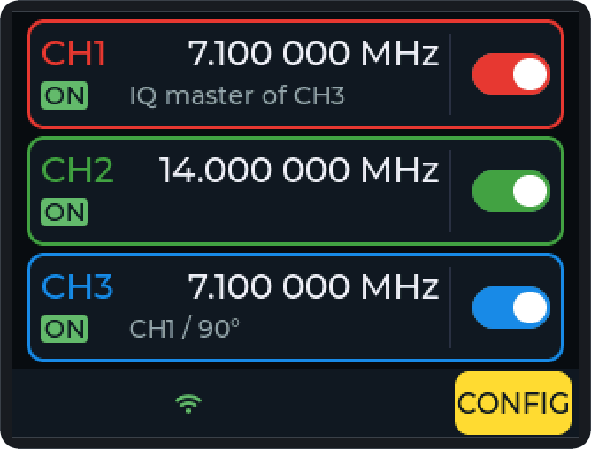

```text
+--------------------------------------------+
| CH1              10.000 000 MHz |  [==o]   |
| ON   SSC -0.5% | Low noise      |          |
+--------------------------------------------+
| CH2              14.000 000 MHz |  [o==]   |
| OFF                             |          |
+--------------------------------------------+
| CH3              10.000 000 MHz |  [==o]   |
| WAIT CH1 / 90° / master off     |          |
+--------------------------------------------+
| WiFi  REMOTE USB               [ CONFIG ]  |
+--------------------------------------------+
```

### CH1 / CH2

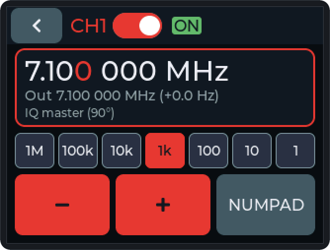

```text
+--------------------------------------------+
| [◀] CH1  [==o]  ON                         |
+--------------------------------------------+
| 10.000 000 MHz                             |
| Out 10.000 000 MHz (+0.3 Hz)               |
| SSC -0.5% | IQ master (90°)                |
+--------------------------------------------+
| [1M][100k][10k][ 1k ][100][ 10][  1]       |
| [   −   ]  [   +   ]  [  NUMPAD  ]         |
+--------------------------------------------+
```

### CH2 gekoppelt

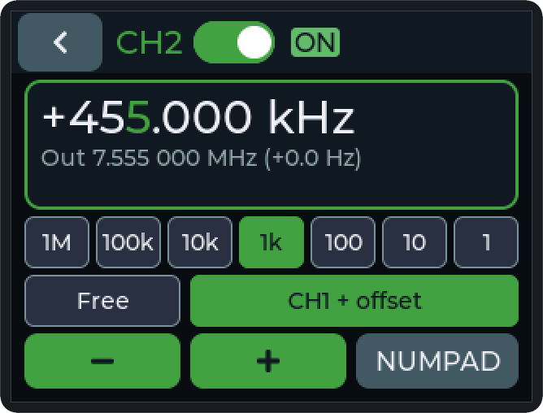

```text
+--------------------------------------------+
| [◀] CH2  [==o]  ON                         |
+--------------------------------------------+
| +455.000 kHz                               |
| Out 7.555 000 MHz (+0.3 Hz)                |
|                                            |
+--------------------------------------------+
| [1M][100k][10k][ 1k ][100][ 10][  1]       |
| [  Free  ]  [      CH1 + offset       ]    |
| [   −   ]  [   +   ]  [  NUMPAD  ]         |
+--------------------------------------------+
```

### CH3 IQ

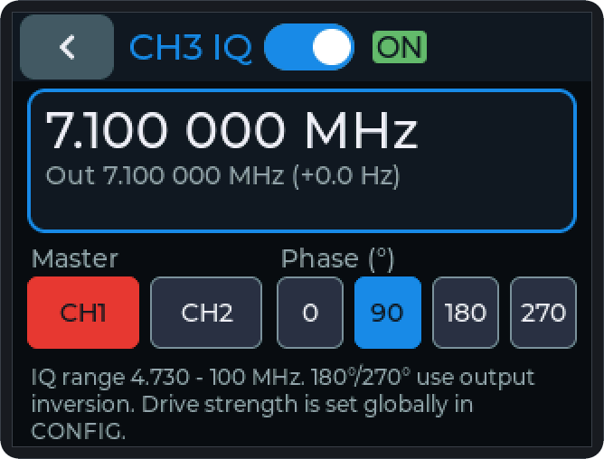

```text
+--------------------------------------------+
| [◀] CH3 IQ  [==o]  ON                      |
+--------------------------------------------+
| 10.000 000 MHz                             |
| Out 10.000 000 MHz (+0.3 Hz)               |
+--------------------------------------------+
| Master            Phase (°)                |
| [CH1] [CH2]       [0] [90] [180] [270]     |
| IQ range 4.730 - 100 MHz. 180°/270° use    |
| output inversion. ...                      |
+--------------------------------------------+
```

### CONFIG

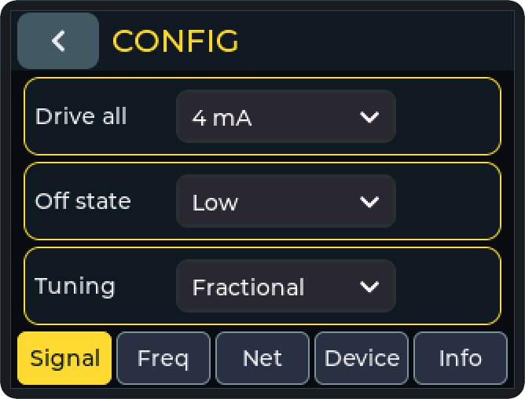 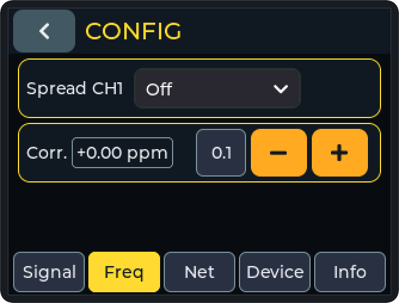 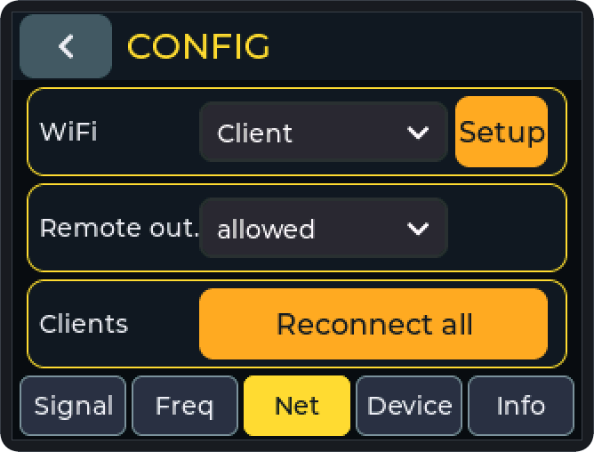 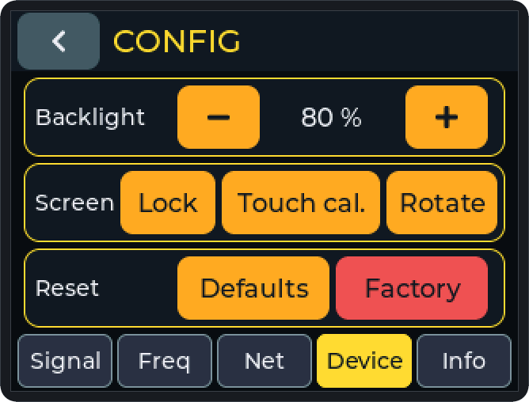 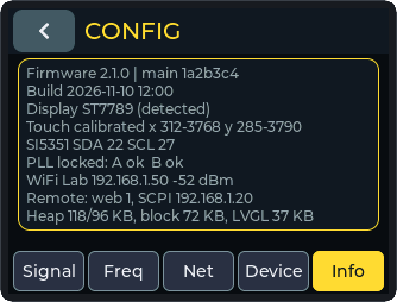

```text
+--------------------------------------------+
| [◀] CONFIG                                 |
+--------------------------------------------+
| Drive all   [ 4 mA        v]               |
| Off state   [ Low         v]               |
| Tuning      [ Fractional  v]               |
+--------------------------------------------+
|[Signal]| Freq |  Net  | Device |  Info    |
+--------------------------------------------+
```

### NUMPAD

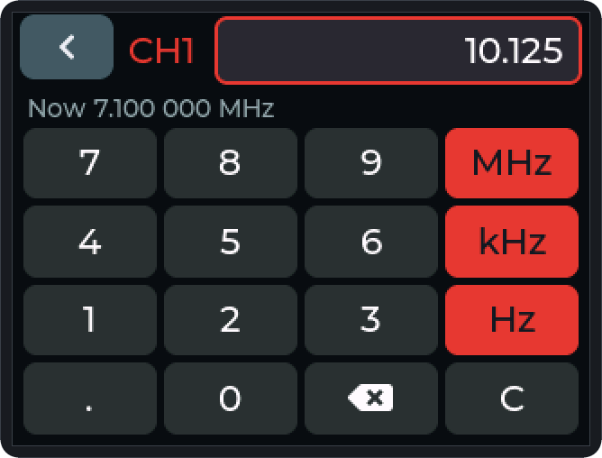

```text
+--------------------------------------------+
| [<]  CH1  [                     10.7 ]     |
| Now 10.000 000 MHz         8 kHz - 160 MHz |
| [ 7 ][ 8 ][ 9 ][ MHz ]                     |
| [ 4 ][ 5 ][ 6 ][ kHz ]                     |
| [ 1 ][ 2 ][ 3 ][ Hz  ]                     |
| [ . ][ 0 ][ ⌫ ][  C  ]                     |
+--------------------------------------------+
```

### WIFI

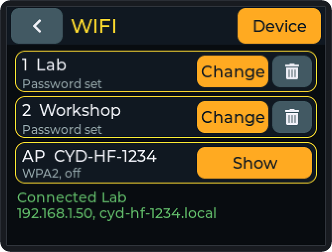 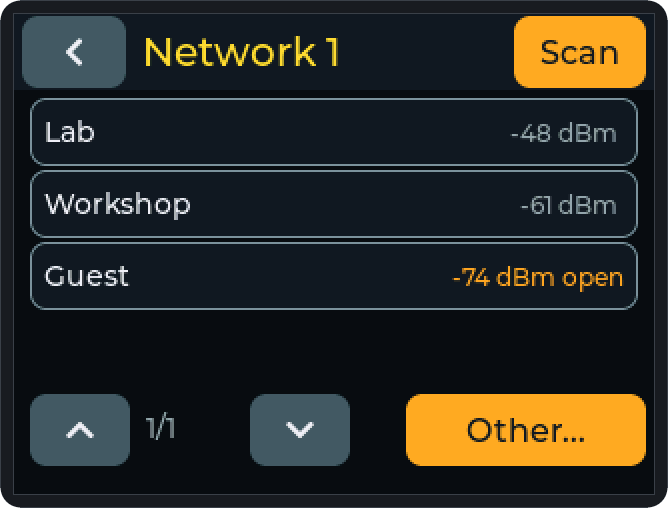

### Gerät

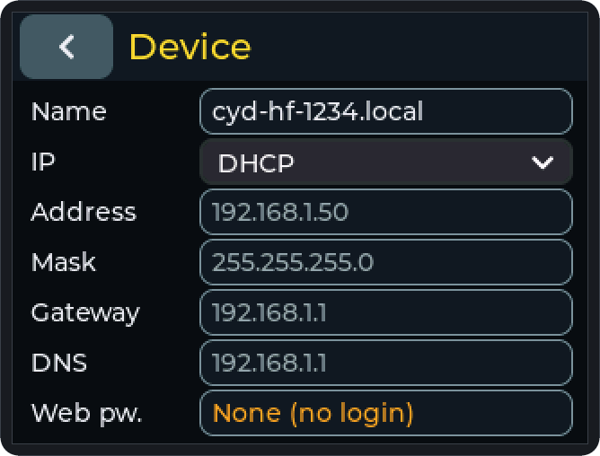

### Access Point

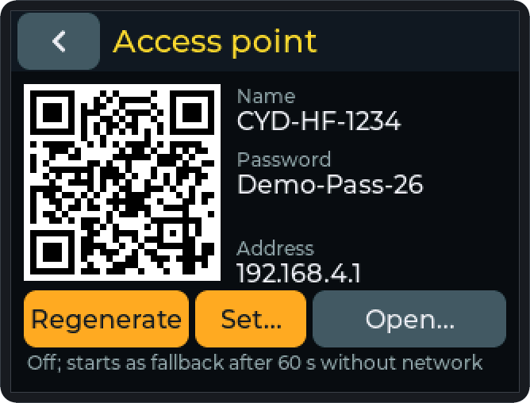

### Dialog `Network change`

Netzänderung aus dem Browser ohne Web-Passwort (Abschnitt 16):

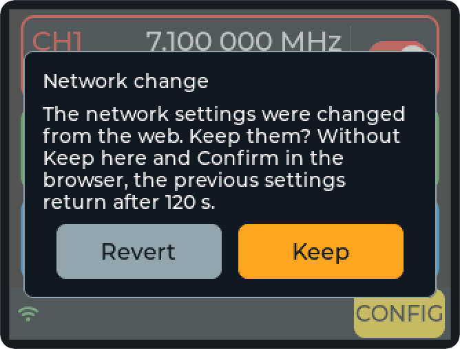

### Weboberfläche

Gerendert mit `tools/web_mock.py` im gleichen Zustand (Abschnitt 16): Desktop mit 1280 px, WiFi-Bereich und Telefon mit der Ausgangsleiste unten.

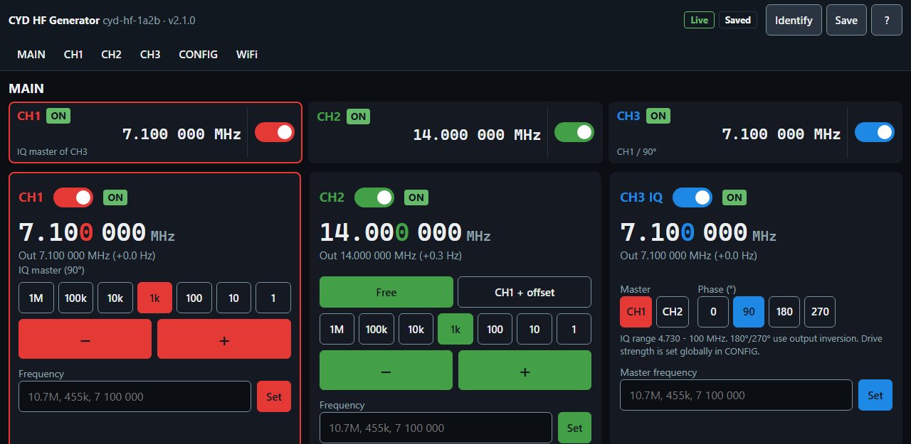

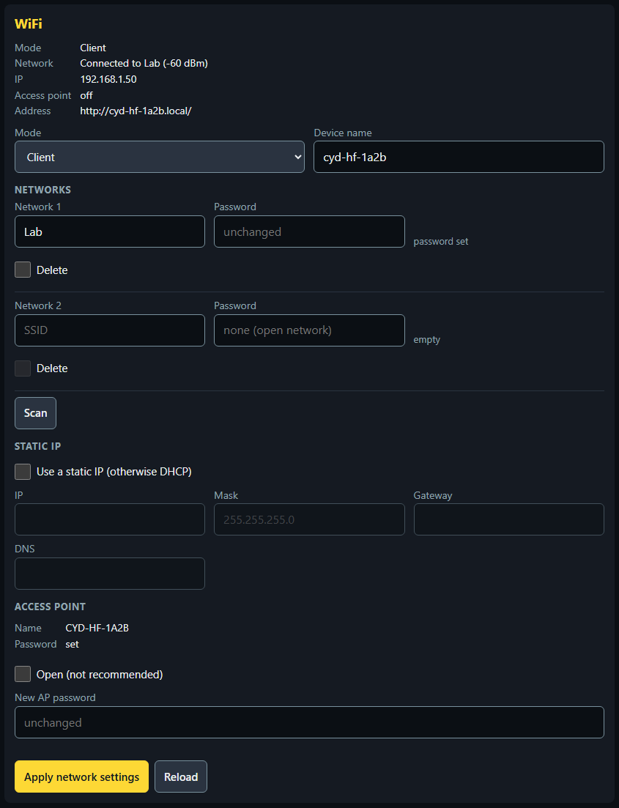 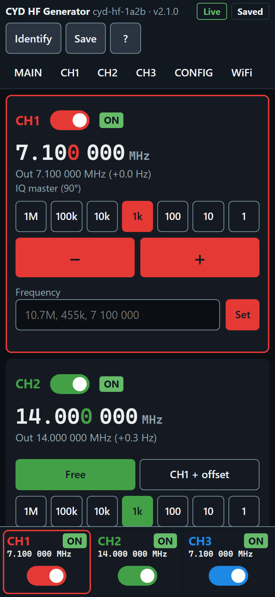

---

## Anhang B: Glossar

| Anzeige | Bedeutung | Abschnitt |
|---|---|---|
| `ON` (grünes Feld) | Ausgang läuft | 2 |
| `OFF` (graue Schrift) | Ausgang aus | 2 |
| `WAIT` (oranges Feld) | CH3 eingeschaltet, wartet auf Master oder IQ-Bereich; gekoppelter CH2 wartet, bis CH1 + Offset im Bereich liegt | 2, 4, 7 |
| `! ERR` (rotes Feld) | Einstellen fehlgeschlagen, Wiederholung alle 2 s | 11 |
| `! NO HW` (rotes Feld) | SI5351 nicht gefunden oder Verbindung verloren | 11 |
| `~` vor der Frequenz | tatsächliche Frequenz weicht um 1 Hz oder mehr ab (`Integer`) | 2, 8 |
| `Out …` | tatsächlich erzeugte Frequenz und Abweichung in Hz | 5 |
| `Out … mean, SSC …` | mittlere Frequenz bei Spread Spectrum | 5 |
| `Off \| Out …` | Kanal aus; so läuft er nach dem Einschalten | 5 |
| `IQ master (90°)` | CH3 folgt diesem Kanal mit der angegebenen Phase | 2, 5 |
| `CH1 / 90° / master off` | CH3: Master, Phase und Grund des Wartens | 2, 7 |
| `CH1 +455 kHz`, `+455.000 kHz` | CH2 an CH1 gekoppelt: Offset (MAIN bzw. CH2-Seite) | 2, 4 |
| `Waiting: CH1 + offset below 8 kHz` | gekoppelter CH2: CH1 + Offset außerhalb von 8 kHz – 160 MHz | 4 |
| Moduszeile | Einstellungen, die vom Werkszustand abweichen | 2 |
| `OFF=High` / `OFF=High-Z` | ausgeschaltete Ausgänge führen HIGH (Gleichspannung) bzw. sind hochohmig | 8 |
| `SSC -0.5 %` usw. | Spread Spectrum: Frequenz wird absichtlich verteilt | 8 |
| `Fractional` / `Low noise` / `Integer` | Teilerverfahren des SI5351 (`Tuning`) | 8 |
| `2mA` … `8mA` | Ausgangsstrom (`Drive all`) | 8 |
| `Corr.`, ppm | Frequenzkorrektur des Quarzes in Millionstel | 8 |
| `LOCKED` (oranges Feld) | Bildschirm gesperrt; 2 s halten entsperrt | 8 |
| `Save failed` / `Not saved` | Speichern fehlgeschlagen bzw. nicht möglich | 8, 9 |
| `Now …` | NUMPAD: aktuelle Frequenz | 6 |
| `8 kHz - 160 MHz`, `Enter a number`, `Max. 10 characters` | NUMPAD: Grund einer abgelehnten Eingabe | 6 |
| `-50.00 to +50.00 ppm` | NUMPAD der Korrektur: Wert außerhalb des Bereichs | 8 |
| `-160 to +160 MHz` | NUMPAD des Offsets: Wert außerhalb des Bereichs | 4, 6 |
| `>100MHz: low level` / `<1MHz: harmonics` | Kanalseite: Hinweis außerhalb von 1–100 MHz | 1, 5 |
| `Touch calibrated …` / `Touch not calibrated (default)` | Info-Karte: Touch-Abgleich | 8 |
| `detected` / `default` / `build flag` | Info-Karte: Herkunft des Display-Controllers | 8, 13 |
| `(swapped)` / `(clone?)` | Info-Karte: SDA/SCL vertauscht bzw. ungewöhnliches SI5351-Register | 8, 11 |
| `PLL locked: A ok  B ok` / `LOL` | Info-Karte: PLL eingerastet bzw. nicht eingerastet (orange) | 8 |

---

## Anhang C: Symptome und Abhilfe

| Symptom | Wahrscheinliche Ursache | Abhilfe | Abschnitt |
|---|---|---|---|
| Frequenz weicht um einige kHz ab, `Out` orange, `~` auf MAIN | `Tuning` = `Integer` (Raster) | `Fractional` oder `Low noise` wählen | 8 |
| Spektrum breit, Träger „verschmiert“ | Spread Spectrum (`SSC` in der Moduszeile) | `Spread CH1` = `Off` | 8 |
| Gleichspannung an einem ausgeschalteten Ausgang | `Off state` = `High` | `Low` oder `High-Z` | 8 |
| Pegel zu klein oder zu groß | `Drive all`; über 100 MHz sinkt der Pegel | 8 mA bzw. 2 mA wählen | 1, 8 |
| Starke Oberwellen unter 1 MHz | Rechteck mit steilen Flanken | Tiefpass am Ausgang | 1 |
| Frequenzzähler zeigt einige Hz Abweichung bei allen Frequenzen | Quarztoleranz | `Corr.` abgleichen | 8 |
| CH3 bleibt bei `WAIT` | Master aus oder Masterfrequenz außerhalb des IQ-Bereichs | Master einschalten, Frequenz ≥ 4,730 MHz | 7, 11 |
| CH2 bleibt bei `WAIT`, CH2-Frequenz von außen abgelehnt (−221) | CH2 an CH1 gekoppelt (`CH1 + offset`) | CH1 oder Offset ändern bzw. `Free` wählen | 4, 11 |
| `! NO HW` auf allen Karten | Kabel, 3,3 V oder GND an CN1 | Verbindung prüfen; SDA/SCL dürfen vertauscht sein | 11 |
| Tipps landen neben der Taste, Rand schwer zu treffen | Touch-Abgleich fehlt oder passt nicht | CONFIG `Device` → `Touch cal.` | 8 |
| Display zeigt nur Rauschen | Controller nicht erkannt | Firmware mit `DISPLAY_FORCE_PANEL` bauen | 13 |
| Einstellungen nach dem Ausschalten verloren | `Save failed` / `Not saved` | Gerät neu starten; bleibt es, Flash-Speicher defekt | 9, 11 |
| Ausgänge nach dem Einschalten aus | so vorgesehen | Ausgänge einschalten | 2 |
| Kurzer Aussetzer beim Abstimmen | `Low noise`, `Integer` oder IQ-Betrieb | gewollt; `Fractional` stimmt ohne Aussetzer | 5 |
| Seitenband im Mischer vertauscht | Phase 90° statt 270° (oder umgekehrt) | Phase auf der CH3-Seite prüfen | 7 |
