# User Manual – CYD HF Generator

Firmware version: 2.1.0

This manual is a translation of [USER_MANUAL_DE.md](USER_MANUAL_DE.md) (firmware 2.1.0); the German manual is the reference for the firmware's behavior.

## Contents

- [Quick Start](#quick-start)
- [1. Overview](#1-overview)
- [2. Basic Operation](#2-basic-operation)
- [3. Frequency Display](#3-frequency-display)
- [4. Using CH1 and CH2](#4-using-ch1-and-ch2)
- [5. Changing the Frequency with + and −](#5-changing-the-frequency-with--and-)
- [6. Entering the Frequency with the NUMPAD](#6-entering-the-frequency-with-the-numpad)
- [7. Using CH3 as IQ Follower](#7-using-ch3-as-iq-follower)
- [8. CONFIG Page](#8-config-page)
- [9. Saving Settings](#9-saving-settings)
- [10. Usage Examples](#10-usage-examples)
- [11. Errors and Notes](#11-errors-and-notes)
- [12. Serial Diagnostics](#12-serial-diagnostics)
- [13. Current Hardware Pinout](#13-current-hardware-pinout)
- [14. Safety Note](#14-safety-note)
- [15. Remote Control over USB and Network (SCPI)](#15-remote-control-over-usb-and-network-scpi)
- [16. Web Interface](#16-web-interface)
- [17. Updating the Firmware](#17-updating-the-firmware)
- [18. Mixer Experiments](#18-mixer-experiments)
- [Appendix A: Page Images](#appendix-a-page-images)
- [Appendix B: Glossary](#appendix-b-glossary)
- [Appendix C: Symptoms and Remedies](#appendix-c-symptoms-and-remedies)

## Quick Start

For the lab bench; details in the sections named, images of the pages in Appendix A.

1. **Connect:** SI5351 module to CN1 (3.3 V, GND, GPIO22, GPIO27; SDA and SCL in either order), supply via USB. CH1 = CLK0, CH2 = CLK1, CH3 = CLK2 (section 13).
2. **Switch on:** All outputs are off. At the very first start the touch calibration appears: hold four crosses and a check cross one after another until they turn green (section 8).
3. **Set the frequency:** tap the `CH1` card, choose a step button (`1M` … `1`), then `−` / `+`; or `NUMPAD`, enter the number, confirm with `MHz`, `kHz` or `Hz` (sections 5 and 6).
4. **Switch the output on:** switch on the card or in the title bar. Next to it is what the output does: `ON` in a green field = running.
5. **IQ signal:** `CH3` card, master `CH1` or `CH2`, phase `0` / `90` / `180` / `270`, switch on. Below 4.730 MHz master frequency CH3 waits (`WAIT`) and starts by itself (section 7).
6. **Before measuring:** if a mode line appears below a frequency (e.g. `OFF=High`, `SSC -0.5%`, `Integer`), CONFIG differs from the factory settings (section 2).
7. **On errors:** `! NO HW` = SI5351 not connected; `! ERR` = setup failed, the firmware retries every 2 s (section 11, Appendix C).

Factory settings in CONFIG: `Drive all` 4 mA, `Off state` Low, `Tuning` Fractional, `Spread CH1` Off, `Corr.` 0 ppm, `Backlight` 80 %, screen upright (`Rotate` 0°); frequencies 10 MHz (CH1) and 14 MHz (CH2), CH2 `Free` (offset 0), step 1 kHz. For the next group: CONFIG `Device` → `Reset` → `Defaults` (the calibration stays); against accidental changes: CONFIG `Device` → `Screen` → `Lock`.

---

## 1. Overview

The **CYD HF Generator** is a 3-channel HF square-wave generator based on an ESP32-2432S028R display and an SI5351 clock generator.

The device generates square waves with a 50 % duty cycle in the range:

```text
8 kHz to 160 MHz (CH1, CH2)
4.730 MHz to 100 MHz (CH3 in IQ operation)
```

Above 100 MHz the output level drops; below 1 MHz the square wave carries strong harmonics (use a low-pass filter). The channel page then shows a hint (section 5).

The three outputs are:

| Output | Function |
|---|---|
| CH1 / CLK0 | Freely adjustable frequency |
| CH2 / CLK1 | Freely adjustable frequency |
| CH3 / CLK2 | IQ follower of CH1 or CH2 |

CH3 always follows the frequency of its master and can be operated with a phase of 0°, 90°, 180° or 270°. IQ operation is possible from **4.730 MHz to 100 MHz**; all four phases are available in this range.

The CONFIG page also lets you select the SI5351 divider scheme (`Tuning`), spread spectrum for CH1 and the state of switched-off outputs (section 8).

### Licenses

The firmware, the web interface and the web flasher page are free software under the GNU General Public License version 3 or (at your option) any later version (GPL-3.0-or-later), Copyright (C) 2026 DM8SB. They are provided **without any warranty**, without even the implied warranty of merchantability or fitness for a particular purpose; you use them at your own risk. The CYD HF Generator is a private, non-commercial hobby project. As an additional permission under GPLv3 section 7, the firmware may be conveyed together with the libraries Espressif supplies only as object code (Wi-Fi, PHY, Bluetooth controller and others); the wording is in `LICENSE-EXCEPTION.md`.

The firmware contains third-party components under their own licenses (among them Arduino-ESP32 with ESP-IDF, TFT_eSPI, LVGL, ArduinoJson, AsyncTCP and ESPAsyncWebServer). All components with license and copyright holders are listed in `THIRD_PARTY_NOTICES.md`; every release contains the license texts (`cyd-hf-generator-<version>-licenses.tar.gz`) and the source of the LGPL libraries (`cyd-hf-generator-<version>-lgpl-sources.tar.gz`). The complete source is on GitHub: https://github.com/dm8sb/CYD-HF-Generator. The license line is in the footer of the web interface (section 16), not on the display.

---

## 2. Basic Operation

After power-up, the display stays dark until the first screen has been drawn; then the main page appears. At the very first start (no touch calibration stored yet) the touch calibration comes first (section 8, `Touch`). **All outputs are off after power-up**, even if they were on when the device was switched off. Frequencies, CH3 master and phase, and all CONFIG settings are retained.

The main page shows one card per channel with:

- channel name and status
- the frequency you set (requested frequency)
- its own ON/OFF switch
- an extra line: on CH1/CH2 the mode line (see below) and `IQ master of CH3` when CH3 is switched on and follows this channel (shortened to `| IQ master` after a mode line); for a coupled CH2 the offset in short form, e.g. `CH1 +455 kHz` (section 4); on CH3 the master and phase, e.g. `CH1 / 90°`, and with `WAIT` and `! ERR` also the reason (e.g. `CH1 / 90° / master off`)

In mode `Tuning` = `Integer`, the frequency is preceded by a `~` when the actual frequency deviates from the requested frequency by 1 Hz or more (section 8). From 100 MHz on the `~` no longer fits the card and is left out; the mode line shows `Integer` then.

### Mode Line

CONFIG settings that change the signal of a channel compared to the factory settings appear as a mode line on the main page (cards CH1 and CH2) and on the channel pages (CH1 to CH3, in the card below the `Out` line). With the factory settings it is empty. The entries appear in this order, separated by ` | `:

| Entry | Appears with |
|---|---|
| `OFF=High` / `OFF=High-Z` | `Off state` ≠ `Low` |
| `SSC -0.5%`, `SSC -1.5%`, `SSC +/-0.5%` | `Spread CH1` ≠ `Off`, only on CH1 and on CH3 with master CH1 |
| `Low noise` / `Integer` | `Tuning` ≠ `Fractional` |
| `2mA`, `6mA`, `8mA` | `Drive all` ≠ `4 mA` |

Example: `SSC -0.5% | Low noise | 8mA` on CH1, `Low noise | 8mA` on CH2. With `OFF=High` the line is orange, because a switched-off output then carries DC; otherwise gray. If the line is too long on the main page, it ends with `...`; the channel page shows it completely.

Operation on the main page:

- **Tapping a card** opens the channel's page.
- **The switch on a card** (on the right, separated by a line) turns the output on or off directly, without leaving the page. A tap on the frequency or `MHz` only opens the channel page.
- The frequencies are right-aligned; decimal point and `MHz` of all cards line up.
- The status bar at the bottom shows the WiFi state at the far left (section 8, `WiFi`): the WiFi symbol green (connected) or gray (searching), `AP` green while the own access point runs, `AP open` orange when it runs without a password; with `Off` the WiFi symbol gray and struck through. A tap on it opens the WIFI page, with `Off` CONFIG on the `Net` tab, where WiFi can be switched on.
- Next to it, something about saving is shown only when there is a problem (red `Save failed` / `Not saved`, section 8); on the right is the `CONFIG` button (yellow). The channels open via their cards. With the screen locked it also shows `LOCKED` in an orange field (section 8).
- After a remote command `REMOTE USB` (SCPI over USB), `REMOTE SCPI` (SCPI over TCP or VXI-11) or `REMOTE WEB` (web interface and REST) shows for 10 s in a blue field (the CH3 color); `LOCKED` takes precedence.
- Colored buttons and selected chips have dark text, switched-off switches a light gray track, unselected chips a gray border.
- Buttons at the screen edge (e.g. `◀` top left, `CONFIG` bottom right, the outer NUMPAD keys) react up to the edge, also to a tap just beside them towards the edge. The gap between two buttons stays free.

Status display below the channel name (the same in the title bar of the channel pages). Every state except `OFF` appears as a colored field with dark text; errors start with `!`. Active and faulty outputs can thus be recognized without telling colors apart and from a distance.

| Status | Meaning |
|---|---|
| `ON` (green field) | Output active |
| `OFF` (gray text, no field) | Output off |
| `! ERR` (red field) | Setting up the output failed although the SI5351 responds; the firmware retries every 2 s. The switch keeps showing the desired setting |
| `WAIT` (orange field) | CH3 is switched on but cannot run at the moment (master off or master frequency outside the IQ range: below 4.730 MHz, slightly narrower with `Spread CH1` on master CH1, section 8); or CH2 is coupled to CH1 and switched on, but CH1 + offset lies outside 8 kHz – 160 MHz (section 4) |
| `! NO HW` (red field) | SI5351 not found or connection lost; the firmware reconnects automatically |

The channel colors: CH1 red, CH2 green, CH3 blue, CONFIG yellow.

All pages except the main page have the same title bar: `◀` at the top left goes one level back (from CH1, CH2, CH3 and CONFIG to the main page, from the WIFI pages to CONFIG or the WIFI overview, from the NUMPAD without a change to the page before), the title follows, and on the right there may be a button of the page (e.g. `Device`, `Scan`). On the channel pages, the title bar also contains the ON/OFF switch and next to it the actual state as on the main page: `ON`, `OFF`, `WAIT` (CH3 and a coupled CH2), `! ERR` or `! NO HW`. The switch shows what is set, the text what the output is doing; for CH3 and a coupled CH2 the switch can therefore be ON while the text shows `WAIT`. The NUMPAD has the `◀` button instead (section 6).

On the channel pages, the RGB LED also shows the channel color:

| Page | RGB LED |
|---|---|
| CH1 | Red |
| CH2 | Green |
| CH3 | Blue |
| MAIN, CONFIG, NUMPAD | off |

---

## 3. Frequency Display

The frequency is shown in MHz with grouped decimal places.

Examples:

```text
455.000 kHz
1.000 000 MHz
5.000 000 MHz
10.700 000 MHz
150.000 000 MHz
```

Below 1 MHz the device shows the frequency in kHz with three decimals (Hz resolution).

This corresponds to:

| Display | Frequency |
|---|---:|
| 1.000 000 MHz | 1 MHz |
| 5.000 000 MHz | 5 MHz |
| 10.700 000 MHz | 10.7 MHz |
| 100.000 000 MHz | 100 MHz |
| 455.000 kHz | 455 kHz |

What is displayed and saved is the **requested frequency you set**, with 1 Hz resolution. The SI5351 cannot generate every frequency exactly; the actual frequency is shown in the `Out` line of the channel page (section 5).

---

## 4. Using CH1 and CH2

CH1 and CH2 are freely adjustable frequency outputs.

### Turning CH1 or CH2 ON

1. On the main page, tap the `CH1` or `CH2` card.
2. Turn on the ON/OFF switch in the title bar.
3. The display changes to `ON`.
4. A signal is present at the corresponding SI5351 output:

| Channel | SI5351 output |
|---|---|
| CH1 | CLK0 |
| CH2 | CLK1 |

Alternatively, the channel can be switched on directly with the switch on its card on the main page.

### Turning CH1 or CH2 OFF

1. Open the channel page (or use the switch on the main page).
2. Turn off the ON/OFF switch.
3. The display changes to `OFF`.
4. The output is switched off and takes the state selected under `Off state` (default `Low`, section 8).

### Coupling CH2 to CH1 (`CH1 + offset`)

CH2 can follow CH1 at a fixed distance (offset), e.g. as LO or test signal of a superheterodyne receiver with a fixed IF (section 18). On the CH2 page two chips sit below the frequency card; the other rows move closer together for them:

| Chip | Effect |
|---|---|
| `Free` | CH2 is freely adjustable (default) |
| `CH1 + offset` | CH2 runs at CH1 + offset |

While coupled:

- The frequency card shows the offset, always with its sign, e.g. `+455.000 kHz` or `-10.700 000 MHz`. `+`/`−`, the step chips, a tap on a digit and the NUMPAD (section 6) change the offset. The `Out` line shows the actual frequency of CH2.
- Offset −160 MHz to +160 MHz in 1 Hz steps; `+`/`−` stop at these limits.
- CH1 stays freely adjustable. Every change of CH1 retunes CH2 as well (its own PLL B; in `Fractional` mode without a dropout, section 5).
- If CH1 + offset lies outside 8 kHz – 160 MHz, CH2 **waits**: output CLK1 stays off, the state shows `WAIT` (with CH2 switched on), the line below the offset `Waiting: CH1 + offset below 8 kHz` or `Waiting: CH1 + offset above 160 MHz` (also with CH2 switched off). Once CH1 + offset is back in the range, CH2 starts **by itself**; no error message appears.
- The main page shows the frequency CH1 + offset on the CH2 card (`0.000 kHz` below 0 Hz) and the offset in short form in the extra line, e.g. `CH1 +455 kHz` or `CH1 -10.7 MHz`.
- Tap `Free`: CH2 stays at the frequency it last ran at (if it was waiting, the last valid one) and is freely adjustable again. The offset is kept and applies again with the next `CH1 + offset`; over SCPI and REST it can also be set in advance in `Free` mode.
- With CH3: if CH2 is the master of CH3, CH3 follows the coupled CH2 frequency, and the IQ range (4.730 – 100 MHz) then applies to CH1 + offset. If CH2 waits, CH3 waits too (`Waiting: CH2 below 4.730 MHz` or `above 100 MHz`). Every change of CH1 then sets up the IQ pair again, with the short dropout described in section 7. In this case a tap on the frequency of the CH3 page opens the NUMPAD for the offset.
- `Spread CH1` does not affect CH2 (PLL B), coupled or not.
- Coupling and offset are saved (section 9); `Defaults` and `*RST` set `Free` and offset 0. Remote control: SCPI `SOUR2:COUP` and `SOUR2:FREQ:OFFS` (section 15), REST `coupled` and `offset` (section 16). While CH2 is coupled, the device refuses a CH2 frequency from outside with −221 `CH2 is coupled to CH1`.

Example: CH1 7.100 MHz, CH2 `CH1 + offset` with offset `+455.000 kHz` → CH2 runs at 7.555 MHz; tune CH1 to 7.200 MHz → CH2 7.655 MHz. With offset `-7.100 000 MHz` CH2 waits (0 Hz is below 8 kHz) until CH1 is above 7.108 MHz.

---

## 5. Changing the Frequency with + and −

The CH1 and CH2 channel pages contain:

- the frequency card with the `Out` line
- a row of step buttons: `1M`, `100k`, `10k`, `1k`, `100`, `10`, `1` (in Hz), like the digits of the frequency above: large steps on the left, small ones on the right
- large `−` (left) and `+` (right) buttons
- the `NUMPAD` button

The `−` and `+` buttons change the frequency by the currently selected step. The selected step is highlighted in color and is chosen on the channel page. It applies to CH1 and CH2 together and stays stored: switching from CH1 to CH2 keeps the step.

**Tapping a digit directly:** Tapping a digit of the frequency display selects that digit position as the step (e.g. the third decimal place = 1 kHz). The digit changed by `−`/`+` is highlighted in the channel color. Digits above 1 MHz (10 MHz, 100 MHz) select the largest step, 1 MHz. Tapping the unit `MHz` opens the NUMPAD. Tapping is a shortcut to the step buttons: the digits are only 2–3 mm wide, and a tap on the point or a gap selects the nearer neighboring digit.

**Press and hold:** After about 0.6 s, the step repeats automatically until the button is released: at first about 3 steps per second, after holding for 3 s about 10 per second, after 6 s about 20 per second (2 steps per repeat). Short pressure dropouts (up to 70 ms) do not end the hold. This also applies to `−`/`+` of `Corr.`.

Whether a frequency change briefly interrupts the output depends on `Tuning` (section 8):

- `Fractional` (default): no interruption. Only in rare cases does the PLL have to be switched; this causes a short dropout. From 112.5 MHz on every step changes the PLL: a short dropout on every step.
- `Low noise`: short dropout when the divider changes.
- `Integer`: short dropout when the PLL changes.
- In IQ operation, the master and CH3 drop out briefly on every frequency change (section 7).

### Actual Frequency (`Out`)

Below the frequency, the `Out` line shows the frequency that the SI5351 actually generates with the programmed dividers, and in parentheses the deviation from the requested frequency:

```text
Out 10.000 000 MHz (+0.3 Hz)
```

- The values assume that the frequency correction (section 8) is right.
- From a deviation of 1 Hz upward, the line is shown in orange.
- Deviation per mode up to 100 MHz: `Fractional` ≤ 0.5 Hz, `Low noise` up to 1.5 Hz; above up to 1.5 Hz (to 112.5 MHz), 2 Hz (to 150 MHz) and 3 Hz (to 160 MHz). In `Integer` mode, the frequency lies on a grid and can deviate by a few kHz, e.g. at 7.1 MHz:

```text
Out 7.102 273 MHz (+2272.7 Hz)
```

- With spread spectrum on CH1, the line shows the mean frequency and the setting:

```text
Out 9.975 000 MHz mean, SSC -0.5 %
```

- Outside 1–100 MHz the mode line shows a hint: `>100MHz: low level` or `<1MHz: harmonics`.
- With the channel switched off, the line starts with `Off | `, e.g. `Off | Out 10.000 000 MHz (+0.3 Hz)`: this is how the output would run after switching on.
- If CH3 follows this channel, the mode line below shows `IQ master (90°)` with the phase of CH3; frequency changes then move both outputs.

In case of errors, the following is shown in red instead of the frequency:

| Display | Meaning |
|---|---|
| `SI5351 not found` | SI5351 missing or connection lost (status `! NO HW`) |
| `Output error, retrying` | Setting failed; the firmware retries every 2 s (status `! ERR`) |

Example:

```text
Current frequency: 10.000 000 MHz
Step: 1k
Press +
New frequency: 10.001 000 MHz
```

Another example:

```text
Current frequency: 7.100 000 MHz
Step: 10k
Press −
New frequency: 7.090 000 MHz
```

The frequency always stays within the range 8 kHz to 160 MHz.

---

## 6. Entering the Frequency with the NUMPAD

On CH1 or CH2:

1. Press `NUMPAD`.
2. Enter digits. Below the input field, the current frequency is shown on the left, e.g. `Now 10.000 000 MHz`.
3. Optionally use a decimal point (only one is allowed).
4. Press a unit:
   - `Hz`
   - `kHz`
   - `MHz`

The unit confirms the entry immediately and returns to the channel page.

The `◀` button at the top left returns to the channel page **without any change**.

For a coupled CH2 (section 4) the NUMPAD enters the **offset**: title `Offs.`, below it `Now +455.000 kHz`, and in the bottom row an extra `+/-` key for the sign (the field then shows a `-`). `0` is allowed, `C` also clears the sign. Outside ±160 MHz, `-160 to +160 MHz` appears.

```text
 7    8   9   MHz
 4    5   6   kHz
 1    2   3   Hz
+/-   .   0   ⌫   C
```

### Keypad

```text
 7   8   9   MHz
 4   5   6   kHz
 1   2   3   Hz
 .   0   ⌫   C
```

| Key | Function |
|---|---|
| 0–9 | Digit entry |
| . | Decimal point |
| `⌫` | Delete last character |
| C | Clear input |
| Hz | Apply value as Hz |
| kHz | Apply value as kHz |
| MHz | Apply value as MHz |
| `◀` | Back to the channel page without any change |

A maximum of 10 characters is allowed (e.g. `150.000001`); an eleventh shows `Max. 10 characters`.

The frequency is rounded to whole Hz, half a hertz and more upwards, exactly as with SCPI and REST: `7.1000005` `MHz` gives 7 100 001 Hz, `7.10000049` `MHz` 7 100 000 Hz.

### Invalid Input

If the value is outside 8 kHz – 160 MHz, or the input is empty or invalid, it is **not applied**. The input stays, the border turns red and the reason appears in red to the right below the field:

| Display | Meaning |
|---|---|
| `8 kHz - 160 MHz` | value out of range, e.g. `500` `MHz` |
| `Enter a number` | no digit entered (empty or only `.`) |
| `Max. 10 characters` | field full |
| `-160 to +160 MHz` | offset of a coupled CH2 outside ±160 MHz |

Correct the input with `⌫` or clear it with `C`; the next key clears the hint.

### Example 1: Enter 10 MHz

1. Open CH1.
2. Press `NUMPAD`.
3. Enter:

```text
10
```

4. Press `MHz`.
5. CH1 is set to 10 MHz.

Display:

```text
10.000 000 MHz
```

### Example 2: Enter 10.7 MHz

1. Open CH2.
2. Press `NUMPAD`.
3. Enter:

```text
10.7
```

4. Press `MHz`.

Display:

```text
10.700 000 MHz
```

### Example 3: Enter 1 000 kHz

1. Open CH1.
2. Press `NUMPAD`.
3. Enter:

```text
1000
```

4. Press `kHz`.

Display:

```text
1.000 000 MHz
```

### Example 4: Enter 5 000 000 Hz

1. Open CH1.
2. Press `NUMPAD`.
3. Enter:

```text
5000000
```

4. Press `Hz`.

Display:

```text
5.000 000 MHz
```

---

## 7. Using CH3 as IQ Follower

CH3 is not a freely adjustable channel. CH3 follows CH1 or CH2.

On the CH3 page you can set:

- Master: buttons `CH1` or `CH2`
- Phase: buttons `0`, `90`, `180` or `270` (degrees)
- ON/OFF via the switch in the title bar

The selected button is highlighted in color. The CH3 frequency is always identical to the master frequency; the drive strength is set in CONFIG for all channels.

- **Change the master frequency from here:** tapping the frequency opens the master's NUMPAD; after the entry (or `◀`) you return to the CH3 page.
- **Switch the master on:** if CH3 waits for its switched-off master, the status line shows `Master CH1 is off: tap to switch on`; tapping it switches the master on.

### Status Line

Below the frequency, the CH3 page shows the current state:

| Display | Meaning |
|---|---|
| `Off  \|  follows CHx` | CH3 switched off |
| `Out 10.000 000 MHz (+0.3 Hz)` | IQ output running; actual frequency of CLK2 (section 5) |
| `Master CHx is off: tap to switch on` | CH3 switched on, master off; tapping the line switches it on |
| `Waiting: CHx below 4.730 MHz` | CH3 switched on, master frequency too low (higher with spread spectrum on CH1, e.g. `4.749`) |
| `Waiting: CHx above 99.502 MHz` | CH3 switched on, master frequency too high; only with spread `+/-0.5 %` on master CH1 |
| `IQ setup failed, retrying` | Setting up the IQ pair failed (status `! ERR`); CLK2 is off, the master keeps running, the firmware retries every 2 s |
| `SI5351 not found` | SI5351 missing |

**Important:** If CH3 is switched on but cannot run at the moment (master off or below 4.730 MHz), the switch stays ON. Output CLK2 stays off until the conditions are met – then CH3 starts **automatically**. No error message appears.

### Frequency Range and Phases

| Phase | Available |
|---|---|
| 0° | 4.730 – 100 MHz |
| 90° | 4.730 – 100 MHz |
| 180° | 4.730 – 100 MHz |
| 270° | 4.730 – 100 MHz |

180° and 270° are produced by inverting the CH3 output (0° or 90° plus inversion). Below 4.730 MHz, the SI5351 oscillator (VCO) would run below 600 MHz and thus outside its specification.

Accuracy: In `Fractional` and `Low noise` modes, the IQ frequency deviates from the requested frequency by at most ≈ 1.4 Hz. In `Integer` mode, IQ operation also uses an integer PLL; the frequency then lies on the grid (section 8), and the phases work unchanged.

### Tuning in IQ Operation

The master and CH3 share one PLL. Every change of the master frequency or of the frequency correction, and every phase change from 0°/180° to 90°/270° (or vice versa), briefly switches both outputs off, reconfigures them and realigns the phase by resetting the PLL. Switching between 0° and 180° or between 90° and 270°, and changing the drive strength, work without a dropout.

Spread spectrum (`Spread CH1`) also affects CH3 when CH1 is its master; with master CH2, CH3 is not affected.

If the master CH2 is coupled to CH1 (section 4), CH3 follows the frequency CH1 + offset; every change of CH1 or of the offset is then a change of the master frequency.

### Example: CH3 Follows CH1 with 90° Phase

1. Set CH1 to 10 MHz.
2. Switch CH1 on.
3. Go to the CH3 page.
4. Tap master `CH1`.
5. Tap phase `90`.
6. Switch CH3 on.

Result:

```text
CH1 / CLK0 = 10 MHz, 0° reference
CH3 / CLK2 = 10 MHz, shifted by 90°
```

### Example: CH3 Follows CH2 with 180° Phase

1. Set CH2 to 5 MHz.
2. Switch CH2 on.
3. Open CH3.
4. Tap master `CH2`.
5. Tap phase `180`.
6. Switch CH3 on.

Result:

```text
CH2 / CLK1 = 5 MHz
CH3 / CLK2 = 5 MHz, shifted by 180°
```

---

## 8. CONFIG Page

The CONFIG page is where global settings are changed. Every change takes effect immediately and is saved automatically (section 9).

### Layout and Tabs

The title bar with `◀` stays fixed. Below it CONFIG shows at most three rows; a tab bar at the bottom selects which. Nothing scrolls.

| Tab | Row | Controls |
|---|---|---|
| `Signal` | `Drive all` | drop-down list `2 mA` … `8 mA` |
| | `Off state` | drop-down list `Low`, `High`, `High-Z` |
| | `Tuning` | drop-down list `Fractional`, `Low noise`, `Integer` |
| `Freq` | `Spread CH1` | drop-down list `Off`, `-0.5 %`, `-1.5 %`, `+/-0.5 %` |
| | `Corr.` | value in ppm (tap: entry), step button, `−`, `+` |
| `Net` | `WiFi` | drop-down `Off`, `Client`, `Access point`; button `Setup` (WIFI page) |
| | `Remote out.` | drop-down `allowed`, `local only` |
| | `Clients` | `Reconnect all` button (disconnect remote connections) |
| `Device` | `Backlight` | `−`, value, `+` |
| | `Screen` | `Lock` (screen lock), `Touch cal.` (touch calibration) and `Rotate` (turn the screen by 180°) buttons |
| | `Reset` | `Defaults` and `Factory` (red) buttons |
| `Info` | Info card | Firmware, Build, Display, Touch, SI5351, PLL, WiFi, remote access, memory |

- A tap on a tab shows its rows; the selected tab is filled yellow. When CONFIG is opened for the first time after power-on, `Signal` is selected, the settings that change the signal.
- The last selected tab is kept when you leave the page via `◀`, `Setup` or the numpad of the correction and come back to CONFIG (until power-off).
- The frequency step is set with the step buttons of the channel pages (section 5).
- Drop-down lists open upward when there is no room below.

### Save Indicator

Every change is saved automatically, a few seconds after the last change (5 s at the device, section 9); there is no indicator for it. If you switch the device off right after a change, it may be lost. Only when saving fails does the title bar to the right of `CONFIG` and the status bar of the main page show in red:

| Display | Meaning |
|---|---|
| `Save failed` (red) | Saving to flash failed; a dialog also appears; the firmware tries again every 30 s |
| `Not saved` (red) | Flash storage (NVS) not available at startup; changes are lost at power-off |

### Drive all

The drive strength applies globally to all channels (CH1, CH2 and CH3); CH3 has no setting of its own. Options: `2 mA`, `4 mA` (default), `6 mA`, `8 mA`.

The SI5351 outputs are CMOS square-wave drivers. The drive strength sets how much current a driver can deliver into the load:

| Effect | small value (2 mA) | large value (8 mA) |
|---|---|---|
| Level into 50 Ω | lower | higher |
| Edges | slower, fewer harmonics | steeper, more harmonics |
| Crosstalk between the outputs, noise on the supply | lower | stronger |
| Current consumption | lower | higher |

- Into a high-impedance input (logic, counter, oscilloscope with 1 MΩ) the level hardly changes; 2 or 4 mA are enough there.
- Into a 50 Ω load or a long coax cable, 6 or 8 mA give more level and cleaner edges.
- A square wave always contains odd harmonics (3rd, 5th, … multiple). If you need a clean sine wave, filter with a low-pass; a smaller drive strength only softens the harmonics.
- The change takes effect immediately and without a dropout, also on a running IQ pair.
- Typical levels per step into 50 Ω (not measured yet) are in section 18; the measured values follow after measurement M-312 in `MESSPLAN.md`.

### Off state (State of Switched-Off Outputs)

Determines the level that a switched-off output carries (SI5351 register 24). The setting applies to CLK0, CLK1 and CLK2.

| Option | Output in the OFF state | Typical use |
|---|---|---|
| `Low` (default) | LOW (0 V) | DC-coupled mixers (diode ring, switches such as the FST3253), logic with an active-high input: off = no clock, no current into a 50 Ω load |
| `High` | HIGH (supply voltage of the outputs, usually 3.3 V) | Logic with an active-low input that must see HIGH when idle |
| `High-Z` | high impedance | The external circuit sets the idle level (pull-up/-down, bias through a resistor), or another driver uses the same line |

- `High` needs a confirmation: the dialog `Off state High` explains the DC voltage on a switched-off output. `High` (orange) applies the setting, `Cancel` keeps the previous one. `Low` and `High-Z` apply without a question.
- Remotely (SCPI over USB, TCP or VXI-11, REST, web UI) `High` applies only with `Remote out.` = `allowed`, then without a question at the device (the web UI asks itself). With `local only` the device refuses `High`, like switching an output on (SCPI `-221`, REST 403); `Low` and `High-Z` stay allowed.
- The change takes effect immediately; running outputs are not affected.
- If the setting differs from `Low`, the main page and the channel pages show `OFF=High` or `OFF=High-Z` in the mode line (section 2).
- The firmware writes the state when connecting to the SI5351, before any output can be switched on.
- **`High`:** A continuous current flows into a DC-coupled load (e.g. 50 Ω), limited by the drive strength; a DC-coupled mixer sees a DC voltage.
- For DC-coupled diode ring mixers, use `Low` or `High-Z`.
- Until hardware check M-118 (`MESSPLAN.md`), with `High` and `High-Z` the output driver of switched-off outputs stays powered, including that of CLK2 when CH3 is off. With `Low`, CLK2 is powered down completely as before, as long as CH3 is not running in IQ operation.

### Tuning (Divider Scheme)

`Tuning` determines how the SI5351 composes a frequency. Three things depend on it: how clean the spectrum is (spurs), how accurately the frequency is hit, and whether the output drops out briefly while tuning. The setting applies to all channels.

**How the frequency is made:** The SI5351 works in two stages. A PLL multiplies the 25 MHz crystal up to 600–900 MHz (VCO). A divider (MultiSynth) divides this down to the output frequency; below 1 MHz an additional divider (R) divides once more by 2 to 128.

```text
Output = 25 MHz × PLL factor / divider
```

Both stages can work as **integer** (e.g. factor 36, divider 90) or **fractional** (with a fractional part, e.g. divider 126.7605). A fractional divider cannot really divide by 126.7605: it switches between 126 and 127 in a fixed pattern so that the average is right. This pattern causes a small periodic phase error that shows up in the spectrum as **spurs** next to the carrier. Where they lie and how strong they are depends on the fractional part, that is on the exact frequency. A stage that works as integer does not produce these spurs. A fractional divider in the PLL disturbs less than one in the MultiSynth, because the PLL control loop filters out part of the error.

**Overview:**

| | `Fractional` (default) | `Low noise` | `Integer` |
|---|---|---|---|
| PLL (VCO) | fixed: 900 MHz or 887.5 MHz | fractional, follows the frequency | integer: 25 MHz × 24 … 36 |
| Divider (MultiSynth) | fractional | even, integer | even, integer |
| Spurs | most likely, depending on the frequency | fewer | fewest |
| Deviation from the requested frequency | ≤ 0.5 Hz (up to 100 MHz) | ≤ 1.5 Hz (up to 100 MHz) | grid, Hz to MHz (table below) |
| Tuning with `+`/`−` | without dropouts, rarely a short one | without dropouts, short dropout when the divider changes | short dropout when the PLL changes at a grid step |
| Frequency correction (`Corr.`) | fully compensated | fully compensated | cannot be compensated |
| `Spread CH1` | possible | possible | locked |
| CH3 IQ | yes, deviation ≤ 1.4 Hz | yes, deviation ≤ 1.4 Hz | yes, on the grid |

Above 100 MHz `Fractional` and `Low noise` work largely the same (see below); the deviation there rises to up to 1.5 Hz (up to 112.5 MHz), 2 Hz (up to 150 MHz) and 3 Hz (up to 160 MHz).

Whether a setting gives measurably fewer spurs in a given case depends on frequency, load and measurement setup. The comparison measurements are in `MESSPLAN.md` (M-301, M-303, M-302); they also decide whether `Low noise` becomes the default.

#### Fractional

The PLL stays fixed at one of two values (900 or 887.5 MHz); only the MultiSynth divider changes, fractionally with a denominator of up to 1 048 575. This hits every frequency up to 100 MHz to within 0.5 Hz, also with frequency correction.

- **Tuning:** A new divider is taken over without restarting the PLL; the output keeps running. Only when the current PLL frequency cannot hit a frequency accurately enough does it switch to the other value and restart: the output drops out briefly once. The firmware keeps the current PLL as long as it is accurate to 0.25 Hz; switches are therefore rare.
- **Spurs:** The divider is almost always fractional. Even 10 MHz (900 MHz / 90) becomes fractional as soon as a frequency correction is set. Spurs can therefore occur at any frequency and move while tuning.
- **Above 100 MHz:** If neither of the two fixed PLL frequencies hits to within 0.25 Hz, the firmware takes an even divider (8, 6 or 4) with a fractional PLL as in `Low noise`, if that is more accurate. From 112.5 MHz on this is always the case; then every step changes the PLL and the output drops out briefly at every step.
- **VCO with correction:** The fixed 900 MHz PLL is 36 times the crystal and follows its actual frequency. With a correction of +50 ppm the VCO therefore runs at 900.045 MHz, 45 kHz above the 900 MHz limit of the datasheet. This is uncritical and accepted deliberately.
- **Suited for:** general use, tuning through without interruption (e.g. as a VFO, sweeping by hand), calibration.

#### Low noise

The MultiSynth divider is an even integer; the PLL handles fine tuning and frequency correction. This is the method used in the VFOs from QRP Labs and Etherkit.

- **Divider choice:** The firmware takes the largest even divider at which the VCO reaches at most 900 MHz. Example: divider 90 covers 6.67–10 MHz (VCO 600–900 MHz).
- **Tuning:** As long as the frequency stays within the range of the current divider, only the PLL changes, without a restart and without a dropout. Only when the range is left (in the example below 6.67 or above 10 MHz) does the divider change; the PLL restarts and the output drops out briefly. Tuning back keeps the new divider as long as possible, so the switch does not toggle back and forth at the same point.
- **Spurs:** The divider at the output produces no spurs; the fractional PLL produces fewer because its control loop filters.
- **Accuracy:** up to 1.5 Hz (at 100 MHz with divider 8), well below that for most frequencies.
- **Suited for:** receiver and mixer experiments, local oscillator, anything where a clean spectrum matters more than tuning without any dropout.

#### Integer

PLL and divider are both integers. The frequency can therefore only take grid values:

```text
Output = 25 MHz × a / divider    (a = 24 … 36, divider even; below 1 MHz additionally / 2 … 128)
```

The firmware selects the grid point closest to the requested frequency. The higher the frequency, the coarser the grid (values without frequency correction):

| Requested | Grid point | Deviation | Spacing of the grid points there |
|---|---|---:|---:|
| 3.5 MHz | 25 × 28 / 200 = 3.500 000 MHz | 0 Hz | ≈ 4 kHz |
| 7.1 MHz | 25 × 25 / 88 = 7.102 273 MHz | +2.3 kHz | ≈ 19 kHz |
| 10 MHz | 25 × 24 / 60 = 10.000 000 MHz | 0 Hz | ≈ 57 kHz |
| 14.2 MHz | 25 × 25 / 44 = 14.204 545 MHz | +4.5 kHz | ≈ 38 kHz |
| 28.5 MHz | 25 × 32 / 28 = 28.571 429 MHz | +71 kHz | ≈ 160 kHz |
| 50.1 MHz | 25 × 24 / 12 = 50.000 000 MHz | −100 kHz | ≈ 1.6 MHz |
| 144.3 MHz | 25 × 35 / 6 = 145.833 333 MHz | +1.5 MHz | ≈ 4 MHz |

- **Tuning:** `+`/`−` change the requested frequency. The actual frequency only jumps when a different grid point is closer. If the PLL factor changes with it, the PLL restarts and the output drops out briefly. The `Out` line on the channel page always shows the actual frequency and the deviation.
- **Display:** The main page shows the requested frequency preceded by `~` when the deviation is 1 Hz or more (from 100 MHz without `~`; the mode line then shows `Integer`).
- **Frequency correction:** The grid is computed from the corrected crystal. The correction therefore shifts the actual frequency instead of compensating it; the `Out` line shows this.
- **Spurs:** No stage works fractionally; the spectrum is cleanest here.
- **Spread spectrum:** locked, because it needs a fractional PLL. Switching to `Integer` turns it off.
- **Suited for:** educational experiments comparing integer and fractional dividers (section 10, example E), measurements that need exactly one grid point (e.g. 10 MHz, 25 MHz, 50 MHz); not for arbitrary accurate frequencies.

#### Changing the mode

- A change reconfigures all outputs; running outputs drop out briefly once, an IQ pair is realigned afterwards.
- If the mode differs from `Fractional`, it appears in the mode line of the main page and the channel pages (section 2).
- Over SCPI: `SYST:TUN FRAC|LNO|INT` (section 15).

**Which mode for what?**

| Application | Recommendation |
|---|---|
| General use, tuning through without interruption | `Fractional` |
| Local oscillator for a receiver or mixer, clean spectrum | `Low noise` |
| Accurate frequency with calibration (`Corr.`) | `Fractional` or `Low noise` |
| Spread spectrum on CH1 | `Fractional` or `Low noise` |
| Comparing fractional/integer, grid frequencies | `Integer` |

### Spread CH1 (Spread Spectrum)

Spread spectrum (SSC) modulates the frequency of PLL A at about 31.5 kHz and spreads the carrier power over a frequency band. The SI5351 can only do this on PLL A. It therefore affects CH1, and CH3 when CH1 is its master; CH2 (PLL B) is not affected.

| Option | Effect |
|---|---|
| `Off` | off (default) |
| `-0.5 %` | Down spread: the frequency varies between the requested frequency and 0.5 % below it |
| `-1.5 %` | Down spread: between the requested frequency and 1.5 % below it |
| `+/-0.5 %` | Center spread: ±0.5 % around the requested frequency |

Example: CH1 = 10 MHz with `-0.5 %` occupies the band 9.95–10.00 MHz; the channel page shows the mean frequency `Out 9.975 000 MHz mean, SSC -0.5 %`.

- Switching resets PLL A: CH1 drops out briefly. If CH3 is running in IQ operation with master CH1, its phase is realigned afterwards.
- In `Integer` mode, the option is locked and shows a grayed-out `Off (Integer)`. Switching to `Integer` turns spread spectrum off; after switching back, it has to be selected again.
- With spread, too, the SI5351 oscillator (VCO) must stay within 600–900 MHz. With master CH1 the IQ range of CH3 therefore becomes slightly narrower: `-0.5 %` from 4.749 MHz, `-1.5 %` from 4.797 MHz, `+/-0.5 %` from 4.749 to 99.502 MHz. Outside it, CH3 waits (`WAIT`) as below 4.730 MHz. The CH3 page shows the valid range.
- **What for:** Spread spectrum spreads the power of the carrier and its harmonics over a wider band and so lowers their peak level. This helps in EMC experiments (radiated emission of a clock) and shows how a receiver reacts to a widened signal.
- For mixer and receiver experiments with a clean carrier, leave it `Off`: with spread the carrier is no longer a single line but a band.

### Frequency Correction (`Corr.`)

The correction compensates for the tolerance of the SI5351 crystal. It is shown in **ppm**, e.g. `+9.70 ppm`.

| Element | Function |
|---|---|
| Step button (`0.01` / `0.1` / `1`) | Step size in ppm; each tap switches to the next one |
| `−` / `+` | Change the correction by the step size; holding repeats |
| Value (framed) | opens the NUMPAD for the correction: digits, `.`, `+/-` (sign), `ppm` applies, `◀` back without a change |

Range: ±50 ppm. A positive value means that without correction, the output was too high. The NUMPAD shows `Now +9.70 ppm` at the top; a value outside shows `-50.00 to +50.00 ppm`, the entry is rounded to 0.01 ppm.

The outputs are reconfigured after each change; the SI5351 is not re-initialized. In `Integer` mode, the correction cannot be applied to the output; it only shifts the displayed actual frequency (see `Tuning`).

**Calibration:**

1. Set CH1 to 10 MHz and switch it on (`Tuning` = `Fractional` or `Low noise`).
2. Measure with a frequency counter.
3. Divide the deviation in Hz by 10 = correction in ppm.
4. Add this value to the current correction and enter it: tap the value, type the number, `ppm`.

Example:

```text
Measured: 10 000 097 Hz  ->  +97 Hz at 10 MHz  ->  set +9.70 ppm
```

### Backlight

`−` and `+` change the display brightness in 10 % steps:

```text
10 % to 100 %
```

The current value is shown between the buttons. Holding a button does not repeat. The 10 % minimum prevents the display from accidentally going completely dark and thus becoming unusable. Values stored by older firmware are rounded to the nearest 10 % step; values below 5 % (e.g. 0 % from firmware 1.0.0) are set to 80 %.

### WiFi

Drop-down `Off` (default), `Client`, `Access point`. The setting is saved and applies at once.

- `Off`: the radio is off (for the cleanest RF).
- `Client`: the device looks for the stored networks and connects to the strongest. If it finds none for 60 s, it additionally opens its own access point (fallback) and keeps searching; as soon as it is connected, the access point goes off.
  It searches every 15 s at first; as long as none of the stored networks is seen, the interval doubles up to 5 min (15 s, 30 s, 1 min, 2 min, 4 min, 5 min). A hidden network is tried at the same pace. With devices connected to the fallback access point it searches at most every 2 min, because the access point leaves its channel briefly for every search. Without a stored network it does not search at all. After a router outage reconnecting can therefore take up to 5 min; `Change` on the WIFI page or a newly stored network starts the search again at once with 15 s.
- `Access point`: the device opens its own network `CYD-HF-<4 digits>` with a password.

Networks, passwords and the access point data are set up on the WIFI page (button `Setup` on the right of the row). The status bar and the info card show the state.

### WIFI Page (Setup)

`◀` at the top left returns to CONFIG. Below are the two network slots `1` and `2`:

- Network name and below it `Password set`, orange `Open network (no password)` or `Empty`.
- `Change`: scans the networks around (`Scanning...`, about 3 s) and lists them, strongest first, 4 per page; `▲` and `▼` turn the pages, `Scan` scans again. On the right are the signal strength and for open networks an orange `open`. Hidden networks do not appear; for them there is `Other...` (enter the name).
- Tap a network: for a network with a password the keyboard opens. Enter the password (8–63 characters, or the 64-digit hex key (PMK) of a pure WPA2 network), `Show`/`Hide` shows or hides it, the number of characters is on the right below the field. The check mark (✓) saves, the cross cancels. An open network is taken only after a warning (`Use`).
- Trash can: deletes the slot after a confirmation.

The keyboard has letters, digits and special characters, but no umlauts, `ß` and `€`. Network names are shown cleaned (control and invalid characters as `?`). A stored password is never shown again.

A line at the bottom shows what the WiFi does: `WiFi is Off. Choose Client in CONFIG > WiFi.`, `Searching...`, `Connecting...`, green `Connected <network>` with address and `<device name>.local`, red `Wrong password`, `Network not found`, `Connection failed`, `Fallback: AP <name> active`, `Access point <name> active`, `No network stored. Tap Change.`, orange `Web change pending (<seconds> s)` (a change from the browser waits for its confirmation, section 16)

After saving, the WiFi restarts with the new data. With both slots used the device connects to the stronger network (the first one at equal strength); if that fails (e.g. wrong password) it tries the other one next time.

The third card `AP  CYD-HF-<4 digits>` shows the own access point (`WPA2` or orange `open`, `active` or `off`); `Show` opens its page. `Device` at the top right opens device name and IP settings.

### Access Point (Page)

- On the left a QR code to connect: point the phone camera at it, the phone connects without typing. On the right name, password (in clear, so it can be typed) and the address `192.168.4.1`.
- The password (12 characters without look-alikes such as `0`/`O`, `1`/`l`/`I`) is created at random on the first visit of the page or the first start of the access point, and saved.
- `Regenerate`: new random password; `Set...`: own password (8–63 characters) on the keyboard. A running access point restarts with the new password, connected devices must connect again.
- `Open...`: access point without password, only after a warning. The password then shows orange `none (open)`, the button reads `Secure` and restores WPA2. An open access point goes off after 15 min without a connected device.
- At the bottom the state: `Active, 1 connected`, `Off; starts as fallback after 60 s without network` (mode `Client`), `Off. Choose Access point in CONFIG > WiFi.`
- If the access point is set to open and the device finds no network in `Client` mode, the fallback access point starts only after the question `Open fallback AP` (`Start`). If another question is open at the time, it appears afterwards; `Start` counts only while the device has still found no network (section 11).

### Device (Page)

`Device` at the top right of the WIFI page opens the device settings. Every change is saved at once, the WiFi reconnects with the new data.

| Row | Meaning |
|---|---|
| `Name` | Device name under which the device is reachable as `<name>.local` (default `cyd-hf-<4 digits>`). Tapping opens the keyboard; allowed are 1–32 characters `a`–`z`, `0`–`9` and `-`, not at the start or end. Otherwise `a-z 0-9 - (1-32)` appears below the field. |
| `IP` | `DHCP` (address from the router) or `Static` (fixed address) |
| `Address`, `Mask`, `Gateway`, `DNS` | With `DHCP` in gray the stored fixed values, for empty fields the router's lease (`-` without connection). With `Static` in black the stored values; tapping opens a numeric field (`192.168.1.50`). An empty `DNS` means `= gateway`. |
| `Web pw.` | Web password for the web interface (section 16): `Set (login needed)` or orange `None (no login)`, the password itself is never shown. Tapping opens the `Web password` keyboard (8–64 characters, otherwise `8-64 characters`); OK saves it, hashing takes about 1.3 s (`Saving...`) while the device stays usable. With a password set, an empty field and OK removes it after the question `Remove web password`. Every change ends all web sessions; the WiFi does not restart. |

When switching to `Static`, empty fields are filled from the current DHCP lease, so usually only `Address` needs changing. An implausible combination is refused, the message `Static IP` gives the reason and the old value stays (when switching, `DHCP` stays):

| Message | Cause |
|---|---|
| `The mask must be /1 to /30, e.g. 255.255.255.0.` | Mask not contiguous or /0, /31, /32 |
| `Address and gateway must be set.` | Address or gateway missing |
| `The address equals the gateway.` | Address = gateway |
| `The gateway is not in the subnet of the address.` | Gateway in another network |
| `Address or gateway is the network address.` / `... broadcast address.` | Network or broadcast address of the subnet |

A wrong but plausible static address (e.g. already in use) makes the device unreachable on the network; then choose `DHCP` again on the device.

### Remote out. (Switching Outputs Remotely)

Drop-down `allowed` (default) and `local only`. With `local only` remote control (SCPI over USB, TCP and VXI-11, web interface and REST) may set everything and switch outputs off, but **not on**, and may not set `Off state` to `High` (DC on the switched-off outputs; section 15). The setting can only be changed here at the device, is saved at once and kept by `Defaults` and `*RST`; `Factory` resets it to `allowed`.

### Touch (Touch Calibration)

The calibration adapts the touch detection to the board: with fixed values, hits were up to 19 px off depending on the board, and the corner at the right edge could not be reached.

It starts automatically as long as no calibration is stored (first start, after erasing the memory), and at any time with `Device` → `Screen` → `Touch cal.`:

1. An orange cross appears near the top left corner, above it `Hold the cross (1/4)`.
2. Tap the center of the cross and hold until the cross turns green (about ½ s, display `Release`), then let go.
3. The same at the top right, bottom right and bottom left.
4. As a check, hold the cross in the middle (`Check: hold the cross`).

- If the check cross is at most 8 px off, the calibration is stored and applies at once; then the main page (first start) or CONFIG appears.
- Otherwise the reason appears in orange below the cross (`Check cross off by … px. Again, please.` or `The corners did not match. Again, please.`) and the calibration starts over.
- Without a touch for 30 s the calibration ends: at the first start with the fixed values (it appears again at the next start), from CONFIG without a change.
- During the calibration, messages (e.g. `SI5351 not found`) wait until it has ended.
- The calibration also works with the screen turned (`Rotate`): the crosses appear in the corners of the shown image. The raw values of the edges of the upright screen are stored, so one calibration is valid in both orientations; no new calibration is needed after `Rotate`. If the orientation changes during the calibration (e.g. over SCPI), it starts over in the new orientation.

### Screen (Screen Lock)

`Lock` locks the operation so that nobody changes anything by accident, e.g. during a measurement or between two groups:

- The device switches to the main page; the status bar shows `LOCKED` in an orange field. The outputs keep running unchanged.
- A tap does nothing; while the finger is down, `Locked: hold 2 s to unlock` appears.
- **Unlock:** hold anywhere for 2 s. The touch that unlocks triggers nothing; only the next tap acts.
- The lock lasts until unlocking or power-off (it is not stored).
- Dialogs also appear on a locked screen; unlock first to close them with `OK`.

### Rotate (Turn the Screen by 180°)

For mounting in a case with the USB and SMA sockets on the other side: `Rotate` (tab `Device`, row `Screen`) turns image and touch by 180°; the next tap puts both upright again (0°, default).

- The rotation applies at once without a restart: the shown page is drawn again in the new orientation (an open dialog too), taps hit the turned controls up to the corners. The outputs keep running unchanged.
- The orientation is stored (after 5 s like any change, section 9) and applies from the first image after power-on.
- `Defaults` and `Factory` put the screen upright (0°). `*RST` over SCPI does so like for `Backlight` in RAM only: not stored, after a restart the stored orientation applies again.
- The touch calibration stays valid and can be run in both orientations (section "Touch").
- Remote control: SCPI `SYST:DISP:ROT 0|180` (section 15), REST `rotation` (section 16); the web interface shows it in CONFIG as row `Screen` with `0°` and `180°`.

### Reset (Defaults, Factory Reset)

| Button | Effect |
|---|---|
| `Defaults` | After confirmation (`Reset`) all factory settings apply (quick start), including the frequencies, CH3 master and phase, the step and the upright screen (`Rotate` 0°); all outputs switch off. **Frequency correction and touch calibration stay.** Saved after 5 s like any change. |
| `Factory` (red) | After confirmation (`Erase`) the device erases all stored settings including frequency correction, touch calibration, `Remote outputs` and the WiFi settings (also those of the WiFi driver) and restarts. Then the touch calibration appears as at the first start. |

`Cancel` leaves everything unchanged.

### Info Card

At the end of the page, a card shows information for troubleshooting without a serial monitor, for example:

```text
Firmware 2.1.0 | main 1a2b3c4
Build 2026-11-05 14:00 UTC
Display ST7789 (detected)
Touch calibrated x 161-3778 y 245-3830
SI5351 SDA 22 SCL 27
PLL locked: A ok  B ok
WiFi Lab 192.168.1.50 -60 dBm
Heap 241/215 KB, block 108 KB, LVGL 30 KB
```

| Line | Content |
|---|---|
| `Firmware` | Version, branch and commit the firmware was built from. A release candidate shows the version of its tag with the suffix, e.g. `Firmware 2.0.0-rc1 | v2.0.0-rc1 1a2b3c4` (release builds show the tag instead of the branch). `+` after the commit: built with uncommitted changes. Without git, `unknown` is shown |
| `Build` | Date and time of the commit in UTC, not of the build: two builds of the same commit are equal, and the firmware of a release can be rebuilt byte for byte. Only a build with `+` shows the time of the build |
| `Display` | Display controller (`ILI9341` or `ST7789`) and source: `detected` (detected automatically), `default` (nothing detected, ILI9341 assumed), `build flag` (set at build time) |
| `Touch` | `Touch calibrated x … y …`: stored calibration with the raw values of the screen edges; `Touch not calibrated (default)`: fixed values |
| `SI5351` | I2C pins of the connection; suffix ` (swapped)` for swapped wires, ` (clone?)` for an unusual register 183 (e.g. a clone). Without a connection: `SI5351 not found` |
| `PLL locked` | Lock state of the two PLLs of the SI5351 (`A` feeds CH1, `B` CH2; CH3 uses the PLL of its master), read by the supervision every 2 s: `ok` locked, `LOL` (loss of lock) not locked, the whole line is then orange; `-` for a PLL that has not been set up since connecting. A short `LOL` right after a frequency change with a PLL reset is possible; a lasting `LOL` points to a fault of the module (crystal, supply). Without a connection: `PLL locked: -` in red |
| `WiFi` | `WiFi off`; connected: network, address, signal strength (shown anew only after a change of at least 3 dB, read about once per second); `WiFi searching (<device name>)`; access point: `AP` or `Fallback AP`, name, address, number of connected devices (orange without password). Foreign network names are cleaned (control and invalid characters as `?`, at most 32 bytes) |
| `Remote` | `web <n>` open browser pages, `SCPI <address>` or `-` the SCPI client over TCP 5025 or, if none is connected there, over VXI-11. The `Reconnect all` button (tab `Net`, row `Clients`) closes all browser connections, ends the web sessions, the SCPI TCP and the VXI-11 connection. The peers connect again by themselves afterwards (a browser without web password within seconds, an SCPI program at once). It does not lock anybody out. A web password locks only the web interface and REST; SCPI over TCP 5025 and VXI-11 stay without login (section 15). To keep the outputs from being switched on from the network set `Remote out.` to `local only`; against foreign clients use an own, secured network or switch WiFi off (section 14). |
| `Heap` | free memory and its minimum since boot, largest contiguous block, free memory of the user interface (LVGL), each in KB; measured every 5 s, shown anew when the free memory changes by at least 4 KB or the page is redrawn anyway. If the free memory drops below 40 KB, the log shows `[ERROR][MEM] Heap low` (section 12) |

The display draws only what changes: without operation and without a change from outside the screen stays as it is (no SPI transfer to the display next to the SI5351).

---

## 9. Saving Settings

Changes are saved automatically.

Sequence:

1. Change a setting.
2. Wait 5 seconds.
3. The firmware saves automatically to NVS.
4. The serial monitor shows:

```text
[SETTINGS] Saved to NVS
```

The following are saved:

- CH1 frequency
- CH2 frequency
- CH3 master
- CH3 phase
- Backlight
- Frequency step
- Frequency correction
- Global drive strength
- `Tuning`, `Spread CH1` and `Off state`
- CH2 coupling (`Free` / `CH1 + offset`) and offset
- the screen orientation (`Rotate`: 0° or 180°)
- the touch calibration (right after the calibration, not by autosave)
- `Remote out.` (at once when changed, not by autosave)
- the WiFi settings: mode, networks with password, access point, device name, static IP and the web password (as a hash); at once when changed, in a storage area of their own, not by autosave (changes from the browser only after the confirmation, section 16)

If the three new options are missing from storage (settings from firmware 1.2.0), the defaults `Fractional`, `Off` and `Low` apply, i.e. the behavior of 1.2.0. If coupling and offset are missing (settings from a firmware without coupling), CH2 stays `Free` with its stored frequency, offset 0. If the screen orientation is missing (settings from a firmware without `Rotate`), the screen is upright (0°). Invalid stored values are replaced by the default value at startup.

The display controller is not stored but detected at every startup (section 13).

The touch calibration is stored per board; an implausible stored value is not used (the calibration then starts again).

Settings changed over SCPI (USB, TCP, VXI-11) are saved only after 30 s without a further change, `SYST:SAVE` at once; `*RST` saves nothing (section 15). Changes from the web interface and over REST are saved after 5 s as at the touch screen, `POST /api/save` at once (section 16).

The ON/OFF state of the outputs is not saved; all outputs are off after power-up. Switching outputs on or off therefore does not trigger saving, nor does a setting that already has the selected value. This spares the flash memory.

---

## 10. Usage Examples

### Example A: Simple 10 MHz Output on CH1

1. Open the main page.
2. Press `CH1`.
3. Press `NUMPAD`.
4. Enter `10`.
5. Press `MHz`.
6. Set CH1 to `ON`.

Output:

```text
CLK0 = 10 MHz square wave
```

---

### Example B: Two Independent Frequencies

Goal:

```text
CH1 = 10 MHz
CH2 = 14 MHz
```

Procedure:

1. Open CH1.
2. Enter 10 MHz.
3. Switch CH1 on.
4. Return to the main page.
5. Open CH2.
6. Enter 14 MHz.
7. Switch CH2 on.

Outputs:

```text
CLK0 = 10 MHz
CLK1 = 14 MHz
```

---

### Example C: 10 MHz IQ Output with 90°

Goal:

```text
CH1 = 10 MHz
CH3 = 10 MHz with 90° phase shift
```

Procedure:

1. Set CH1 to 10 MHz.
2. Switch CH1 on.
3. Open CH3.
4. Tap master `CH1`.
5. Tap phase `90`.
6. Switch CH3 on.

Outputs:

```text
CLK0 = 10 MHz reference
CLK2 = 10 MHz, shifted by 90°
```

---

### Example D: Changing the Output Power

Goal:

```text
All channels with 8 mA drive strength
```

Procedure:

1. Open CONFIG.
2. Select `8 mA` for `Drive all`.
3. Wait a few seconds; then the setting is saved.

This setting then applies to all channels.

---

### Example E: Comparing Fractional and Integer Dividers

1. Set CH1 to 7.1 MHz and switch it on; connect a spectrum analyzer to CLK0.
2. In CONFIG, set `Tuning` to `Fractional`, `Low noise` and `Integer` in turn.
3. Compare the spurs. The channel page shows the actual frequency in each case; with `Integer` it shows `Out 7.102 273 MHz (+2272.7 Hz)`.

---

## 11. Errors and Notes

### Error Messages

Errors are shown as a dialog. `OK` (large light gray button at the bottom) closes the dialog. At most one dialog is open at any time; further messages appear one after another, identical messages only once. Connection messages close by themselves after reconnecting; messages about output errors stay open until they are closed with `OK`.

The same holds for questions with two buttons (e.g. `Delete network`, `Open fallback AP`, `Network change`): at most one is open. If a second one comes up during a question, it appears only afterwards; each button acts only on the question it belongs to. If a waiting or open question is no longer needed (the device found a network meanwhile, the network change from the browser has ended), it disappears without effect.

### SI5351 Not Found

If the SI5351 is not found at startup, **one** message appears. After that, the channels on the main page show `! NO HW` and the channel pages show `SI5351 not found`. Settings can still be changed and are saved.

The firmware checks every 2 seconds whether the SI5351 responds. Without an SI5351 it searches every 2 s during the first minute after boot or after losing the connection, then every 10 s (each search step sets up the I2C driver again for both assignments); a module connected later is then found after about 10 s at the latest. If it is connected later or a loose contact is fixed, the firmware reconnects automatically, restores the set frequencies and ON/OFF states and closes the connection message. If the connection is lost during operation (or the SI5351 briefly loses power), the message `Connection lost` appears and the channels show `! NO HW` until the connection is restored. The firmware tries to reconnect right after detecting the loss; after a short power interruption the outputs therefore run again after about 2 s at the latest.

The supervision also detects a restart of the SI5351 when no output is on: after every power-up the SI5351 sets a flag (`SYS_INIT_STKY` in register 1), which the firmware clears after the setup and reads along every 2 s. If it is set again, the module lost its supply (voltage dip, loose contact at 3.3 V); the firmware reports `Connection lost`, sets up the SI5351 again and restores the settings (log `[ERROR][SI5351] Device restarted (SYS_INIT)`). A clone that does not let this bit be cleared is used anyway; this detection does not apply to it (log `SYS_INIT sticky not cleared; restart detection off`), a power interruption then only shows while an output is on.

SDA and SCL may be connected to CN1 in either order (GPIO22/GPIO27). The firmware tries both assignments, also after replugging during operation. The info card on CONFIG and the serial monitor show the assignment found, with the suffix `(swapped)` for swapped wires.

Further messages when connecting:

| Message | Meaning |
|---|---|
| `SI5351 not found ...` | No device at address 0x60: check the cable, 3.3 V and GND. The search continues. |
| `I2C line stays low ...` | An I2C line is permanently held at GND: short circuit, missing 3.3 V at the module or defective module. The search continues. |
| `The device at I2C address 0x60 is not an SI5351 ...` | Another device responds at 0x60. It is not programmed (at most one test byte in register 3) until it is unplugged. An SI5351 that briefly returns wrong values while being plugged in is checked again automatically. |

Note: If an SI5351 module stays powered while its cable is unplugged, its outputs keep running. On reconnection, the firmware switches them off for a few milliseconds and then restores them.

### Output Errors

If setting up an output fails although the SI5351 responds, a dialog appears. The channel shows `! ERR` (main page, title bar), the channel page shows `Output error, retrying`, and the CH3 page `IQ setup failed, retrying`. The dialog names the channel and what keeps running. The switch keeps the desired setting; the firmware retries every 2 s without another dialog. In case of an IQ error, the master keeps running.

| Message | Meaning |
|---|---|
| `CH1: frequency setup failed. Retrying every 2 s.` | CH1 (or CH2) could not be set |
| `CH3: IQ setup failed, CLK2 stays off. CH1 keeps running. Retrying every 2 s.` | The IQ pair could not be set up; CLK2 stays off, the master (here CH1) keeps running |

### Settings Are Not Saved

If the flash storage (NVS) is not available at startup, a dialog appears and CONFIG shows `Not saved`. If saving fails, a dialog appears and CONFIG shows `Save failed`. The change stays pending: the firmware tries to save again every 30 s, without another dialog, and shows `Save failed` until it succeeds. A new change is saved after 5 s as usual.

### Restart After an Internal Error

If the user interface runs out of memory or the firmware hangs for more than 5 s, the device restarts by itself instead of freezing with running outputs. Afterwards, as after every power-up, all outputs are off; the stored settings are kept. Until the firmware re-initializes the SI5351, its outputs keep running briefly. The serial monitor shows the reason (section 12).

### No Output Signal

Check:

1. Do the main page or the title bar show `ON` (not just the switch)?
2. Are you measuring the correct output?

```text
CH1 = CLK0
CH2 = CLK1
CH3 = CLK2
```

3. Is the SI5351 found on I2C? The info card on CONFIG shows the pins (`SI5351 SDA 22 SCL 27`) or `SI5351 not found`. The serial monitor should show:

```text
[APP] SI5351 at 0x60, SDA=22 SCL=27
```

4. Is there a common ground?
5. Is the SI5351 supplied with 3.3 V?
6. If the SI5351 module has an OE pin, is it at the active level?

Many SI5351 modules have an active-low OE:

```text
OE = GND -> outputs enabled
OE = HIGH -> outputs disabled
```

### CH3 Shows WAIT or "Waiting"

Possible causes:

```text
The master is switched off.
The master frequency is below 4.730 MHz.
With spread spectrum on master CH1: master frequency outside the narrower IQ range
(-0.5 %: from 4.749 MHz, -1.5 %: from 4.797 MHz, +/-0.5 %: 4.749 to 99.502 MHz).
```

Solution:

- switch the master on
- set the master frequency to at least 4.730 MHz (with spread, to the range shown on the CH3 page)
- or set `Spread CH1` to `Off`

CH3 then starts automatically; the switch does not need to be operated again.

### CH2 shows WAIT or "Waiting: CH1 + offset …"

CH2 is coupled to CH1 (section 4), and CH1 + offset lies below 8 kHz or above 160 MHz.

Solution: change CH1 or the offset so that CH1 + offset lies in the range, or choose `Free`. CH2 then starts automatically.

### Limitations

- The touch calibration is linear per axis (offset and slope); it does not compensate a rotation of the touch panel against the display.
- The displayed actual frequency assumes that the frequency correction is right.
- IQ operation only at a master frequency of 4.730 to 100 MHz; above, CH3 waits (`WAIT`) and the master keeps running.

---

## 12. Serial Diagnostics

Serial monitor:

```bash
pio device monitor -b 115200
```

The firmware writes log lines into a 1 KB transmit buffer and does not wait for the serial port. If more lines arrive than leave at 115,200 Bd (about 11 KB/s), it waits only once the buffer is full.

Important messages:

| Message | Meaning |
|---|---|
| `[BOOT] CYD HF Generator 2.1.0 (main 1a2b3c4, 2026-11-10 11:00 UTC)` | Startup: version, branch, commit and build time as on the info card |
| `[I2C] Line held low; releasing bus` | An I2C line was LOW at startup and was released |
| `[SETTINGS] Loaded from NVS` | Settings loaded |
| `[SETTINGS] Stored display choice removed; the controller is detected` | Once after updating from 1.3.0/1.3.1: the choice of the former boot gesture was deleted (section 13) |
| `[SI5351] Init OK; all outputs off` | SI5351 initialized, all outputs off |
| `[APP] SI5351 at 0x60, SDA=22 SCL=27` | Connected; with swapped wires `SDA=27 SCL=22 (swapped)` |
| `[APP] SI5351 not found` | No SI5351 found; the search continues |
| `[APP] SI5351 search every 10 s` | One minute without an SI5351: the search runs only every 10 s (section 11) |
| `[TOUCH] XPT2046 init OK on VSPI` | Touch ready |
| `[TOUCH] Calibration started` | Touch calibration begins |
| `[TOUCH] Calibrated: x 161..3778, y 245..3830, check -2/+2 px` | Calibration stored: raw values of the screen edges, deviation of the check cross |
| `[TOUCH] Calibration skipped; default calibration` / `Calibration cancelled` | 30 s without a touch (first start or from CONFIG) |
| `[ERROR][TOUCH] Check cross off by … px. Again, please.` | Check failed, the calibration starts over |
| `[ERROR][SETTINGS] Stored touch calibration implausible; using the default` | Stored calibration unusable; the calibration starts |
| `[DISPLAY] ST7789 (detected); ...` | Display controller, source and detection readings |
| `[BOOT] Setup complete` | Startup complete |
| `[GUI] Screen locked` / `[GUI] Screen unlocked` | screen lock on or off |
| `[APP] Settings reset to defaults; correction kept` | `Reset` → `Defaults` done |
| `[SETTINGS] All settings erased`, `[BOOT] Factory reset; restarting` | factory reset, then restart; the `Defaults` line comes first because all outputs are switched off first (the correction is erased afterwards all the same) |
| `[SETTINGS] Saved to NVS` | Autosave |
| `[APP] Restoring outputs` | After reconnecting, the outputs are being restored |
| `[APP] Output error cleared` | An output error (`! ERR`) has been cleared |
| `[SCPI] USB session started; log in SYSTem:LOG?` | First SCPI line over USB: further log lines only go into the buffer (section 15); this line is already in the buffer |
| `[SCPI] USB session ended (idle); log on serial again` | 10 min without an SCPI line: the log runs over USB again |
| `[SCPI] TCP server on port: 5025`, `[SCPI] TCP server stopped` | SCPI over TCP on (WiFi connected or AP with password) or off |
| `[SCPI] TCP client 10.0.0.5 connected` / `refused (busy)` / `closed` | TCP connection; when closed with the reason: `(idle)`, `(HTTP request)`, `(disconnect)`, `(WiFi)`, `(send failed)`, `(not reading)`. Commands are never logged |
| `[SCPI] VXI-11 on port 9009, portmapper on port 111`, `[SCPI] VXI-11 stopped` | VXI-11 on or off, under the same conditions as SCPI over TCP (section 15); `[ERROR][SCPI] VXI-11 ports not available`: a port is taken, tried again every 10 s |
| `[SCPI] VXI-11 client 10.0.0.5 connected` / `refused (busy)` / `closed` | VXI-11 connection; reasons as for TCP, plus `(record too large)` (a call over 2 KB, e.g. a browser on port 9009). Discovery requests to the portmapper and commands are never logged |
| `[WEB] Server on port: 80` | Web interface ready (WiFi connected or access point) |
| `[WEB] Login`, `[WEB] Login failed` | Login with the web password right or wrong (the password is never logged) (`[WEB] Logout`: logged out) |
| `[GUI] Web password set` / `removed`, `[GUI] Reconnect all remote clients`, `[WEB] Disconnected at the device, WebSockets: 1` | Web password on the Device page; `Reconnect all` in the `Net` tab (CONFIG) |
| `[WEB] Server stopped (WiFi off)` | WiFi `Off`: the web server accepts nothing more, open pages are disconnected |
| `[WEB] Network change from the web; confirm within 120 s` / `Network change from the web: WiFi off` | Network change from the browser accepted; it is applied shortly (`WiFi off`: final, section 16) |
| `[WEB] Network change applied; waiting for confirmation`, `[WEB] Network change confirmed`, `[WEB] Network change not confirmed: previous settings restored` | Network change from the browser (section 16) |
| `[GUI] Network change refused: web change pending` | A network setting at the device was refused because a change from the browser waits for its confirmation (section 16) |
| `[WEB] WebSocket closed: no pong` | Browser no longer answers |
| `[WEB] WebSocket closed: ping flood` | A client sent more than 3 WebSocket pings in 10 s (the web interface sends none) and was disconnected |
| `[APP] Remote outputs: allowed` / `Remote outputs: local only` | CONFIG `Remote out.` changed (saved at once) |
| `[APP] *RST: defaults in RAM, not saved` | `*RST` executed over SCPI |
| `[APP] Identify` | `SYST:IDEN`: backlight and LED blink for 5 s |
| `[APP] CH2 coupled to CH1` / `CH2 free` | CH2 chip `CH1 + offset` or `Free` (also over SCPI and REST) |
| `[APP] Screen rotated by 180 degrees` / `Screen upright` | `Rotate` (also over SCPI and REST; `Defaults` and `*RST` without this line) |
| `[WIFI] Mode Off, name cyd-hf-1a2b` | WiFi mode at boot or after a change and the device name; default `Off` (radio off) |
| `[WIFI] Seen <network>, RSSI -61 dBm, WPA2/WPA3` / `No stored network among 12 seen; next scan in 30 s` | Scan result for the stored networks; without a match with the time to the next search (section 8, `WiFi`) |
| `[WIFI] Connecting to <network>`, `[WIFI] Connected to <network>, 192.168.1.50, RSSI -60 dBm` | Connecting and connected with an address |
| `[WIFI] Network not reached (reason 201)` | No connection after 15 s; reason from the WiFi driver (201 = network not found, 2/15/202 = login or password refused) |
| `[WIFI] Connection lost; searching` | Connection lost, the search goes on |
| `[WIFI] Fallback AP CYD-HF-1A2B WPA2` | 60 s without connection: own access point as fallback; the search goes on |
| `[WIFI] AP CYD-HF-1A2B WPA2` / `AP CYD-HF-1A2B open` | Mode `Access point`: the access point starts (with password or open); `failed` at the end: the start failed |
| `[WIFI] Radio off` | WiFi `Off`: the radio is off |
| `[WIFI] AP off (client has an address)` | Connected: the access point goes off at once |
| `[WIFI] AP password created` | First start of the access point: random password created and saved |
| `[WIFI] Scan started`, `[WIFI] Scan: 12 networks` | Scan of the WIFI page |
| `[GUI] WiFi network stored` | Network stored on the WIFI page (no password in the log) |
| `[GUI] AP stored: WPA2` / `AP stored: open`, `[WIFI] AP off` | Access point password or "open" saved; a running access point restarts |

Error messages start with `[ERROR]`, e.g.:

| Message | Meaning |
|---|---|
| `[ERROR][SI5351] Device lost or reset` | Supervision: the SI5351 does not respond or has lost its configuration |
| `[ERROR][SI5351] Device restarted (SYS_INIT)` | Supervision: the SI5351 restarted (supply interrupted), also with no output on; it is set up again (section 11) |
| `[ERROR][SI5351] SYS_INIT sticky not cleared; restart detection off` | The module does not let the restart flag be cleared (clone); it is used, but a restart with no output on goes unnoticed |
| `[ERROR][SI5351] I2C transfer failed; device lost` | An I2C transfer to the SI5351 failed; the search for the SI5351 starts (every 2 s for one minute, then every 10 s) |
| `[E][esp32-hal-i2c-ng.c:372] i2cWriteReadNonStop(): i2c_master_transmit_receive failed: [259] ESP_ERR_INVALID_STATE`, then `[E][Wire.cpp:532] requestFrom(): i2cWriteReadNonStop returned Error 259` | Message of the Arduino core (I2C driver) about the same failure, together with `[ERROR][SI5351] I2C transfer failed; device lost` |
| `[ERROR][SI5351] Unexpected register 183 (clone?); continuing` | Unusual register 183, e.g. a clone; the module is used anyway |
| `[ERROR][APP] I2C fails at 400 kHz; staying at 100 kHz` | The bus only works at 100 kHz (e.g. weak pull-ups) |
| `[ERROR][SETTINGS] Saving to NVS failed` | Saving failed |
| `[ERROR][BOOT] NVS unavailable; using defaults, changes will not be saved` | Flash storage (NVS) not available at startup: factory settings, nothing is saved (CONFIG `Not saved`) |
| `[ERROR][BOOT] SI5351 init failed`, `[ERROR][BOOT] Touch init failed`, `[ERROR][TOUCH] XPT2046 init failed` | At startup the SI5351 or the touch controller does not answer; the SI5351 is searched further |
| `[ERROR][BOOT] No memory for SCPI over TCP` / `No memory for VXI-11` / `No memory for the web server` | Too little memory at startup: SCPI over TCP, VXI-11 or the web interface stays off |
| `[ERROR][WEB] No memory for the web server`, `[ERROR][WEB] Saving the network settings failed`, `[ERROR][WEB] Low memory; WebSocket push skipped` | Web interface: too little memory when the server starts; network settings from the browser not saved; no contiguous memory for an update of the open pages (it follows as soon as there is room again; logged at most once per minute) |
| `[ERROR][MEM] Heap low: free 39012 B, largest block 15020 B` | Less than 40 KB of memory free (checked once per second): free memory and largest contiguous block in bytes. In normal use, even with all remote accesses at once, at least 40 KB stay free; the line points to an overload or a fault. It appears once and again only after the free memory has risen above 48 KB |
| `[ERROR][WIFI] Saving the AP password failed`, `[ERROR][WIFI] AP DHCP server start failed`, `[ERROR][WIFI] mDNS start failed`, `[ERROR][WIFI] Power save off failed` / `TX power not set` | WiFi: random password not saved; access point without DHCP server; `<device name>.local` not reachable (the address still works); the driver did not accept power save off or full TX power (WiFi still runs, but may answer more slowly, section 16) |
| `[ERROR][FATAL] LVGL assert; restarting` | User interface out of memory or similar; the device restarts |
| `task_wdt: Task watchdog got triggered … loopTask` | The firmware hung for 5 s; the device restarts |

Dialog texts also appear in the log, e.g. `[ERROR][SI5351] CH1: frequency setup failed. Retrying every 2 s.`.

Network names (SSIDs) appear in the log as on the display: at most 32 bytes, invalid sequences and control characters as `?`. Elsewhere, too, the log writes every control character inside a line as `?`, so a network name cannot create log lines of its own or terminal control sequences.

The touch test builds for the measurement plan (README) additionally write one line per touch `[TOUCH] x=… y=… to …,… z=… t=…ms gap=…ms drop=n/…ms target=…` (start and end point, highest pressure, duration, pause since the previous touch, bridged pressure dropouts, pressed element) and on the hit map `[HITMAP] target n (x,y) hit (x,y) dx … dy …`. The normal firmware contains neither.

Frequency changes and detailed SI5351 messages (output mask, phase register, I2C scan, etc.) only appear if the firmware was built with `LOG_DEBUG 1` (in `include/config.h`). They are off in normal operation because serial output slows down the user interface.

---

## 13. Current Hardware Pinout

The SI5351 is connected to CN1. SDA and SCL may be swapped; the firmware detects the assignment:

```text
SDA / SCL = GPIO22 / GPIO27 (either order; tried first: SDA = GPIO22)
SI5351 address = 0x60
```

Display and touch use separate SPI buses. The complete pinout is given in [PROJECT_SPECIFICATION.md](PROJECT_SPECIFICATION.md), section 1.3.

### Assembly and Supply

These hints are common practice for SI5351 builds; their effect on this device is still being measured (MESSPLAN M-310, M-418). Bill of materials, wiring and component values are on the hardware page [docs/hardware.md](docs/hardware.md).

- **Own LDO with ferrite:** Supply the SI5351 from its own low-noise 3.3 V regulator, fed through a ferrite bead. This keeps noise from the ESP32, WiFi and display out of the outputs. The grounds of board and module stay connected.
- **Short ground:** Connect board and module with a short, wide ground connection; connect the shields of the coax cables to the module ground right at the output.
- **Shielding:** Shield the module and the output lines, for example with a metal enclosure or a shield over the module and with coax cables instead of loose wires. Keep the output lines away from the CN1 cable and the display.
- **TCXO (optional):** A 25 MHz TCXO instead of the crystal is an option. Whether it is worth it depends on the warm-up drift and the short-term stability; a recommendation follows after the measurements (MESSPLAN M-313, M-411). The frequency correction compensates the fixed error of the crystal (`Corr.`, section 8).
- **Flashing and reset:** The SI5351 keeps running with its last setting while the ESP32 is flashed or reset, until the restarted firmware sets it up; with its own supply also as long as the board is off. Disconnect sensitive circuits beforehand. The duration follows after the measurements (MESSPLAN M-119).

### Board Variants

Two boards are sold under the name ESP32-2432S028R; they differ only in the display controller. The same firmware runs on both; it detects the controller at power-on:

| Board | Distinguishing feature | Display controller |
|---|---|---|
| Original CYD | micro-USB port only | ILI9341 |
| CYD2USB | additional USB-C port | ST7789 |

The info card on CONFIG and the serial monitor show the result, for example `Display ST7789 (detected)` and `[DISPLAY] ST7789 (detected); ...` respectively. Pinout, touch and operation are the same on both variants, `Rotate` too (turn the screen by 180°, section 8).

A touch at power-on has no effect and is not passed on to the user interface as a tap. The boot gesture of firmware 1.3.0 and 1.3.1 (holding the display at power-on) no longer exists; a choice stored with it is deleted at the first startup (log `[SETTINGS] Stored display choice removed; the controller is detected`).

**Display shows only noise:** The detection did not recognize an unknown controller and assumed ILI9341 (info card or log `default`). Only a firmware with a fixed controller helps then: set `-DDISPLAY_FORCE_PANEL=1` (ILI9341) or `=2` (ST7789) at build time (README).

---

## 14. Safety Note

The SI5351 outputs deliver digital square-wave signals. Before connecting them to sensitive HF circuits, check:

- signal level
- load impedance
- possible attenuation
- galvanic connection
- ground routing
- state of switched-off outputs (`Off state`): with `High`, a switched-off output carries a DC voltage

For operation:

- **Physical access is full access:** anyone who can operate the device or reflash it via USB can change all settings and outputs; there is no lock and no password. This includes SCPI over USB (section 15): any program on the connected PC can switch outputs on.
- **Network without login:** with WiFi anyone who reaches the device in the network can control it over SCPI (TCP 5025 and VXI-11) without a password: change frequencies and settings, run `*RST` and `SYST:SAVE`, switch outputs off and, with `Remote out.` `allowed`, also on. The web password protects only the web interface and REST (section 16). Neither SCPI nor the web interface is encrypted (no HTTPS).
- **Recommendation for the network:** run the device only in a trusted network, best in an own guest or IoT WiFi that is separated from the rest of the home network, or in the own access point with password (never open). Set `Remote out.` to `local only` if nothing may be switched on from the network; WiFi `Off` if the device shall not be operated from the network.
- **Foreign device at 0x60:** if another device answers at I2C address 0x60, the firmware reads its identification and writes at most one test byte into its register 3 before it recognizes it as "not an SI5351" (section 11). Do not connect other devices with this address to CN1.
- **Current with WiFi:** with WiFi `Client` or `Access point` the radio stays ready to receive all the time (no power save) and transmits at full power, so that the device answers in the network at once (section 16). The board then draws about 80–100 mA more than with WiFi `Off` (data sheet value, typical, not measured); the USB power supply or port must deliver it. With `Off` the radio is completely off.

Radio and conformity:

- **Not a transmitter:** the generator delivers test signals. Never connect an output to an antenna without a suitable low-pass filter; the square wave contains strong harmonics.
- **Radiate** only with an amateur radio licence, only in the permitted bands and within the spurious-emission limits.
- The operator is responsible for complying with the EMC and radio regulations.
- **Self-built for your own use**, the device carries no CE marking. Whoever passes on or sells pre-flashed devices becomes the manufacturer and needs CE conformity under the EMC and Radio Equipment Directive (RED), including the RED delegated act on cybersecurity (the device has WiFi).

---

## 15. Remote Control over USB and Network (SCPI)

The generator understands SCPI commands over the same USB connection that also carries the log. Every change appears on the display at once; touch and SCPI have equal rights, the last change wins. All remote interfaces with setup and examples are summarized on the API page [docs/REMOTE_API.md](docs/REMOTE_API.md).

### Connection

- 115 200 baud, 8N1; every line ends with LF (`\n`), a CR before it is ignored. Answers end with LF.
- Open the port with **DTR and RTS off**. Otherwise the board's auto-reset circuit restarts it when the port is opened.
- The first line received starts an **SCPI session**: from then on the device writes no log lines to USB, so they do not mix with answers. They go into a buffer (32 lines, the oldest drop out) and can be read with `SYST:LOG?`. After 10 minutes without a line the session ends and the log runs over USB again (`[SCPI] USB session ended (idle); log on serial again`).
- A line has at most 256 characters and at most 16 commands separated by `;`. Only printable ASCII characters and TAB are allowed. A line that breaks these rules is discarded completely: error −363 (too long), −101 (invalid character) or −223 (too many commands).
- At most 20 setting commands per second; every further one is refused with `-200,"Execution error;Too many commands"`.

### Connection over the Network (TCP)

- With WiFi (mode `Client` connected, or the own access point with password) the device also takes SCPI over TCP: port **5025**, address from the status line of the WIFI page or `<device name>.local`; announced by mDNS as `_scpi-raw._tcp`. PyVISA: `TCPIP0::<address>::5025::SOCKET` with `read_termination` and `write_termination` `\n`.
- Lines, commands, limits and errors as over USB; the TCP connection has its own error queue, which starts empty with every new connection (`*ESE` and `*SRE` 0 as well). The status bar shows `REMOTE SCPI`.
- **One connection** at a time; a second one is closed at once without an answer. After 10 min without a line the device closes the connection; a peer that disappears is noticed after about 90 s (keepalive).
- If a line starts like an HTTP request (e.g. a browser on `http://<address>:5025/`), the device closes the connection without executing this or any later line.
- If the peer does not read the answers, the device stops reading too and closes the connection when the buffer is full.
- Over an open access point (without password) SCPI over TCP is blocked.
- **No login:** SCPI over TCP (and VXI-11, next section) asks for no password; the web password protects only the web interface and REST (section 16). Anyone in the network can thus run every command of the table below, also `*RST` and `SYST:SAVE`. There is no setting of its own to switch it off, as usual for lab instruments. Protection: a trusted network (e.g. a separate guest or IoT WiFi, section 14) and `Remote out.` set to `local only`.
- A client that sends lines regularly keeps the only connection as long as it likes; `Reconnect all` (CONFIG, tab `Net`, section 8) disconnects it, but it can connect again at once.

### LXI / VXI-11

Besides the raw TCP port 5025 the device speaks **VXI-11**, the protocol behind the VISA addresses `TCPIP::<address>::INSTR`. LXI tools such as [lxi-tools](https://github.com/lxi-tools/lxi-tools), PyVISA and python-vxi11 find and control it this way. The same conditions as for SCPI over TCP apply: only with WiFi (mode `Client` connected or the own access point with password), never over an open access point; `Remote out.` applies as well.

- **Ports:** portmapper on UDP and TCP **111** (it also answers the broadcast search; over TCP two connections at a time, a third replaces the one idle the longest), VXI-11 channel fixed on TCP **9009**. Besides `_scpi-raw._tcp`, mDNS announces `_vxi-11._tcp` (port 111), `_lxi._tcp` and `_http._tcp` (port 80); the TXT record of `_lxi._tcp` holds only `txtvers=1`, `Manufacturer=DM8SB` and `Model=CYD HF Generator` (no version, no serial number).
- **Identification:** `http://<address>/lxi/identification` returns the LXI identification XML: manufacturer `DM8SB`, model `CYD HF Generator`, serial number as in `*IDN?`, firmware version, device name, address, mask and gateway of the connection and the addresses `TCPIP::<address>::INSTR` and `TCPIP::<address>::5025::SOCKET`. No MAC address, no commit. The web server serves the page on port 80 with the same Host check as the web interface; it stays readable without login even with a web password, since it holds only what `*IDN?` returns anyway.
- **Commands**, lines and limits as over USB and TCP. A command ends with LF or with the END flag of the write call (the tools set it themselves). A read call fetches the answer of a query; it reaches at most up to the LF of that answer, so two queries on two lines give two answers. If no answer is waiting, the device reports a timeout at once (VXI-11 error 15, PyVISA `VI_ERROR_TMO`), because commands run at once and no answer can come later. A new command before the answer of the previous one was read discards it with `-410,"Query INTERRUPTED"`; if the answers of one line do not fit into 2 KB, they are dropped with `-225,"Out of memory"`.
- **Status:** own error queue, which starts empty with every new link (`*ESE` and `*SRE` 0). `read_stb()` returns the status byte; bit 4 (MAV, value 16) is set while an answer is waiting. `clear()` (device clear) discards half lines and unread answers, the error queue stays (`*CLS` clears it).
- **One connection** with one link at a time, as on TCP 5025; both ways at the same time work. A second client is closed at once without an answer. After 10 min without a call the device closes the connection; a peer that disappears is noticed after about 90 s as for TCP.
- **Not supported:** HiSLIP, abort channel (the device reports port 0), interrupt channel and service request (SRQ), `trigger()` and `device_docmd` (VXI-11 error 8, "operation not supported"), several links or device names. Locks (`lock()`/`unlock()`) and `remote`/`local` are accepted but do nothing, since there is only one link. A lock is **no access control**: TCP 5025, the web interface and the touch screen stay usable. The device name of the link is `inst0` (the default of all tools).
- **No login:** anyone in the network can control the device over VXI-11 just as over TCP 5025; the web password does not apply here, and there is no setting of its own. Use it only in a trusted network or in the own access point with password; `Remote out.` set to `local only` prevents switching the outputs on from the network.

lxi-tools (Linux, macOS, Windows): `lxi discover` searches by broadcast in all own network segments and asks every device found for `*IDN?`; `-m` (`--mdns`) searches by mDNS instead. The search waits 1 s, with mDNS 5 s; on a slow WiFi `-t 3` helps. Without `-r`, `lxi scpi` speaks VXI-11 (through the portmapper on port 111), with `-r` raw over TCP (port 5025, the default with `-r`).

```bash
lxi discover                                     # VXI-11 broadcast
lxi discover -m                                  # mDNS/DNS-SD: _lxi, _vxi-11, _scpi-raw
lxi scpi -a 192.168.1.50 "*IDN?"                 # over VXI-11
lxi scpi -a 192.168.1.50 "FREQ 7.1MHZ"
lxi scpi -a 192.168.1.50 -r "FREQ?"              # raw over TCP, port 5025
lxi scpi -a 192.168.1.50 -r -i                   # interactive, raw over TCP
lxi benchmark -a 192.168.1.50 -c 100             # 100 x *IDN? over VXI-11
curl http://192.168.1.50/lxi/identification      # LXI identification (XML)
```

PyVISA with pyvisa-py (`pip install pyvisa pyvisa-py`):

```python
import pyvisa
rm = pyvisa.ResourceManager("@py")
print(rm.list_resources())                       # finds TCPIP::<address>::INSTR by broadcast
gen = rm.open_resource("TCPIP::192.168.1.50::INSTR", open_timeout=5000)  # VXI-11
gen.read_termination = "\n"
gen.write_termination = "\n"
print(gen.query("*IDN?"))
gen.write("FREQ 7.1 MHZ")
print(gen.query("SYST:ERR?"))
gen.close()
# raw over TCP: rm.open_resource("TCPIP::192.168.1.50::5025::SOCKET", open_timeout=5000, read_termination="\n", write_termination="\n")
```

`open_timeout` is needed: otherwise pyvisa-py waits only about 0.1 s for the connection, and over WiFi with power save the device often needs 0.2–0.4 s.

python-vxi11 (`pip install python-vxi11`, from Python 3.13 on also `pip install standard-xdrlib`):

```python
import vxi11
gen = vxi11.Instrument("192.168.1.50")           # or "TCPIP::192.168.1.50::INSTR"
print(gen.ask("*IDN?"))
gen.close()
```

### Commands

Short form in capitals, any case (`FREQ`, `freq`, `FREQuency`). `<n>` is the channel 1–3, 1 if omitted. `[ ]` is optional. Queries end with `?`.

| Command | Query answer | Meaning |
|---|---|---|
| `*IDN?` | `CYD,HF-Generator,<MAC>,<version>` | Identification |
| `*RST` | – | All outputs off, defaults in RAM (correction kept; also `Backlight` 80 % and the screen upright), **not saved** until `SYST:SAVE` or the next change (then only its value) |
| `*CLS`, `*ESE`, `*ESE?`, `*ESR?`, `*SRE`, `*SRE?`, `*STB?`, `*OPC`, `*OPC?`, `*WAI` | | Status registers per IEEE 488.2; commands run at once, `*OPC?` answers `1` |
| `*TST?` | `0` / `1` | `1`: no SI5351 connected |
| `OUTPut<n>[:STATe] ON\|OFF\|1\|0` | `1` / `0` | Output on/off (CH3: request like the switch) |
| `OUTPut<n>:CONDition?` | `ON`, `OFF`, `ERR`, `WAIT`, `NOHW` | Actual state as shown (`WAIT`: CH3 or a coupled CH2 waits, `NOHW`: no SI5351) |
| `[SOURce<n>:]FREQuency[:CW] <f>` | Hz | Frequency CH1/CH2; CH3 query only (frequency of its master), setting it on CH3 gives −221 `CH3 follows its master`. Coupled CH2: the query gives CH1 + offset (`0` below 0 Hz), setting gives −221 `CH2 is coupled to CH1` |
| `SOURce2:COUPle OFF\|CH1` | `OFF` / `CH1` | CH2 free or coupled to CH1 (section 4) |
| `SOURce2:FREQuency:OFFSet <f>` | Hz with sign | Offset of CH2 from CH1, −160 MHz to +160 MHz; sign, units `HZ`, `KHZ`, `MHZ`, exponent and `MIN`/`MAX`/`DEF` (0) as for the frequency; can be set in `OFF` mode too |
| `[SOURce<n>:]FREQuency:ACTual?` | Hz with 0.1 Hz | Actual frequency like the `Out` line |
| `SOURce3:IQ:MASTer 1\|2` | `1` / `2` | Master of CH3 |
| `SOURce3:PHASe 0\|90\|180\|270` | degrees | Phase of CH3; unit `DEG` allowed |
| `SOURce3:IQ:RANGe?` | `<min>,<max>` in Hz | IQ range of the master (narrower with spread spectrum) |
| `OUTPut:DRIVe 2\|4\|6\|8` | mA | `Drive all` |
| `OUTPut:OFFState LOW\|HIGH\|HIZ` | | `Off state`; `HIGH` refused with `Remote outputs` `local only` (−221) |
| `OUTPut:REMote?` | `ALLOWED` / `LOCAL` | `Remote outputs` (read only, see below) |
| `[SOURce1:]SSC OFF\|DOWN05\|DOWN15\|CENT05` | | `Spread CH1`; in `Integer` only `OFF`, else −221 `Not in Integer tuning` |
| `SYSTem:TUNing FRACtional\|LNOise\|INTeger` | `FRAC`, `LNO`, `INT` | `Tuning` |
| `SYSTem:CORRection <ppm>` | ppm with 2 places | Frequency correction, ±50 ppm, rounded to 0.01 ppm; unit `PPM` allowed |
| `SYSTem:STEP <Hz>` | Hz | Frequency step (1 Hz … 1 MHz, powers of ten); units `HZ`, `KHZ`, `MHZ` allowed (`STEP 1KHZ`) |
| `SYSTem:BACKlight <%>` | % | Brightness (10–100 %), rounded to 10 % (`55` → 60); unit `PCT` allowed |
| `SYSTem:DISPlay:ROTation 0\|180` | `0` / `180` | Screen orientation in degrees (`Rotate`), applies at once; other values −224; unit `DEG` allowed |
| `SYSTem:SI5351?` | `CONN`, `NFO`, `BLOC`, `UNKN` | Connection: connected, not found, line held low, foreign device |
| `SYSTem:HEAP?` | `<free>,<minimum>,<largest block>` | Memory in bytes (at most 0.1 s old) |
| `SYSTem:IDENtify` | – | Backlight and RGB LED blink for 5 s |
| `SYSTem:LOG?` | `"<line>"` | Oldest buffered log line, `""` when none is left; only over USB, over TCP and VXI-11 always `""` (the buffer stays with the USB session) |
| `SYSTem:SAVE` | – | Save the changed settings at once (at most once per 10 s, see below) |
| `SYSTem:ERRor[:NEXT]?`, `SYSTem:ERRor:COUNt?` | `<code>,"<text>"` | Error queue (16 entries), `0,"No error"` when empty |
| `SYSTem:VERSion?` | `1999.0` | SCPI version |

Numbers: whole Hz (`7100000`), a decimal number with or without the unit `HZ`, `KHZ`, `MHZ` (`7.1 MHZ`, `455khz`) or with an exponent (`7.1E6`); rounded to 1 Hz. `MIN`, `MAX` and `DEF` set the limit or the default. Nothing is clipped: values out of range give −222, `NAN`, `INF`, hex numbers, unknown units and values not allowed −224, strings −104. Invalid characters, e.g. two values without a comma (`FREQ 7MHZ 8MHZ`) or `0x10`, give −101 once for that command; commands after the next `;` still run. A refused command changes nothing.

Further errors: −113 unknown command; −114 channel suffix out of range (`OUTP4`, `SOUR2:PHAS`); −108 one parameter too many (`FREQ 7MHZ,1`); −109 missing parameter (`FREQ`); −221 settings conflict (`CH3 follows its master`, `CH2 is coupled to CH1`, `Not in Integer tuning`, `Remote outputs: local only`); −240 `Hardware error;SI5351` (the SI5351 did not take the setting); −200 `Execution error;Too many commands` (more than 20 setting commands per second) or `Execution error;Busy` (the command queue is full, send again shortly).

Several commands in one line: `FREQ 7.1MHZ;:OUTP1 ON` (`;:` starts again at the root); queries answer in one line separated by `;`: `FREQ?;:OUTP1?` → `7100000;1`.

### Saving, Defaults and Errors

- Settings changed over SCPI are saved after 30 s without a further change (at the touch screen after 5 s). `SYST:SAVE` saves at once, but only the changed values (without a change it writes nothing) and at most once per 10 s per interface (USB, network SCPI, web interface/REST). A further `SYST:SAVE` within these 10 s is accepted without an error and merged with the previous one: the save then follows 10 s after the previous save. So no program can wear out the flash memory by saving continuously.
- Errors caused by an SCPI command (e.g. output errors) open no dialog on the display; they are in the error queue (`-240,"Hardware error;SI5351"`) and in the log.
- `Remote outputs`: with the option at `local only` the device refuses `OUTP<n> ON` and `OUTP:OFFS HIGH` with `-221,"Settings conflict;Remote outputs: local only"`; switching off and `OUTP:OFFS LOW` and `HIZ` stay allowed. The option can only be changed at the device (CONFIG row `Remote out.`).

### Example (Python with pyserial)

```python
import serial

gen = serial.Serial()
gen.port = "COM5"          # Linux: /dev/ttyUSB0
gen.baudrate = 115200
gen.timeout = 2
gen.dtr = False            # before open(): no restart when opening
gen.rts = False
gen.open()

def query(cmd):
    gen.write((cmd + "\n").encode())
    return gen.readline().decode().strip()

print(query("*IDN?"))
gen.write(b"FREQ 7.1 MHZ\n")
gen.write(b"OUTP1 ON\n")
print(query("FREQ:ACT?"))
print(query("SYST:ERR?"))
```

More scripts are in the `tools/` folder (instructions in `tools/README.md`):

- `scpi_example.py`: the same over USB (`--usb COM5`), TCP (`--tcp <address>`) or PyVISA (`--visa <resource>`).
- `device_check.py`: checks the SCPI command set on the device (round trips, refusals with error code, line length, rate limit, response time) and prints `PASS`/`FAIL`/`SKIP` per check. At the end it restores the changed settings, switches the outputs off and saves nothing; it switches outputs on only with `--outputs`. `fake_scpi_device.py` is a stand-in device for trials without hardware.
- `rest_example.py`: example for the REST interface (section 16), with login when a web password is set.
- `lxi_example.py`: finds devices by VXI-11 broadcast like `lxi discover` and asks `*IDN?` (`--discover`), sends commands over VXI-11 (`--address <address>`, `--command`) or over PyVISA (`--pyvisa`); without PyVISA it needs only the Python standard library. `fake_scpi_device.py --vxi11` offers VXI-11 on the fake device as well.

---

## 16. Web Interface

With WiFi (section 8, WIFI page) the generator can also be operated in a browser: `http://<device name>.local/` or the address from the status line of the WIFI page; in the own access point `http://192.168.4.1/` (a phone usually opens the page by itself when connecting). The page is stored in the device, no internet connection is needed. No HTTPS: use it only in a trusted network (best an own guest or IoT WiFi) or in the own access point with password (section 14).

WiFi runs without power save and at full transmit power: the device answers in the network (web interface, REST, SCPI over TCP, VXI-11, `ping`) mostly within a few milliseconds; with power save it took up to about 0.4 s. In return it draws more current (section 14).

### Operation

- At the top name, version and connection (`Live`, `Polling`, `Offline`), save state, `REMOTE <source>`, `Identify`, `Save`, `?` (help) and the links MAIN/CH1/CH2/CH3/CONFIG/WiFi; this header stays in place while scrolling, on phones as well. Below the areas MAIN, CH1, CH2, CH3 IQ, CONFIG and WiFi as on the device. On a phone the areas are stacked, the on/off switches of the channels stay at the bottom edge.
- Frequencies: tapping or clicking a digit selects the step, the mouse wheel over a digit changes it, the unit opens an input field (`10.7M`, `455k`, `7 100 000`, `10,7 MHz`; an error stays next to the field).
- CH2 has the chips `Free` and `CH1 + offset` as on the device (section 4). While coupled, the digits show the offset with its sign, and keys, mouse wheel and input field (`Offset`, e.g. `+455k`, `-10.7M`, `-455000`) change it; the MAIN card shows CH1 + offset and `CH1 +455 kHz`, and while CH2 waits, `Waiting: CH1 + offset below 8 kHz` or `above 160 MHz` appears below the digits. On CH3 with a coupled master CH2 the frequency keys change the offset.
- Keyboard: `↑`/`↓` (also `+`/`−`) frequency by the step, `←`/`→` step larger/smaller, `PgUp`/`PgDn` frequency × 10 / ÷ 10, `1`/`2`/`3` channel, `F` or `Enter` input field, `O` output on/off, `?` help.
- Changes at the device or over SCPI appear after about 1 s and are highlighted briefly; a field with focus is not overwritten. Without connection everything is gray. With very fast changes (e.g. a SCPI loop) the device sends at most 10 states per second; the latest state always arrives. When the device runs short of memory, it skips single updates or refuses new connections (`Low memory`) instead of restarting.
- After a change from the browser the device status bar shows `REMOTE WEB` for 10 s. `Remote out.` `local only` (section 8) applies here too: switching on and `Off state` `High` are refused (then without a question, the message shows next to the selection).
- At most 3 browsers at a time; a fourth sees `Too many clients (max. 3)`. A tab in the background (covered or minimized) frees its place after 60 s and connects again as soon as it is shown. A connection that does not answer the device's checks (every 15 s) is closed after 30 s; one that floods the device with checks of its own (WebSocket ping) at once.
- CONFIG shows the screen orientation of the device as row `Screen` with `0°` and `180°`; a click turns the device screen at once (section 8).
- Only at the device: defaults and factory reset, touch calibration, screen lock, new access point password, web password (WIFI → `Device`, row `Web pw.`).
- The footer at the end of the page shows `CYD HF Generator · GPL-3.0-or-later, no warranty · Source and licenses`; `Source` and `licenses` open the repository and `THIRD_PARTY_NOTICES.md` on GitHub as of the release tag of the firmware (e.g. `v2.1.0`) in a new tab (this needs internet access in the browser, section 1, "Licenses").

### Web Password

If a web password is set, the page asks for it as soon as it opens: without a login it shows no values; the device gives out the state (`GET /api/state`), the token and the live values (WebSocket) only with a login as well. If the question is cancelled, the header shows `Login required` and the `Log in` button asks again. Only the LXI identification `/lxi/identification` stays readable without login (manufacturer, model, serial number, version, address; the same that `*IDN?` gives over SCPI anyway). The login takes about 1.5 s and lasts 12 h. After 5 wrong attempts the login is locked for 30 s, every further lock lasts twice as long (up to 16 min). `Log out` in the header (only with a web password and a login) ends the login; the page then asks for the password again. Setting, changing or removing the web password at the device ends every login and disconnects the open pages; they connect again (with a password after a new login). The web password is set at the device on the Device page (section 8); without a web password everyone in the network can operate the device. It protects **only the web interface and REST**: SCPI over TCP 5025 and VXI-11 ask for no password and stay operable for anyone in the network even with a web password (section 15). Over an open access point (without password) the login is blocked, because the password would go over the air unencrypted: the page does not send it and shows `Passwords cannot be sent over the open access point`, and the device refuses `POST /api/login` as well (403). With a web password the device can therefore neither be viewed nor operated over an open access point.

### Network Settings from the Browser

Mode, device name, networks, static IP and access point can also be changed in the browser. So that nobody locks themselves out, a change only stays after a confirmation:

1. After `Apply` the WiFi restarts with the new data. The page shows `Confirm within 120 s`.
2. Open the page at the new address and press `Confirm` there.
3. Without a web password the device asks `Network change` (`Revert`/`Keep`) as well; only `Keep` at the device and `Confirm` in the browser together keep the change.
4. Without confirmation within 120 s or with `Revert` the previous settings return.

While a change from the browser waits for its confirmation, the network settings belong to it alone:

- Only the confirmed state is saved. If the power fails meanwhile, the previous settings apply after switching on. An access point password created meanwhile is also saved only with the confirmation.
- At the device the network settings (mode, networks, access point, device name, IP, web password) cannot be changed then. Every attempt opens the question `Web change pending` with `Revert` (the previous settings return at once) and `Keep` (the change stays open; without a web password `Keep` counts as the confirmation at the device as with `Network change`). The status line of the WIFI page shows `Web change pending (<seconds> s)` in orange.
- With a web password the device need not confirm, but it still shows the open change with the same question, so that it can be taken back at the device with `Revert`.

`Off` from the browser applies at once and without confirmation (it could not be confirmed over a new connection); the WiFi can then only be switched on at the device. `Off` takes only the mode: changing networks, device name, static IP or access point at the same time gives `WiFi off takes no other changes: apply them first` and nothing changes. Apply such changes first with `Apply` and confirm them, then choose `Off` (REST: `{"mode":"off"}` alone, otherwise `-108,Parameter not allowed`). Password fields are blocked over an open access point.

### Remote Control over REST

Programs can use the same functions over HTTP and JSON; example in `tools/rest_example.py`, the description of all calls in `data/www/README.md`.

| Call | Content |
|---|---|
| `GET /api/state` | State as JSON (channels, CH3, frequency range and step list, CONFIG, WiFi, saving, `REMOTE`); with a web password only with a login |
| `POST /api/channel/1`, `/api/channel/2` | `{"enabled":true,"frequency":7100000}` or `{"frequencyText":"7.1M"}`; CH2 also `{"coupled":true,"offset":-455000}` (offset in Hz, ±160 MHz; order offset, coupling, frequency, on/off). While coupled, a CH2 frequency gives 400 `-221,CH2 is coupled to CH1`; the state has `coupled` and `offset` for CH2, and `frequency` is then CH1 + offset |
| `POST /api/ch3` | `{"enabled":true,"master":1,"phase":90}` |
| `POST /api/config` | `drive`, `tuning`, `spread`, `offState` (`high` under `local only` 403), `correction` (0.01 ppm), `step`, `backlight`, `rotation` (0 or 180) |
| `POST /api/save`, `/api/identify` | `{}`; saving like `SYST:SAVE` at most once per 10 s (section 15) |
| `POST /api/login`, `POST /api/logout` | `{"password":"…"}` or `{}`, answer with a session cookie or an expired cookie |
| `GET`/`POST /api/wifi`, `POST /api/wifi/confirm`, `GET /api/wifi/scan` | Network settings (passwords write-only; `slot` 0 and 1 = network 1 and 2 at the device; network password 8–63 characters or 64 hex digits), confirmation, network scan (at most every 10 s) |
| WebSocket `/ws?t=<token>` | State on every change; with a web password only with a login |

Every `POST` needs `Content-Type: application/json` and the header `X-CYD-Token` with the token from the page (new with every restart, `GET /api/token`). Errors come as with SCPI as `{"error":"-222,Data out of range"}` (HTTP 400); `-221,Remote outputs: local only` (switching on, `offState` `high`) 403, too many commands 429, device busy 503, not logged in 401. Limits: request at most 1 KB, address 256 characters, 20 setting commands per second. `backlight` takes every value from 10 to 100 and rounds to 10 % (55 → 60). All error codes and HTTP status codes are listed in `data/www/README.md`.

---

## 17. Updating the Firmware

New versions are published as releases on GitHub: https://github.com/dm8sb/CYD-HF-Generator/releases. The easiest way to install one is the web flasher, straight from the browser. The installed version is shown in CONFIG → `Info`, line `Firmware` (section 8).

One firmware serves both boards (CYD with ILI9341 and CYD2USB with ST7789); the display controller is detected at boot (section 13).

### Requirements

| What | Note |
|---|---|
| Browser | Chrome or Edge on a desktop computer (Windows, macOS, Linux). Firefox, Safari and browsers on phones and tablets cannot flash: they lack Web Serial. |
| USB cable | A data cable. Some cables carry power only; then no port appears. |
| Driver | The USB serial chip of the CYD is a CH340. On Windows it needs the CH340 driver from WCH if no COM port appears. Linux includes the driver. |
| Free port | Close any serial monitor (PlatformIO, Arduino IDE, terminal program) and SCPI programs over USB; they hold the port. |
| Saved settings | Wait 5 s after the last change so it is saved; after SCPI changes 30 s or `SYST:SAVE` (section 9). |

### With the Web Flasher

1. Open https://dm8sb.github.io/CYD-HF-Generator/. The page names the version of the current release and the commit it was built from.
2. Connect the board by USB.
3. Click `Connect` and choose the board's port (Windows: `COMx`, "USB-SERIAL CH340"; Linux: `/dev/ttyUSB0`).
4. Choose install. The flasher asks whether to erase the device first (`Erase`):
   - **First installation:** confirm erasing.
   - **Update:** do not erase.
5. Wait for the installation; the flasher shows the progress. The board then restarts.

After every start, including after an update, all outputs are off (section 9). While flashing, the SI5351 keeps running with its last setting (section 13, "Assembly and Supply").

### First Installation or Update

| | First installation (with erase) | Update (without erase) |
|---|---|---|
| Flash memory | fully erased, then written | only bootloader, partition table, `boot_app0` and firmware rewritten |
| Touch calibration | erased; the calibration starts at the first boot (section 8) | kept |
| Frequency correction (`Corr.`) | erased (0 ppm) | kept |
| WiFi, web password, `Remote out.` | erased | kept |
| Frequencies and other settings | factory settings (Quick Start) | kept |
| When | first flashing, board with other firmware, fresh start | new version of the same firmware |

The update writes four parts separately to their addresses. The settings memory (NVS) lies in between and stays untouched; a single merged image from address 0 would overwrite it as well.

| Address | Part |
|---|---|
| `0x1000` | Bootloader (`…-bootloader.bin`) |
| `0x8000` | Partition table (`…-partitions.bin`) |
| `0xE000` | `boot_app0` (`…-boot_app0.bin`) |
| `0x10000` | Firmware (`…-firmware.bin`) |

Erasing all settings also works without flashing: CONFIG `Device` → `Reset` → `Factory` (section 8).

### If the Connection Fails

| Symptom | Remedy |
|---|---|
| The browser reports that it cannot flash | Use Chrome or Edge on a desktop; open the page only via `https://`. |
| No port in the list | Use a data cable instead of a charging cable; on Windows install the CH340 driver; try another USB port. |
| The port cannot be opened | Close the serial monitor, SCPI program or a second flasher tab. |
| The connection drops or is not established | Hold the `BOOT` button on the board while clicking `Connect` and choosing the port; release it as soon as the progress runs. |
| After flashing the display stays dark or shows noise | Unplug and replug USB. If that does not help: first installation with erase. Noise on an unknown board: section 13. |

### Checking the Download

Every release contains the flash parts, checksums and build provenance for every file:

| File | Content |
|---|---|
| `cyd-hf-generator-<version>-esp32-2432S028R-firmware.bin` | Firmware at `0x10000` (the same as in the web flasher) |
| `…-bootloader.bin`, `…-partitions.bin`, `…-boot_app0.bin` | other flash parts of the same build |
| `SHA256SUMS` | SHA-256 checksums of all files |
| `cyd-hf-generator-<version>-licenses.tar.gz`, `…-lgpl-sources.tar.gz` | Licenses and source of the LGPL libraries (section 1) |

Compare the checksums of the downloaded files (in the folder with the files):

```bash
sha256sum -c --ignore-missing SHA256SUMS
```

On Windows without `sha256sum`: `Get-FileHash <file> -Algorithm SHA256` in PowerShell, and compare the value with the line in `SHA256SUMS` (case does not matter).

Check the provenance with the GitHub CLI (`gh`, logged in): the check confirms that the file was built by the release workflow of this repository.

```bash
gh attestation verify <file> --repo dm8sb/CYD-HF-Generator
```

### With esptool

Without a browser, esptool installs the same parts. Install esptool 5 (`pip install esptool`), download the four flash parts of the release into one folder and run there (example for 2.0.0; the release notes contain the command for every version):

```bash
esptool --chip esp32 write-flash 0x1000 cyd-hf-generator-2.1.0-esp32-2432S028R-bootloader.bin 0x8000 cyd-hf-generator-2.1.0-esp32-2432S028R-partitions.bin 0xE000 cyd-hf-generator-2.1.0-esp32-2432S028R-boot_app0.bin 0x10000 cyd-hf-generator-2.1.0-esp32-2432S028R-firmware.bin
```

- The command does not erase the settings memory; touch calibration, correction and WiFi stay (like the update in the web flasher).
- First installation: run `esptool --chip esp32 erase-flash` before.
- esptool finds the port itself; otherwise add `--port COMx` (Linux: `--port /dev/ttyUSB0`) after `--chip esp32`.
- esptool 4: `esptool.py` instead of `esptool`, `write_flash` and `erase_flash` instead of `write-flash` and `erase-flash`.

### Building from Source

Building it yourself needs PlatformIO; the README describes building and flashing (section [Build and Flash](README.md#build-and-flash)). `pio run -t upload` writes the same parts to the same addresses and keeps the settings.

---

## 18. Mixer Experiments

The generator works as a local oscillator (LO) and as a test signal for mixer and receiver experiments. This section collects levels, filters and settings for that and shows two setups.

**About the numbers:** values marked *typical, not measured* are calculated or empirical values, not measurements on this device. They will be replaced by measured values once measurements M-312, M-419, M-420 and M-413 in `MESSPLAN.md` are done. Values marked *calculated* follow from the formula, values marked *datasheet* from the datasheet of the part named.

### Settings

| Setting | Recommendation | Reason |
|---|---|---|
| `Tuning` | `Low noise` | fewer spurs in the LO; integer divider at the output (section 8) |
| `Spread CH1` | `Off` | with spread the LO is no longer a single carrier but a band |
| `Off state` | `Low` or `High-Z` | no DC voltage on a DC-coupled mixer; never `High` |
| `Drive all` | by level (table below) | applies to all three outputs at once |
| `Corr.` | calibrate (section 8) | the LO hits its frequency, the IF is exact |

### Output Levels into 50 Ω

The SI5351 delivers a CMOS square wave between 0 V and about 3.3 V. Into 50 Ω the drive strength limits the level. The datasheet gives no levels into 50 Ω.

| `Drive all` | Fundamental into 50 Ω (typical, not measured) | equals square wave Vpp (calculated) |
|---|---:|---:|
| 2 mA | ≈ 0 dBm | ≈ 0.5 V |
| 4 mA | ≈ +5 dBm | ≈ 0.9 V |
| 6 mA | ≈ +8 dBm | ≈ 1.25 V |
| 8 mA | ≈ +10 dBm | ≈ 1.6 V |

- The values apply around 10 MHz. Above 100 MHz the level drops (section 1).
- Upper limit: an ideal square wave of 3.3 Vpp would give a fundamental of +16.4 dBm into 50 Ω (calculated). The internal resistance of the driver lowers the level well below that.
- A high-impedance input (logic, switch, NE612) sees almost the full square wave, independent of the drive strength.
- The output carries a DC component (mean ≈ 1.65 V). Put a coupling capacitor in series in front of a 50 Ω input or a transformer winding (e.g. 100 nF).
- In front of a spectrum analyzer always use 20 dB attenuation and a DC block first.

### Harmonics and Low-Pass Filter

A square wave with exactly 50 % duty cycle contains only odd harmonics. Their level falls with 1/n:

| Harmonic | Level (calculated, ideal 50 % square wave) |
|---|---:|
| 2nd | none |
| 3rd | −9.5 dBc |
| 5th | −14.0 dBc |
| 7th | −16.9 dBc |
| 9th | −19.1 dBc |

- The duty cycle is not measured yet (MESSPLAN M-309). If it deviates, even harmonics appear: at 49 % the 2nd harmonic is at ≈ −30 dBc, at 48 % at ≈ −24 dBc (calculated).
- Real edges have a finite slope; the high harmonics are therefore somewhat below the table. A lower drive strength reduces them only a little.
- **Sine needed:** low-pass filter after the output. For −50 dBc the 3rd harmonic needs ≥ 40 dB attenuation: e.g. a 5th to 7th order low-pass (Chebyshev or Cauer) with a cutoff about 1.2 to 1.5 times above the wanted frequency, one filter per band.
- **Switching mixers** (diode ring, FST3253) even work better with a square-wave LO than with a sine. The LO harmonics, however, mix signals at 3 × LO ± IF, 5 × LO ± IF etc. into the IF. A band-pass or low-pass filter in front of the mixer's RF input helps against that, not at the LO.

### Diode Ring Mixer

Examples: SBL-1, ADE-1, TUF-1 and other "level 7" mixers.

- **LO level:** +7 dBm (mixer datasheets). From the level table: `Drive all` 8 mA (≈ +10 dBm) and a 3 dB attenuator, or 6 mA (≈ +8 dBm) and 1 dB (typical, not measured). Check the level on the analyzer first.
- The attenuator also improves the match: the impedance of the LO port changes with the level, and a mismatch worsens the isolation.
- Too little LO (below about +4 dBm) increases the conversion loss. Mixers for +13 dBm or +17 dBm need an amplifier after the generator.
- **DC current:** the LO port is usually a transformer winding to ground, so a short circuit for DC. Always put a coupling capacitor (e.g. 100 nF) in series; `Off state` `Low` or `High-Z`, never `High` (section 8).
- **Conversion loss:** ≈ 6–7 dB (datasheet, typical for level 7 mixers).
- **Test signal:** CH2 through 30–40 dB attenuation to the RF port. The RF signal should be at least 20 dB below the LO level.
- **Crosstalk:** CH1 and CH2 sit in the same chip. At small RF levels the LO crosstalk onto CH2 can be in the same range as the test signal (section 8, `Drive all`). A lower drive strength and external attenuation at the test signal help.
- Terminate the IF port with 50 Ω over a wide band (e.g. a diplexer); this improves the large-signal performance.

### NE612 / SA612

The NE612 (SA612, NE602) is a Gilbert cell mixer with its own oscillator. The generator replaces the oscillator: LO through a coupling capacitor to pin 6, pin 7 stays open.

- **LO level:** at least 200 mVpp at pin 6 (datasheet); about 200–300 mVpp is enough. More level brings no gain, only more spurious products.
- Pin 6 has a high impedance. It would see almost the full 3.3 V square wave; therefore use a voltage divider:

```text
CLK0 ── 1 kΩ ──┬── 100 nF ── pin 6 (NE612)
               │
             100 Ω
               │
              GND
```

- The 1 kΩ / 100 Ω divider makes about 0.3 Vpp out of 3.3 V (calculated). `Drive all` 2 or 4 mA; check the level at pin 6 with the oscilloscope.
- Pin 6 carries an internal bias voltage; the coupling capacitor is therefore mandatory.

### IQ Mixer with FST3253 / 74CBT3253 (Tayloe Detector)

The FST3253 (or 74CBT3253) is a dual 1-of-4 analog switch. As a Tayloe detector it samples the RF signal in four quarter periods and delivers I and Q at audio frequency. The select inputs S0 and S1 need two square waves at the LO frequency, 90° apart; they then run through the sequence 00, 01, 11, 10. That is exactly what CH3 delivers in IQ mode, without a divide-by-4:

| Generator | FST3253 |
|---|---|
| CH1 / CLK0 (0°) | S0 |
| CH3 / CLK2 (master CH1, phase `90`) | S1 |
| GND | GND |

- **Range:** CH3 IQ works from 4.730 to 100 MHz (section 7). For lower frequencies (160 m, 80 m, 60 m) set CH1 to four times the frequency and divide by 4 with a Johnson counter of two D flip-flops (e.g. 74AC74); example: 3.6 MHz from 14.4 MHz.
- **Sideband:** switching from `90` to `270` inverts Q and thus swaps the upper and lower sideband. The switch causes no dropout (section 7). `0` and `180` give no quadrature and are unsuitable for the Tayloe detector.
- **Odd dividers:** in IQ mode with `Fractional` or `Low noise` the divider is min(127, ⌊900 MHz / f⌋), e.g. 63 at 14.2 MHz or 9 at 99 MHz. 180° and 270° are made by inverting the CH3 output (section 7). Whether the phase at an odd divider is as exact as at an even one is not measured yet (MESSPLAN M-308). For the best image rejection use `90` and swap the sideband in software (swap I and Q).
- **Duty cycle:** every edge of S0 and S1 defines a sampling window. A deviation from the 50 % duty cycle (MESSPLAN M-309) shifts the windows and costs image rejection.
- **Logic levels:** at a 5 V supply the FST3253 detects HIGH from 2.0 V (datasheet); the 3.3 V square waves drive it directly. The inputs have a high impedance; `Drive all` 2 or 4 mA is enough.
- **Switched off:** with `Off state` `Low`, S0 and S1 are LOW; the switch stays on channel 0. This does no harm.

### Equal Cable Lengths

A delay difference between the lines from CLK0 and CLK2 acts like a phase error. 1° corresponds to (calculated, coax with velocity factor 0.66 such as RG-58 and RG-174):

| Frequency | 1° equals | Coax length |
|---|---:|---:|
| 7.1 MHz | 391 ps | 77 mm |
| 10 MHz | 278 ps | 55 mm |
| 30 MHz | 93 ps | 18 mm |
| 100 MHz | 28 ps | 5.5 mm |

- Both lines of equal length, of the same cable type and equally loaded. An unequal load (capacitance at the input) shifts the edges as well.
- On a PCB route the traces to S0 and S1 with equal length.

### Phase Error and Image Rejection

The image rejection (IRR) of an IQ receiver depends on the phase and amplitude error between I and Q:

```text
IRR = 10 · log10( (1 + 2g · cos φ + g²) / (1 − 2g · cos φ + g²) )

g = amplitude ratio of I to Q (1 = equal)
φ = phase error (deviation from 90°)
with g = 1:  IRR = 20 · log10( cot(φ/2) )
```

| Phase error φ (g = 1) | IRR (calculated) |
|---|---:|
| 0.5° | 47 dB |
| 1° | 41 dB |
| 2° | 35 dB |
| 3° | 32 dB |
| 5° | 27 dB |
| 10° | 21 dB |

| Amplitude error (φ = 0) | IRR (calculated) |
|---|---:|
| 0.1 dB | 45 dB |
| 0.2 dB | 39 dB |
| 0.5 dB | 31 dB |
| 1 dB | 25 dB |

- The phase error of the generator itself is not measured yet (MESSPLAN M-115, M-116, M-307 and M-308). The mixer, sampling capacitors, audio amplifiers and sound card add to the total error.
- SDR programs often correct IQ errors automatically; without correction the table shows what the phase alone allows.

### Example: Superhet Receiver for 7.1 MHz with a 455 kHz IF

A diode ring mixer converts 7.1 MHz to the 455 kHz IF; CH1 is the LO, CH2 the test signal (like MESSPLAN M-419).

```text
CH2 7.100 MHz ── 30 dB ──────────► RF ┐
                                      ├ diode ring (level 7) ── IF ──► analyzer
CH1 7.555 MHz ── 3 dB ── 100 nF ─► LO ┘
```

1. CONFIG `Signal`: `Drive all` `8 mA`, `Off state` `Low`, `Tuning` `Low noise`; tab `Freq`: `Spread CH1` `Off`.
2. Set CH1 to 7.555 MHz (LO above: 7.100 + 0.455 MHz) and switch it on.
3. Set CH2 to 7.100 MHz and switch it on. Alternatively set CH2 to `CH1 + offset` with offset `-455.000 kHz` (section 4): the test signal then follows every change of the LO, and the IF stays at 455 kHz.
4. LO through 3 dB and 100 nF to the LO port: ≈ +7 dBm (typical, not measured; check on the analyzer).
5. Test signal through 30 dB to the RF port: ≈ −20 dBm (typical, not measured).
6. The mixing products appear at the IF port:

```text
IF     = 7.555 − 7.100 = 0.455 MHz
Sum    = 7.555 + 7.100 = 14.655 MHz
Image  = 7.555 + 0.455 = 8.010 MHz   (also gives 455 kHz)
```

7. Set CH2 to 8.010 MHz: the image appears at 455 kHz too. Only a 7 MHz band-pass filter in front of the RF port suppresses it.
8. Read off: conversion loss (IF level against RF level, ≈ 6–7 dB by datasheet) and LO leakage at 7.555 MHz at the IF port.

### Example: Direct Conversion Receiver with a Tayloe Detector for 7.1 MHz

1. CONFIG `Signal`: `Drive all` `4 mA`, `Off state` `Low`, `Tuning` `Low noise`; tab `Freq`: `Spread CH1` `Off`.
2. Set CH1 to 7.100 MHz and switch it on.
3. CH3 page: master `CH1`, phase `90`, switch on. The status line shows `Out 7.100 000 MHz …`.
4. CLK0 to S0, CLK2 to S1, with lines of equal length.
5. I and Q (after the audio amplifiers) to the stereo line input of a sound card; an SDR program in IQ mode, center frequency 7.100 MHz. At a 48 kHz sample rate 7.076–7.124 MHz are visible.
6. If the spectrum is mirrored, choose phase `270` or swap I and Q in the program.
7. Test signal: CH2 at 7.101 MHz through 40–60 dB attenuation to the RF input. The line appears 1 kHz above the center, its image 1 kHz below; the difference between both is the image rejection (table above, MESSPLAN M-413).

### Never Unfiltered to an Antenna

- The generator is not a transmitter (section 14). The square wave contains strong harmonics (3rd harmonic −9.5 dBc).
- A receiver setup radiates too: the LO reaches the antenna through the mixer's RF port. With a diode ring at +7 dBm LO and a typical LO-RF isolation of 30–45 dB (datasheet) that is about −38 to −23 dBm. A band-pass filter in front of the mixer and a preamplifier with good reverse isolation reduce it.
- Radiate only with an amateur radio licence, in the permitted bands, within the spurious-emission limits and with a suitable low-pass filter.

## Appendix A: Page Images

The images are rendered on the PC from the GUI code of the firmware and scaled up twice (`python tools/render_images.py`, README "Documentation images"). All values are examples: CH1 7.1 MHz, CH2 14 MHz, CH3 IQ 90° to CH1, invented networks `Lab` and `Workshop`, a sample password, no real MAC. The sketches below them are schematic, not to scale; `[==o]` = switch on, `[o==]` = off, `#` = scroll bar.

### MAIN

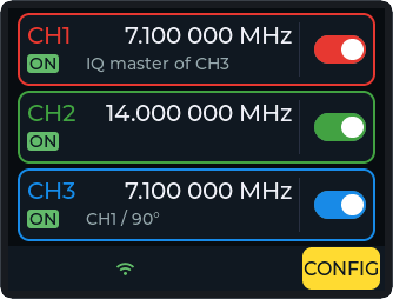

```text
+--------------------------------------------+
| CH1              10.000 000 MHz |  [==o]   |
| ON   SSC -0.5% | Low noise      |          |
+--------------------------------------------+
| CH2              14.000 000 MHz |  [o==]   |
| OFF                             |          |
+--------------------------------------------+
| CH3              10.000 000 MHz |  [==o]   |
| WAIT CH1 / 90° / master off     |          |
+--------------------------------------------+
| WiFi  REMOTE USB               [ CONFIG ]  |
+--------------------------------------------+
```

### CH1 / CH2

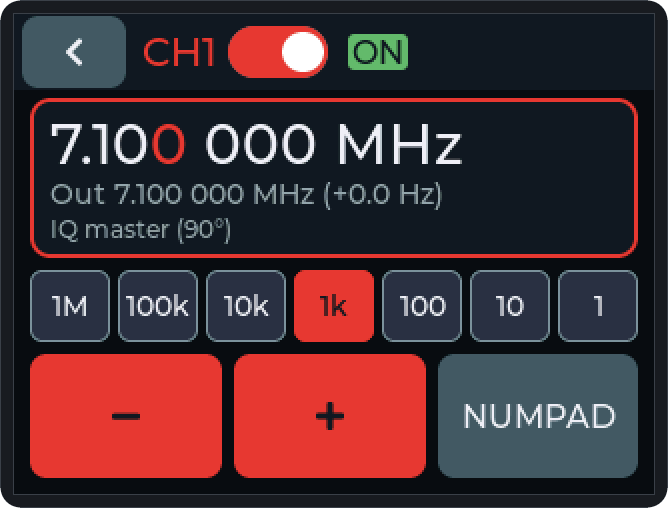

```text
+--------------------------------------------+
| [◀] CH1  [==o]  ON                         |
+--------------------------------------------+
| 10.000 000 MHz                             |
| Out 10.000 000 MHz (+0.3 Hz)               |
| SSC -0.5% | IQ master (90°)                |
+--------------------------------------------+
| [1M][100k][10k][ 1k ][100][ 10][  1]       |
| [   −   ]  [   +   ]  [  NUMPAD  ]         |
+--------------------------------------------+
```

### CH2 coupled

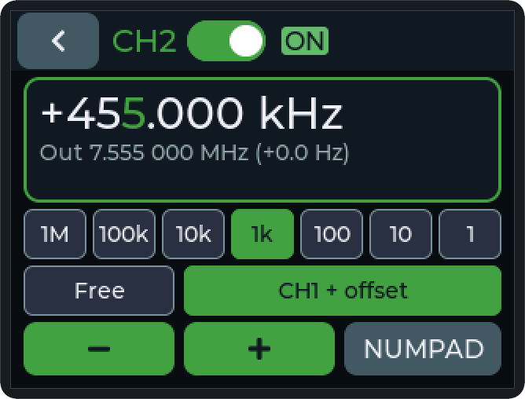

```text
+--------------------------------------------+
| [◀] CH2  [==o]  ON                         |
+--------------------------------------------+
| +455.000 kHz                               |
| Out 7.555 000 MHz (+0.3 Hz)                |
|                                            |
+--------------------------------------------+
| [1M][100k][10k][ 1k ][100][ 10][  1]       |
| [  Free  ]  [      CH1 + offset       ]    |
| [   −   ]  [   +   ]  [  NUMPAD  ]         |
+--------------------------------------------+
```

### CH3 IQ

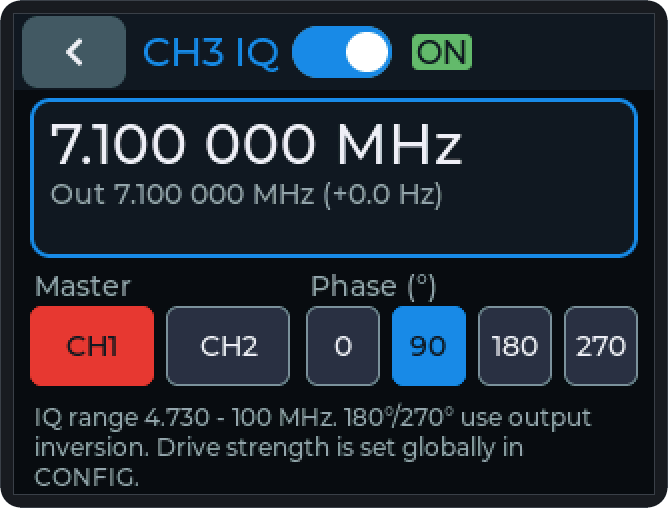

```text
+--------------------------------------------+
| [◀] CH3 IQ  [==o]  ON                      |
+--------------------------------------------+
| 10.000 000 MHz                             |
| Out 10.000 000 MHz (+0.3 Hz)               |
+--------------------------------------------+
| Master            Phase (°)                |
| [CH1] [CH2]       [0] [90] [180] [270]     |
| IQ range 4.730 - 100 MHz. 180°/270° use    |
| output inversion. ...                      |
+--------------------------------------------+
```

### CONFIG

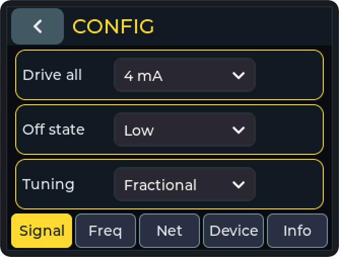 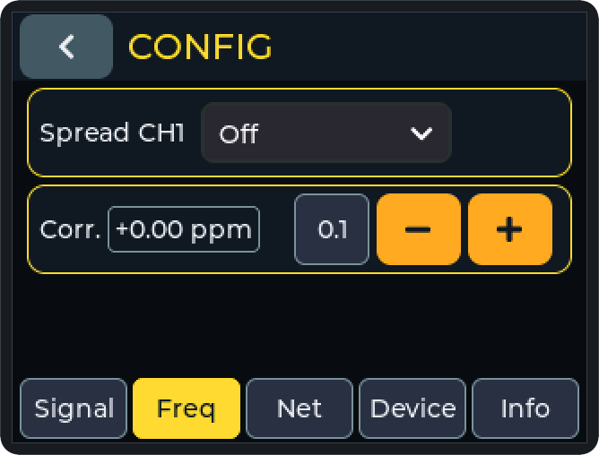 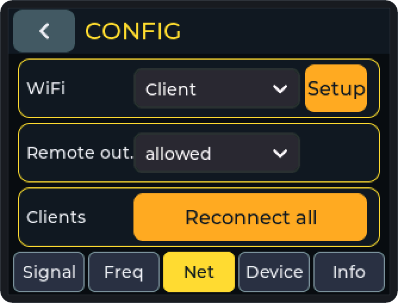 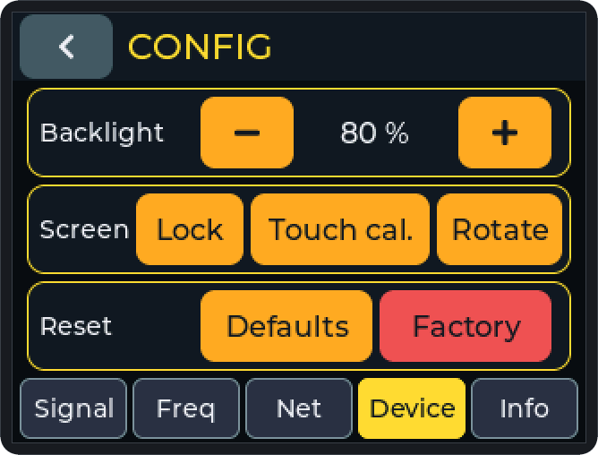 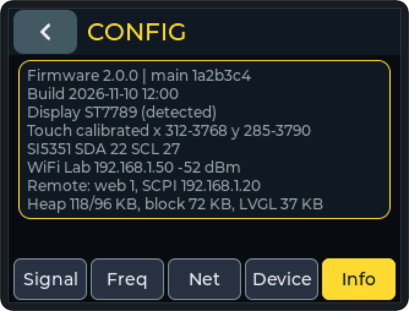

```text
+--------------------------------------------+
| [◀] CONFIG                                 |
+--------------------------------------------+
| Drive all   [ 4 mA        v]               |
| Off state   [ Low         v]               |
| Tuning      [ Fractional  v]               |
+--------------------------------------------+
|[Signal]| Freq |  Net  | Device |  Info    |
+--------------------------------------------+
```

### NUMPAD

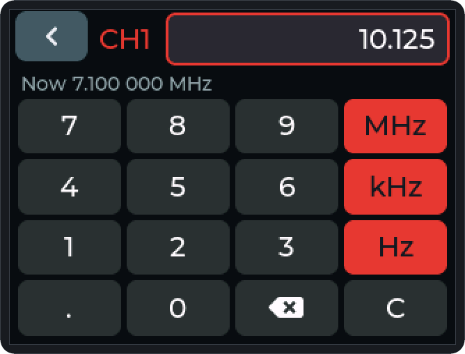

```text
+--------------------------------------------+
| [<]  CH1  [                     10.7 ]     |
| Now 10.000 000 MHz         8 kHz - 160 MHz |
| [ 7 ][ 8 ][ 9 ][ MHz ]                     |
| [ 4 ][ 5 ][ 6 ][ kHz ]                     |
| [ 1 ][ 2 ][ 3 ][ Hz  ]                     |
| [ . ][ 0 ][ ⌫ ][  C  ]                     |
+--------------------------------------------+
```

### WIFI

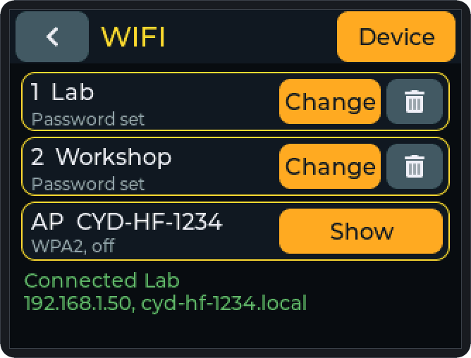 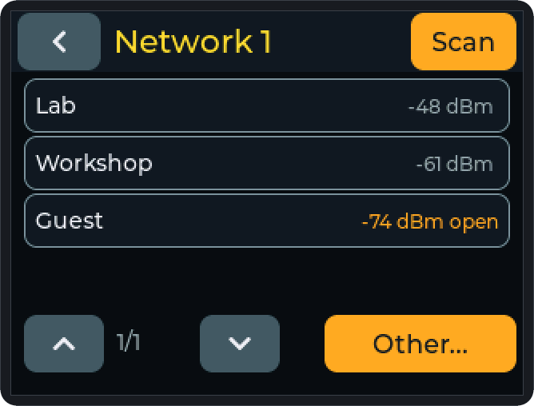

### Device

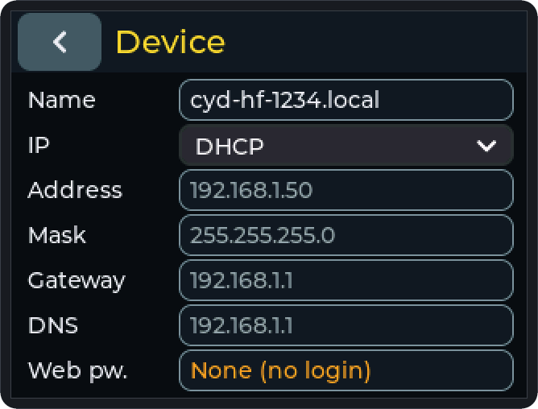

### Access Point

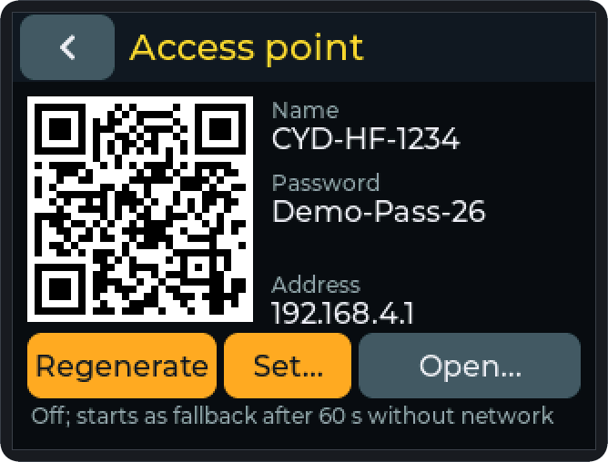

### Dialog `Network change`

Network change from the browser without a web password (section 16):

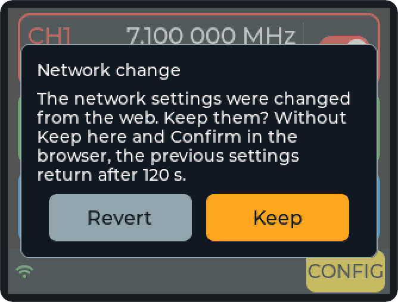

### Web Interface

Rendered with `tools/web_mock.py` in the same state (section 16): desktop at 1280 px, the WiFi area and a phone with the output bar at the bottom.

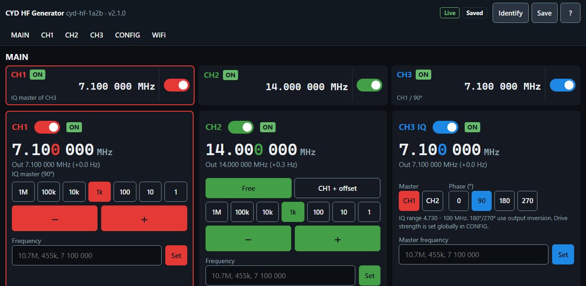

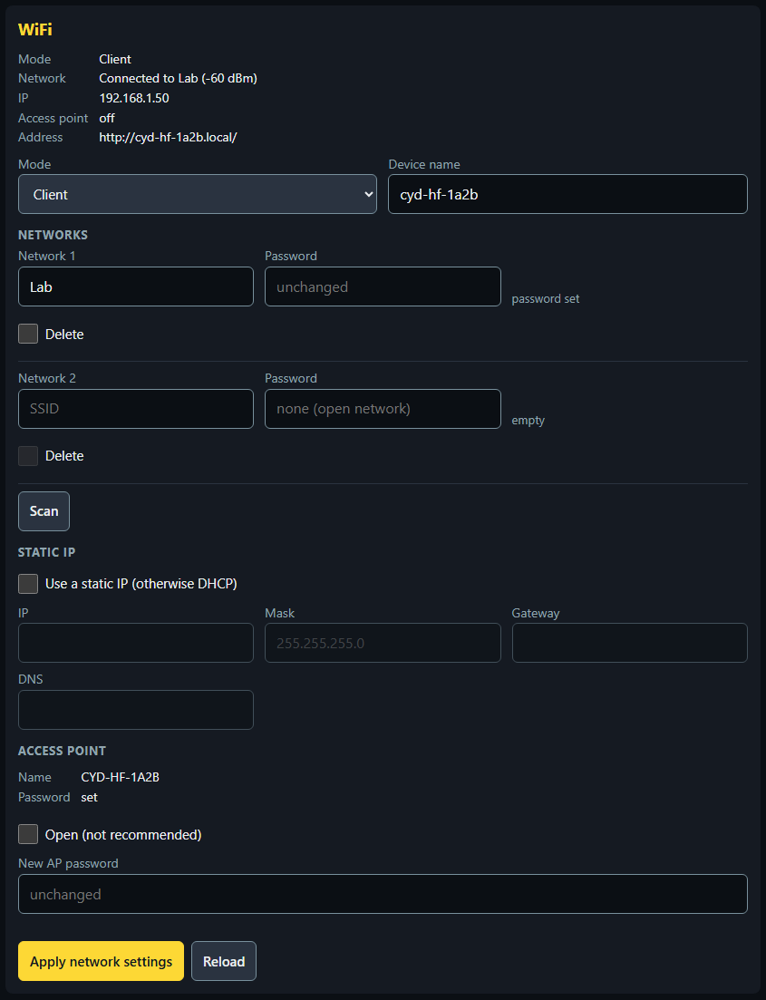 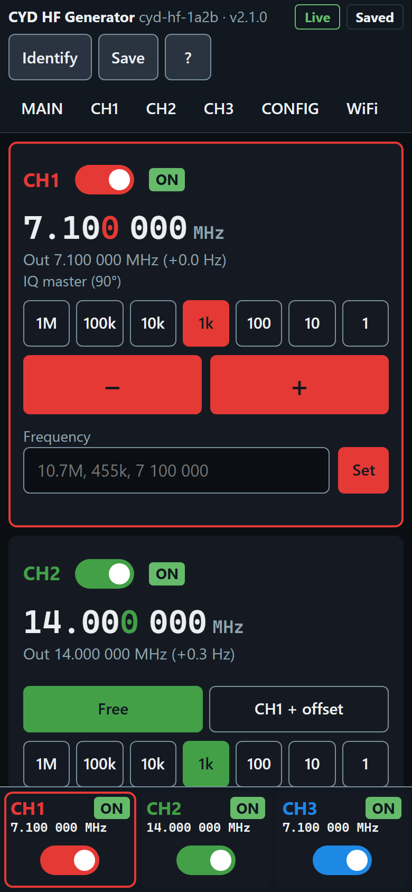

---

## Appendix B: Glossary

| Display | Meaning | Section |
|---|---|---|
| `ON` (green field) | output running | 2 |
| `OFF` (gray text) | output off | 2 |
| `WAIT` (orange field) | CH3 switched on, waiting for the master or the IQ range; a coupled CH2 waits until CH1 + offset is in the range | 2, 4, 7 |
| `! ERR` (red field) | setup failed, retried every 2 s | 11 |
| `! NO HW` (red field) | SI5351 not found or connection lost | 11 |
| `~` before the frequency | actual frequency deviates by 1 Hz or more (`Integer`) | 2, 8 |
| `Out …` | frequency actually generated and deviation in Hz | 5 |
| `Out … mean, SSC …` | mean frequency with spread spectrum | 5 |
| `Off \| Out …` | channel off; this is how it runs after switching on | 5 |
| `IQ master (90°)` | CH3 follows this channel with the phase shown | 2, 5 |
| `CH1 / 90° / master off` | CH3: master, phase and reason for waiting | 2, 7 |
| `CH1 +455 kHz`, `+455.000 kHz` | CH2 coupled to CH1: offset (MAIN or CH2 page) | 2, 4 |
| `Waiting: CH1 + offset below 8 kHz` | coupled CH2: CH1 + offset outside 8 kHz – 160 MHz | 4 |
| mode line | settings that differ from the factory state | 2 |
| `OFF=High` / `OFF=High-Z` | switched-off outputs carry HIGH (DC voltage) or are high impedance | 8 |
| `SSC -0.5 %` etc. | spread spectrum: the frequency is spread on purpose | 8 |
| `Fractional` / `Low noise` / `Integer` | divider scheme of the SI5351 (`Tuning`) | 8 |
| `2mA` … `8mA` | output current (`Drive all`) | 8 |
| `Corr.`, ppm | frequency correction of the crystal in parts per million | 8 |
| `LOCKED` (orange field) | screen locked; hold 2 s to unlock | 8 |
| `Save failed` / `Not saved` | saving failed or not possible | 8, 9 |
| `Now …` | NUMPAD: current frequency | 6 |
| `8 kHz - 160 MHz`, `Enter a number`, `Max. 10 characters` | NUMPAD: reason for a rejected input | 6 |
| `-50.00 to +50.00 ppm` | correction NUMPAD: value out of range | 8 |
| `-160 to +160 MHz` | offset NUMPAD: value out of range | 4, 6 |
| `>100MHz: low level` / `<1MHz: harmonics` | channel page: hint outside 1–100 MHz | 1, 5 |
| `Touch calibrated …` / `Touch not calibrated (default)` | info card: touch calibration | 8 |
| `detected` / `default` / `build flag` | info card: source of the display controller | 8, 13 |
| `(swapped)` / `(clone?)` | info card: SDA/SCL swapped or unusual SI5351 register | 8, 11 |
| `PLL locked: A ok  B ok` / `LOL` | info card: PLL locked or not locked (orange) | 8 |

---

## Appendix C: Symptoms and Remedies

| Symptom | Likely cause | Remedy | Section |
|---|---|---|---|
| Frequency off by a few kHz, `Out` orange, `~` on MAIN | `Tuning` = `Integer` (raster) | choose `Fractional` or `Low noise` | 8 |
| Spectrum wide, carrier "smeared" | spread spectrum (`SSC` in the mode line) | `Spread CH1` = `Off` | 8 |
| DC voltage on a switched-off output | `Off state` = `High` | `Low` or `High-Z` | 8 |
| Level too low or too high | `Drive all`; above 100 MHz the level drops | choose 8 mA or 2 mA | 1, 8 |
| Strong harmonics below 1 MHz | square wave with steep edges | low-pass filter at the output | 1 |
| Frequency counter shows a few Hz deviation at all frequencies | crystal tolerance | adjust `Corr.` | 8 |
| CH3 stays at `WAIT` | master off or master frequency outside the IQ range | switch the master on, frequency ≥ 4.730 MHz | 7, 11 |
| CH2 stays at `WAIT`, a CH2 frequency from outside is refused (−221) | CH2 coupled to CH1 (`CH1 + offset`) | change CH1 or the offset, or choose `Free` | 4, 11 |
| `! NO HW` on all cards | cable, 3.3 V or GND at CN1 | check the connection; SDA/SCL may be swapped | 11 |
| Taps land next to the button, edge hard to hit | touch calibration missing or off | CONFIG `Device` → `Touch cal.` | 8 |
| Display shows only noise | controller not detected | build the firmware with `DISPLAY_FORCE_PANEL` | 13 |
| Settings lost after power-off | `Save failed` / `Not saved` | restart the device; if it stays, the flash memory is defective | 9, 11 |
| Outputs off after power-up | by design | switch the outputs on | 2 |
| Short dropout while tuning | `Low noise`, `Integer` or IQ operation | intended; `Fractional` tunes without dropouts | 5 |
| Sideband swapped in the mixer | phase 90° instead of 270° (or the other way round) | check the phase on the CH3 page | 7 |
