# User Manual – CYD HF Generator

Firmware version: 1.3.3

This manual is a translation of [USER_MANUAL_DE.md](USER_MANUAL_DE.md) (firmware 1.3.3); the German manual is the reference for the firmware's behavior.

## Contents

- [Quick Start](#quick-start)
- [1. Overview](#1-overview)
- [2. Basic Operation](#2-basic-operation)
- [3. Frequency Display](#3-frequency-display)
- [4. Using CH1 and CH2](#4-using-ch1-and-ch2)
- [5. Changing the Frequency with + and −](#5-changing-the-frequency-with--and-)
- [6. Entering the Frequency with the NUMPAD](#6-entering-the-frequency-with-the-numpad)
- [7. Using CH3 as IQ Follower](#7-using-ch3-as-iq-follower)
- [8. CONFIG Page](#8-config-page)
- [9. Saving Settings](#9-saving-settings)
- [10. Usage Examples](#10-usage-examples)
- [11. Errors and Notes](#11-errors-and-notes)
- [12. Serial Diagnostics](#12-serial-diagnostics)
- [13. Current Hardware Pinout](#13-current-hardware-pinout)
- [14. Safety Note](#14-safety-note)
- [15. Remote Control over USB and Network (SCPI)](#15-remote-control-over-usb-and-network-scpi)
- [16. Web Interface](#16-web-interface)
- [Appendix A: Page Images](#appendix-a-page-images)
- [Appendix B: Glossary](#appendix-b-glossary)
- [Appendix C: Symptoms and Remedies](#appendix-c-symptoms-and-remedies)

## Quick Start

For the lab bench; details in the sections named, images of the pages in Appendix A.

1. **Connect:** SI5351 module to CN1 (3.3 V, GND, GPIO22, GPIO27; SDA and SCL in either order), supply via USB. CH1 = CLK0, CH2 = CLK1, CH3 = CLK2 (section 13).
2. **Switch on:** All outputs are off. At the very first start the touch calibration appears: hold four crosses and a check cross one after another until they turn green (section 8).
3. **Set the frequency:** tap the `CH1` card, choose a step button (`1M` … `1`), then `−` / `+`; or `NUMPAD`, enter the number, confirm with `MHz`, `kHz` or `Hz` (sections 5 and 6).
4. **Switch the output on:** switch on the card or in the title bar. Next to it is what the output does: `ON` in a green field = running.
5. **IQ signal:** `CH3` card, master `CH1` or `CH2`, phase `0` / `90` / `180` / `270`, switch on. Below 4.730 MHz master frequency CH3 waits (`WAIT`) and starts by itself (section 7).
6. **Before measuring:** if a mode line appears below a frequency (e.g. `OFF=High`, `SSC -0.5%`, `Integer`), CONFIG differs from the factory settings (section 2).
7. **On errors:** `! NO HW` = SI5351 not connected; `! ERR` = setup failed, the firmware retries every 2 s (section 11, Appendix C).

Factory settings in CONFIG: `Drive all` 4 mA, `Off state` Low, `Tuning` Fractional, `Spread CH1` Off, `Corr.` 0 ppm, `Backlight` 80 %; frequencies 10 MHz (CH1) and 14 MHz (CH2), step 1 kHz. For the next group: CONFIG `Reset` → `Defaults` (the calibration stays); against accidental changes: CONFIG `Screen` → `Lock`.

---

## 1. Overview

The **CYD HF Generator** is a 3-channel HF square-wave generator based on an ESP32-2432S028R display and an SI5351 clock generator.

The device generates square waves with a 50 % duty cycle in the range:

```text
8 kHz to 160 MHz (CH1, CH2)
4.730 MHz to 100 MHz (CH3 in IQ operation)
```

Above 100 MHz the output level drops; below 1 MHz the square wave carries strong harmonics (use a low-pass filter). The channel page then shows a hint (section 5).

The three outputs are:

| Output | Function |
|---|---|
| CH1 / CLK0 | Freely adjustable frequency |
| CH2 / CLK1 | Freely adjustable frequency |
| CH3 / CLK2 | IQ follower of CH1 or CH2 |

CH3 always follows the frequency of its master and can be operated with a phase of 0°, 90°, 180° or 270°. IQ operation is possible from **4.730 MHz to 100 MHz**; all four phases are available in this range.

The CONFIG page also lets you select the SI5351 divider scheme (`Tuning`), spread spectrum for CH1 and the state of switched-off outputs (section 8).

### Licenses

The firmware, the web interface and the web flasher page are free software under the GNU General Public License version 3 or (at your option) any later version (GPL-3.0-or-later), Copyright (C) 2026 DM8SB. They are provided **without any warranty**, without even the implied warranty of merchantability or fitness for a particular purpose; you use them at your own risk. The CYD HF Generator is a private, non-commercial hobby project.

The firmware contains third-party components under their own licenses (among them Arduino-ESP32 with ESP-IDF, TFT_eSPI, LVGL, ArduinoJson, AsyncTCP and ESPAsyncWebServer). All components with license and copyright holders are listed in `THIRD_PARTY_NOTICES.md`; every release contains the license texts (`cyd-hf-generator-<version>-licenses.tar.gz`) and the source of the LGPL libraries (`cyd-hf-generator-<version>-lgpl-sources.tar.gz`). The complete source is on GitHub: https://github.com/dm8sb/CYD-HF-Generator. The license line is in the footer of the web interface (section 16), not on the display.

---

## 2. Basic Operation

After power-up, the display stays dark until the first screen has been drawn; then the main page appears. At the very first start (no touch calibration stored yet) the touch calibration comes first (section 8, `Touch`). **All outputs are off after power-up**, even if they were on when the device was switched off. Frequencies, CH3 master and phase, and all CONFIG settings are retained.

The main page shows one card per channel with:

- channel name and status
- the frequency you set (requested frequency)
- its own ON/OFF switch
- an extra line: on CH1/CH2 the mode line (see below) and `IQ master of CH3` when CH3 is switched on and follows this channel (shortened to `| IQ master` after a mode line); on CH3 the master and phase, e.g. `CH1 / 90°`, and with `WAIT` and `! ERR` also the reason (e.g. `CH1 / 90° / master off`)

In mode `Tuning` = `Integer`, the frequency is preceded by a `~` when the actual frequency deviates from the requested frequency by 1 Hz or more (section 8). From 100 MHz on the `~` no longer fits the card and is left out; the mode line shows `Integer` then.

### Mode Line

CONFIG settings that change the signal of a channel compared to the factory settings appear as a mode line on the main page (cards CH1 and CH2) and on the channel pages (CH1 to CH3, in the card below the `Out` line). With the factory settings it is empty. The entries appear in this order, separated by ` | `:

| Entry | Appears with |
|---|---|
| `OFF=High` / `OFF=High-Z` | `Off state` ≠ `Low` |
| `SSC -0.5%`, `SSC -1.5%`, `SSC +/-0.5%` | `Spread CH1` ≠ `Off`, only on CH1 and on CH3 with master CH1 |
| `Low noise` / `Integer` | `Tuning` ≠ `Fractional` |
| `2mA`, `6mA`, `8mA` | `Drive all` ≠ `4 mA` |

Example: `SSC -0.5% | Low noise | 8mA` on CH1, `Low noise | 8mA` on CH2. With `OFF=High` the line is orange, because a switched-off output then carries DC; otherwise gray. If the line is too long on the main page, it ends with `...`; the channel page shows it completely.

Operation on the main page:

- **Tapping a card** opens the channel's page.
- **The switch on a card** (on the right, separated by a line) turns the output on or off directly, without leaving the page. A tap on the frequency or `MHz` only opens the channel page.
- The frequencies are right-aligned; decimal point and `MHz` of all cards line up.
- The status bar at the bottom shows the save state on the left (section 8, `Saved`, `Saving...`, red `Save failed` / `Not saved`) and has the `CONFIG` button (yellow) on the right. The channels open via their cards. With the screen locked it also shows `LOCKED` in an orange field (section 8).
- Right of the save state is the WiFi state (section 8, `WiFi`): the WiFi symbol green (connected) or gray (searching), `AP` green while the own access point runs, `AP open` orange when it runs without a password; nothing with `Off`.
- After a remote command `REMOTE USB` (later `REMOTE SCPI`, `REMOTE WEB`) shows for 10 s in a blue field (the CH3 color); `LOCKED` takes precedence.
- Colored buttons and selected chips have dark text, switched-off switches a light gray track, unselected chips a gray border.
- Buttons at the screen edge (e.g. `MAIN` top right, `CONFIG` bottom right, the outer NUMPAD keys) react up to the edge, also to a tap just beside them towards the edge. The gap between two buttons stays free.

Status display below the channel name (the same in the title bar of the channel pages). Every state except `OFF` appears as a colored field with dark text; errors start with `!`. Active and faulty outputs can thus be recognized without telling colors apart and from a distance.

| Status | Meaning |
|---|---|
| `ON` (green field) | Output active |
| `OFF` (gray text, no field) | Output off |
| `! ERR` (red field) | Setting up the output failed although the SI5351 responds; the firmware retries every 2 s. The switch keeps showing the desired setting |
| `WAIT` (orange field) | CH3 is switched on but cannot run at the moment (master off or master frequency outside the IQ range: below 4.730 MHz, slightly narrower with `Spread CH1` on master CH1, section 8) |
| `! NO HW` (red field) | SI5351 not found or connection lost; the firmware reconnects automatically |

The channel colors: CH1 red, CH2 green, CH3 blue, CONFIG yellow.

The channel pages and CONFIG have a title bar with the `MAIN` button on the right to return to the main page. On the channel pages, it also contains the ON/OFF switch and next to it the actual state as on the main page: `ON`, `OFF`, `WAIT` (CH3 only), `! ERR` or `! NO HW`. The switch shows what is set, the text what the output is doing; for CH3 the switch can therefore be ON while the text shows `WAIT`. The NUMPAD has the `◀` button instead (section 6).

On the channel pages, the RGB LED also shows the channel color:

| Page | RGB LED |
|---|---|
| CH1 | Red |
| CH2 | Green |
| CH3 | Blue |
| MAIN, CONFIG, NUMPAD | off |

---

## 3. Frequency Display

The frequency is shown in MHz with grouped decimal places.

Examples:

```text
455.000 kHz
1.000 000 MHz
5.000 000 MHz
10.700 000 MHz
150.000 000 MHz
```

Below 1 MHz the device shows the frequency in kHz with three decimals (Hz resolution).

This corresponds to:

| Display | Frequency |
|---|---:|
| 1.000 000 MHz | 1 MHz |
| 5.000 000 MHz | 5 MHz |
| 10.700 000 MHz | 10.7 MHz |
| 100.000 000 MHz | 100 MHz |
| 455.000 kHz | 455 kHz |

What is displayed and saved is the **requested frequency you set**, with 1 Hz resolution. The SI5351 cannot generate every frequency exactly; the actual frequency is shown in the `Out` line of the channel page (section 5).

---

## 4. Using CH1 and CH2

CH1 and CH2 are freely adjustable frequency outputs.

### Turning CH1 or CH2 ON

1. On the main page, tap the `CH1` or `CH2` card.
2. Turn on the ON/OFF switch in the title bar.
3. The display changes to `ON`.
4. A signal is present at the corresponding SI5351 output:

| Channel | SI5351 output |
|---|---|
| CH1 | CLK0 |
| CH2 | CLK1 |

Alternatively, the channel can be switched on directly with the switch on its card on the main page.

### Turning CH1 or CH2 OFF

1. Open the channel page (or use the switch on the main page).
2. Turn off the ON/OFF switch.
3. The display changes to `OFF`.
4. The output is switched off and takes the state selected under `Off state` (default `Low`, section 8).

---

## 5. Changing the Frequency with + and −

The CH1 and CH2 channel pages contain:

- the frequency card with the `Out` line
- a row of step buttons: `1M`, `100k`, `10k`, `1k`, `100`, `10`, `1` (in Hz), like the digits of the frequency above: large steps on the left, small ones on the right
- large `−` (left) and `+` (right) buttons
- the `NUMPAD` button

The `−` and `+` buttons change the frequency by the currently selected step. The selected step is highlighted in color and is chosen on the channel page. It applies to CH1 and CH2 together and stays stored: switching from CH1 to CH2 keeps the step.

**Tapping a digit directly:** Tapping a digit of the frequency display selects that digit position as the step (e.g. the third decimal place = 1 kHz). The digit changed by `−`/`+` is highlighted in the channel color. Digits above 1 MHz (10 MHz, 100 MHz) select the largest step, 1 MHz. Tapping the unit `MHz` opens the NUMPAD. Tapping is a shortcut to the step buttons: the digits are only 2–3 mm wide, and a tap on the point or a gap selects the nearer neighboring digit.

**Press and hold:** After about 0.6 s, the step repeats automatically until the button is released: at first about 3 steps per second, after holding for 3 s about 10 per second, after 6 s about 20 per second (2 steps per repeat). Short pressure dropouts (up to 70 ms) do not end the hold. This also applies to `−`/`+` of `Corr.`.

Whether a frequency change briefly interrupts the output depends on `Tuning` (section 8):

- `Fractional` (default): no interruption. Only in rare cases does the PLL have to be switched; this causes a short dropout. From 112.5 MHz on every step changes the PLL: a short dropout on every step.
- `Low noise`: short dropout when the divider changes.
- `Integer`: short dropout when the PLL changes.
- In IQ operation, the master and CH3 drop out briefly on every frequency change (section 7).

### Actual Frequency (`Out`)

Below the frequency, the `Out` line shows the frequency that the SI5351 actually generates with the programmed dividers, and in parentheses the deviation from the requested frequency:

```text
Out 10.000 000 MHz (+0.3 Hz)
```

- The values assume that the frequency correction (section 8) is right.
- From a deviation of 1 Hz upward, the line is shown in orange.
- Deviation per mode up to 100 MHz: `Fractional` ≤ 0.5 Hz, `Low noise` up to 1.5 Hz; above up to 1.5 Hz (to 112.5 MHz), 2 Hz (to 150 MHz) and 3 Hz (to 160 MHz). In `Integer` mode, the frequency lies on a grid and can deviate by a few kHz, e.g. at 7.1 MHz:

```text
Out 7.102 273 MHz (+2272.7 Hz)
```

- With spread spectrum on CH1, the line shows the mean frequency and the setting:

```text
Out 9.975 000 MHz mean, SSC -0.5 %
```

- Outside 1–100 MHz the mode line shows a hint: `>100MHz: low level` or `<1MHz: harmonics`.
- With the channel switched off, the line starts with `Off | `, e.g. `Off | Out 10.000 000 MHz (+0.3 Hz)`: this is how the output would run after switching on.
- If CH3 follows this channel, the mode line below shows `IQ master (90°)` with the phase of CH3; frequency changes then move both outputs.

In case of errors, the following is shown in red instead of the frequency:

| Display | Meaning |
|---|---|
| `SI5351 not found` | SI5351 missing or connection lost (status `! NO HW`) |
| `Output error, retrying` | Setting failed; the firmware retries every 2 s (status `! ERR`) |

Example:

```text
Current frequency: 10.000 000 MHz
Step: 1k
Press +
New frequency: 10.001 000 MHz
```

Another example:

```text
Current frequency: 7.100 000 MHz
Step: 10k
Press −
New frequency: 7.090 000 MHz
```

The frequency always stays within the range 8 kHz to 160 MHz.

---

## 6. Entering the Frequency with the NUMPAD

On CH1 or CH2:

1. Press `NUMPAD`.
2. Enter digits. Below the input field, the current frequency is shown on the left, e.g. `Now 10.000 000 MHz`.
3. Optionally use a decimal point (only one is allowed).
4. Press a unit:
   - `Hz`
   - `kHz`
   - `MHz`

The unit confirms the entry immediately and returns to the channel page.

The `◀` button at the top left returns to the channel page **without any change**.

### Keypad

```text
 7   8   9   MHz
 4   5   6   kHz
 1   2   3   Hz
 .   0   ⌫   C
```

| Key | Function |
|---|---|
| 0–9 | Digit entry |
| . | Decimal point |
| `⌫` | Delete last character |
| C | Clear input |
| Hz | Apply value as Hz |
| kHz | Apply value as kHz |
| MHz | Apply value as MHz |
| `◀` | Back to the channel page without any change |

A maximum of 10 characters is allowed (e.g. `150.000001`); an eleventh shows `Max. 10 characters`.

### Invalid Input

If the value is outside 8 kHz – 160 MHz, or the input is empty or invalid, it is **not applied**. The input stays, the border turns red and the reason appears in red to the right below the field:

| Display | Meaning |
|---|---|
| `8 kHz - 160 MHz` | value out of range, e.g. `500` `MHz` |
| `Enter a number` | no digit entered (empty or only `.`) |
| `Max. 10 characters` | field full |

Correct the input with `⌫` or clear it with `C`; the next key clears the hint.

### Example 1: Enter 10 MHz

1. Open CH1.
2. Press `NUMPAD`.
3. Enter:

```text
10
```

4. Press `MHz`.
5. CH1 is set to 10 MHz.

Display:

```text
10.000 000 MHz
```

### Example 2: Enter 10.7 MHz

1. Open CH2.
2. Press `NUMPAD`.
3. Enter:

```text
10.7
```

4. Press `MHz`.

Display:

```text
10.700 000 MHz
```

### Example 3: Enter 1 000 kHz

1. Open CH1.
2. Press `NUMPAD`.
3. Enter:

```text
1000
```

4. Press `kHz`.

Display:

```text
1.000 000 MHz
```

### Example 4: Enter 5 000 000 Hz

1. Open CH1.
2. Press `NUMPAD`.
3. Enter:

```text
5000000
```

4. Press `Hz`.

Display:

```text
5.000 000 MHz
```

---

## 7. Using CH3 as IQ Follower

CH3 is not a freely adjustable channel. CH3 follows CH1 or CH2.

On the CH3 page you can set:

- Master: buttons `CH1` or `CH2`
- Phase: buttons `0`, `90`, `180` or `270` (degrees)
- ON/OFF via the switch in the title bar

The selected button is highlighted in color. The CH3 frequency is always identical to the master frequency; the drive strength is set in CONFIG for all channels.

- **Change the master frequency from here:** tapping the frequency opens the master's NUMPAD; after the entry (or `◀`) you return to the CH3 page.
- **Switch the master on:** if CH3 waits for its switched-off master, the status line shows `Master CH1 is off: tap to switch on`; tapping it switches the master on.

### Status Line

Below the frequency, the CH3 page shows the current state:

| Display | Meaning |
|---|---|
| `Off  \|  follows CHx` | CH3 switched off |
| `Out 10.000 000 MHz (+0.3 Hz)` | IQ output running; actual frequency of CLK2 (section 5) |
| `Master CHx is off: tap to switch on` | CH3 switched on, master off; tapping the line switches it on |
| `Waiting: CHx below 4.730 MHz` | CH3 switched on, master frequency too low (higher with spread spectrum on CH1, e.g. `4.749`) |
| `Waiting: CHx above 99.502 MHz` | CH3 switched on, master frequency too high; only with spread `+/-0.5 %` on master CH1 |
| `IQ setup failed, retrying` | Setting up the IQ pair failed (status `! ERR`); CLK2 is off, the master keeps running, the firmware retries every 2 s |
| `SI5351 not found` | SI5351 missing |

**Important:** If CH3 is switched on but cannot run at the moment (master off or below 4.730 MHz), the switch stays ON. Output CLK2 stays off until the conditions are met – then CH3 starts **automatically**. No error message appears.

### Frequency Range and Phases

| Phase | Available |
|---|---|
| 0° | 4.730 – 100 MHz |
| 90° | 4.730 – 100 MHz |
| 180° | 4.730 – 100 MHz |
| 270° | 4.730 – 100 MHz |

180° and 270° are produced by inverting the CH3 output (0° or 90° plus inversion). Below 4.730 MHz, the SI5351 oscillator (VCO) would run below 600 MHz and thus outside its specification.

Accuracy: In `Fractional` and `Low noise` modes, the IQ frequency deviates from the requested frequency by at most ≈ 1.4 Hz. In `Integer` mode, IQ operation also uses an integer PLL; the frequency then lies on the grid (section 8), and the phases work unchanged.

### Tuning in IQ Operation

The master and CH3 share one PLL. Every change of the master frequency or of the frequency correction, and every phase change from 0°/180° to 90°/270° (or vice versa), briefly switches both outputs off, reconfigures them and realigns the phase by resetting the PLL. Switching between 0° and 180° or between 90° and 270°, and changing the drive strength, work without a dropout.

Spread spectrum (`Spread CH1`) also affects CH3 when CH1 is its master; with master CH2, CH3 is not affected.

### Example: CH3 Follows CH1 with 90° Phase

1. Set CH1 to 10 MHz.
2. Switch CH1 on.
3. Go to the CH3 page.
4. Tap master `CH1`.
5. Tap phase `90`.
6. Switch CH3 on.

Result:

```text
CH1 / CLK0 = 10 MHz, 0° reference
CH3 / CLK2 = 10 MHz, shifted by 90°
```

### Example: CH3 Follows CH2 with 180° Phase

1. Set CH2 to 5 MHz.
2. Switch CH2 on.
3. Open CH3.
4. Tap master `CH2`.
5. Tap phase `180`.
6. Switch CH3 on.

Result:

```text
CH2 / CLK1 = 5 MHz
CH3 / CLK2 = 5 MHz, shifted by 180°
```

---

## 8. CONFIG Page

The CONFIG page is where global settings are changed. Every change takes effect immediately and is saved automatically (section 9).

### Layout and Scrolling

The title bar with the save indicator and `MAIN` stays fixed. The area below it is taller than the screen and can be moved vertically with a finger. CONFIG is the only page that scrolls.

| Row | Controls |
|---|---|
| `Drive all` | drop-down list `2 mA` … `8 mA` |
| `Off state` | drop-down list `Low`, `High`, `High-Z` |
| `Tuning` | drop-down list `Fractional`, `Low noise`, `Integer` |
| `Spread CH1` | drop-down list `Off`, `-0.5 %`, `-1.5 %`, `+/-0.5 %` |
| `Corr.` | value in ppm (tap: entry), step button, `−`, `+` |
| `Backlight` | `−`, value, `+` |
| `WiFi` | drop-down `Off`, `Client`, `Access point`; button `Setup` (WIFI page) |
| `Remote out.` | drop-down `allowed`, `local only` |
| `Touch` | `Calibrate` button (touch calibration) |
| `Screen` | `Lock` button (screen lock) |
| `Reset` | `Defaults` and `Factory` (red) buttons |
| Info card | Firmware, Build, Display, Touch, SI5351, WiFi, memory |

- The settings that change the signal come first. The frequency step is set with the step buttons of the channel pages (section 5).
- When the page opens, three rows and the upper half of the fourth are visible. The wide scroll bar on the right is always visible and shows that the list continues.
- The page snaps to the rows.
- Scrolling only starts after about 10 px of finger movement; a short tap remains a tap. If a swipe starts on a button, the button does not trigger, and neither does the repeat function of `Corr.`.
- Drop-down lists open upward when there is no room below.
- The scroll position is kept when you go to the main page via `MAIN` and back to CONFIG (until power-off).

### Save Indicator

The save state is shown in the title bar between `CONFIG` and `MAIN`, at every scroll position; the status bar of the main page shows it as well:

| Display | Meaning |
|---|---|
| `Saving...` | Change not yet saved (autosave after 5 s) |
| `Saved` | Everything saved |
| `Save failed` (red) | Saving to flash failed; a dialog also appears; the firmware tries again every 30 s |
| `Not saved` (red) | Flash storage (NVS) not available at startup; changes are lost at power-off |

### Drive all

The drive strength applies globally to all channels (CH1, CH2 and CH3); CH3 has no setting of its own.

Options:

```text
2 mA
4 mA
6 mA
8 mA
```

### Off state (State of Switched-Off Outputs)

Determines the level that a switched-off output carries (SI5351 register 24). The setting applies to CLK0, CLK1 and CLK2.

| Option | Output in the OFF state |
|---|---|
| `Low` (default) | LOW (0 V), as up to firmware 1.2.0 |
| `High` | HIGH (supply voltage of the outputs, usually 3.3 V) |
| `High-Z` | high impedance |

- `High` needs a confirmation: the dialog `Off state High` explains the DC voltage on a switched-off output. `High` (orange) applies the setting, `Cancel` keeps the previous one. `Low` and `High-Z` apply without a question.
- The change takes effect immediately; running outputs are not affected.
- If the setting differs from `Low`, the main page and the channel pages show `OFF=High` or `OFF=High-Z` in the mode line (section 2).
- The firmware writes the state when connecting to the SI5351, before any output can be switched on.
- **`High`:** A continuous current flows into a DC-coupled load (e.g. 50 Ω), limited by the drive strength; a DC-coupled mixer sees a DC voltage.
- For DC-coupled diode ring mixers, use `Low` or `High-Z`.
- Until hardware check K2 (`MESSPLAN.md`), with `High` and `High-Z` the output driver of switched-off outputs stays powered, including that of CLK2 when CH3 is off. With `Low`, CLK2 is powered down completely as before, as long as CH3 is not running in IQ operation.

### Tuning (Divider Scheme)

The SI5351 generates every frequency in two stages: a PLL multiplies the 25 MHz crystal up to 600–900 MHz (VCO), and a divider (MultiSynth) divides this down to the output frequency. Both stages can work as integer or fractional (with a fractional part). Fractional dividers allow fine steps but produce spurs close to the carrier. `Tuning` determines which stage works fractionally; the setting applies to all channels.

| Option | PLL | Divider (MultiSynth) | Properties |
|---|---|---|---|
| `Fractional` (default) | fixed 900 or 887.5 MHz | fractional | finest steps, tuning without dropouts, deviation ≤ 0.5 Hz; spurs from the fractional divider possible |
| `Low noise` | fractional | even, integer | fewer spurs; short dropout when the divider changes; deviation up to 1.5 Hz |
| `Integer` | integer | even, integer | lowest spurs; frequency on a grid, deviation up to the kHz range |

Changing the mode reconfigures all outputs; running outputs drop out briefly once.

**Fractional:** Behavior as in firmware 1.2.0. The PLL stays fixed; only the divider changes. If 900 MHz cannot hit a frequency accurately enough, the PLL switches to 887.5 MHz; only then does the output drop out briefly.

**Low noise:** The divider is an even integer; the PLL handles fine tuning and frequency correction (the method used in the VFOs from QRP Labs and Etherkit). While tuning, the divider is kept as long as the PLL stays within 600–900 MHz; then only the PLL changes, without a dropout. Only when the divider has to change does the output drop out briefly. Example: divider 90 covers 6.67–10 MHz.

**Integer:** PLL and divider are both integers. The frequency can therefore only take grid values:

```text
Output = crystal × a / divider    (a = 24 … 36, divider even)
```

The firmware selects the grid point closest to the requested frequency. Example: a requested 7.1 MHz gives 25 MHz × 25 / 88 = 7.102 273 MHz.

- The frequency correction cannot be applied within the grid; it only shifts the displayed actual frequency.
- `+`/`−` change the requested frequency. The actual frequency only changes when a different grid point is closer; the `Out` line shows this.
- The main page shows the requested frequency preceded by `~` when the deviation is 1 Hz or more.
- Spread spectrum is locked.

This mode is intended for educational experiments comparing integer and fractional dividers, not for accurate frequencies.

### Spread CH1 (Spread Spectrum)

Spread spectrum (SSC) modulates the frequency of PLL A at about 31.5 kHz and spreads the carrier power over a frequency band. The SI5351 can only do this on PLL A. It therefore affects CH1, and CH3 when CH1 is its master; CH2 (PLL B) is not affected.

| Option | Effect |
|---|---|
| `Off` | off (default) |
| `-0.5 %` | Down spread: the frequency varies between the requested frequency and 0.5 % below it |
| `-1.5 %` | Down spread: between the requested frequency and 1.5 % below it |
| `+/-0.5 %` | Center spread: ±0.5 % around the requested frequency |

Example: CH1 = 10 MHz with `-0.5 %` occupies the band 9.95–10.00 MHz; the channel page shows the mean frequency `Out 9.975 000 MHz mean, SSC -0.5 %`.

- Switching resets PLL A: CH1 drops out briefly. If CH3 is running in IQ operation with master CH1, its phase is realigned afterwards.
- In `Integer` mode, the option is locked and shows a grayed-out `Off (Integer)`. Switching to `Integer` turns spread spectrum off; after switching back, it has to be selected again.
- With spread, too, the SI5351 oscillator (VCO) must stay within 600–900 MHz. With master CH1 the IQ range of CH3 therefore becomes slightly narrower: `-0.5 %` from 4.749 MHz, `-1.5 %` from 4.797 MHz, `+/-0.5 %` from 4.749 to 99.502 MHz. Outside it, CH3 waits (`WAIT`) as below 4.730 MHz. The CH3 page shows the valid range.
- For mixer and receiver experiments with a clean carrier, leave it `Off`.

### Frequency Correction (`Corr.`)

The correction compensates for the tolerance of the SI5351 crystal. It is shown in **ppm**, e.g. `+9.70 ppm`.

| Element | Function |
|---|---|
| Step button (`0.01` / `0.1` / `1`) | Step size in ppm; each tap switches to the next one |
| `−` / `+` | Change the correction by the step size; holding repeats |
| Value (framed) | opens the NUMPAD for the correction: digits, `.`, `+/-` (sign), `ppm` applies, `◀` back without a change |

Range: ±50 ppm. A positive value means that without correction, the output was too high. The NUMPAD shows `Now +9.70 ppm` at the top; a value outside shows `-50.00 to +50.00 ppm`, the entry is rounded to 0.01 ppm.

The outputs are reconfigured after each change; the SI5351 is not re-initialized. In `Integer` mode, the correction cannot be applied to the output; it only shifts the displayed actual frequency (see `Tuning`).

**Calibration:**

1. Set CH1 to 10 MHz and switch it on (`Tuning` = `Fractional` or `Low noise`).
2. Measure with a frequency counter.
3. Divide the deviation in Hz by 10 = correction in ppm.
4. Add this value to the current correction and enter it: tap the value, type the number, `ppm`.

Example:

```text
Measured: 10 000 097 Hz  ->  +97 Hz at 10 MHz  ->  set +9.70 ppm
```

### Backlight

`−` and `+` change the display brightness in 10 % steps:

```text
10 % to 100 %
```

The current value is shown between the buttons. Holding a button does not repeat. The 10 % minimum prevents the display from accidentally going completely dark and thus becoming unusable. Values stored by older firmware are rounded to the nearest 10 % step; values below 5 % (e.g. 0 % from firmware 1.0.0) are set to 80 %.

### WiFi

Drop-down `Off` (default), `Client`, `Access point`. The setting is saved and applies at once.

- `Off`: the radio is off (for the cleanest RF).
- `Client`: the device looks for the stored networks and connects to the strongest. If it finds none for 60 s, it additionally opens its own access point (fallback) and keeps searching; as soon as it is connected, the access point goes off.
- `Access point`: the device opens its own network `CYD-HF-<4 digits>` with a password.

Networks, passwords and the access point data are set up on the WIFI page (button `Setup` on the right of the row). The status bar and the info card show the state.

### WIFI Page (Setup)

`<` at the top left returns to CONFIG. Below are the two network slots `1` and `2`:

- Network name and below it `Password set`, orange `Open network (no password)` or `Empty`.
- `Change`: scans the networks around (`Scanning...`, about 3 s) and lists them, strongest first, 4 per page; `<` and `>` turn the pages, `Scan` scans again. On the right are the signal strength and for open networks an orange `open`. Hidden networks do not appear; for them there is `Other...` (enter the name).
- Tap a network: for a network with a password the keyboard opens. Enter the password (8–63 characters), `Show`/`Hide` shows or hides it, the number of characters is on the right below the field. The check mark (✓) saves, the cross cancels. An open network is taken only after a warning (`Use`).
- Trash can: deletes the slot after a confirmation.

The keyboard has letters, digits and special characters, but no umlauts, `ß` and `€`. Network names are shown cleaned (control and invalid characters as `?`). A stored password is never shown again.

A line at the bottom shows what the WiFi does: `WiFi is Off. Choose Client in CONFIG > WiFi.`, `Searching...`, `Connecting...`, green `Connected <network>` with address and `<device name>.local`, red `Wrong password`, `Network not found`, `Connection failed`, `Fallback: AP <name> active`, `Access point <name> active`, `No network stored. Tap Change.`

After saving, the WiFi restarts with the new data. With both slots used the device connects to the stronger network; if that fails (e.g. wrong password) it tries the other one next time.

The third card `AP  CYD-HF-<4 digits>` shows the own access point (`WPA2` or orange `open`, `active` or `off`); `Show` opens its page. `Device` at the top right opens device name and IP settings.

### Access Point (Page)

- On the left a QR code to connect: point the phone camera at it, the phone connects without typing. On the right name, password (in clear, so it can be typed) and the address `192.168.4.1`.
- The password (12 characters without look-alikes such as `0`/`O`, `1`/`l`/`I`) is created at random on the first visit of the page or the first start of the access point, and saved.
- `Regenerate`: new random password; `Set...`: own password (8–63 characters) on the keyboard. A running access point restarts with the new password, connected devices must connect again.
- `Open...`: access point without password, only after a warning. The password then shows orange `none (open)`, the button reads `Secure` and restores WPA2. An open access point goes off after 15 min without a connected device.
- At the bottom the state: `Active, 1 connected`, `Off; starts as fallback after 60 s without network` (mode `Client`), `Off. Choose Access point in CONFIG > WiFi.`
- If the access point is set to open and the device finds no network in `Client` mode, the fallback access point starts only after the question `Open fallback AP` (`Start`).

### Device (Page)

`Device` at the top right of the WIFI page opens the device settings. Every change is saved at once, the WiFi reconnects with the new data.

| Row | Meaning |
|---|---|
| `Name` | Device name under which the device is reachable as `<name>.local` (default `cyd-hf-<4 digits>`). Tapping opens the keyboard; allowed are 1–32 characters `a`–`z`, `0`–`9` and `-`, not at the start or end. Otherwise `a-z 0-9 - (1-32)` appears below the field. |
| `IP` | `DHCP` (address from the router) or `Static` (fixed address) |
| `Address`, `Mask`, `Gateway`, `DNS` | With `DHCP` in gray the stored fixed values, for empty fields the router's lease (`-` without connection). With `Static` in black the stored values; tapping opens a numeric field (`192.168.1.50`). An empty `DNS` means `= gateway`. |
| `Web pw.` | Web password for the web interface (section 16): `Set (login needed)` or orange `None (no login)`, the password itself is never shown. Tapping opens the `Web password` keyboard (8–64 characters, otherwise `8-64 characters`); OK saves it, hashing takes about 1.3 s (`Saving...`) while the device stays usable. With a password set, an empty field and OK removes it after the question `Remove web password`. Every change ends all web sessions; the WiFi does not restart. |

When switching to `Static`, empty fields are filled from the current DHCP lease, so usually only `Address` needs changing. An implausible combination is refused, the message `Static IP` gives the reason and the old value stays (when switching, `DHCP` stays):

| Message | Cause |
|---|---|
| `The mask must be /1 to /30, e.g. 255.255.255.0.` | Mask not contiguous or /0, /31, /32 |
| `Address and gateway must be set.` | Address or gateway missing |
| `The address equals the gateway.` | Address = gateway |
| `The gateway is not in the subnet of the address.` | Gateway in another network |
| `Address or gateway is the network address.` / `... broadcast address.` | Network or broadcast address of the subnet |

A wrong but plausible static address (e.g. already in use) makes the device unreachable on the network; then choose `DHCP` again on the device.

### Remote out. (Switching Outputs Remotely)

Drop-down `allowed` (default) and `local only`. With `local only` remote control (SCPI, later web) may set everything and switch outputs off, but **not on** (section 15). The setting can only be changed here at the device, is saved at once and kept by `Defaults` and `*RST`; `Factory` resets it to `allowed`.

### Touch (Touch Calibration)

The calibration adapts the touch detection to the board: with fixed values, hits were up to 19 px off depending on the board, and the corner at the right edge could not be reached.

It starts automatically as long as no calibration is stored (first start, after erasing the memory), and at any time with `Touch` → `Calibrate`:

1. An orange cross appears near the top left corner, above it `Hold the cross (1/4)`.
2. Tap the center of the cross and hold until the cross turns green (about ½ s, display `Release`), then let go.
3. The same at the top right, bottom right and bottom left.
4. As a check, hold the cross in the middle (`Check: hold the cross`).

- If the check cross is at most 8 px off, the calibration is stored and applies at once; then the main page (first start) or CONFIG appears.
- Otherwise the reason appears in orange below the cross (`Check cross off by … px. Again, please.` or `The corners did not match. Again, please.`) and the calibration starts over.
- Without a touch for 30 s the calibration ends: at the first start with the fixed values (it appears again at the next start), from CONFIG without a change.
- During the calibration, messages (e.g. `SI5351 not found`) wait until it has ended.

### Screen (Screen Lock)

`Lock` locks the operation so that nobody changes anything by accident, e.g. during a measurement or between two groups:

- The device switches to the main page; the status bar shows `LOCKED` in an orange field. The outputs keep running unchanged.
- A tap does nothing; while the finger is down, `Locked: hold 2 s to unlock` appears.
- **Unlock:** hold anywhere for 2 s. The touch that unlocks triggers nothing; only the next tap acts.
- The lock lasts until unlocking or power-off (it is not stored).
- Dialogs also appear on a locked screen; unlock first to close them with `OK`.

### Reset (Defaults, Factory Reset)

| Button | Effect |
|---|---|
| `Defaults` | After confirmation (`Reset`) all factory settings apply (quick start), including the frequencies, CH3 master and phase and the step; all outputs switch off. **Frequency correction and touch calibration stay.** Saved after 5 s like any change. |
| `Factory` (red) | After confirmation (`Erase`) the device erases all stored settings including frequency correction, touch calibration, `Remote outputs` and the WiFi settings (also those of the WiFi driver) and restarts. Then the touch calibration appears as at the first start. |

`Cancel` leaves everything unchanged.

### Info Card

At the end of the page, a card shows information for troubleshooting without a serial monitor, for example:

```text
Firmware 1.3.3 | dev 47d9307
Build 2026-11-05 15:00
Display ST7789 (detected)
Touch calibrated x 161-3778 y 245-3830
SI5351 SDA 22 SCL 27
WiFi Lab 192.168.1.50 -60 dBm
Heap 241/215 KB, block 108 KB, LVGL 30 KB
```

| Line | Content |
|---|---|
| `Firmware` | Version, branch and commit the firmware was built from. `+` after the commit: built with uncommitted changes. Without git, `unknown` is shown |
| `Build` | Date and time of the build |
| `Display` | Display controller (`ILI9341` or `ST7789`) and source: `detected` (detected automatically), `default` (nothing detected, ILI9341 assumed), `build flag` (set at build time) |
| `Touch` | `Touch calibrated x … y …`: stored calibration with the raw values of the screen edges; `Touch not calibrated (default)`: fixed values |
| `SI5351` | I2C pins of the connection; suffix ` (swapped)` for swapped wires, ` (clone?)` for an unusual register 183 (e.g. a clone). Without a connection: `SI5351 not found` |
| `WiFi` | `WiFi off`; connected: network, address, signal strength; `WiFi searching (<device name>)`; access point: `AP` or `Fallback AP`, name, address, number of connected devices (orange without password). Foreign network names are cleaned (control and invalid characters as `?`, at most 32 bytes) |
| `Remote` | `web <n>` open browser pages, `SCPI <address>` or `-` the SCPI TCP client. Below it the button `Reconnect all`: closes all browser connections, ends the web sessions and the SCPI TCP connection. The peers connect again by themselves afterwards (a browser without web password within seconds, an SCPI program at once). It does not lock anybody out; for that set a web password or set `Remote out.` to `local only`. |
| `Heap` | free memory and its minimum since boot, largest contiguous block, free memory of the user interface (LVGL), each in KB |

---

## 9. Saving Settings

Changes are saved automatically.

Sequence:

1. Change a setting.
2. Wait 5 seconds (on CONFIG, the indicator in the title bar changes from `Saving...` to `Saved`).
3. The firmware saves automatically to NVS.
4. The serial monitor shows:

```text
[SETTINGS] Saved to NVS
```

The following are saved:

- CH1 frequency
- CH2 frequency
- CH3 master
- CH3 phase
- Backlight
- Frequency step
- Frequency correction
- Global drive strength
- `Tuning`, `Spread CH1` and `Off state`
- the touch calibration (right after the calibration, not by autosave)

If the three new options are missing from storage (settings from firmware 1.2.0), the defaults `Fractional`, `Off` and `Low` apply, i.e. the behavior of 1.2.0. Invalid stored values are replaced by the default value at startup.

The display controller is not stored but detected at every startup (section 13).

The touch calibration is stored per board; an implausible stored value is not used (the calibration then starts again).

Settings changed over SCPI are saved only after 30 s without a further change, `SYST:SAVE` at once; `*RST` saves nothing (section 15).

The ON/OFF state of the outputs is not saved; all outputs are off after power-up. Switching outputs on or off therefore does not trigger saving, nor does a setting that already has the selected value. This spares the flash memory.

---

## 10. Usage Examples

### Example A: Simple 10 MHz Output on CH1

1. Open the main page.
2. Press `CH1`.
3. Press `NUMPAD`.
4. Enter `10`.
5. Press `MHz`.
6. Set CH1 to `ON`.

Output:

```text
CLK0 = 10 MHz square wave
```

---

### Example B: Two Independent Frequencies

Goal:

```text
CH1 = 10 MHz
CH2 = 14 MHz
```

Procedure:

1. Open CH1.
2. Enter 10 MHz.
3. Switch CH1 on.
4. Return to the main page.
5. Open CH2.
6. Enter 14 MHz.
7. Switch CH2 on.

Outputs:

```text
CLK0 = 10 MHz
CLK1 = 14 MHz
```

---

### Example C: 10 MHz IQ Output with 90°

Goal:

```text
CH1 = 10 MHz
CH3 = 10 MHz with 90° phase shift
```

Procedure:

1. Set CH1 to 10 MHz.
2. Switch CH1 on.
3. Open CH3.
4. Tap master `CH1`.
5. Tap phase `90`.
6. Switch CH3 on.

Outputs:

```text
CLK0 = 10 MHz reference
CLK2 = 10 MHz, shifted by 90°
```

---

### Example D: Changing the Output Power

Goal:

```text
All channels with 8 mA drive strength
```

Procedure:

1. Open CONFIG.
2. Select `8 mA` for `Drive all`.
3. Wait until `Saved` is shown in the title bar.

This setting then applies to all channels.

---

### Example E: Comparing Fractional and Integer Dividers

1. Set CH1 to 7.1 MHz and switch it on; connect a spectrum analyzer to CLK0.
2. In CONFIG, set `Tuning` to `Fractional`, `Low noise` and `Integer` in turn.
3. Compare the spurs. The channel page shows the actual frequency in each case; with `Integer` it shows `Out 7.102 273 MHz (+2272.7 Hz)`.

---

## 11. Errors and Notes

### Error Messages

Errors are shown as a dialog. `OK` (large light gray button at the bottom) closes the dialog. At most one dialog is open at any time; further messages appear one after another, identical messages only once. Connection messages close by themselves after reconnecting; messages about output errors stay open until they are closed with `OK`.

### SI5351 Not Found

If the SI5351 is not found at startup, **one** message appears. After that, the channels on the main page show `! NO HW` and the channel pages show `SI5351 not found`. Settings can still be changed and are saved.

The firmware checks every 2 seconds whether the SI5351 responds. If it is connected later or a loose contact is fixed, the firmware reconnects automatically, restores the set frequencies and ON/OFF states and closes the connection message. If the connection is lost during operation (or the SI5351 briefly loses power), the message `Connection lost` appears and the channels show `! NO HW` until the connection is restored. The firmware tries to reconnect right after detecting the loss; after a short power interruption the outputs therefore run again after about 2 s at the latest.

SDA and SCL may be connected to CN1 in either order (GPIO22/GPIO27). The firmware tries both assignments, also after replugging during operation. The info card on CONFIG and the serial monitor show the assignment found, with the suffix `(swapped)` for swapped wires.

Further messages when connecting:

| Message | Meaning |
|---|---|
| `SI5351 not found ...` | No device at address 0x60: check the cable, 3.3 V and GND. The search continues. |
| `I2C line stays low ...` | An I2C line is permanently held at GND: short circuit, missing 3.3 V at the module or defective module. The search continues. |
| `The device at I2C address 0x60 is not an SI5351 ...` | Another device responds at 0x60. It is not programmed (at most one test byte in register 3) until it is unplugged. An SI5351 that briefly returns wrong values while being plugged in is checked again automatically. |

Note: If an SI5351 module stays powered while its cable is unplugged, its outputs keep running. On reconnection, the firmware switches them off for a few milliseconds and then restores them.

### Output Errors

If setting up an output fails although the SI5351 responds, a dialog appears. The channel shows `! ERR` (main page, title bar), the channel page shows `Output error, retrying`, and the CH3 page `IQ setup failed, retrying`. The dialog names the channel and what keeps running. The switch keeps the desired setting; the firmware retries every 2 s without another dialog. In case of an IQ error, the master keeps running.

| Message | Meaning |
|---|---|
| `CH1: frequency setup failed. Retrying every 2 s.` | CH1 (or CH2) could not be set |
| `CH3: IQ setup failed, CLK2 stays off. CH1 keeps running. Retrying every 2 s.` | The IQ pair could not be set up; CLK2 stays off, the master (here CH1) keeps running |

### Settings Are Not Saved

If the flash storage (NVS) is not available at startup, a dialog appears and CONFIG shows `Not saved`. If saving fails, a dialog appears and CONFIG shows `Save failed`. The change stays pending: the firmware tries to save again every 30 s, without another dialog, and shows `Save failed` until it succeeds. A new change is saved after 5 s as usual.

### Restart After an Internal Error

If the user interface runs out of memory or the firmware hangs for more than 5 s, the device restarts by itself instead of freezing with running outputs. Afterwards, as after every power-up, all outputs are off; the stored settings are kept. Until the firmware re-initializes the SI5351, its outputs keep running briefly. The serial monitor shows the reason (section 12).

### No Output Signal

Check:

1. Do the main page or the title bar show `ON` (not just the switch)?
2. Are you measuring the correct output?

```text
CH1 = CLK0
CH2 = CLK1
CH3 = CLK2
```

3. Is the SI5351 found on I2C? The info card on CONFIG shows the pins (`SI5351 SDA 22 SCL 27`) or `SI5351 not found`. The serial monitor should show:

```text
[APP] SI5351 at 0x60, SDA=22 SCL=27
```

4. Is there a common ground?
5. Is the SI5351 supplied with 3.3 V?
6. If the SI5351 module has an OE pin, is it at the active level?

Many SI5351 modules have an active-low OE:

```text
OE = GND -> outputs enabled
OE = HIGH -> outputs disabled
```

### CH3 Shows WAIT or "Waiting"

Possible causes:

```text
The master is switched off.
The master frequency is below 4.730 MHz.
With spread spectrum on master CH1: master frequency outside the narrower IQ range
(-0.5 %: from 4.749 MHz, -1.5 %: from 4.797 MHz, +/-0.5 %: 4.749 to 99.502 MHz).
```

Solution:

- switch the master on
- set the master frequency to at least 4.730 MHz (with spread, to the range shown on the CH3 page)
- or set `Spread CH1` to `Off`

CH3 then starts automatically; the switch does not need to be operated again.

### Limitations

- The touch calibration is linear per axis (offset and slope); it does not compensate a rotation of the touch panel against the display.
- The displayed actual frequency assumes that the frequency correction is right.
- IQ operation only at a master frequency of 4.730 to 100 MHz; above, CH3 waits (`WAIT`) and the master keeps running.

---

## 12. Serial Diagnostics

Serial monitor:

```bash
pio device monitor -b 115200
```

Important messages:

| Message | Meaning |
|---|---|
| `[BOOT] CYD HF Generator 1.3.3 (dev 47d9307, 2026-11-05 15:00)` | Startup: version, branch, commit and build time as on the info card |
| `[I2C] Line held low; releasing bus` | An I2C line was LOW at startup and was released |
| `[SETTINGS] Loaded from NVS` | Settings loaded |
| `[SETTINGS] Stored display choice removed; the controller is detected` | Once after updating from 1.3.0/1.3.1: the choice of the former boot gesture was deleted (section 13) |
| `[SI5351] Init OK; all outputs off` | SI5351 initialized, all outputs off |
| `[APP] SI5351 at 0x60, SDA=22 SCL=27` | Connected; with swapped wires `SDA=27 SCL=22 (swapped)` |
| `[APP] SI5351 not found` | No SI5351 found; the search continues |
| `[TOUCH] XPT2046 init OK on VSPI` | Touch ready |
| `[TOUCH] Calibration started` | Touch calibration begins |
| `[TOUCH] Calibrated: x 161..3778, y 245..3830, check -2/+2 px` | Calibration stored: raw values of the screen edges, deviation of the check cross |
| `[TOUCH] Calibration skipped; default calibration` / `Calibration cancelled` | 30 s without a touch (first start or from CONFIG) |
| `[ERROR][TOUCH] Check cross off by … px. Again, please.` | Check failed, the calibration starts over |
| `[ERROR][SETTINGS] Stored touch calibration implausible; using the default` | Stored calibration unusable; the calibration starts |
| `[DISPLAY] ST7789 (detected); ...` | Display controller, source and detection readings |
| `[BOOT] Setup complete` | Startup complete |
| `[GUI] Screen locked` / `[GUI] Screen unlocked` | screen lock on or off |
| `[APP] Settings reset to defaults; correction kept` | `Reset` → `Defaults` done |
| `[SETTINGS] All settings erased`, `[BOOT] Factory reset; restarting` | factory reset, then restart; the `Defaults` line comes first because all outputs are switched off first (the correction is erased afterwards all the same) |
| `[SETTINGS] Saved to NVS` | Autosave |
| `[APP] Restoring outputs` | After reconnecting, the outputs are being restored |
| `[APP] Output error cleared` | An output error (`! ERR`) has been cleared |
| `[SCPI] USB session started; log in SYSTem:LOG?` | First SCPI line over USB: further log lines only go into the buffer (section 15); this line is already in the buffer |
| `[SCPI] USB session ended (idle); log on serial again` | 10 min without an SCPI line: the log runs over USB again |
| `[SCPI] TCP server on port: 5025`, `[SCPI] TCP server stopped` | SCPI over TCP on (WiFi connected or AP with password) or off |
| `[SCPI] TCP client 10.0.0.5 connected` / `refused (busy)` / `closed` | TCP connection; when closed with the reason: `(idle)`, `(HTTP request)`, `(disconnect)`, `(WiFi)`, `(send failed)`, `(not reading)`. Commands are never logged |
| `[WEB] Server on port: 80` | Web interface ready (WiFi connected or access point) |
| `[WEB] Login`, `[WEB] Login failed` | Login with the web password right or wrong (the password is never logged) (`[WEB] Logout`: logged out) |
| `[GUI] Web password set` / `removed`, `[GUI] Reconnect all remote clients`, `[WEB] Disconnected at the device, WebSockets: 1` | Web password on the Device page; `Reconnect all` on the info card |
| `[WEB] Server stopped (WiFi off)` | WiFi `Off`: the web server accepts nothing more, open pages are disconnected |
| `[WEB] Network change applied; waiting for confirmation`, `[WEB] Network change confirmed`, `[WEB] Network change not confirmed: previous settings restored` | Network change from the browser (section 16) |
| `[WEB] WebSocket closed: no pong`, `[WEB] No memory for the web server`, `[WEB] Saving the network settings failed` | Browser no longer answers; too little memory; saving failed |
| `[APP] *RST: defaults in RAM, not saved` | `*RST` executed over SCPI |
| `[APP] Identify` | `SYST:IDEN`: backlight and LED blink for 5 s |
| `[WIFI] Mode Off, name cyd-hf-1a2b` | WiFi mode at boot or after a change and the device name; default `Off` (radio off) |
| `[WIFI] Seen <network>, RSSI -61 dBm, WPA2/WPA3` / `No stored network among 12 seen` | Scan result for the stored networks |
| `[WIFI] Connecting to <network>`, `[WIFI] Connected to <network>, 192.168.1.50, RSSI -60 dBm` | Connecting and connected with an address |
| `[WIFI] Network not reached (reason 201)` | No connection after 15 s; reason from the WiFi driver (201 = network not found, 2/15/202 = login or password refused) |
| `[WIFI] Connection lost; searching` | Connection lost, the search goes on |
| `[WIFI] Fallback AP CYD-HF-1A2B WPA2` | 60 s without connection: own access point as fallback; the search goes on |
| `[WIFI] AP off (client has an address)` | Connected: the access point goes off at once |
| `[WIFI] AP password created` | First start of the access point: random password created and saved |
| `[WIFI] Scan started`, `[WIFI] Scan: 12 networks` | Scan of the WIFI page |
| `[GUI] WiFi network stored` | Network stored on the WIFI page (no password in the log) |
| `[GUI] AP stored: WPA2` / `AP stored: open`, `[WIFI] AP off` | Access point password or "open" saved; a running access point restarts |

Error messages start with `[ERROR]`, e.g.:

| Message | Meaning |
|---|---|
| `[ERROR][SI5351] Device lost or reset` | Supervision: the SI5351 does not respond or has lost its configuration |
| `[E][esp32-hal-i2c-ng.c:372] i2cWriteReadNonStop(): i2c_master_transmit_receive failed: [259] ESP_ERR_INVALID_STATE`, then `[E][Wire.cpp:532] requestFrom(): i2cWriteReadNonStop returned Error 259` | The same message in firmware built with Arduino core 3.x |
| `[ERROR][SI5351] Unexpected register 183 (clone?); continuing` | Unusual register 183, e.g. a clone; the module is used anyway |
| `[ERROR][APP] I2C fails at 400 kHz; staying at 100 kHz` | The bus only works at 100 kHz (e.g. weak pull-ups) |
| `[ERROR][SETTINGS] Saving to NVS failed` | Saving failed |
| `[ERROR][FATAL] LVGL assert; restarting` | User interface out of memory or similar; the device restarts |
| `task_wdt: Task watchdog got triggered … loopTask` | The firmware hung for 5 s; the device restarts |

Dialog texts also appear in the log, e.g. `[ERROR][SI5351] CH1: frequency setup failed. Retrying every 2 s.`.

The touch test builds for the measurement plan (README) additionally write one line per touch `[TOUCH] x=… y=… to …,… z=… t=…ms gap=…ms drop=n/…ms target=…` (start and end point, highest pressure, duration, pause since the previous touch, bridged pressure dropouts, pressed element) and on the hit map `[HITMAP] target n (x,y) hit (x,y) dx … dy …`. The normal firmware contains neither.

Frequency changes and detailed SI5351 messages (output mask, phase register, I2C scan, etc.) only appear if the firmware was built with `LOG_DEBUG 1` (in `include/config.h`). They are off in normal operation because serial output slows down the user interface.

---

## 13. Current Hardware Pinout

The SI5351 is connected to CN1. SDA and SCL may be swapped; the firmware detects the assignment:

```text
SDA / SCL = GPIO22 / GPIO27 (either order; tried first: SDA = GPIO22)
SI5351 address = 0x60
```

Display and touch use separate SPI buses. The complete pinout is given in [PROJECT_SPECIFICATION.md](PROJECT_SPECIFICATION.md), section 2.

### Board Variants

Two boards are sold under the name ESP32-2432S028R; they differ only in the display controller. The same firmware runs on both; it detects the controller at power-on:

| Board | Distinguishing feature | Display controller |
|---|---|---|
| Original CYD | micro-USB port only | ILI9341 |
| CYD2USB | additional USB-C port | ST7789 |

The info card on CONFIG and the serial monitor show the result, for example `Display ST7789 (detected)` and `[DISPLAY] ST7789 (detected); ...` respectively. Pinout, touch and operation are the same on both variants.

A touch at power-on has no effect and is not passed on to the user interface as a tap. The boot gesture of firmware 1.3.0 and 1.3.1 (holding the display at power-on) no longer exists; a choice stored with it is deleted at the first startup (log `[SETTINGS] Stored display choice removed; the controller is detected`).

**Display shows only noise:** The detection did not recognize an unknown controller and assumed ILI9341 (info card or log `default`). Only a firmware with a fixed controller helps then: set `-DDISPLAY_FORCE_PANEL=1` (ILI9341) or `=2` (ST7789) at build time (README).

---

## 14. Safety Note

The SI5351 outputs deliver digital square-wave signals. Before connecting them to sensitive HF circuits, check:

- signal level
- load impedance
- possible attenuation
- galvanic connection
- ground routing
- state of switched-off outputs (`Off state`): with `High`, a switched-off output carries a DC voltage

For operation:

- **Physical access is full access:** anyone who can operate the device or reflash it via USB can change all settings and outputs; there is no lock and no password. This includes SCPI over USB (section 15): any program on the connected PC can switch outputs on.
- **Foreign device at 0x60:** if another device answers at I2C address 0x60, the firmware reads its identification and writes at most one test byte into its register 3 before it recognizes it as "not an SI5351" (section 11). Do not connect other devices with this address to CN1.

Radio and conformity:

- **Not a transmitter:** the generator delivers test signals. Never connect an output to an antenna without a suitable low-pass filter; the square wave contains strong harmonics.
- **Radiate** only with an amateur radio licence, only in the permitted bands and within the spurious-emission limits.
- The operator is responsible for complying with the EMC and radio regulations.
- **Self-built for your own use**, the device carries no CE marking. Whoever passes on or sells pre-flashed devices becomes the manufacturer and needs CE conformity under the EMC and Radio Equipment Directive (RED), including the RED delegated act on cybersecurity (the device has WiFi).

---

## 15. Remote Control over USB and Network (SCPI)

The generator understands SCPI commands over the same USB connection that also carries the log. Every change appears on the display at once; touch and SCPI have equal rights, the last change wins.

### Connection

- 115 200 baud, 8N1; every line ends with LF (`\n`), a CR before it is ignored. Answers end with LF.
- Open the port with **DTR and RTS off**. Otherwise the board's auto-reset circuit restarts it when the port is opened.
- The first line received starts an **SCPI session**: from then on the device writes no log lines to USB, so they do not mix with answers. They go into a buffer (32 lines, the oldest drop out) and can be read with `SYST:LOG?`. After 10 minutes without a line the session ends and the log runs over USB again (`[SCPI] USB session ended (idle); log on serial again`).
- A line has at most 256 characters and at most 16 commands separated by `;`. Only printable ASCII characters and TAB are allowed. A line that breaks these rules is discarded completely: error −363 (too long), −101 (invalid character) or −223 (too many commands).
- At most 20 setting commands per second; every further one is refused with `-200,"Execution error;Too many commands"`.

### Connection over the Network (TCP)

- With WiFi (mode `Client` connected, or the own access point with password) the device also takes SCPI over TCP: port **5025**, address from the status line of the WIFI page or `<device name>.local`; announced by mDNS as `_scpi-raw._tcp`. PyVISA: `TCPIP0::<address>::5025::SOCKET` with `read_termination` and `write_termination` `\n`.
- Lines, commands, limits and errors as over USB; the TCP connection has its own error queue, which starts empty with every new connection (`*ESE` and `*SRE` 0 as well). The status bar shows `REMOTE SCPI`.
- **One connection** at a time; a second one is closed at once without an answer. After 10 min without a line the device closes the connection; a peer that disappears is noticed after about 90 s (keepalive).
- If a line starts like an HTTP request (e.g. a browser on `http://<address>:5025/`), the device closes the connection without executing this or any later line.
- If the peer does not read the answers, the device stops reading too and closes the connection when the buffer is full.
- Over an open access point (without password) SCPI over TCP is blocked.

### Commands

Short form in capitals, any case (`FREQ`, `freq`, `FREQuency`). `<n>` is the channel 1–3, 1 if omitted. `[ ]` is optional. Queries end with `?`.

| Command | Query answer | Meaning |
|---|---|---|
| `*IDN?` | `CYD,HF-Generator,<MAC>,<version>` | Identification |
| `*RST` | – | All outputs off, defaults in RAM (correction kept), **not saved** until `SYST:SAVE` or the next change (then only its value) |
| `*CLS`, `*ESE`, `*ESE?`, `*ESR?`, `*SRE`, `*SRE?`, `*STB?`, `*OPC`, `*OPC?`, `*WAI` | | Status registers per IEEE 488.2; commands run at once, `*OPC?` answers `1` |
| `*TST?` | `0` / `1` | `1`: no SI5351 connected |
| `OUTPut<n>[:STATe] ON\|OFF\|1\|0` | `1` / `0` | Output on/off (CH3: request like the switch) |
| `OUTPut<n>:CONDition?` | `ON`, `OFF`, `ERR`, `WAIT`, `NOHW` | Actual state as shown (`WAIT`: CH3 waits, `NOHW`: no SI5351) |
| `[SOURce<n>:]FREQuency[:CW] <f>` | Hz | Frequency CH1/CH2; CH3 query only (frequency of its master) |
| `[SOURce<n>:]FREQuency:ACTual?` | Hz with 0.1 Hz | Actual frequency like the `Out` line |
| `SOURce3:IQ:MASTer 1\|2` | `1` / `2` | Master of CH3 |
| `SOURce3:PHASe 0\|90\|180\|270` | degrees | Phase of CH3 |
| `SOURce3:IQ:RANGe?` | `<min>,<max>` in Hz | IQ range of the master (narrower with spread spectrum) |
| `OUTPut:DRIVe 2\|4\|6\|8` | mA | `Drive all` |
| `OUTPut:OFFState LOW\|HIGH\|HIZ` | | `Off state` |
| `OUTPut:REMote?` | `ALLOWED` / `LOCAL` | `Remote outputs` (read only, see below) |
| `[SOURce1:]SSC OFF\|DOWN05\|DOWN15\|CENT05` | | `Spread CH1` |
| `SYSTem:TUNing FRACtional\|LNOise\|INTeger` | `FRAC`, `LNO`, `INT` | `Tuning` |
| `SYSTem:CORRection <ppm>` | ppm with 2 places | Frequency correction, ±50 ppm, rounded to 0.01 ppm |
| `SYSTem:STEP <Hz>` | Hz | Frequency step (1 Hz … 1 MHz, powers of ten) |
| `SYSTem:BACKlight <%>` | % | Brightness (10–100 %) |
| `SYSTem:SI5351?` | `CONN`, `NFO`, `BLOC`, `UNKN` | Connection: connected, not found, line held low, foreign device |
| `SYSTem:HEAP?` | `<free>,<minimum>,<largest block>` | Memory in bytes |
| `SYSTem:IDENtify` | – | Backlight and RGB LED blink for 5 s |
| `SYSTem:LOG?` | `"<line>"` | Oldest buffered log line, `""` when none is left |
| `SYSTem:SAVE` | – | Save all settings at once |
| `SYSTem:ERRor[:NEXT]?`, `SYSTem:ERRor:COUNt?` | `<code>,"<text>"` | Error queue (16 entries), `0,"No error"` when empty |
| `SYSTem:VERSion?` | `1999.0` | SCPI version |

Numbers: whole Hz (`7100000`), a decimal number with or without the unit `HZ`, `KHZ`, `MHZ` (`7.1 MHZ`, `455khz`) or with an exponent (`7.1E6`); rounded to 1 Hz. `MIN`, `MAX` and `DEF` set the limit or the default. Nothing is clipped: values out of range give −222, `NAN`, `INF`, hex numbers, unknown units and values not allowed −224, strings −104. Invalid characters, e.g. two values without a comma (`FREQ 7MHZ 8MHZ`) or `0x10`, give −101 once for that command; commands after the next `;` still run. A refused command changes nothing.

Several commands in one line: `FREQ 7.1MHZ;:OUTP1 ON` (`;:` starts again at the root); queries answer in one line separated by `;`: `FREQ?;:OUTP1?` → `7100000;1`.

### Saving, Defaults and Errors

- Settings changed over SCPI are saved after 30 s without a further change (at the touch screen after 5 s). `SYST:SAVE` saves at once.
- Errors caused by an SCPI command (e.g. output errors) open no dialog on the display; they are in the error queue (`-240,"Hardware error;SI5351"`) and in the log.
- `Remote outputs`: with the option at `local only` the device refuses `OUTP<n> ON` with `-221,"Settings conflict;Remote outputs: local only"`; switching off stays allowed. The option can only be changed at the device (CONFIG row `Remote out.`).

### Example (Python with pyserial)

```python
import serial

gen = serial.Serial()
gen.port = "COM5"          # Linux: /dev/ttyUSB0
gen.baudrate = 115200
gen.timeout = 2
gen.dtr = False            # before open(): no restart when opening
gen.rts = False
gen.open()

def query(cmd):
    gen.write((cmd + "\n").encode())
    return gen.readline().decode().strip()

print(query("*IDN?"))
gen.write(b"FREQ 7.1 MHZ\n")
gen.write(b"OUTP1 ON\n")
print(query("FREQ:ACT?"))
print(query("SYST:ERR?"))
```

More scripts are in the `tools/` folder (instructions in `tools/README.md`):

- `scpi_example.py`: the same over USB (`--usb COM5`), TCP (`--tcp <address>`, from S54 on) or PyVISA (`--visa <resource>`).
- `device_check.py`: checks the SCPI command set on the device (round trips, refusals with error code, line length, rate limit, response time) and prints `PASS`/`FAIL`/`SKIP` per check. At the end it restores the changed settings, switches the outputs off and saves nothing; it switches outputs on only with `--outputs`. `fake_scpi_device.py` is a stand-in device for trials without hardware.
- `rest_example.py`: example for the REST interface (follows with the web interface).

---

## 16. Web Interface

With WiFi (section 8, WIFI page) the generator can also be operated in a browser: `http://<device name>.local/` or the address from the status line of the WIFI page; in the own access point `http://192.168.4.1/` (a phone usually opens the page by itself when connecting). The page is stored in the device, no internet connection is needed. No HTTPS: use it only in a trusted network or in the own access point with password.

### Operation

- At the top name, version and connection (`Live`, `Polling`, `Offline`), save state, `REMOTE <source>`, `Identify`, `Save`, `?` (help) and the links MAIN/CH1/CH2/CH3/CONFIG/WiFi; this header stays in place while scrolling, on phones as well. Below the areas MAIN, CH1, CH2, CH3 IQ, CONFIG and WiFi as on the device. On a phone the areas are stacked, the on/off switches of the channels stay at the bottom edge.
- Frequencies: tapping or clicking a digit selects the step, the mouse wheel over a digit changes it, the unit opens an input field (`10.7M`, `455k`, `7 100 000`, `10,7 MHz`; an error stays next to the field).
- Keyboard: `↑`/`↓` (also `+`/`−`) frequency by the step, `←`/`→` step larger/smaller, `PgUp`/`PgDn` frequency × 10 / ÷ 10, `1`/`2`/`3` channel, `F` or `Enter` input field, `O` output on/off, `?` help.
- Changes at the device or over SCPI appear after about 1 s and are highlighted briefly; a field with focus is not overwritten. Without connection everything is gray.
- After a change from the browser the device status bar shows `REMOTE WEB` for 10 s. `Remote out.` `local only` (section 8) applies here too: switching on is refused.
- At most 3 browsers at a time; a fourth sees `Too many clients (max. 3)`.
- Only at the device: defaults and factory reset, touch calibration, screen lock, new access point password, web password (WIFI → `Device`, row `Web pw.`).
- The footer at the end of the page shows `CYD HF Generator · GPL-3.0-or-later, no warranty · Source and licenses`; `Source` and `licenses` open the repository and `THIRD_PARTY_NOTICES.md` on GitHub in a new tab (this needs internet access in the browser, section 1, "Licenses").

### Web Password

If a web password is set, the page asks for it before the first change (reading works without). The login takes about 1.5 s and lasts 12 h. After 5 wrong attempts the login is locked for 30 s, every further lock lasts twice as long (up to 16 min). `Log out` in the header (only with a web password and a login) ends the login; the next change asks for the password again. The web password is set at the device on the Device page (section 8); without a web password everyone in the network can operate the device.

### Network Settings from the Browser

Mode, device name, networks, static IP and access point can also be changed in the browser. So that nobody locks themselves out, a change only stays after a confirmation:

1. After `Apply` the WiFi restarts with the new data. The page shows `Confirm within 120 s`.
2. Open the page at the new address and press `Confirm` there.
3. Without a web password the device asks `Network change` (`Revert`/`Keep`) as well; only `Keep` at the device and `Confirm` in the browser together keep the change.
4. Without confirmation within 120 s or with `Revert` the previous settings return.

`Off` from the browser applies at once and without confirmation (it could not be confirmed over a new connection); the WiFi can then only be switched on at the device. Password fields are blocked over an open access point.

### Remote Control over REST

Programs can use the same functions over HTTP and JSON; example in `tools/rest_example.py`, the description of all calls in `data/www/README.md`.

| Call | Content |
|---|---|
| `GET /api/state` | State as JSON (channels, CH3, CONFIG, WiFi, saving, `REMOTE`) |
| `POST /api/channel/1`, `/api/channel/2` | `{"enabled":true,"frequency":7100000}` or `{"frequencyText":"7.1M"}` |
| `POST /api/ch3` | `{"enabled":true,"master":1,"phase":90}` |
| `POST /api/config` | `drive`, `tuning`, `spread`, `offState`, `correction` (0.01 ppm), `step`, `backlight` |
| `POST /api/save`, `/api/identify` | `{}` |
| `POST /api/login`, `POST /api/logout` | `{"password":"…"}` or `{}`, answer with a session cookie or an expired cookie |
| `GET`/`POST /api/wifi`, `POST /api/wifi/confirm`, `GET /api/wifi/scan` | Network settings (passwords write-only), confirmation, network scan (at most every 10 s) |
| WebSocket `/ws?t=<token>` | State on every change |

Every `POST` needs `Content-Type: application/json` and the header `X-CYD-Token` with the token from the page (new with every restart, `GET /api/token`). Errors come as with SCPI as `{"error":"-222,Data out of range"}` (HTTP 400); `-221,Remote outputs: local only` 403, too many commands 429, device busy 503, not logged in 401. Limits: request at most 1 KB, address 256 characters, 20 setting commands per second.

## Appendix A: Page Images

The images are rendered on the PC from the GUI code of the firmware and scaled up twice (`python tools/render_images.py`, README "Documentation images"). All values are examples: CH1 7.1 MHz, CH2 14 MHz, CH3 IQ 90° to CH1, invented networks `Lab` and `Workshop`, a sample password, no real MAC. The sketches below them are schematic, not to scale; `[==o]` = switch on, `[o==]` = off, `#` = scroll bar.

### MAIN

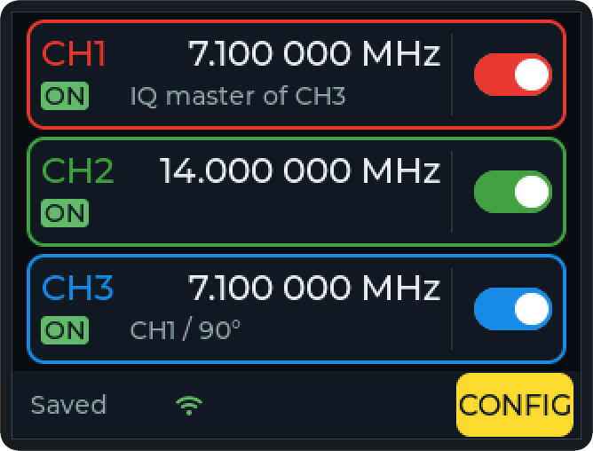

```text
+--------------------------------------------+
| CH1              10.000 000 MHz |  [==o]   |
| ON   SSC -0.5% | Low noise      |          |
+--------------------------------------------+
| CH2              14.000 000 MHz |  [o==]   |
| OFF                             |          |
+--------------------------------------------+
| CH3              10.000 000 MHz |  [==o]   |
| WAIT CH1 / 90° / master off     |          |
+--------------------------------------------+
| Saved   WiFi  REMOTE USB       [ CONFIG ]  |
+--------------------------------------------+
```

### CH1 / CH2

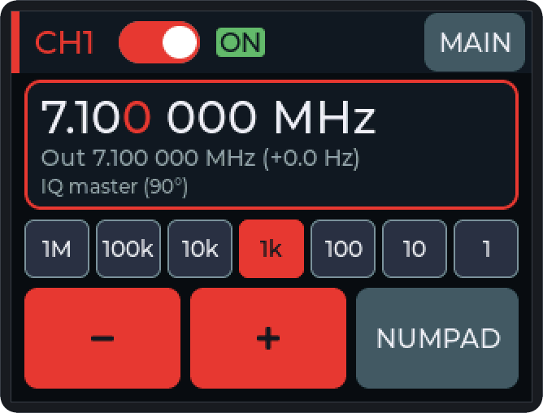

```text
+--------------------------------------------+
| CH1  [==o]  ON                    [ MAIN ] |
+--------------------------------------------+
| 10.000 000 MHz                             |
| Out 10.000 000 MHz (+0.3 Hz)               |
| SSC -0.5% | IQ master (90°)                |
+--------------------------------------------+
| [1M][100k][10k][ 1k ][100][ 10][  1]       |
| [   −   ]  [   +   ]  [  NUMPAD  ]         |
+--------------------------------------------+
```

### CH3 IQ

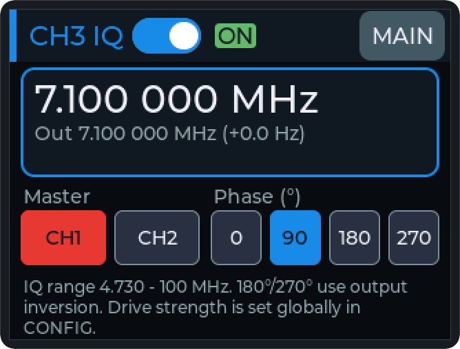

```text
+--------------------------------------------+
| CH3 IQ  [==o]  ON                 [ MAIN ] |
+--------------------------------------------+
| 10.000 000 MHz                             |
| Out 10.000 000 MHz (+0.3 Hz)               |
+--------------------------------------------+
| Master            Phase (°)                |
| [CH1] [CH2]       [0] [90] [180] [270]     |
| IQ range 4.730 - 100 MHz. 180°/270° use    |
| output inversion. ...                      |
+--------------------------------------------+
```

### CONFIG

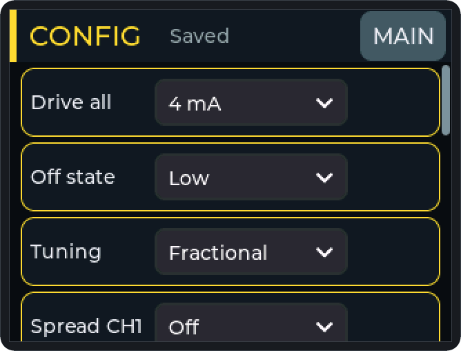 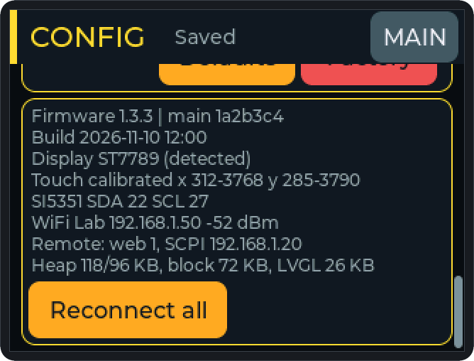

```text
+--------------------------------------------+
| CONFIG   Saved                    [ MAIN ] |
+--------------------------------------------+
| Drive all   [ 4 mA        v]             # |
| Off state   [ Low         v]             # |
| Tuning      [ Fractional  v]             | |
| Spread CH1  [ Off         v]             | |   <- swipe
| (Corr., Backlight, WiFi, Remote out., ...) |
+--------------------------------------------+
```

### NUMPAD

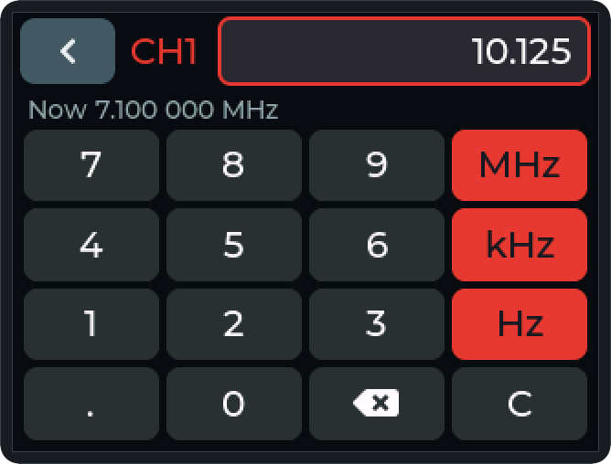

```text
+--------------------------------------------+
| [<]  CH1  [                     10.7 ]     |
| Now 10.000 000 MHz         8 kHz - 160 MHz |
| [ 7 ][ 8 ][ 9 ][ MHz ]                     |
| [ 4 ][ 5 ][ 6 ][ kHz ]                     |
| [ 1 ][ 2 ][ 3 ][ Hz  ]                     |
| [ . ][ 0 ][ ⌫ ][  C  ]                     |
+--------------------------------------------+
```

### WIFI

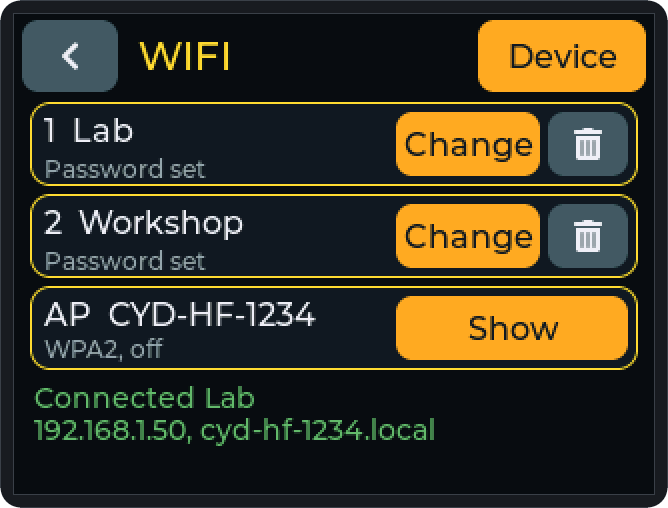 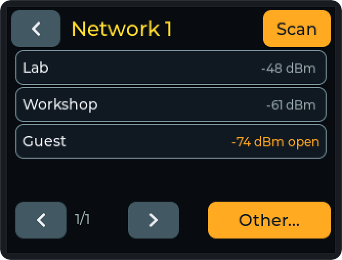

### Device

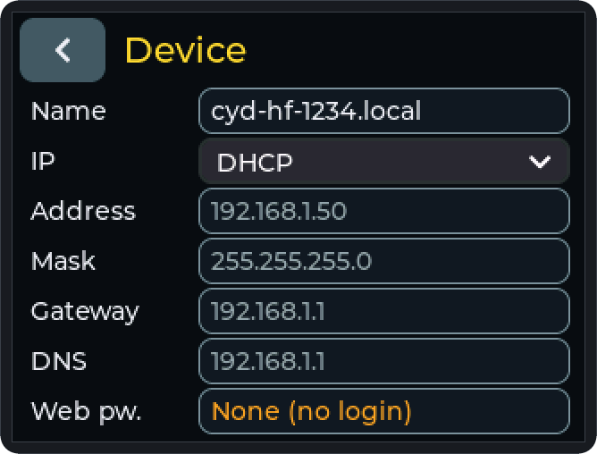

### Access Point

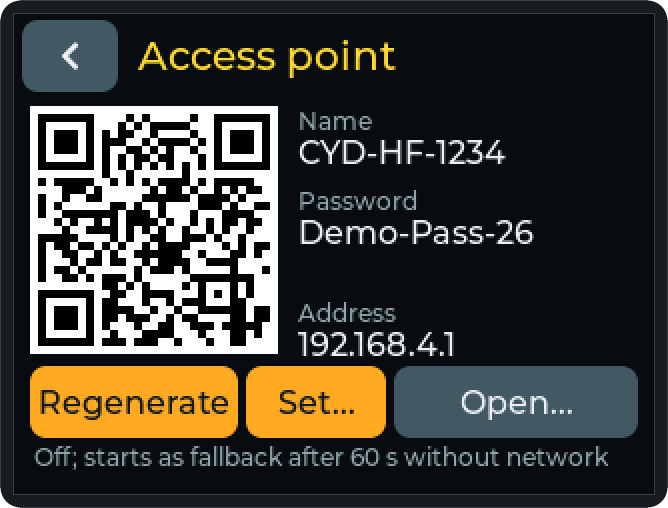

### Dialog `Network change`

Network change from the browser without a web password (section 16):

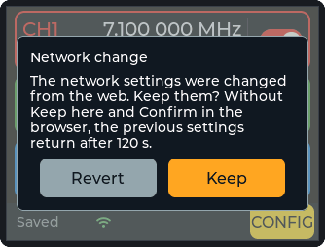

### Web Interface

Rendered with `tools/web_mock.py` in the same state (section 16): desktop at 1280 px, the WiFi area and a phone with the output bar at the bottom.

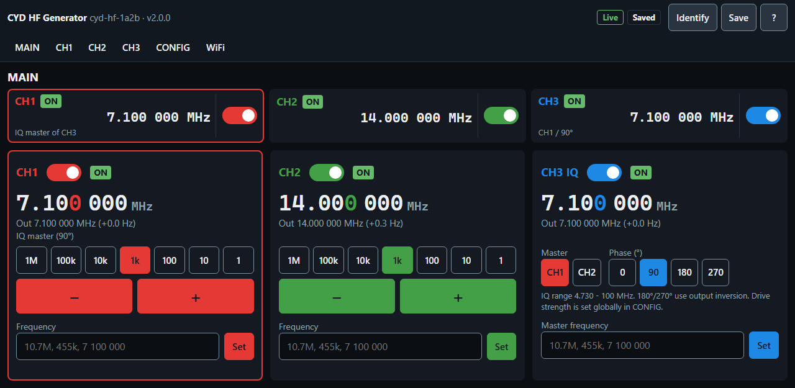

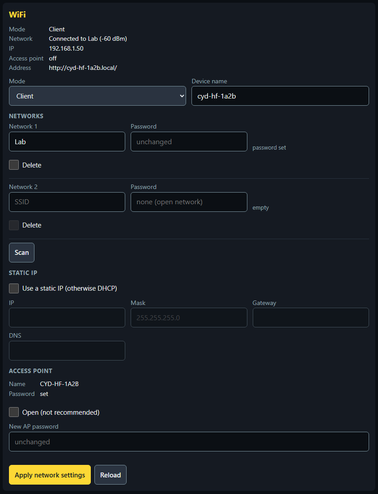 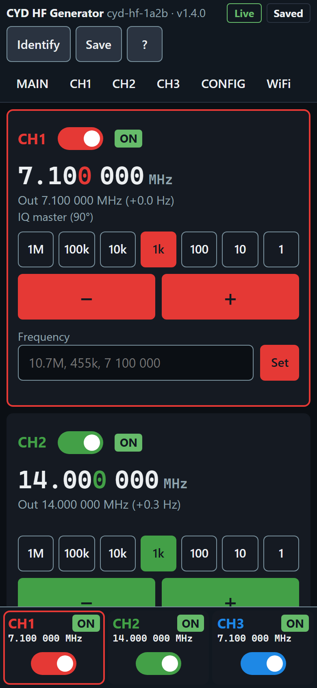

---

## Appendix B: Glossary

| Display | Meaning | Section |
|---|---|---|
| `ON` (green field) | output running | 2 |
| `OFF` (gray text) | output off | 2 |
| `WAIT` (orange field) | CH3 switched on, waiting for the master or the IQ range | 2, 7 |
| `! ERR` (red field) | setup failed, retried every 2 s | 11 |
| `! NO HW` (red field) | SI5351 not found or connection lost | 11 |
| `~` before the frequency | actual frequency deviates by 1 Hz or more (`Integer`) | 2, 8 |
| `Out …` | frequency actually generated and deviation in Hz | 5 |
| `Out … mean, SSC …` | mean frequency with spread spectrum | 5 |
| `Off \| Out …` | channel off; this is how it runs after switching on | 5 |
| `IQ master (90°)` | CH3 follows this channel with the phase shown | 2, 5 |
| `CH1 / 90° / master off` | CH3: master, phase and reason for waiting | 2, 7 |
| mode line | settings that differ from the factory state | 2 |
| `OFF=High` / `OFF=High-Z` | switched-off outputs carry HIGH (DC voltage) or are high impedance | 8 |
| `SSC -0.5 %` etc. | spread spectrum: the frequency is spread on purpose | 8 |
| `Fractional` / `Low noise` / `Integer` | divider scheme of the SI5351 (`Tuning`) | 8 |
| `2mA` … `8mA` | output current (`Drive all`) | 8 |
| `Corr.`, ppm | frequency correction of the crystal in parts per million | 8 |
| `LOCKED` (orange field) | screen locked; hold 2 s to unlock | 8 |
| `Saved` / `Saving...` / `Save failed` / `Not saved` | save state | 8, 9 |
| `Now …` | NUMPAD: current frequency | 6 |
| `8 kHz - 160 MHz`, `Enter a number`, `Max. 10 characters` | NUMPAD: reason for a rejected input | 6 |
| `-50.00 to +50.00 ppm` | correction NUMPAD: value out of range | 8 |
| `>100MHz: low level` / `<1MHz: harmonics` | channel page: hint outside 1–100 MHz | 1, 5 |
| `Touch calibrated …` / `Touch not calibrated (default)` | info card: touch calibration | 8 |
| `detected` / `default` / `build flag` | info card: source of the display controller | 8, 13 |
| `(swapped)` / `(clone?)` | info card: SDA/SCL swapped or unusual SI5351 register | 8, 11 |

---

## Appendix C: Symptoms and Remedies

| Symptom | Likely cause | Remedy | Section |
|---|---|---|---|
| Frequency off by a few kHz, `Out` orange, `~` on MAIN | `Tuning` = `Integer` (raster) | choose `Fractional` or `Low noise` | 8 |
| Spectrum wide, carrier "smeared" | spread spectrum (`SSC` in the mode line) | `Spread CH1` = `Off` | 8 |
| DC voltage on a switched-off output | `Off state` = `High` | `Low` or `High-Z` | 8 |
| Level too low or too high | `Drive all`; above 100 MHz the level drops | choose 8 mA or 2 mA | 1, 8 |
| Strong harmonics below 1 MHz | square wave with steep edges | low-pass filter at the output | 1 |
| Frequency counter shows a few Hz deviation at all frequencies | crystal tolerance | adjust `Corr.` | 8 |
| CH3 stays at `WAIT` | master off or master frequency outside the IQ range | switch the master on, frequency ≥ 4.730 MHz | 7, 11 |
| `! NO HW` on all cards | cable, 3.3 V or GND at CN1 | check the connection; SDA/SCL may be swapped | 11 |
| Taps land next to the button, edge hard to hit | touch calibration missing or off | CONFIG `Touch` → `Calibrate` | 8 |
| Display shows only noise | controller not detected | build the firmware with `DISPLAY_FORCE_PANEL` | 13 |
| Settings lost after power-off | `Save failed` / `Not saved` | restart the device; if it stays, the flash memory is defective | 9, 11 |
| Outputs off after power-up | by design | switch the outputs on | 2 |
| Short dropout while tuning | `Low noise`, `Integer` or IQ operation | intended; `Fractional` tunes without dropouts | 5 |
| Sideband swapped in the mixer | phase 90° instead of 270° (or the other way round) | check the phase on the CH3 page | 7 |
