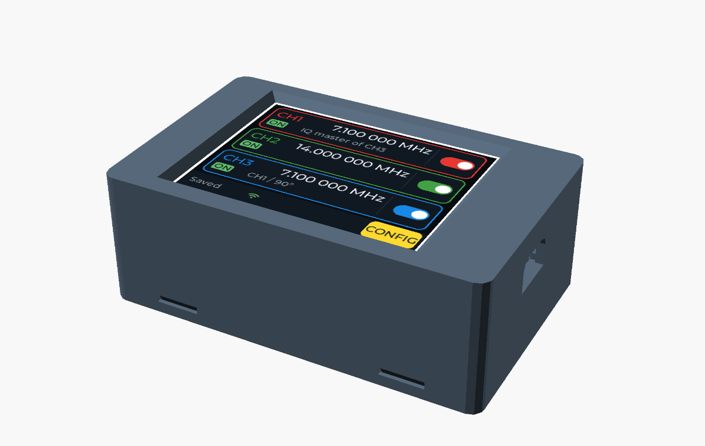
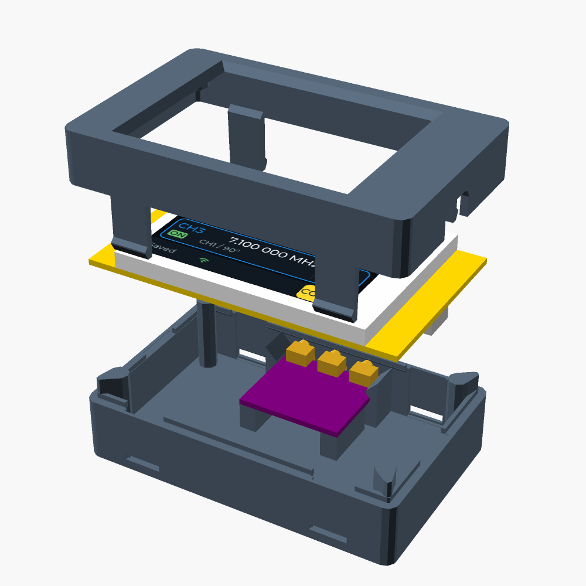
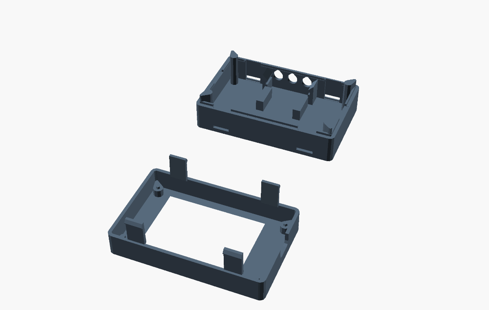
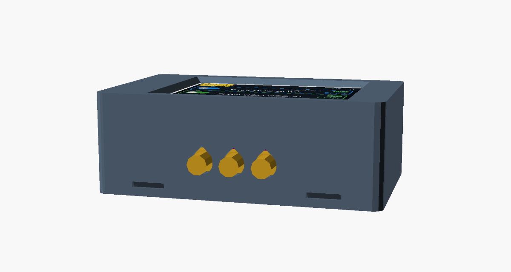
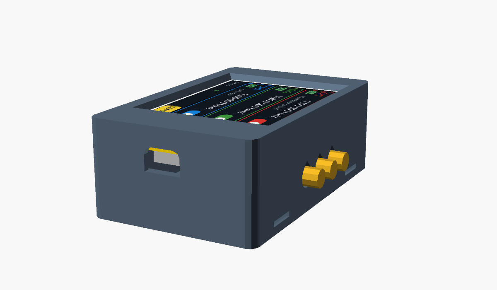

# Case (OpenSCAD)

<p align="center"></p>

`CYD_Si5351_Gehaeuse.scad` is a parametric two-part case for the CYD2USB (ESP32-2432S028R with USB-C) and a CJMCU-5351 (Si5351A) module with three edge-mount SMA sockets soldered to it. Outside about 90.6 × 57 × 32.3 mm. Both parts print without support (all overhangs 45°).

- **Top:** display window with a 45° chamfer, USB-C opening open towards the parting line (no bridge), domes with centering pins for the four CYD holes.
- **Bottom:** SMA holes (slotted in Z as height tolerance, teardrop top), holder for the Si5351 module, centering lip; can be put on turned by 180° (SMA sockets on the other side).
- **Closure:** `closure = "snap"` (default) four snap hooks, no screws; open by pressing the hooks through the windows with a small screwdriver. `closure = "screw"`: 4 × M2.5 countersunk from below through tube into dome (the length is echoed when rendering).
- **Si5351 module:** `si_mount = "rail"` (default): lay the board behind the guide rails and slide it towards the SMA wall until the SMA bodies touch the wall, then tighten the SMA nuts outside. `si_mount = "screw"`: two M2 domes.

The CYD dimensions were measured from the STEP model "Cheap Yellow Display" by mbrembati. **Measure the Si5351 module before printing** (`si_l`, `si_w`, `si_sma`, `sma_axis_off`): the CJMCU-5351 boards differ.

## Views

Rendered with dummies for the CYD2USB and the Si5351 module, default parameters (`closure = "snap"`, `si_mount = "rail"`); regenerate with `python tools/render_images.py case` (README, "Documentation images").

| Exploded | Print layout |
|---|---|
|  |  |
| **SMA side** | **USB-C side** |
|  |  |

## Render and export

Choose the part with `part` (`print` = both parts side by side, `top`, `bottom`, `assembly`, `explode`) in the OpenSCAD customizer or on the command line:

```bash
openscad -o case_top.stl    -D 'part="top"'    case/CYD_Si5351_Gehaeuse.scad
openscad -o case_bottom.stl -D 'part="bottom"' case/CYD_Si5351_Gehaeuse.scad
```

Assembly and wiring: [docs/hardware.md](../docs/hardware.md). The case is part of this repository and under its license (GPL-3.0-or-later, see the repository README); it comes without any warranty.
